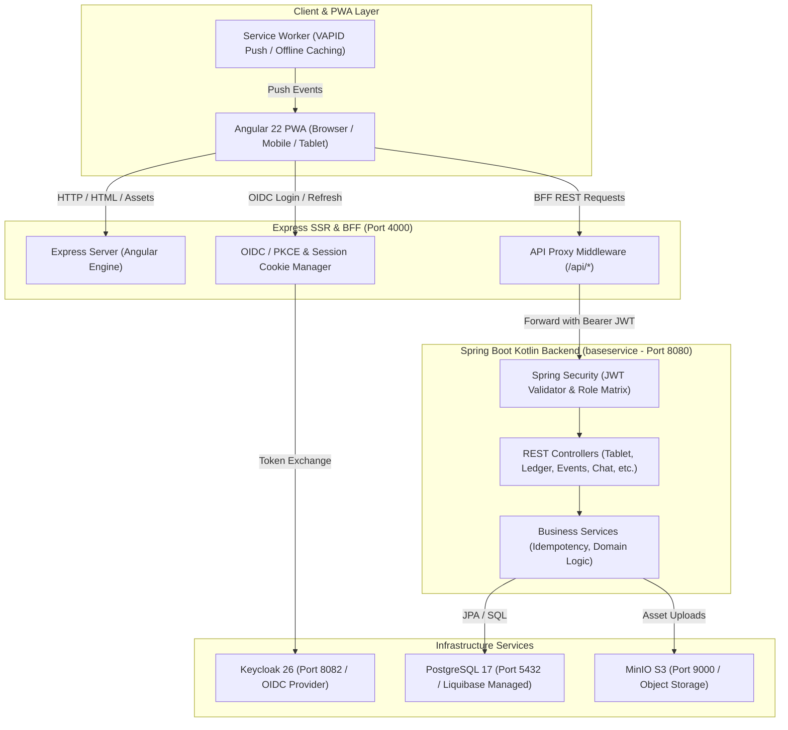

# 🍻 Vereint – Moderne Vereinsverwaltung & Digitale Strichliste

[](https://spring.io/projects/spring-boot)
[](https://kotlinlang.org/)
[](https://angular.dev/)
[](https://www.keycloak.org/)
[](https://www.postgresql.org/)
[](https://min.io/)

**Vereint** ist eine moderne, hochperformante All-in-One-Plattform für Vereine, Clubs und Organisationen. Sie kombiniert ein **doppeltes Kassenbuch (Double-Entry Ledger)**, eine blitzschnelle **Tablet-Strichliste (Kiosk Touch Mode)**, ein vollumfängliches **Event- & Teilnehmer-Management mit Gäste-Einladungstoken**, einen **Getränkekatalog mit Sublisten**, **Drink With Me Standortfreigaben**, **Vereinschat & Push-Benachrichtigungen** sowie tiefe **Verbrauchs- und Finanzanalysen**.

---

## 🚀 Schnellstart & Lokale Entwicklung (Quickstart)

### Voraussetzungen
- **Docker & Docker Compose** (Docker Desktop oder Engine)
- **Node.js 22+ & npm 11+** (für das Frontend/BFF)
- **Java 25 JDK** (für das Spring Boot Backend)

### 1. Infrastruktur starten (PostgreSQL, Keycloak, MinIO)
```bash
# Kopiere die Beispiel-Umgebungskonfiguration
cp .env.example .env

# Starte alle Abhängigkeiten im Hintergrund
docker compose up -d
```

### 2. Backend starten (`baseservice`)
```bash
cd baseservice
./gradlew bootRun
# Backend läuft auf http://localhost:8080
```

### 3. Frontend & SSR-BFF starten (`webservice`)
```bash
cd webservice
npm install
npm run dev:ssr
# Frontend läuft auf http://localhost:4000
```

### 4. Standard-Zugangsdaten (Development Seed)

| Benutzername | Passwort | Zugewiesene Rollen | Anwendungsbereich |
| :--- | :--- | :--- | :--- |
| `admin` | `admin` | `admin`, `board`, `member` | Systemadministration & Vollzugriff |
| `board` | `board` | `board`, `member` | Vorstand (Events, Kasse, Broadcasts) |
| `member` | `member` | `member` | Reguläres Vereinsmitglied |
| `tablet` | `tablet` | `member`, `tabletRecorder` (`purchase.tablet`) | Kiosk-Tablet an der Vereinstheke |

---

## 🏛️ Systemarchitektur im Überblick



---

## 📚 Vollständige Dokumentations-Suite

Die Dokumentation ist lückenlos nach Fachbereichen und technischen Schichten unter `docs/` gegliedert:

### 🏛️ [Architektur & Sicherheit](docs/architecture/)
- **[System-Überblick](docs/architecture/system-overview.md)** – Multi-Tier Topologie, Komponenten-Interaktion, SSR-Hydration & Technologiestack.
- **[Sicherheit & Authentifizierung](docs/architecture/security-and-auth.md)** – Keycloak OIDC/PKCE Flow, HTTP-Only Cookies, Rollen- & Berechtigungsmatrix, Spring Security Filter.
- **[Datenmodell & Schema](docs/architecture/data-model.md)** – Vollständiges ERD-Diagramm, Tabellenstrukturen, Constraints & Liquibase Migrationen.

### 💼 [Fachdomänen & Module (Functional & Technical Deep Dives)](docs/domains/)
- **[Benutzerverwaltung & Authentifizierung](docs/domains/auth-and-user-management.md)** – Profile, Rollen, Account-Deaktivierung, Keycloak Sync & Provisionierung.
- **[Kassenbuch & Finanzwesen (Ledger)](docs/domains/ledger-and-finance.md)** – Double-Entry Journal, Buchungstypen (`topup`, `purchase`, `payout`, `correction`), Kontostand & Idempotenz.
- **[Getränkekatalog, Sublisten & "Drink With Me"](docs/domains/drink-catalog-and-sublists.md)** – Master-Katalog, Kategorien, Event-Sublisten und opt-in Standortfreigaben.
- **[Event-Management & Gast-Einladungen](docs/domains/events-and-invites.md)** – Event-Lifecycle, Teilnehmerverwaltung, Krypto-Gasttoken und passwortlose Anmeldung.
- **[Tablet Strichlisten-Recorder](docs/domains/tablet-strichliste-recorder.md)** – Touch-Kiosk UI, 1-Tap-Getränkebuchung, Rundenabrechnung & Abendabschluss.
- **[Kommunikation & Push-Benachrichtigungen](docs/domains/chat-and-push-notifications.md)** – Vereinskanäle, Direktnachrichten, VAPID Web Push & Board-Broadcasts.
- **[Statistiken & Eber-Analytics](docs/domains/statistics-and-analytics.md)** – Verbrauchsanalysen, Top-Listen, Anwesenheiten und Finanzkurven.

### 💻 [Frontend, PWA & Design-System](docs/frontend/)
- **[Angular SSR, BFF & PWA](docs/frontend/angular-ssr-and-pwa.md)** – Express Server-Side Rendering, TransferState Hydration, Service Worker Cache Policies.
- **[UI-Komponenten & Optimus Design-System](docs/frontend/ui-components-and-design-system.md)** – Standalone UI-Komponenten (`balance-card`, `modal`, `stepper` etc.) & Design Tokens.

### 🔌 [API-Referenz & Fehlerbehandlung](docs/api/)
- **[REST-API Referenz & DTOs](docs/api/rest-api-reference.md)** – Umfassender Endpunktkatalog, Request/Response Payloads & Validierungsregeln.
- **[Fehlerbehandlung & Idempotenz-Standards](docs/api/error-handling-and-idempotency.md)** – RFC 7807 Problem Details, UUIDv4 Idempotenzschlüssel & Retry-Sicherheit.

### ⚙️ [Betrieb & Infrastruktur](docs/operations/)
- **[Lokales Docker Setup & Umgebungsvariablen](docs/operations/local-setup-docker.md)** – `docker-compose.yml`, Ports, Healthchecks und `.env`-Konfiguration.
- **[Keycloak & S3 Objektspeicher](docs/operations/keycloak-and-storage.md)** – Realm-Import/Export, MinIO S3 Buckets & Asset-Handling.
- **[Datenbankmigrationen (Liquibase)](docs/operations/database-migrations.md)** – Master-Changelog, XML Changesets & Migrations-Best-Practices.

---

## 🛠️ Modulübersicht im Repository

| Verzeichnis | Technologie | Zweck & Verantwortung |
| :--- | :--- | :--- |
| `baseservice/` | Kotlin 2.3, Spring Boot 4.1, Java 25 | REST-Backend, Business-Logik, JPA/PostgreSQL, Liquibase, S3 Storage, Web Push. |
| `webservice/` | Angular 22, Express 5, TypeScript 6 | SSR-BFF, PWA Frontend, Session-Cookie Handling, Optimus UI Komponenten. |
| `keycloak/` | Keycloak 26 | OIDC/OAuth2 Identity Provider, Realm-Definitionen (`realm-export-dev.json`). |
| `docs/` | Markdown & Mermaid | Vollständige technische und fachliche Dokumentationssuite. |
