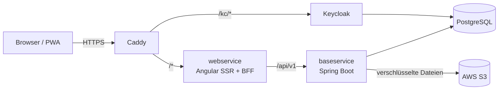

# 🍻 Vereint – Vereinsverwaltung & digitale Strichliste

[](https://spring.io/projects/spring-boot)
[](https://kotlinlang.org/)
[](https://angular.dev/)
[](https://www.keycloak.org/)
[](https://www.postgresql.org/)
[](infra/aws/)

**Vereint** ist die App für den Verein: Events mit Zu- und Absagen, Vereinschat,
Direkt- und Event-Chats, Guthaben statt Bargeld, Bezahlen per Barcode-Scan, das
Thekenterminal im Kiosk-Modus, Getränke- und Speisenkatalog, Moments mit Fotos
und kurzen Videos, Statistiken und Einladungen per Link. Sie läuft als
installierbare Web-App (PWA) mit Web Push.

**Einstieg und Betriebsüberblick: das [Projekt-Wiki](https://github.com/damaurer/vereint/wiki)**
(gepflegt unter [`wiki/`](wiki/)). Anleitungen je Rolle mit Bildschirmfotos stehen
im [Benutzerhandbuch](docs/handbuch/README.md).

---

## 🚀 Lokale Entwicklung

Voraussetzungen: Docker mit Compose, Java 25, Node.js ≥ 22.22.3 und npm 11.

```bash
# 1. Umgebungsvariablen anlegen; PUBLIC_BASE_URL auf http://localhost:4200 setzen
cp .env.example .env

# 2. PostgreSQL (2x), Keycloak und MinIO (lokaler S3-Ersatz) starten
docker compose up -d

# 3. Fachservice, Port 8081
cd baseservice && ./gradlew bootRun

# 4. Oberfläche mit SSR und BFF, Port 4200
cd webservice && npm install && npm start
```

Die App läuft dann unter `http://localhost:4200`. Der Entwicklungs-Realm legt die
Konten `admin`, `board` und `member` an; ihre Passwörter stehen in der `.env`
(`KEYCLOAK_SEED_*_PASSWORD`) und müssen beim ersten Login geändert werden.

Details: [Wiki: Lokale Entwicklung](https://github.com/damaurer/vereint/wiki/Lokale-Entwicklung)
und [docs/operations/local-setup-docker.md](docs/operations/local-setup-docker.md).

---

## 🏛️ Architektur



Produktion: ein ARM-Server bei AWS in Frankfurt, per Terraform angelegt
([infra/aws](infra/aws/README.md)), Docker Compose hinter Caddy
([deploy](deploy/README.md)). Chat-Nachrichten, Mitteilungen, Bilder und Videos
verschlüsselt der baseservice mit AES-256-GCM, bevor sie gespeichert werden.
Jeder Merge nach `main` rollt mit Backup, Health Check und automatischem
Rollback aus.

---

## 🛠️ Module

| Verzeichnis | Technologie | Aufgabe |
| :--- | :--- | :--- |
| `baseservice/` | Kotlin 2.3, Spring Boot 4.1, Java 25 | REST-API, Fachlogik, PostgreSQL/Liquibase, Verschlüsselung, S3, Web Push |
| `webservice/` | Angular 22, Express 5, TypeScript 6 | Oberfläche, PWA, SSR, BFF mit Session-Cookie und API-Proxy |
| `keycloak/` | Keycloak 26.8.1 | Realm-Definitionen, Login-Theme, Produktions-Image |
| `deploy/` | Docker Compose, Caddy | Produktions-Stack, Backups, Deployment-Skripte |
| `infra/aws/` | Terraform | AWS-Server, Buckets, Secrets, Alarme, GitHub-OIDC |
| `e2e/` | Playwright | Tests gegen den kompletten Produktions-Stack |
| `scripts/handbook/` | Playwright | Bildschirmfotos für das Benutzerhandbuch |
| `docs/` | Markdown | Technische und fachliche Dokumentation, Benutzerhandbuch |
| `wiki/` | Markdown | Quelle des GitHub-Wikis |

---

## 📚 Dokumentation

- [docs/README.md](docs/README.md) – Übersicht aller Dokumente und Glossar
- [docs/handbuch/](docs/handbuch/README.md) – Benutzerhandbuch je Rolle
- [deploy/README.md](deploy/README.md) – Produktionsbetrieb, Backups, Deployments
- [infra/aws/README.md](infra/aws/README.md) – AWS mit Terraform
- [e2e/README.md](e2e/README.md) – E2E-Tests
