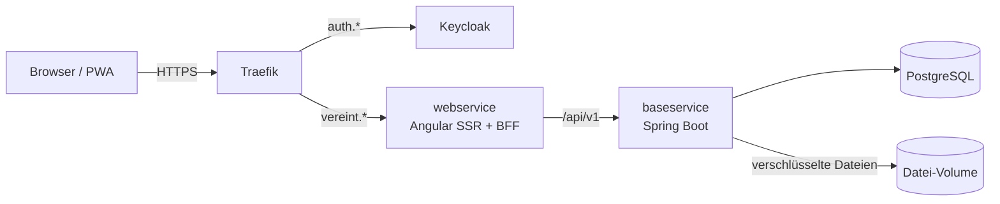

# 🍻 Vereint – Deine Gruppe. Vereint.

[](https://spring.io/projects/spring-boot)
[](https://kotlinlang.org/)
[](https://angular.dev/)
[](https://www.keycloak.org/)
[](https://www.postgresql.org/)
[](docs/betrieb/strato.md)

**Vereint** ist die App für Gruppen aller Art, ob Stammtisch, Verein oder Team.
Eine Installation trägt beliebig viele Gruppen; jede hat eigene Mitglieder,
Rollen und Daten; alle Funktionen sind frei nutzbar, ohne Tarife. Je
Gruppe gibt es Treffen und Events mit Zu- und Absagen, Gruppenchat,
Direkt- und Event-Chats, Guthaben statt Bargeld, Bezahlen per Barcode-Scan, das
Thekenterminal im Kiosk-Modus, Getränke- und Speisenkatalog, Moments mit Fotos
und kurzen Videos, Statistiken und Einladungen per Link. Sie läuft als
installierbare Web-App (PWA) mit Web Push.

Einstieg: [Funktionen](docs/funktionen.md), [Rollen](docs/rollen-und-berechtigungen.md),
[Betrieb](#-betrieb) und [offene Punkte](docs/offene-punkte.md). Anleitungen je Rolle mit
Bildschirmfotos stehen im [Benutzerhandbuch](docs/handbuch/README.md).

---

## 🚀 Lokale Entwicklung

Am schnellsten: `node local/vereint.mjs up` startet die komplette App mit
Demo-Daten unter `http://localhost:4200`, `node local/vereint.mjs test` führt
alle Tests aus (Backend, Frontend, E2E). Dafür reichen Docker und Node.js;
Details in [local/README.md](local/README.md).

Zum Entwickeln mit automatischem Neuladen laufen baseservice und webservice
direkt auf dem Rechner. Voraussetzungen: Docker mit Compose, Java 25, Node.js ≥ 22.22.3 und npm 11.

```bash
# 1. Umgebungsvariablen anlegen; die Vorlage funktioniert ohne Änderungen
cp .env.example .env

# 2. PostgreSQL (2x) und Keycloak starten
docker compose up -d

# 3. Fachservice, Port 8081
cd baseservice && ./gradlew bootRun

# 4. Oberfläche mit SSR und BFF, Port 4200
cd webservice && npm install && npm start
```

Die App läuft dann unter `http://localhost:4200`. Der Entwicklungs-Realm legt die
Konten `admin`, `board` und `member` an, mit den Startpasswörtern `admin-demo-2026`,
`board-demo-2026` und `member-demo-2026` (aus der `.env`); Keycloak verlangt beim
ersten Login ein neues Passwort.

Details: [docs/operations/local-setup-docker.md](docs/operations/local-setup-docker.md),
E2E-Tests: [e2e/README.md](e2e/README.md).

---

## 🏛️ Architektur



Produktion: `https://vereint.maurercloud.de` auf einem Strato VPS, den
[LinuxServerSetup](https://github.com/damaurer/LinuxServerSetup) per Ansible
einrichtet (Traefik, Keycloak der Plattform, Backups nach HiDrive), siehe
[Betrieb auf einem Strato VPS](docs/betrieb/strato.md). Dieses Repo liefert
die Images und die Pipeline, den Server beschreibt allein LinuxServerSetup.
Chat-Nachrichten, Mitteilungen, Bilder und Videos verschlüsselt der
baseservice mit AES-256-GCM, bevor sie gespeichert werden. Ein Merge nach
`main` mit neuen Images rollt mit Backup, Health Check und automatischem
Rollback aus.

---

## 🛠️ Module

| Verzeichnis | Technologie | Aufgabe |
| :--- | :--- | :--- |
| `baseservice/` | Kotlin 2.3, Spring Boot 4.1, Java 25 | REST-API, Fachlogik, Trennung der Gruppen (Row-Level-Security), PostgreSQL/Liquibase, Verschlüsselung, Dateispeicher (Verzeichnis oder S3), Web Push |
| `webservice/` | Angular 22, Express 5, TypeScript 6 | Oberfläche, PWA, SSR, BFF mit Session-Cookie und API-Proxy |
| `keycloak/` | Keycloak 26.8.1 | Realm-Definitionen und Login-Theme (Vorlage für LinuxServerSetup), Image für den lokalen Stack |
| `local/` | Docker Compose, Caddy | Kompletter Stack für den lokalen Start und die E2E-Tests |
| `e2e/` | Playwright | Tests gegen den kompletten Stack |
| `scripts/handbook/` | Playwright | Bildschirmfotos für das Benutzerhandbuch |
| `docs/` | Markdown | Technische und fachliche Dokumentation, Benutzerhandbuch |

---

## 🚢 Betrieb

- Gearbeitet wird auf `develop`. Jeder Pull Request nach `develop`, `qs` oder `main`
  muss Tests, Sicherheitsscans und E2E-Tests bestehen.
- Ein Merge nach `main` mit neuen Images rollt
  automatisch auf den Strato VPS aus (`deploy vereint <release-tag>` per SSH):
  Datenbank-Dump vorher, Health Check danach, automatischer Rollback bei Fehlern.
- Chat-Nachrichten, Mitteilungen, Bilder und Videos werden in der App mit
  AES-256-GCM verschlüsselt, bevor sie in der Datenbank oder im Dateispeicher landen.
- Backups macht LinuxServerSetup: Dump vor jedem Deployment, stündlich und
  nachts, verschlüsselt mit restic nach HiDrive.
- Den Datenschlüssel (`vault_vereint_data_encryption_key`) zusätzlich offline
  aufbewahren, neben Vault-Passwort und restic-Passwort. Ohne ihn sind Chat,
  Bilder und Videos auch aus einem intakten Backup nicht mehr lesbar.

| Thema | Dokument |
| :--- | :--- |
| Betrieb auf Strato (eigener Server), Go-Live-Checkliste | [Betrieb auf einem Strato VPS](docs/betrieb/strato.md) |
| Branches, CI, Images | [Branches und CI](docs/betrieb/branches-und-ci.md) |
| Verschlüsselung, Schlüssel, Härtung | [Sicherheit und Schlüssel](docs/betrieb/sicherheit-und-schluessel.md) |
| Lizenz, Öffentlichschalten, Selbstbetrieb | [Open Source](docs/betrieb/open-source.md) |

---

## 📚 Dokumentation

- [docs/README.md](docs/README.md) – Übersicht aller Dokumente und Glossar
- [docs/handbuch/](docs/handbuch/README.md) – Benutzerhandbuch je Rolle
- [docs/domains/stammtische.md](docs/domains/stammtische.md) – Mehrere Gruppen, Trennung der Daten, Rollen je Gruppe
- [docs/betrieb/strato.md](docs/betrieb/strato.md) – Produktionsbetrieb auf Strato, Go-Live-Checkliste
- [local/README.md](local/README.md) – Lokal ausführen und testen
- [e2e/README.md](e2e/README.md) – E2E-Tests

---

## 🤝 Mitmachen und Lizenz

Vereint ist ein Open-Source-Hobbyprojekt unter der
[GNU Affero General Public License v3.0](LICENSE). Beiträge sind willkommen,
siehe [CONTRIBUTING.md](CONTRIBUTING.md); Sicherheitslücken bitte vertraulich
melden, siehe [SECURITY.md](SECURITY.md). Der Startbestand der
Getränkedatenbank stammt aus Open Food Facts (ODbL 1.0).
