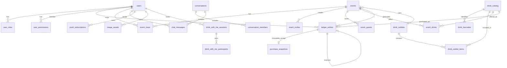

# Datenmodell & PostgreSQL-Schema

Das Datenmodell von **Vereint** ist auf maximale Konsistenz, Revisionssicherheit und Idempotenz ausgelegt. Die Schemastruktur wird vollständig über **Liquibase** versioniert und in **PostgreSQL 17** persistiert.

---

## 📊 Entity-Relationship-Diagramm (ERD)



---

## 🗄️ Tabellenkatalog & Schema-Details

### 1. Benutzer & Autorisierung
- **`users`**:
  - `id` (`UUID`, PK)
  - `keycloak_subject` (`VARCHAR(64)`, Unique) – Verknüpfung zum OIDC Identity Provider
  - `email` (`VARCHAR(255)`), `display_name` (`VARCHAR(255)`)
  - `disabled` (`BOOLEAN`, default `false`)
  - `drink_recorder` (`BOOLEAN`, default `false`)
  - `board_role` (`VARCHAR(32)`, Check: `chair`, `treasurer`, `secretary`, `assessor`)
  - `version` (`BIGINT`, Optimistic Locking)
- **`user_roles`**: `user_id` (FK), `role` (`VARCHAR(32)`, PK composite)
- **`user_permissions`**: `user_id` (FK), `permission` (`VARCHAR(64)`, PK composite)

### 2. Kassenbuch & Transaktionssicherheit (Double-Entry Ledger)
- **`ledger_entries`**:
  - `id` (`UUID`, PK)
  - `member_id` (`UUID`, FK `users.id`, nullable für anonyme Abendabschlüsse)
  - `event_id` (`UUID`, FK `events.id`, nullable)
  - `drink_id` (`UUID`, FK `drink_catalog.id`, nullable)
  - `amount_cents` (`INTEGER`, negativ bei Abbuchung/Kauf, positiv bei Einzahlung)
  - `entry_type` (`VARCHAR(32)`, Check: `purchase`, `topup`, `payout`, `correction`)
  - `accounting_mode` (`VARCHAR(32)`, Check: `credit`, `revenueOnly`)
  - `source` (`VARCHAR(32)`, Check: `pwaBarcode`, `tabletManual`, `round`, `evening`)
  - `reverses_entry_id` (`UUID`, FK `ledger_entries.id`, RESTRICT delete) – Für Stornierungen
  - `created_at` (`TIMESTAMPTZ`)
- **`purchase_snapshots`**: Unveränderlicher Beleg mit Preis und Artikelname zum Kaufzeitpunkt.
- **`idempotency_records`**:
  - `id` (`UUID`, PK), `scope` (`VARCHAR(64)`), `idempotency_key` (`VARCHAR(128)`)
  - `response_code` (`INTEGER`), `response_body` (`TEXT`), `created_at` (`TIMESTAMPTZ`)
  - Unique Constraint auf `(scope, idempotency_key)` verhindert doppelte Ausführung.

### 3. Getränkekatalog & Sublisten
- **`drink_catalog`**:
  - `id` (`UUID`, PK), `name` (`VARCHAR(255)`), `category` (`VARCHAR(64)`), `price_cents` (`INTEGER`), `volume_ml` (`INTEGER`), `tax_rate_percent` (`NUMERIC(4,2)`)
  - `status` (`VARCHAR(32)`, Check: `proposed`, `approved`, `rejected`)
  - `proposed_by` (FK `users.id`), `approved_by` (FK `users.id`)
  - `image_asset_id` (FK `image_assets.id`), `version` (`BIGINT`)
- **`drink_barcodes`**: `id` (`UUID`, PK), `drink_id` (FK `drink_catalog.id`), `barcode` (`VARCHAR(128)`, Unique)
- **`drink_sublists`**: `id` (`UUID`, PK), `name` (`VARCHAR(255)`), `description` (`TEXT`)
- **`drink_sublist_items`**: `id` (`UUID`, PK), `sublist_id` (FK `drink_sublists.id`), `drink_id` (FK `drink_catalog.id`), `price_cents_override` (`INTEGER`), `active` (`BOOLEAN`)
- **`event_drinks`**: Event-spezifisches Getränkeangebot.

### 4. Events & Einladungen
- **`events`**:
  - `id` (`UUID`, PK), `title` (`VARCHAR(255)`), `description` (`TEXT`), `location` (`VARCHAR(255)`)
  - `starts_at` (`TIMESTAMPTZ`), `ends_at` (`TIMESTAMPTZ`)
  - `status` (`VARCHAR(32)`, Check: `draft`, `published`, `active`, `cancelled`, `completed`, `archived`)
  - `created_by` (FK `users.id`), `sublist_id` (FK `drink_sublists.id`), `version` (`BIGINT`)
- **`event_rsvps`**: `id` (`UUID`, PK), `event_id` (FK), `user_id` (FK), `status` (`attending`, `declined`, `maybe`)
- **`event_invites`**: `id` (`UUID`, PK), `event_id` (FK), `token_hash` (`VARCHAR(64)`, Unique SHA-256), `max_uses` (`INTEGER`), `uses_count` (`INTEGER`), `expires_at` (`TIMESTAMPTZ`)
- **`event_guests`**: `id` (`UUID`, PK), `event_id` (FK), `invite_id` (FK), `display_name` (`VARCHAR(255)`), `status` (`pending`, `active`, `revoked`, `expired`)

### 5. Chat, Push & Kollaboration
- **`conversations`**: `id` (`UUID`, PK), `type` (`direct`, `channel`, `event`), `title` (`VARCHAR(255)`), `event_id` (FK)
- **`conversation_members`**: `conversation_id` (FK), `user_id` (FK)
- **`chat_messages`**: `id` (`UUID`, PK), `conversation_id` (FK), `sender_id` (FK), `content` (`TEXT`), `created_at` (`TIMESTAMPTZ`)
- **`push_subscriptions`**: `id` (`UUID`, PK), `user_id` (FK), `endpoint` (`TEXT`), `p256dh` (`VARCHAR(255)`), `auth` (`VARCHAR(255)`)
- **`drink_with_me_sessions`** & **`drink_with_me_participants`**: Rundenangebote und Mitrinker.
- **`image_assets`**: S3-Metadaten (`storage_key`, `content_type`, `size_bytes`, `purpose`, `target_id`).
- **`audit_logs`**: Revisionsprotokolle für sicherheitskritische Operationen.

---

## 🔒 Datenbankseitige Integritätsregeln & Trigger

### Append-Only Trigger für das Kassenbuch (`002-integrity-constraints.xml`)
Um Manipulationen an historischen Buchungsdaten auszuschließen, verbietet ein PostgreSQL-Trigger jegliches `UPDATE` oder `DELETE` auf den Tabellen `ledger_entries` und `purchase_snapshots`:

```sql
CREATE OR REPLACE FUNCTION vereint_reject_ledger_mutation() RETURNS trigger AS $$
BEGIN
    RAISE EXCEPTION 'ledger is append-only: % on % is not allowed, use a compensating entry',
        TG_OP, TG_TABLE_NAME;
END;
$$ LANGUAGE plpgsql;

CREATE TRIGGER trg_ledger_entries_append_only
BEFORE UPDATE OR DELETE ON ledger_entries
FOR EACH ROW EXECUTE FUNCTION vereint_reject_ledger_mutation();
```

---

## 📜 Liquibase Migration Changelog Historie

| Changeset | Datei | Beschreibung |
| :--- | :--- | :--- |
| `001` | `001-initial-schema.xml` | Grundlegendes relationales Datenmodell (Users, Events, Drinks, Ledger, Chat, Push). |
| `002` | `002-integrity-constraints.xml` | CHECK-Constraints für Enums, Optimistic Locking (`version`), Append-Only Trigger für Ledger, Query-Indizes. |
| `003` | `003-drink-catalog-approval.xml` | Getränke-Vorschlagsworkflow (`proposed`, `approved`, `rejected`) mit `proposed_by` und `approved_by`. |
| `004` | `004-image-assets.xml` | S3 Metadatentabelle `image_assets` mit Zweckzuordnung (`profile`, `event`, `drink`, `drinkWithMe`). |
| `005` | `005-ledger-transactions.xml` | Erweiterte Buchungstypen (`topup`, `payout`, `correction`), Storno-Referenz (`reverses_entry_id`) und gelockerte Null-Constraints. |
