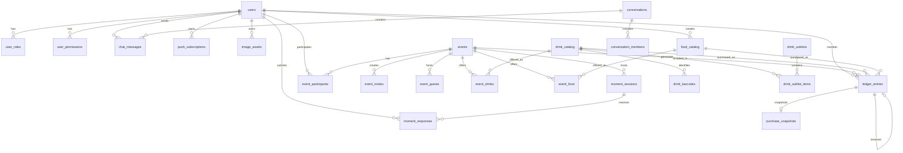

# Datenmodell & PostgreSQL-Schema

Das Datenmodell von **Vereint** ist auf maximale Konsistenz, Revisionssicherheit und Idempotenz ausgelegt. Die Schemastruktur wird vollständig über **Liquibase** versioniert und in **PostgreSQL 17** persistiert.

---

## 📊 Entity-Relationship-Diagramm (ERD)



---

## 🗄️ Tabellenkatalog & Schema-Details

### 1. Benutzer & Autorisierung
- **`users`**:
  - `id` (`UUID`, PK)
  - `keycloak_subject` (`VARCHAR(64)`, Unique) – Verknüpfung zum OIDC Identity Provider
  - `email` (`VARCHAR(255)`), `display_name` (`VARCHAR(255)`)
  - `disabled` (`BOOLEAN`, default `false`)
  - `drink_recorder` (`BOOLEAN`, default `false`)
  - `board_role` (`VARCHAR(32)`, Check: `chair`, `treasurer`, `secretary`, `assessor`)
  - `created_at` (`TIMESTAMPTZ`), `updated_at` (`TIMESTAMPTZ`)
  - `version` (`BIGINT`, Optimistic Locking)
- **`user_roles`**: `user_id` (FK `users.id`), `role` (`VARCHAR(32)`), PK composite (`user_id`, `role`)
- **`user_permissions`**: `user_id` (FK `users.id`), `permission` (`VARCHAR(64)`), PK composite (`user_id`, `permission`)

### 2. Kassenbuch & Transaktionssicherheit (Double-Entry Ledger)
- **`ledger_entries`**:
  - `id` (`UUID`, PK)
  - `member_id` (`UUID`, FK `users.id`, non-null)
  - `event_id` (`UUID`, FK `events.id`, nullable für Topups/Payouts/Korrekturen)
  - `drink_id` (`UUID`, FK `drink_catalog.id`, nullable für Speisenkäufe/Topups/Payouts/Korrekturen)
  - `food_id` (`UUID`, FK `food_catalog.id`, nullable für Getränkekäufe/Topups/Payouts/Korrekturen)
  - `amount` (`DECIMAL(10,2)`, negativ bei Belastung/Kauf, positiv bei Einzahlung/Topup)
  - `currency` (`VARCHAR(3)`, default `'EUR'`)
  - `entry_type` (`VARCHAR(32)`, Check: `purchase`, `topup`, `payout`, `correction`)
  - `accounting_mode` (`VARCHAR(32)`, Check: `credit`, `revenueOnly`)
  - `source` (`VARCHAR(32)`, nullable, Check: `pwaBarcode`, `tabletManual`, `round`, `evening`)
  - `actor_id` (`UUID`, FK `users.id`)
  - `idempotency_key` (`VARCHAR(128)`, Unique)
  - `reverses_entry_id` (`UUID`, FK `ledger_entries.id`, RESTRICT delete) – Für Stornierungen
  - `created_at` (`TIMESTAMPTZ`)
- **`purchase_snapshots`**:
  - `id` (`UUID`, PK)
  - `ledger_entry_id` (`UUID`, FK `ledger_entries.id`, Unique, RESTRICT delete) – 1:1 Zuordnung zur Buchung
  - `item_type` (`VARCHAR(32)`, default `'DRINK'`, Check: `DRINK`, `FOOD`) – Artikeltyp
  - `drink_name` (`VARCHAR(255)`, nullable bei Speisen) – Historischer Name des Getränks
  - `food_name` (`VARCHAR(255)`, nullable bei Getränken) – Historischer Name der Speise
  - `image_reference` (`VARCHAR(512)`, nullable)
  - `barcode` (`VARCHAR(128)`, nullable)
  - `unit_price` (`DECIMAL(10,2)`) – Verkaufspreis zum Kaufzeitpunkt
  - `cost_price` (`DECIMAL(10,2)`, default `0.00`) – Einkaufspreis zum Kaufzeitpunkt
  - `profit` (`DECIMAL(10,2)`, default `0.00`) – Deckungsbeitrag (`unit_price - cost_price`)
  - `currency` (`VARCHAR(3)`, default `'EUR'`)
  - `catalog_version` (`INTEGER`, nullable) – Version des Stammartikels
  - `created_at` (`TIMESTAMPTZ`)
- **`idempotency_records`**:
  - `id` (`UUID`, PK), `scope` (`VARCHAR(64)`), `idempotency_key` (`VARCHAR(128)`)
  - `response_code` (`INTEGER`), `response_body` (`TEXT`), `created_at` (`TIMESTAMPTZ`)
  - Unique Constraint auf `(scope, idempotency_key)` verhindert doppelte Ausführung.

### 3. Getränke- & Speisenkatalog, Sublisten und Event-Angebot
- **`drink_catalog`**:
  - `id` (`UUID`, PK), `name` (`VARCHAR(255)`), `description` (`TEXT`), `category` (`VARCHAR(64)`)
  - `default_price` (`DECIMAL(10,2)`), `cost_price` (`DECIMAL(10,2)`, default `0.00`), `currency` (`VARCHAR(3)`, default `'EUR'`), `volume_ml` (`INTEGER`)
  - `status` (`VARCHAR(32)`, Check: `proposed`, `approved`, `rejected`)
  - `catalog_version` (`INTEGER`, default `1`), `active` (`BOOLEAN`, default `true`)
  - `image_reference` (`VARCHAR(512)`), `image_asset_id` (FK `image_assets.id`)
  - `proposed_by_user_id` (FK `users.id`), `approved_by_user_id` (FK `users.id`)
  - `created_at` (`TIMESTAMPTZ`), `updated_at` (`TIMESTAMPTZ`), `version` (`BIGINT`)
- **`drink_barcodes`**: `id` (`UUID`, PK), `drink_id` (FK `drink_catalog.id`), `barcode` (`VARCHAR(128)`, Unique), `active` (`BOOLEAN`)
- **`drink_sublists`**: `id` (`UUID`, PK), `name` (`VARCHAR(255)`), `description` (`TEXT`), `created_by` (FK `users.id`)
- **`drink_sublist_items`**: `id` (`UUID`, PK), `sublist_id` (FK `drink_sublists.id`), `drink_id` (FK `drink_catalog.id`), `default_price` (`DECIMAL(10,2)`)
- **`event_drinks`**: `id` (`UUID`, PK), `event_id` (FK `events.id`), `drink_id` (FK `drink_catalog.id`), `price` (`DECIMAL(10,2)`), `cost_price` (`DECIMAL(10,2)`, nullable), `currency` (`VARCHAR(3)`), `self_service_enabled` (`BOOLEAN`), `tablet_enabled` (`BOOLEAN`), `catalog_version` (`INTEGER`), `image_snapshot` (`VARCHAR(512)`)
- **`food_catalog`**:
  - `id` (`UUID`, PK), `name` (`VARCHAR(255)`), `description` (`TEXT`), `category` (`VARCHAR(64)`)
  - `default_price` (`DECIMAL(10,2)`), `cost_price` (`DECIMAL(10,2)`, default `0.00`), `currency` (`VARCHAR(3)`, default `'EUR'`)
  - `active` (`BOOLEAN`, default `true`), `created_by` (FK `users.id`)
  - `created_at` (`TIMESTAMPTZ`), `updated_at` (`TIMESTAMPTZ`), `version` (`BIGINT`)
  - Index `idx_food_catalog_active` auf `active`
- **`event_food`**:
  - `id` (`UUID`, PK), `event_id` (FK `events.id`, onDelete CASCADE), `food_id` (FK `food_catalog.id`)
  - `price` (`DECIMAL(10,2)`, nullable falls Standardpreis greift), `cost_price` (`DECIMAL(10,2)`, nullable)
  - `currency` (`VARCHAR(3)`, default `'EUR'`)
  - `self_service_enabled` (`BOOLEAN`, default `true`), `tablet_enabled` (`BOOLEAN`, default `true`)
  - `created_at` (`TIMESTAMPTZ`), `updated_at` (`TIMESTAMPTZ`), `version` (`BIGINT`)
  - Unique Constraint `uk_event_food_event_food` auf `(event_id, food_id)`
  - Indizes `idx_event_food_event` auf `event_id`, `idx_event_food_food` auf `food_id`

### 4. Events & Einladungen
- **`events`**:
  - `id` (`UUID`, PK), `title` (`VARCHAR(255)`), `description` (`TEXT`), `location` (`VARCHAR(255)`)
  - `starts_at` (`TIMESTAMPTZ`), `ends_at` (`TIMESTAMPTZ`)
  - `status` (`VARCHAR(32)`, Check: `draft`, `published`, `active`, `cancelled`, `completed`, `archived`)
  - `owner_id` (`UUID`, FK `users.id`), `created_at` (`TIMESTAMPTZ`), `updated_at` (`TIMESTAMPTZ`), `version` (`BIGINT`)
- **`event_participants`**: `id` (`UUID`, PK), `event_id` (FK `events.id`), `user_id` (FK `users.id`), `role` (`VARCHAR(32)`), `joined_at` (`TIMESTAMPTZ`)
- **`event_invites`**: `id` (`UUID`, PK), `event_id` (FK `events.id`), `token_hash` (`VARCHAR(64)`, Unique SHA-256), `created_by` (FK `users.id`), `role` (`VARCHAR(32)`), `max_uses` (`INTEGER`), `uses_count` (`INTEGER`), `expires_at` (`TIMESTAMPTZ`), `revoked` (`BOOLEAN`)
- **`event_guests`**: `id` (`UUID`, PK), `event_id` (FK `events.id`), `invite_id` (FK `event_invites.id`), `display_name` (`VARCHAR(255)`), `status` (`VARCHAR(32)`, Check: `pending`, `active`, `revoked`, `expired`), `expires_at` (`TIMESTAMPTZ`)

### 5. Chat, Push, Moments & Benachrichtigungen
- **`conversations`**: `id` (`UUID`, PK), `type` (`VARCHAR(32)`, default `'event'`), `title` (`VARCHAR(255)`), `event_id` (FK `events.id`)
- **`conversation_members`**: `id` (`UUID`, PK), `conversation_id` (FK `conversations.id`), `user_id` (FK `users.id`)
- **`chat_messages`**: `id` (`UUID`, PK), `conversation_id` (FK `conversations.id`), `sender_id` (FK `users.id`), `guest_id` (FK `event_guests.id`), `message` (`TEXT`), `image_url` (`VARCHAR(512)`), `created_at` (`TIMESTAMPTZ`)
- **`push_subscriptions`**: `id` (`UUID`, PK), `user_id` (FK `users.id`), `endpoint` (`TEXT`), `p256dh` (`VARCHAR(255)`), `auth` (`VARCHAR(255)`), `user_agent` (`VARCHAR(512)`)
- **`notifications`**: `id` (`UUID`, PK), `user_id` (FK `users.id`), `title` (`VARCHAR(255)`), `body` (`TEXT`), `type` (`VARCHAR(64)`), `read` (`BOOLEAN`), `created_at` (`TIMESTAMPTZ`)
- **`moment_sessions`**: `id` (`UUID`, PK), `event_id` (FK `events.id`), `creator_user_id` (FK `users.id`), `conversation_id` (FK `conversations.id`), `title` (`VARCHAR(255)`), `topic_type` (`VARCHAR(64)`), `message` (`VARCHAR(500)`), `latitude` (`DOUBLE PRECISION`), `longitude` (`DOUBLE PRECISION`), `active` (`BOOLEAN`), `expires_at` (`TIMESTAMPTZ`), `completed_at` (`TIMESTAMPTZ`), `summary` (`TEXT`), `created_at` (`TIMESTAMPTZ`), `updated_at` (`TIMESTAMPTZ`), `version` (`BIGINT`)
- **`moment_responses`**: `id` (`UUID`, PK), `moment_id` (FK `moment_sessions.id`), `user_id` (FK `users.id`), `reaction` (`VARCHAR(64)`), `status_text` (`VARCHAR(255)`), `latitude` (`DOUBLE PRECISION`), `longitude` (`DOUBLE PRECISION`), `created_at` (`TIMESTAMPTZ`), `version` (`BIGINT`)
- **`image_assets`**: `id` (`UUID`, PK), `user_id` (FK `users.id`), `purpose` (`VARCHAR(32)`, Check: `profile`, `event`, `drink`, `moment`), `target_id` (`VARCHAR(128)`), `storage_key` (`VARCHAR(512)`), `content_type` (`VARCHAR(128)`), `size_bytes` (`BIGINT`), `status` (`VARCHAR(32)`, Check: `active`, `deleted`)
- **`audit_logs`**: `id` (`UUID`, PK), `actor_id` (FK `users.id`), `action` (`VARCHAR(128)`), `target_entity` (`VARCHAR(64)`), `target_id` (`VARCHAR(128)`), `details` (`TEXT`), `ip_address` (`VARCHAR(64)`), `created_at` (`TIMESTAMPTZ`)

---

## 🔒 Datenbankseitige Integritätsregeln & Trigger

### Append-Only Trigger für das Kassenbuch (`002-integrity-constraints.xml`)
Um Manipulationen an historischen Buchungsdaten auszuschließen, verbietet ein PostgreSQL-Trigger jegliches `UPDATE` oder `DELETE` auf den Tabellen `ledger_entries` und `purchase_snapshots`:

```sql
CREATE OR REPLACE FUNCTION vereint_reject_ledger_mutation() RETURNS trigger AS $$
BEGIN
    RAISE EXCEPTION 'ledger is append-only: % on % is not allowed, use a compensating entry',
        TG_OP, TG_TABLE_NAME;
END;
$$ LANGUAGE plpgsql;

CREATE TRIGGER trg_ledger_entries_append_only
BEFORE UPDATE OR DELETE ON ledger_entries
FOR EACH ROW EXECUTE FUNCTION vereint_reject_ledger_mutation();
```

---

## 📜 Liquibase Migration Changelog Historie

| Changeset | Datei | Beschreibung |
| :--- | :--- | :--- |
| `001` | `001-initial-schema.xml` | Grundlegendes relationales Datenmodell (Users, Events, Drinks, Ledger, Chat, Push). |
| `002` | `002-integrity-constraints.xml` | CHECK-Constraints für Enums, Optimistic Locking (`version`), Append-Only Trigger für Ledger, Query-Indizes. |
| `003` | `003-drink-catalog-approval.xml` | Getränke-Vorschlagsworkflow (`proposed`, `approved`, `rejected`) mit `proposed_by` und `approved_by`. |
| `004` | `004-image-assets.xml` | S3 Metadatentabelle `image_assets` mit Zweckzuordnung (`profile`, `event`, `drink`, `moment`). |
| `005` | `005-ledger-transactions.xml` | Erweiterte Buchungstypen (`topup`, `payout`, `correction`), Storno-Referenz (`reverses_entry_id`) und gelockerte Null-Constraints. |
| `006` | `006-moments-and-rituals.xml` | Moment-Sessions und Responses für Gemeinschaftsmomente mit Multi-Status-Unterstützung, GeoJSON-Koordinaten und 24h-Linked-Chats. |
| `007` | `007-food-and-cost-prices.xml` | Einkaufspreise für Getränke/Speisen, `food_catalog`, `event_food` und Beleg-Snapshots mit `item_type`, `food_name`, `cost_price` und `profit`. |
