# Datenmodell & PostgreSQL-Schema

Das Datenmodell von **Vereint** ist auf maximale Konsistenz, Revisionssicherheit und Idempotenz ausgelegt. Die Schemastruktur wird vollständig über **Liquibase** versioniert und in **PostgreSQL 17** persistiert.

---

## 📊 Entity-Relationship-Diagramm (ERD)

Fast alle fachlichen Tabellen gehören genau einer Gruppe (Spalte `stammtisch_id`, Fremdschlüssel auf `stammtische`). Das Diagramm zeigt die wichtigsten Beziehungen; `stammtisch_id` ist dort der Übersicht halber weggelassen.

```mermaid
erDiagram
    stammtische ||--o{ stammtisch_members : "has"
    stammtische ||--o{ stammtisch_roles : "defines"
    stammtische ||--o| stammtisch_subscriptions : "billed_as"
    users ||--o{ stammtisch_members : "member_of"
    stammtisch_roles ||--o{ user_roles : "assigned_as"
    users ||--o{ user_roles : "has"
    users ||--o{ user_permissions : "has"
    users ||--o{ ledger_entries : "member"
    users ||--o{ event_participants : "participates"
    users ||--o{ chat_messages : "sends"
    users ||--o{ push_subscriptions : "owns"
    users ||--o{ image_assets : "owns"
    users ||--o{ moment_responses : "submits"
    users ||--o{ food_catalog : "creates"

    events ||--o{ event_participants : "has"
    events ||--o{ event_invites : "creates"
    events ||--o{ event_guests : "hosts"
    events ||--o{ event_drinks : "offers"
    events ||--o{ event_food : "offers"
    events ||--o{ ledger_entries : "generates"
    events ||--o{ moment_sessions : "hosts"

    drink_library ||--o{ drink_library_barcodes : "identifies"
    drink_library ||--o{ drink_catalog : "copied_into"
    drink_catalog ||--o{ drink_barcodes : "identifies"
    drink_catalog ||--o{ drink_sublist_items : "included_in"
    drink_catalog ||--o{ event_drinks : "offered_as"
    drink_catalog ||--o{ ledger_entries : "purchased_as"

    food_catalog ||--o{ event_food : "offered_as"
    food_catalog ||--o{ ledger_entries : "purchased_as"

    drink_sublists ||--o{ drink_sublist_items : "contains"

    ledger_entries ||--o| ledger_entries : "reverses"
    ledger_entries ||--o| purchase_snapshots : "snapshots"

    conversations ||--o{ conversation_members : "includes"
    conversations ||--o{ chat_messages : "contains"

    moment_sessions ||--o{ moment_responses : "receives"
    moment_sessions ||--o{ moment_media : "shows"
    moment_types ||--o{ moment_type_reactions : "allows"
    moment_reactions ||--o{ moment_type_reactions : "allowed_in"
    member_invites ||--o{ member_invite_redemptions : "redeemed_by"
```



---

## 🗄️ Tabellenkatalog & Schema-Details

### 1. Gruppen, Benutzer & Autorisierung
- **`stammtische`** (Gruppen): `id` (`UUID`, PK), `name` (`VARCHAR(80)`), `archived` (`BOOLEAN`), `created_by` (FK `users.id`), `image_key`, `image_content_type`, `image_version` (Gruppenbild), `created_at`, `updated_at`, `version`
- **`stammtisch_members`**: `id` (`UUID`, PK), `stammtisch_id` (FK), `user_id` (FK `users.id`, CASCADE), `active` (`BOOLEAN`), `board_role` (`VARCHAR(32)`, Check: `chair`, `treasurer`, `secretary`, `assessor`), `joined_at`, `updated_at`, `version`; Unique (`stammtisch_id`, `user_id`)
- **`stammtisch_roles`**: `id` (`UUID`, PK), `stammtisch_id` (FK), `code` (`VARCHAR(64)`), `name` (`VARCHAR(64)`), `description` (`VARCHAR(255)`), `permissions` (`VARCHAR(2000)`, kommagetrennt), `system_role` (`BOOLEAN`), `sort_order` (`INTEGER`); Unique (`stammtisch_id`, `code`). Jede Gruppe hat die vier Systemrollen `member`, `board`, `admin`, `tabletRecorder` und beliebig viele eigene Rollen.
- **`users`**:
  - `id` (`UUID`, PK)
  - `keycloak_subject` (`VARCHAR(64)`, Unique) – Verknüpfung zum OIDC Identity Provider
  - `email` (`VARCHAR(255)`), `display_name` (`VARCHAR(255)`)
  - `disabled` (`BOOLEAN`, default `false`)
  - `terms_version` (`VARCHAR(32)`), `terms_accepted_at` (`TIMESTAMPTZ`) – zugestimmte Fassung der AGB
  - `created_at` (`TIMESTAMPTZ`), `updated_at` (`TIMESTAMPTZ`)
  - `version` (`BIGINT`, Optimistic Locking)
  - Konten gehören keiner Gruppe; Vorstandsfunktion und Thekenkonto stehen je Gruppe in `stammtisch_members.board_role` bzw. der Rolle `tabletRecorder`.
- **`user_roles`**: `stammtisch_id`, `user_id` (FK `users.id`), `role` (`VARCHAR(64)`); PK (`stammtisch_id`, `user_id`, `role`), FK (`stammtisch_id`, `role`) auf `stammtisch_roles` (CASCADE)
- **`user_permissions`**: `stammtisch_id`, `user_id` (FK `users.id`), `permission` (`VARCHAR(64)`); PK (`stammtisch_id`, `user_id`, `permission`)

### 2. Kassenbuch & Transaktionssicherheit
- **`ledger_entries`**:
  - `id` (`UUID`, PK)
  - `member_id` (`UUID`, FK `users.id`, non-null)
  - `event_id` (`UUID`, FK `events.id`, nullable für Topups/Payouts/Korrekturen)
  - `drink_id` (`UUID`, FK `drink_catalog.id`, nullable für Speisenkäufe/Topups/Payouts/Korrekturen)
  - `food_id` (`UUID`, FK `food_catalog.id`, nullable für Getränkekäufe/Topups/Payouts/Korrekturen)
  - `amount` (`DECIMAL(10,2)`, negativ bei Belastung/Kauf, positiv bei Einzahlung/Topup)
  - `currency` (`VARCHAR(3)`, default `'EUR'`)
  - `entry_type` (`VARCHAR(32)`, Check: `purchase`, `topup`, `payout`, `correction`)
  - `accounting_mode` (`VARCHAR(32)`, Check: `credit`, `revenueOnly`)
  - `source` (`VARCHAR(32)`, nullable, Check: `pwaBarcode`, `tabletManual`, `round`, `evening`)
  - `actor_id` (`UUID`, FK `users.id`)
  - `idempotency_key` (`VARCHAR(128)`, Unique je Gruppe)
  - `reverses_entry_id` (`UUID`, FK `ledger_entries.id`, RESTRICT delete) – Für Stornierungen
  - `created_at` (`TIMESTAMPTZ`)
- **`purchase_snapshots`**:
  - `id` (`UUID`, PK)
  - `ledger_entry_id` (`UUID`, FK `ledger_entries.id`, Unique, RESTRICT delete) – 1:1 Zuordnung zur Buchung
  - `item_type` (`VARCHAR(32)`, default `'DRINK'`, Werte `DRINK`, `FOOD`) – Artikeltyp
  - `drink_name` (`VARCHAR(255)`, nullable bei Speisen) – Historischer Name des Getränks
  - `food_name` (`VARCHAR(255)`, nullable bei Getränken) – Historischer Name der Speise
  - `image_reference` (`VARCHAR(512)`, nullable)
  - `barcode` (`VARCHAR(128)`, nullable)
  - `unit_price` (`DECIMAL(10,2)`) – Verkaufspreis zum Kaufzeitpunkt
  - `cost_price` (`DECIMAL(10,2)`, default `0.00`) – Einkaufspreis zum Kaufzeitpunkt
  - `profit` (`DECIMAL(10,2)`, default `0.00`) – Deckungsbeitrag (`unit_price - cost_price`)
  - `currency` (`VARCHAR(3)`, default `'EUR'`)
  - `catalog_version` (`INTEGER`, nullable) – Version des Stammartikels
  - `created_at` (`TIMESTAMPTZ`)
- **`idempotency_records`**:
  - `id` (`UUID`, PK), `scope` (`VARCHAR(64)`), `idempotency_key` (`VARCHAR(128)`), `request_hash` (`VARCHAR(64)`)
  - `response_status` (`INTEGER`), `response_payload` (`TEXT`), `created_at` (`TIMESTAMPTZ`), `expires_at` (`TIMESTAMPTZ`)
  - Unique Constraint auf `(stammtisch_id, scope, idempotency_key)` verhindert doppelte Ausführung.

### 3. Getränke- & Speisenkatalog, Sublisten und Event-Angebot
- **`drink_catalog`**:
  - `id` (`UUID`, PK), `name` (`VARCHAR(255)`), `description` (`TEXT`), `category` (`VARCHAR(64)`)
  - `default_price` (`DECIMAL(10,2)`), `cost_price` (`DECIMAL(10,2)`, default `0.00`), `currency` (`VARCHAR(3)`, default `'EUR'`)
  - `status` (`VARCHAR(32)`, Check: `proposed`, `approved`, `rejected`)
  - `catalog_version` (`INTEGER`, default `1`), `active` (`BOOLEAN`, default `true`)
  - `image_reference` (`VARCHAR(512)`)
  - `proposed_by` (FK `users.id`), `approved_by` (FK `users.id`)
  - `library_drink_id` (`UUID`, nullable) – Herkunft aus der gemeinsamen Getränkedatenbank
  - `created_at` (`TIMESTAMPTZ`), `updated_at` (`TIMESTAMPTZ`), `version` (`BIGINT`)
- **`drink_barcodes`**: `id` (`UUID`, PK), `drink_id` (FK `drink_catalog.id`), `barcode` (`VARCHAR(128)`, Unique je Gruppe), `active` (`BOOLEAN`)
- **`drink_library`** (gruppenübergreifend, ohne Preise): `id` (`UUID`, PK), `name`, `description`, `category`, `created_at`, `updated_at`, `version`
- **`drink_library_barcodes`**: `id` (`UUID`, PK), `library_drink_id` (FK `drink_library.id`), `barcode` (`VARCHAR(128)`)
- **`drink_sublists`**: `id` (`UUID`, PK), `name` (`VARCHAR(255)`), `description` (`TEXT`), `created_by` (FK `users.id`)
- **`drink_sublist_items`**: `id` (`UUID`, PK), `sublist_id` (FK `drink_sublists.id`), `drink_id` (FK `drink_catalog.id`), `default_price` (`DECIMAL(10,2)`)
- **`event_drinks`**: `id` (`UUID`, PK), `event_id` (FK `events.id`), `drink_id` (FK `drink_catalog.id`), `price` (`DECIMAL(10,2)`), `cost_price` (`DECIMAL(10,2)`, nullable), `currency` (`VARCHAR(3)`), `self_service_enabled` (`BOOLEAN`), `tablet_enabled` (`BOOLEAN`), `catalog_version` (`INTEGER`), `image_snapshot` (`VARCHAR(512)`)
- **`food_catalog`**:
  - `id` (`UUID`, PK), `name` (`VARCHAR(255)`), `description` (`TEXT`), `category` (`VARCHAR(64)`)
  - `default_price` (`DECIMAL(10,2)`), `cost_price` (`DECIMAL(10,2)`, default `0.00`), `currency` (`VARCHAR(3)`, default `'EUR'`)
  - `active` (`BOOLEAN`, default `true`), `created_by` (FK `users.id`)
  - `created_at` (`TIMESTAMPTZ`), `updated_at` (`TIMESTAMPTZ`), `version` (`BIGINT`)
  - Index `idx_food_catalog_active` auf `active`
- **`event_food`**:
  - `id` (`UUID`, PK), `event_id` (FK `events.id`, onDelete CASCADE), `food_id` (FK `food_catalog.id`)
  - `price` (`DECIMAL(10,2)`, nullable falls Standardpreis greift), `cost_price` (`DECIMAL(10,2)`, nullable)
  - `currency` (`VARCHAR(3)`, default `'EUR'`)
  - `self_service_enabled` (`BOOLEAN`, default `true`), `tablet_enabled` (`BOOLEAN`, default `true`)
  - `created_at` (`TIMESTAMPTZ`), `updated_at` (`TIMESTAMPTZ`), `version` (`BIGINT`)
  - Unique Constraint `uk_event_food_event_food` auf `(event_id, food_id)`
  - Indizes `idx_event_food_event` auf `event_id`, `idx_event_food_food` auf `food_id`

### 4. Events & Einladungen
- **`events`**:
  - `id` (`UUID`, PK), `title` (`VARCHAR(255)`), `description` (`TEXT`), `location` (`VARCHAR(255)`)
  - `starts_at` (`TIMESTAMPTZ`), `ends_at` (`TIMESTAMPTZ`)
  - `status` (`VARCHAR(32)`, Check: `draft`, `published`, `active`, `cancelled`, `completed`, `archived`)
  - `owner_id` (`UUID`, FK `users.id`), `invitation_notify_at` (`TIMESTAMPTZ`), `reminder_hours_before` (`INTEGER`), `created_at` (`TIMESTAMPTZ`), `updated_at` (`TIMESTAMPTZ`), `version` (`BIGINT`)
- **`event_participants`**: `id` (`UUID`, PK), `event_id` (FK `events.id`), `user_id` (FK `users.id`), `role` (`VARCHAR(32)`), `joined_at` (`TIMESTAMPTZ`), `rsvp` (`VARCHAR(16)`, Check: `invited`, `accepted`, `maybe`, `declined`), `rsvp_at`, `invitation_sent_at`, `reminder_sent_at`
- **`event_invites`**: `id` (`UUID`, PK), `event_id` (FK `events.id`), `token_hash` (`VARCHAR(64)`, Unique SHA-256), `created_by` (FK `users.id`), `role` (`VARCHAR(32)`), `max_uses` (`INTEGER`), `uses_count` (`INTEGER`), `expires_at` (`TIMESTAMPTZ`), `revoked` (`BOOLEAN`)
- **`event_guests`**: `id` (`UUID`, PK), `event_id` (FK `events.id`), `invite_id` (FK `event_invites.id`), `guest_token_hash` (`VARCHAR(64)`), `display_name` (`VARCHAR(255)`), `status` (`VARCHAR(32)`, Check: `pending`, `active`, `revoked`, `expired`), `expires_at` (`TIMESTAMPTZ`)

- **`member_invites`**: `id` (`UUID`, PK), `token_hash` (`VARCHAR(64)`, nur SHA-256 des Tokens), `label` (`VARCHAR(120)`), `created_by`, `max_uses` (1 bis 50), `uses_count`, `expires_at`, `revoked_at`, `revoked_by`, `created_at`, `version`
- **`member_invite_redemptions`**: `id` (`UUID`, PK), `invite_id` (FK `member_invites.id`), `user_id` (FK `users.id`), `redeemed_at`; Unique (`stammtisch_id`, `user_id`)

### 5. Chat, Push, Moments & Benachrichtigungen
- **`conversations`**: `id` (`UUID`, PK), `type` (`VARCHAR(32)`, default `'event'`), `title` (`VARCHAR(255)`), `event_id` (FK `events.id`), `direct_key` (`VARCHAR(80)`, Unique je Gruppe: `club` bzw. `event:{id}`; Direktchats liegen seit `017` in `direct_conversations`), `pinned_text`, `pinned_by`, `pinned_at`, `expires_at`
- **`conversation_members`**: `id` (`UUID`, PK), `conversation_id` (FK `conversations.id`), `user_id` (FK `users.id`), `guest_id` (FK `event_guests.id`), `joined_at`, `last_read_at`
- **`chat_messages`**: `id` (`UUID`, PK), `conversation_id` (FK `conversations.id`), `sender_id` (FK `users.id`), `guest_id` (FK `event_guests.id`), `message` (`TEXT`, verschlüsselt), `image_url` (`VARCHAR(512)`), `created_at` (`TIMESTAMPTZ`)
- **`chat_reactions`**: `id` (`UUID`, PK), `message_id` (FK `chat_messages.id`), `user_id` (FK `users.id`), `emoji` (`VARCHAR(16)`), `created_at`
- **`push_subscriptions`** (gruppenübergreifend, je Konto): `id` (`UUID`, PK), `user_id` (FK `users.id`), `endpoint` (`TEXT`), `p256dh` (`VARCHAR(255)`), `auth` (`VARCHAR(255)`), `user_agent` (`VARCHAR(512)`)
- **`notifications`**: `id` (`UUID`, PK), `user_id` (FK `users.id`), `title` (`TEXT`, verschlüsselt), `body` (`TEXT`, verschlüsselt), `type` (`VARCHAR(64)`), `link` (`VARCHAR(512)`), `read` (`BOOLEAN`), `created_at` (`TIMESTAMPTZ`)
- **`moment_sessions`**: `id` (`UUID`, PK), `event_id` (FK `events.id`), `creator_user_id` (FK `users.id`), `conversation_id` (FK `conversations.id`), `title` (`VARCHAR(255)`), `topic_type` (`VARCHAR(64)`), `message` (`VARCHAR(500)`), `latitude` (`DOUBLE PRECISION`), `longitude` (`DOUBLE PRECISION`), `active` (`BOOLEAN`), `expires_at` (`TIMESTAMPTZ`), `completed_at` (`TIMESTAMPTZ`), `summary` (`TEXT`), `created_at` (`TIMESTAMPTZ`), `updated_at` (`TIMESTAMPTZ`), `version` (`BIGINT`)
- **`moment_responses`**: `id` (`UUID`, PK), `moment_id` (FK `moment_sessions.id`), `user_id` (FK `users.id`), `reaction` (`VARCHAR(64)`), `status_text` (`VARCHAR(255)`), `latitude` (`DOUBLE PRECISION`), `longitude` (`DOUBLE PRECISION`), `created_at` (`TIMESTAMPTZ`), `version` (`BIGINT`)
- **`moment_types`** / **`moment_reactions`**: verwaltbare Typen und Reaktionen je Gruppe (`code` Unique je Gruppe, `name`, `emoji`, `sort_order`, `active`; Typen zusätzlich `description`, `all_reactions`); **`moment_type_reactions`** (`type_id`, `reaction_id`) ordnet erlaubte Reaktionen zu
- **`moment_media`**: `id` (`UUID`, PK), `moment_id` (FK `moment_sessions.id`), `response_id` (FK `moment_responses.id`), `owner_id` (FK `users.id`), `kind` (`VARCHAR(16)`, Check: `image`, `video`), `content_type`, `size_bytes`, `storage_key`, `encrypted` (`BOOLEAN`), `width`, `height`, `duration_ms`, `created_at`
- **`image_assets`**: `id` (`UUID`, PK), `owner_id` (FK `users.id`), `purpose` (`VARCHAR(32)`, Check: `profile`, `event`, `drink`, `moment`), `target_id` (`UUID`), `storage_key` (`VARCHAR(512)`), `content_type` (`VARCHAR(128)`), `size_bytes` (`BIGINT`), `width`, `height`, `image_version`, `original_filename`, `status` (`VARCHAR(32)`, Check: `active`, `deleted`)
- **`kiosk_sessions`**: `id` (`UUID`, PK), `label` (`VARCHAR(60)`), `pin_hash` (`VARCHAR(100)`, BCrypt), `started_by`, `started_at`, `failed_attempts`, `lockout_count`, `locked_until`, `ended_at`, `ended_by`, `end_reason` (`VARCHAR(16)`)
- **`audit_logs`**: `id` (`UUID`, PK), `actor_id` (FK `users.id`), `action` (`VARCHAR(128)`), `target_entity` (`VARCHAR(64)`), `target_id` (`VARCHAR(128)`), `details` (`TEXT`), `ip_address` (`VARCHAR(64)`), `created_at` (`TIMESTAMPTZ`)

### 5a. Freunde & Direktnachrichten (gruppenübergreifend, je Konto)
Ohne `stammtisch_id` und ohne Row-Level-Security; den Zugriff prüfen `FriendService` und `DirectMessageService` (nur die beiden Beteiligten).
- **`friendships`**: `id` (`UUID`, PK), `pair_key` (`VARCHAR(80)`, Unique, sortierte Konto-IDs), `requester_id`, `addressee_id` (FK `users.id`), `status` (`pending`, `accepted`), `created_at`, `accepted_at`, `version`
- **`direct_conversations`**: `id` (`UUID`, PK), `pair_key` (`VARCHAR(80)`, Unique), `created_at`, `version`
- **`direct_participants`**: `id` (`UUID`, PK), `conversation_id` (FK `direct_conversations.id`), `user_id` (FK `users.id`), `joined_at`, `last_read_at`; Unique (`conversation_id`, `user_id`)
- **`direct_messages`**: `id` (`UUID`, PK), `conversation_id` (FK), `sender_id` (FK `users.id`), `message` (`TEXT`, verschlüsselt), `image_url`, `created_at`
- **`direct_reactions`**: `id` (`UUID`, PK), `message_id` (FK `direct_messages.id`), `user_id` (FK `users.id`), `emoji`, `created_at`; Unique (`message_id`, `user_id`, `emoji`)

### 6. Tarife
- **`stammtisch_subscriptions`**: PK `stammtisch_id`, `plan` (`free`, `stammtisch`, `verein`), `billing_interval` (`month`, `year`), `status` (`none`, `active`, `past_due`, `canceled`, `comped`), `stripe_customer_id`, `stripe_subscription_id`, `current_period_end`, `grace_until`, `updated_at`, `version`
- **`billing_events`**: `id` (Stripe-Ereignis-Id, PK), `type`, `stammtisch_id`, `received_at`; verhindert die doppelte Verarbeitung eines Webhooks

---

## 🔒 Datenbankseitige Integritätsregeln & Trigger

### Trennung der Gruppen (`013-stammtische.xml`)
Zwei Sicherungen greifen unabhängig voneinander:
- **Hibernate `@TenantId`**: Alle Entitäten einer Gruppe erben von `StammtischScoped`. Hibernate setzt `stammtisch_id` beim Anlegen und ergänzt jede Abfrage um die aktuelle Gruppe (`StammtischTenantResolver`).
- **PostgreSQL Row Level Security**: Changeset `165-row-level-security` legt auf jeder Gruppentabelle die Policy `stammtisch_isolation` an (`ENABLE` und `FORCE ROW LEVEL SECURITY`). Sie lässt nur Zeilen mit `stammtisch_id = current_setting('vereint.stammtisch_id')` durch, außer `vereint.rls_bypass = 'on'`. Beide Werte setzt `TenantAwareDataSource` bei jeder Verbindungsausgabe neu. Ohne Kontext liefert PostgreSQL keine Zeilen.

### Append-Only Trigger für das Kassenbuch (`002-integrity-constraints.xml`)
Um Manipulationen an historischen Buchungsdaten auszuschließen, verbieten PostgreSQL-Trigger jegliches `UPDATE` oder `DELETE` auf den Tabellen `ledger_entries` und `purchase_snapshots`:

```sql
CREATE OR REPLACE FUNCTION vereint_reject_ledger_mutation() RETURNS trigger AS $$
BEGIN
    RAISE EXCEPTION 'ledger is append-only: % on % is not allowed, use a compensating entry',
        TG_OP, TG_TABLE_NAME;
END;
$$ LANGUAGE plpgsql;

CREATE TRIGGER trg_ledger_entries_append_only
BEFORE UPDATE OR DELETE ON ledger_entries
FOR EACH ROW EXECUTE FUNCTION vereint_reject_ledger_mutation();
```

---

## 📜 Liquibase Migration Changelog Historie

| Changeset | Datei | Beschreibung |
| :--- | :--- | :--- |
| `001` | `001-initial-schema.xml` | Grundlegendes relationales Datenmodell (Users, Events, Drinks, Ledger, Chat, Push, Moments). |
| `002` | `002-integrity-constraints.xml` | CHECK-Constraints für Enums, Optimistic Locking (`version`), Append-Only Trigger für Ledger, Query-Indizes. |
| `003` | `003-drink-catalog-approval.xml` | Getränke-Vorschlagsworkflow (`proposed`, `approved`, `rejected`) mit `proposed_by` und `approved_by`. |
| `004` | `004-image-assets.xml` | S3 Metadatentabelle `image_assets` mit Zweckzuordnung (`profile`, `event`, `drink`, `moment`). |
| `005` | `005-ledger-transactions.xml` | Erweiterte Buchungstypen (`topup`, `payout`, `correction`), Storno-Referenz (`reverses_entry_id`) und gelockerte Null-Constraints. |
| `007` | `007-food-and-cost-prices.xml` | Einkaufspreise für Getränke/Speisen, `food_catalog`, `event_food` und Beleg-Snapshots mit `item_type`, `food_name`, `cost_price` und `profit`. |
| `008` | `008-encrypted-content.xml` | Benachrichtigungstitel als verschlüsselter Text (Anwendungsverschlüsselung). |
| `009` | `009-chat-and-rsvp.xml` | Lesestand je Mitglied (`last_read_at`), Direktchats, Chat-Reaktionen, Zu-/Absagen und Versandzeitpunkte von Event-Einladungen. |
| `010` | `010-member-invites.xml` | Einladungslinks (`member_invites`, nur Token-Hash) und Einlösungen. |
| `011` | `011-kiosk-sessions.xml` | Kiosk-Sitzungen am Thekenterminal (`kiosk_sessions`, PIN nur als BCrypt-Hash). |
| `012` | `012-moment-types-and-media.xml` | Verwaltbare Moment-Typen und Reaktionen mit Startbestand, Fotos und Videos zu Beiträgen (`moment_media`). |
| `013` | `013-stammtische.xml` | Gruppen (`stammtische`, `stammtisch_members`, `stammtisch_roles`), Spalte `stammtisch_id` an allen fachlichen Tabellen, Row-Level-Security (Details: [stammtische.md](../domains/stammtische.md)). |
| `014` | `014-drink-library.xml` | Gemeinsame Getränkedatenbank (`drink_library`, `drink_library_barcodes`) ohne Preise. |
| `015` | `015-billing.xml` | Tarife je Gruppe (`stammtisch_subscriptions`) und verarbeitete Stripe-Ereignisse (`billing_events`). |
| `016` | `016-terms-acceptance.xml` | Zugestimmte AGB-Fassung je Konto (`users.terms_version`, `users.terms_accepted_at`). |
| `017` | `017-drink-library-seed.xml` | Startbestand der Getränkedatenbank. |
| `018` | `018-drink-library-seed-breweries.xml` | Weitere Getränke aus Brauerei-Sortimenten. |
| `019` | `019-friends-and-direct-messages.xml` | Freundesliste und gruppenübergreifende Direktnachrichten; Umzug bestehender Direktchats. |

Die Nummer `006` ist nicht vergeben.
