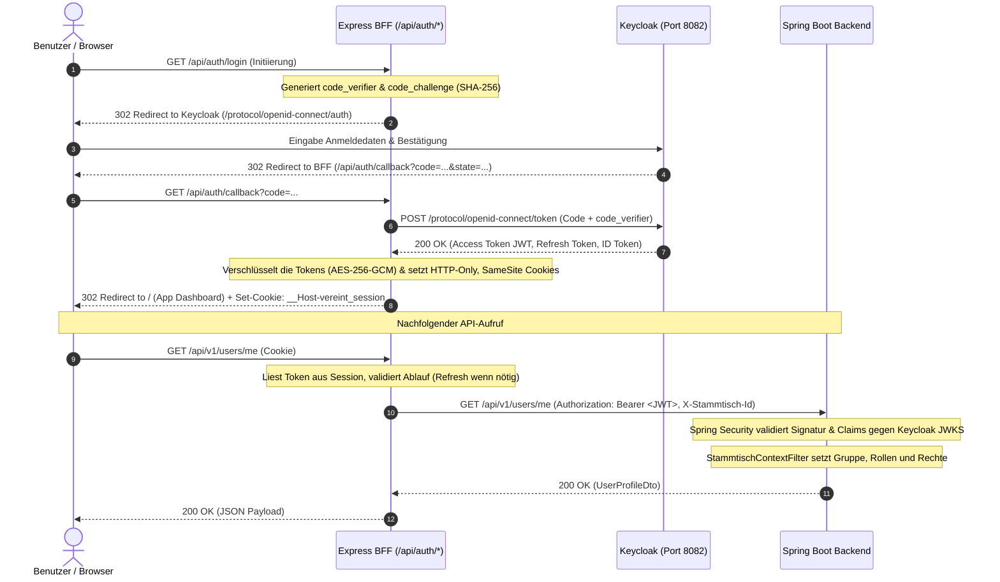

# Sicherheit, Authentifizierung & Berechtigungsmodell

Die Sicherheitsarchitektur von **Vereint** basiert auf dem Prinzip der tief gestaffelten Verteidigung (*Defense-in-Depth*). Sie kombiniert modernes **OpenID Connect (OIDC)** mit **Proof Key for Code Exchange (PKCE)**, geschützte **HTTP-Only Session Cookies** im BFF, eine zustandslose **Spring Security Resource Server**-Validierung und **Rollen je Gruppe**, deren Berechtigungen in der Datenbank stehen (`stammtisch_roles`).

---

## 🔐 Authentifizierungsfluss: OIDC mit PKCE & BFF-Session

Das Browser-Frontend speichert aus Sicherheitsgründen niemals Access- oder Refresh-Tokens im `localStorage` oder `sessionStorage` (Schutz vor XSS-Token-Diebstahl). Stattdessen übernimmt der **Express BFF Server** die Authentifizierung über das OIDC Authorization Code Flow mit PKCE.

---

## 🛡️ Rollen & Berechtigungen je Gruppe

Rollen und Rechte einer Anfrage kommen nur aus der gewählten Gruppe (`stammtisch_roles`, `user_roles`, `user_permissions`), nicht aus den Keycloak-Realmrollen im Token. Die Realmrolle `admin` macht eine Person zusätzlich zum Plattform-Admin (`platformAdmin`, Autorität `ROLE_PLATFORM_ADMIN`); in einer Gruppe hat sie damit keine Rechte. Details: [Gruppen](../domains/stammtische.md#rollen-je-gruppe).

`RolePermissionMatrix` (Version `4`) enthält nur noch die **Startwerte** der vier Systemrollen, die jede neue Gruppe erhält. Danach gelten ausschließlich die Werte in `stammtisch_roles`: Wer `roles.manage` hat, kann die Rechte der Rollen ändern, eigene Rollen anlegen und sie Mitgliedern im Bearbeiten-Formular zuweisen.

### Systemrollen einer Gruppe (`UserRole`)
- `member`: Reguläres Mitglied der Gruppe mit Basisrechten.
- `board`: Vorstand mit erweiterten Verwaltungsrechten.
- `admin`: Verwaltet Mitglieder, Rollen und Gruppe, exportiert die Daten.
- `tabletRecorder`: Technische Rolle für das Thekenkonto.

### Vorstands-Funktionsrollen (`BoardRole`)
Optionale Funktionsbezeichnung innerhalb des Vorstands, je Gruppe in `stammtisch_members.board_role`:
- `chair` (Vorsitz)
- `treasurer` (Kasse)
- `secretary` (Schriftführung)
- `assessor` (Beisitz)

### Startwerte der Systemrollen

| Berechtigung (`Permission`) | `member` | `board` | `admin` | `tabletRecorder` | Beschreibung |
| :--- | :---: | :---: | :---: | :---: | :--- |
| `profile.read.self` | ✅ | ✅ | ✅ | ❌ | Eigenes Profil einsehen |
| `balance.read.self` | ✅ | ✅ | ✅ | ❌ | Eigenen Kontostand und Buchungen abfragen |
| `purchase.self` | ✅ | ✅ | ✅ | ❌ | Eigene Käufe per Barcode-Scan buchen |
| `chat.member` | ✅ | ✅ | ✅ | ❌ | Am Gruppenchat und an Direktchats teilnehmen |
| `chat.event` | ✅ | ✅ | ✅ | ❌ | In Event-Chats schreiben |
| `event.create` | ✅ | ✅ | ✅ | ❌ | Neue Events anlegen |
| `catalog.propose` | ✅ | ✅ | ✅ | ❌ | Getränke für den Katalog vorschlagen |
| `event.manage` | ❌ | ✅ | ✅ | ❌ | Fremde Events bearbeiten, absagen oder abschließen |
| `event.invites.manage` | ❌ | ✅ | ✅ | ❌ | Gasteinladungen zu Events verwalten |
| `catalog.approve` | ❌ | ✅ | ✅ | ❌ | Katalog pflegen, Vorschläge freigeben oder ablehnen |
| `ledger.read` | ❌ | ✅ | ✅ | ❌ | Kassenbuch und Salden der Gruppe einsehen |
| `ledger.correct` | ❌ | ✅ | ✅ | ❌ | Einzahlungen, Auszahlungen, Korrekturen und Stornos buchen |
| `audit.read` | ❌ | ✅ | ✅ | ❌ | Audit-Log einsehen |
| `members.read` | ❌ | ✅ | ✅ | ❌ | Mitgliederliste einsehen |
| `members.invite` | ❌ | ✅ | ✅ | ❌ | Einladungslinks erstellen |
| `moments.manage` | ❌ | ✅ | ✅ | ❌ | Moment-Typen und Reaktionen verwalten |
| `kiosk.manage` | ❌ | ✅ | ✅ | ❌ | Kiosk-Modus starten und beenden |
| `notifications.broadcast` | ❌ | ✅ | ✅ | ❌ | Rundnachrichten an alle Mitglieder senden |
| `chat.moderate` | ❌ | ✅ | ✅ | ❌ | Infotafel im Gruppenchat setzen, alle Event-Chats öffnen |
| `purchase.tablet` | ❌ | ❌ | ✅ | ✅ | Am Thekenterminal für Mitglieder buchen |
| `members.manage` | ❌ | ❌ | ✅ | ❌ | Mitglieder bearbeiten und sperren |
| `roles.manage` | ❌ | ❌ | ✅ | ❌ | Rollen der Gruppe anlegen, ändern und zuweisen |
| `stammtisch.manage` | ❌ | ❌ | ✅ | ❌ | Name, Bild und Einstellungen der Gruppe |
| `audit.read.all` | ❌ | ❌ | ✅ | ❌ | Vollständiges Audit-Log einsehen |

---

## ⚙️ Spring Security Filter Chain & Tokenverarbeitung

In `baseservice` wird jede eingehende Anfrage durch `SecurityConfig` und `JwtAuthConverter` geprüft:

1. **Öffentliche Endpunkte (`permitAll`)**:
   - `/actuator/health`, `/actuator/health/liveness`, `/actuator/health/readiness`, `/actuator/info` (Monitoring)
   - `/api/v1/health`, `/api/v1/info`
   - `/api/v1/auth/access/guest` (Gast-Zugangsprüfung)
   - `/api/v1/invites/accept` (Gäste-Einladung einlösen)
   - `/api/v1/member-invites/preview`, `/api/v1/member-invites/register` (Registrierung per Einladungslink)
   - `/api/v1/events/*/chat/guest/**` (Gast-Chat via temporärem Gasttoken im Header)
   - `/api/v1/signup` (Konto anlegen und Gruppe eröffnen)
   - `/v3/api-docs/**`, `/swagger-ui/**` (OpenAPI Dokumentation, nur mit `API_DOCS_ENABLED=true`, in Produktion aus)
2. **Admin-Endpunkte**:
   - Alle übrigen `/actuator/**`-Endpunkte erfordern `ROLE_ADMIN`.
3. **Stateless JWT-Konvertierung (`JwtAuthConverter`, `JwtClaimExtractor`)**:
   - Extrahiert `sub` (Keycloak Subject), Name, E-Mail und die Realmrollen in einen `UserPrincipal`.
4. **Gruppenkontext (`StammtischContextFilter`)**, direkt nach der Token-Prüfung:
   - Legt das lokale Konto bei Bedarf an (`UserService`, `UserProvisioningService`).
   - Wählt die Gruppe aus dem Header `X-Stammtisch-Id` (der BFF setzt ihn aus dem Gruppen-Cookie) oder, ohne Header, die einzige Gruppe der Person. Fremde Gruppe: `403 stammtisch_access_denied`; fachlicher Endpunkt ohne Gruppe: `409 stammtisch_required`.
   - Ersetzt Rollen und Rechte im Principal durch die der Gruppe und setzt den Mandantenkontext für Hibernate und PostgreSQL.
5. **Fachliche Prüfung im Service**:
   - Es gibt kein `@PreAuthorize`. Die Services prüfen Rechte über `StammtischAccess` (`has`, `require`) bzw. `AuthContext.requirePermission`.

---

## 🚀 SSR-Auslieferung & Transfer-State

1. **`authorization.middleware.ts`**: Prüft vor dem Rendern privater Seiten über den Fachservice (`/api/v1/auth/access`), ob die Session den Seitenkontext öffnen darf; die Entscheidung wird kurz je Session gecacht.
2. **`delivery.middleware.ts`**: Setzt Sicherheits- und Cache-Header (CSP mit Nonce, `no-store` für private Kontexte).
3. **`transfer-state.ts`**: Reduziert den Angular-Transfer-State privater Seiten auf eine Positivliste unkritischer Felder (`appContext`, `access`, `locale`, `theme` u. a.). Tokens, Guthaben, Ledger-Daten und E-Mail-Adressen verlassen den Server nicht im HTML.
4. **Client**: Der `AuthService` lädt die Identität über `/api/auth/me` nach.

---

## 🧱 Härtung im Überblick

| Maßnahme | Wo |
| :--- | :--- |
| **Zwei-Faktor-Anmeldung (freiwillig)**: Im Profil führt „Zwei-Faktor-Anmeldung einrichten“ zur Keycloak-Kontoverwaltung (`/kc/realms/vereint/account`). Wer eine Authenticator-App hinterlegt, wird beim Login nach dem Code gefragt. | Keycloak, Profil |
| **Passwortregeln**: 10 bis 128 Zeichen, nicht Benutzername oder E-Mail, nicht eines der letzten drei; nach 5 Fehlversuchen wachsende Sperre. | Keycloak-Realm |
| **Kein „Passwort vergessen“**: Im Produktions-Realm aus (`resetPasswordAllowed: false`), weil Vereint keine E-Mails verschickt. Ein neues Passwort setzt die Keycloak-Verwaltung. | `keycloak/realm-export.json` |
| **Cross-Site-Schutz**: Der BFF lehnt schreibende Anfragen ab, die nicht von der eigenen Seite kommen (`Sec-Fetch-Site` bzw. `Origin`). | webservice |
| **Rate-Limits**: Einladungs-, Gast-Token- und Registrierungs-Endpunkte (`/api/v1/signup`) 30 Versuche je IP in 15 Minuten, Gast-Chat 60 je IP und Minute, Login-Start 120 je IP in 5 Minuten, übrige API 600 Anfragen je Sitzung und Minute. | webservice |
| **Pfad-Prüfung**: Der API-Proxy reicht nur `/api/v1` weiter und verwirft Pfade mit `..` oder kodierten Schrägstrichen. | webservice |
| **Keine API-Beschreibung in Produktion**: Swagger/OpenAPI nur mit `API_DOCS_ENABLED=true`. | baseservice |
| **Metadaten entfernen**: EXIF/XMP (GPS, Gerät, Zeit) aus Bildern, Orts- und Geräteangaben aus Videos, bevor sie verschlüsselt gespeichert werden. | baseservice |
| **Container**: ohne Root, ohne Linux-Capabilities, schreibgeschütztes Dateisystem für baseservice und webservice, Prozess- und Speicherlimits. | Images, Beispiel `local/compose.yaml` |
| **Reverse Proxy**: HTTPS mit HSTS, Anfragen bis 8 MB (Moment-Medien bis 110 MB), `Permissions-Policy` erlaubt Kamera (Barcode-Scan, Fotos) und Standort (Moments) nur für die eigene Seite. | Betreiber, Beispiel `local/Caddyfile` |

Details: [Vereint selbst betreiben](../betrieb/selbst-betreiben.md) und [Sicherheit und Schlüssel](../betrieb/sicherheit-und-schluessel.md).
