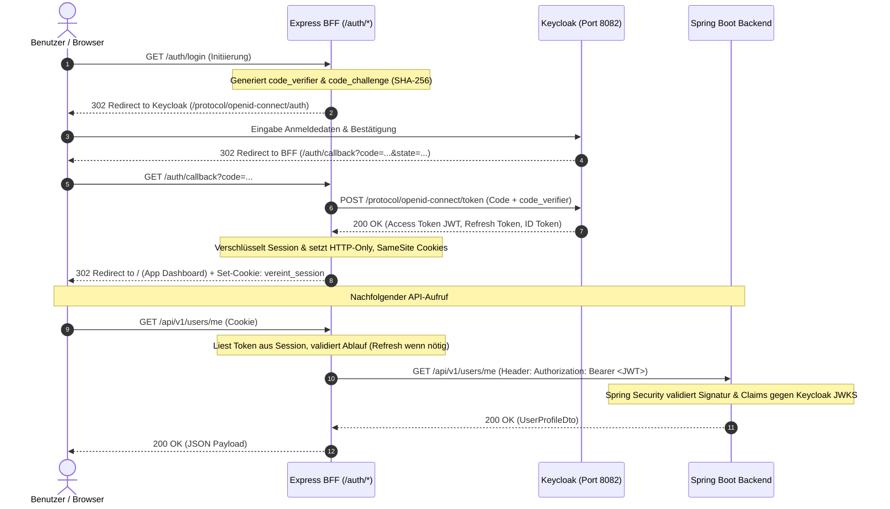

# Sicherheit, Authentifizierung & Berechtigungsmodell

Die Sicherheitsarchitektur von **Vereint** basiert auf dem Prinzip der tief gestaffelten Verteidigung (*Defense-in-Depth*). Sie kombiniert modernes **OpenID Connect (OIDC)** mit **Proof Key for Code Exchange (PKCE)**, geschützte **HTTP-Only Session Cookies** im BFF, eine zustandslose **Spring Security 6 Resource Server**-Validierung und eine zentral versionierte **Rollen- und Berechtigungsmatrix**.

---

## 🔐 Authentifizierungsfluss: OIDC mit PKCE & BFF-Session

Das Browser-Frontend speichert aus Sicherheitsgründen niemals Access- oder Refresh-Tokens im `localStorage` oder `sessionStorage` (Schutz vor XSS-Token-Diebstahl). Stattdessen übernimmt der **Express BFF Server** die Authentifizierung über das OIDC Authorization Code Flow mit PKCE.

---

## 🛡️ Rollen- & Berechtigungsmatrix (`RolePermissionMatrix.kt`)

Die Zuordnung von Systemrollen zu atomaren Berechtigungen ist im Backend in `RolePermissionMatrix` (Version `2`) zentral verankert.

### Rollen im System (`UserRole`)
- `member`: Reguläres Vereinsmitglied mit Basisrechten.
- `board`: Vorstandsmitglied mit erweiterten Verwaltungsrechten.
- `admin`: Administrator mit Vollzugriff auf das Gesamtsystem.
- `tabletRecorder`: Technische Rolle für Kiosksysteme an der Vereinstheke.

### Vorstands-Funktionsrollen (`BoardRole`)
Optionale Funktionsbezeichnung innerhalb des Vorstands:
- `chair` (1. / 2. Vorsitzender)
- `treasurer` (Kassier / Schatzmeister)
- `secretary` (Schriftführer)
- `assessor` (Beisitzer)

### Berechtigungs-Zuordnungstabelle

| Berechtigung (`Permission`) | `member` | `board` | `admin` | `tabletRecorder` | Beschreibung |
| :--- | :---: | :---: | :---: | :---: | :--- |
| `profile.read.self` | ✅ | ✅ | ✅ | ❌ | Eigenes Benutzerprofil einsehen |
| `balance.read.self` | ✅ | ✅ | ✅ | ❌ | Eigenen Kassenstand und Buchungshistorie abfragen |
| `purchase.self` | ✅ | ✅ | ✅ | ❌ | Eigene Einkäufe via Barcode-Scan buchen |
| `purchase.tablet` | ❌ | ❌ | ✅ | ✅ | Getränkebuchungen für alle Mitglieder am Theken-Tablet durchführen |
| `event.create` | ✅ | ✅ | ✅ | ❌ | Neue Vereinsveranstaltungen anlegen |
| `event.manage` | ❌ | ✅ | ✅ | ❌ | Bestehende Events bearbeiten, absagen oder abschließen |
| `event.invites.manage` | ❌ | ✅ | ✅ | ❌ | Gästelisten und Einladungstoken generieren |
| `catalog.propose` | ❌ | ✅ | ✅ | ❌ | Neue Getränke zur Aufnahme in den Katalog vorschlagen |
| `catalog.approve` | ❌ | ✅ | ✅ | ❌ | Vorgeschlagene Getränke freigeben oder ablehnen |
| `ledger.read` | ❌ | ✅ | ✅ | ❌ | Vollständiges Vereins-Kassenbuch und Salden einsehen |
| `ledger.correct` | ❌ | ✅ | ✅ | ❌ | Fehlbuchungen stornieren und Korrekturbuchungen ausführen |
| `chat.member` | ✅ | ✅ | ✅ | ❌ | Am vereinsweiten Chat und Gruppenkanälen teilnehmen |
| `chat.event` | ✅ | ✅ | ✅ | ❌ | In Event-spezifischen Chaträumen schreiben |
| `audit.read` | ❌ | ✅ | ✅ | ❌ | Audit-Logs und administrative Änderungsprotokolle einsehen |

---

## ⚙️ Spring Security Filter Chain & Tokenverarbeitung

In `baseservice` wird jede eingehende Anfrage durch `SecurityConfig` und `JwtAuthConverter` geprüft:

1. **Öffentliche Endpunkte (`permitAll`)**:
   - `/actuator/health`, `/actuator/health/liveness`, `/actuator/health/readiness`, `/actuator/info` (Monitoring)
   - `/api/v1/health`, `/api/v1/info`
   - `/api/v1/auth/access/guest` (Gast-Zugangsprüfung)
   - `/api/v1/invites/accept` (Gäste-Einladung einlösen)
   - `/api/v1/events/*/chat/guest/**` (Gast-Chat via temporärem Gasttoken im Header)
   - `/v3/api-docs/**`, `/swagger-ui/**` (OpenAPI Dokumentation)
2. **Admin-Endpunkte**:
   - `/actuator/**` erfordert Rolle `ROLE_ADMIN`.
3. **Stateless JWT-Konvertierung (`JwtAuthConverter`)**:
   - Extrahiert `sub` (Keycloak Subject UUID), `preferred_username`, `email`, `roles` und benutzerdefinierte Claims.
   - Synchronisiert den Benutzerstatus bei Bedarf transparent in die lokale Datenbank (`UserProvisioningService`).
   - Erstellt ein `UserPrincipal`-Objekt im `SecurityContextHolder`.
4. **Method Security**:
   - Controller-Methoden können über `@PreAuthorize("hasAuthority('purchase.tablet')")` oder `@PreAuthorize("hasRole('admin')")` abgesichert werden.

---

## 🚀 SSR Delivery & TransferState Injection

Um beim serverseitigen Rendern (SSR) im Express BFF eine nahtlose Authentifizierung ohne Layout-Springen zu gewährleisten:

1. **`delivery.middleware.ts`**: Ermittelt aus dem Session-Cookie die Rollen und Berechtigungen des aktuellen Benutzers.
2. **`transfer-state.ts`**: Injiziert das `AuthStateDto` sowie die Instanzkonfiguration (`CLUB_CONFIG_KEY`) in den HTML-Renderbaum.
3. **Client-Hydration**: Die Angular-App liest beim Start im Browser den State aus dem DOM aus, initialisiert die Signals im `AuthService` synchron und verhindert Ladeverzögerungen oder unberechtigte Redirects.
