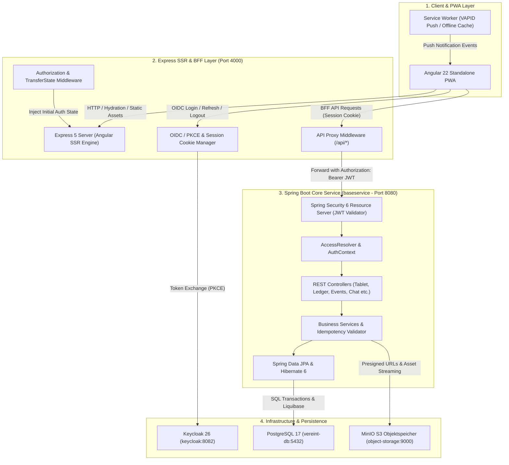
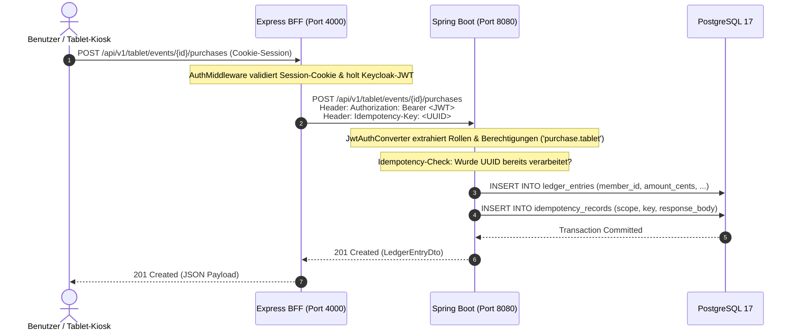

# System-Überblick & Architektur-Topologie

Die **Vereint**-Plattform ist als moderne Multi-Tier-Webanwendung konzipiert, die hohe Reaktionsfähigkeit für Theken- und Mobilgeräte mit robuster Datenintegrität und strenger Authentifizierung vereint.

---

## 🏛️ Multi-Tier Systemarchitektur

Das Gesamtsystem besteht aus vier primären logischen Schichten:

---

## 🧩 Schichten & Komponenten im Detail

### 1. Client & PWA Layer (`webservice/src/app`)
- **Framework**: Angular 22 (Standalone Components, Signals, Zoneless/Zone-kompatibel).
- **App Shell Architecture**: Einheitliches Shell-Layout (`AppShellComponent`) mit adaptiver Navigation für Mobile (Bottom Navigation Bar), Tablet (Kiosk Overlay) und Desktop (Sidebar Navigation).
- **Progressive Web App (PWA)**: Service Worker für intelligentes Caching statischer Assets, Offline-Hinweise und Hintergrundempfang von Push-Benachrichtigungen via VAPID.
- **Optimus Design System**: Eigenes UI-System mit CSS Custom Properties für Theme-Konsistenz (`--opt-color-primary`, `--opt-space-*`, `--opt-radius-*`).

### 2. Express SSR & BFF Layer (`webservice/src/server`)
- **Runtime**: Node.js 22+, Express 5.
- **Server-Side Rendering (SSR)**: Schneller First Contentful Paint (FCP) durch serverseitiges Vorrendern der HTML-Seiten mit Angular SSR Engine.
- **State Hydration**: Übertragung des serverseitigen Authentifizierungs- und Vereinskontexts (`TransferState`, `CLUB_CONFIG_KEY`, Auth-State) verhindert Layout-Shifts und Flackern beim Laden.
- **Backend-for-Frontend (BFF) Pattern**:
  - Verwaltet OIDC PKCE Login/Logout-Abläufe und schützt Tokens vor XSS in verschlüsselten, HTTP-Only, SameSite Cookies.
  - Proxy-Middleware (`api-proxy.middleware.ts`) leitet Client-Anfragen transparent an das Spring Boot Backend weiter und hängt das gültige Bearer-Access-Token an.

### 3. Spring Boot Backend (`baseservice`)
- **Framework**: Spring Boot 4.1+, Kotlin 2.3+, Java 25 JDK.
- **Security**: Stateless OAuth2 Resource Server mit JWT-Validierung (`JwtAuthConverter`, `RolePermissionMatrix`).
- **Idempotenz**: Eindeutige Transaktionssicherheit über den HTTP-Header `Idempotency-Key` (UUIDv4) für kritische Kassen- und Thekenbuchungen.
- **Storage & Push**:
  - Integrierter S3-Client (`S3ObjectStorage`) für Profilbilder, Event-Banner und Getränkefotos.
  - VAPID Web Push Sender (`VapidPushSender`) mit RFC-8292-konformer Payload-Verschlüsselung.

### 4. Daten- & Infrastrukturschicht (`docker-compose.yml`)
- **PostgreSQL 17**: Relationale Datenbank für Transaktionsdaten, Buchungsjournal (Append-Only Trigger), Benutzer und Events.
- **Liquibase**: Versionskontrollierte Datenbankmigrationen (`db.changelog-master.xml`).
- **Keycloak 26**: Identity & Access Management (OIDC Provider) mit vorkonfigurierten Rollen und Testbenutzern (`realm-export-dev.json`).
- **MinIO**: S3-kompatibler Objektspeicher mit privatem Asset-Bucket.

---

## 🔄 Typischer Request-Lebenszyklus

---

## 🌐 Port- und Netzwerk-Topologie (Entwicklungsumgebung)

| Dienst | Container / Prozess | Host-Port | Interner Port | Protokoll / Zweck |
| :--- | :--- | :--- | :--- | :--- |
| **Frontend / BFF** | Node.js Express | `4000` | `4000` | HTTP / SSR & BFF API Proxy |
| **Backend Core** | Spring Boot Kotlin | `8080` | `8080` | HTTP / REST API & Actuator |
| **Keycloak IAM** | Keycloak 26 Dev | `8082` | `8080` | HTTP / OIDC Provider & Admin-Console |
| **Keycloak DB** | PostgreSQL 17 | `5433` | `5432` | PostgreSQL JDBC (Keycloak Realm DB) |
| **Vereint DB** | PostgreSQL 17 | `5432` | `5432` | PostgreSQL JDBC (Hauptanwendung) |
| **MinIO S3 API** | MinIO Storage | `9000` | `9000` | S3 REST API (Asset Storage) |
| **MinIO Console** | MinIO Web UI | `9001` | `9001` | HTTP / MinIO Management Console |
