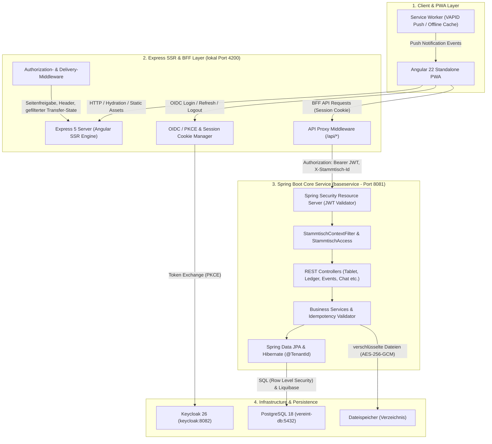
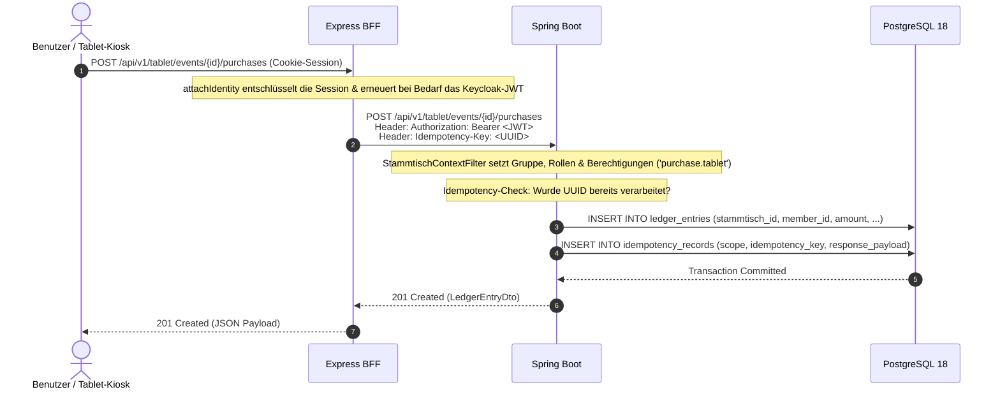

# System-Überblick & Architektur-Topologie

Die **Vereint**-Plattform ist als moderne Multi-Tier-Webanwendung konzipiert, die hohe Reaktionsfähigkeit für Theken- und Mobilgeräte mit robuster Datenintegrität und strenger Authentifizierung vereint.

---

## 🏛️ Multi-Tier Systemarchitektur

Das Gesamtsystem besteht aus vier primären logischen Schichten:

---

## 🧩 Schichten & Komponenten im Detail

### 1. Client & PWA Layer (`webservice/src/app`)
- **Framework**: Angular 22 (Standalone Components, Signals, ohne zone.js).
- **App Shell Architecture**: Einheitliches Shell-Layout (`AppShellComponent`) mit adaptiver Navigation für Mobile (Bottom Navigation Bar) und Desktop (Sidebar Navigation), Gruppenwechsel und Kiosk-Sperre.
- **Progressive Web App (PWA)**: Service Worker für intelligentes Caching statischer Assets, Offline-Hinweise und Hintergrundempfang von Push-Benachrichtigungen via VAPID.
- **Design System**: Bibliothek `@openng/optimus-ui` mit Theme Aura, Tailwind CSS 4 und eigene CSS Custom Properties (`--opt-color-*`, `--opt-radius-*`).

### 2. Express SSR & BFF Layer (`webservice/src/server`)
- **Runtime**: Node.js 22+, Express 5.
- **Server-Side Rendering (SSR)**: Schneller First Contentful Paint (FCP) durch serverseitiges Vorrendern der HTML-Seiten mit Angular SSR Engine.
- **Transfer-State-Filter**: Für private Seiten wird der Angular-Transfer-State vor der Auslieferung auf eine Positivliste reduziert (`transfer-state.ts`); Tokens, Guthaben und E-Mail-Adressen gelangen nicht ins HTML.
- **Backend-for-Frontend (BFF) Pattern**:
  - Verwaltet OIDC PKCE Login/Logout-Abläufe und schützt Tokens vor XSS in verschlüsselten, HTTP-Only, SameSite Cookies.
  - Proxy-Middleware (`api-proxy.middleware.ts`) leitet `/api/v1/*` an das Spring Boot Backend weiter, hängt das gültige Bearer-Access-Token an und setzt aus dem Gruppen-Cookie den Header `X-Stammtisch-Id`.

### 3. Spring Boot Backend (`baseservice`)
- **Framework**: Spring Boot 4.1+, Kotlin 2.3+, Java 25 JDK.
- **Security**: Stateless OAuth2 Resource Server mit JWT-Validierung (`JwtAuthConverter`), danach `StammtischContextFilter` für Gruppe, Rollen und Rechte.
- **Mehrere Gruppen**: Jede fachliche Zeile gehört einer Gruppe (`stammtisch_id`). Hibernate `@TenantId` und PostgreSQL Row Level Security trennen die Daten, siehe [Gruppen](../domains/stammtische.md).
- **Idempotenz**: Eindeutige Transaktionssicherheit über den HTTP-Header `Idempotency-Key` (UUIDv4) für kritische Kassen- und Thekenbuchungen.
- **Domänenmodule**:
  - **Getränke- & Speisenkatalog**: Stammdatenverwaltung (`DrinkCatalogService`, `FoodCatalogService`) mit Standardpreisen und Einkaufspreisen (`costPrice`).
  - **Event-Angebote**: Granulare Zuordnung von Getränken (`EventDrinkService`) und Speisen (`EventFoodService`) zu Events mit individueller Preisgestaltung und Tablet-/Kiosk-Freigabe.
  - **Revisionssicheres Kassenbuch & Gewinnermittlung**: Transaktionsjournal (`LedgerService`) mit Beleg-Snapshots (`PurchaseSnapshot`), Einkaufspreiserfassung und Deckungsbeitragsberechnung (`profit = unit_price - cost_price`).
  - **Tablet Strichlisten-Recorder**: Thekenterminal-API (`TabletRecorderService`) für Getränke und Speisen mit kombinierten Katalogen (`/items`), Anzeige laufender Runden (ausgegeben am eigenen Handy, `RoundService`); Kiosk-Modus mit PIN (`KioskService`).
  - **Gemeinsame Getränkedatenbank**: gruppenübergreifende Stammdaten ohne Preise (`DrinkLibraryService`).
- **Storage & Push**:
  - Integrierter S3-Client (`S3ObjectStorage`) für Bilder sowie Fotos und Videos aus Moments. Alle Dateien werden vor dem Speichern mit `DATA_ENCRYPTION_KEY` verschlüsselt und nur über berechtigungsgeprüfte Endpunkte des baseservice ausgeliefert, nie über direkte S3-Links.
  - VAPID Web Push Sender (`VapidPushSender`, RFC 8292) ohne Nutzlast: Der Push weckt nur den Service Worker, die Inhalte lädt der Client berechtigt aus `notifications` nach.

### 4. Daten- & Infrastrukturschicht
- **PostgreSQL 18**: Relationale Datenbank für Transaktionsdaten, Buchungsjournal (Append-Only Trigger), Benutzer und Events.
- **Liquibase**: Versionskontrollierte Datenbankmigrationen (`db.changelog-master.xml`).
- **Keycloak 26.8.1**: Identity & Access Management (OIDC Provider). Lokal mit Testbenutzern (`keycloak/dev/realm-export-dev.json`), in Produktion ohne Seed-Benutzer (`keycloak/realm-export.json`).
- **Dateispeicher**: Überall ein Verzeichnis (`STORAGE_BACKEND=filesystem`): in Produktion ein dauerhaftes Volume, im lokalen Stack und in den E2E-Tests das Volume `files`, bei `./gradlew bootRun` `<Repo>/.data/files`. Ein S3-kompatibler Speicher ist optional möglich (`STORAGE_BACKEND=s3`).
- **Produktion**: Das Repository liefert die Images `ghcr.io/damaurer/vereint-baseservice` und `ghcr.io/damaurer/vereint-webservice`; Betrieb siehe [Vereint selbst betreiben](../betrieb/selbst-betreiben.md).

---

## 🔄 Typischer Request-Lebenszyklus

---

## 🌐 Port- und Netzwerk-Topologie (Entwicklungsumgebung)

| Dienst | Container / Prozess | Host-Port | Interner Port | Protokoll / Zweck |
| :--- | :--- | :--- | :--- | :--- |
| **Frontend / BFF** | Node.js Express (`npm start`) | `4200` | `4200` | HTTP / SSR & BFF API Proxy |
| **Backend Core** | Spring Boot Kotlin | `8081` | `8081` | HTTP / REST API & Actuator |
| **Keycloak IAM** | Keycloak 26 Dev | `8082` | `8080` | HTTP / OIDC Provider & Admin-Console |
| **Keycloak DB** | PostgreSQL 18 | `5433` | `5432` | PostgreSQL JDBC (Keycloak Realm DB) |
| **Vereint DB** | PostgreSQL 18 | `5432` | `5432` | PostgreSQL JDBC (Hauptanwendung) |

In Produktion sollte von außen nur der Reverse Proxy auf Port 80/443 erreichbar sein; alle anderen Dienste sprechen nur im internen Container-Netz miteinander ([Vereint selbst betreiben](../betrieb/selbst-betreiben.md)).
