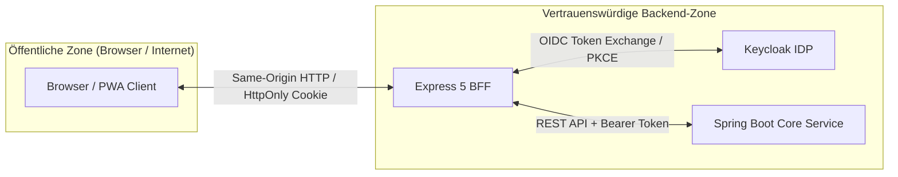

# 🚀 01. Übersicht, Architektur & Setup

Dieses Kapitel beschreibt die Rolle des Express-5-BFF (*Backend-for-Frontend*) innerhalb des Gesamtsystems **Vereint**, den verwendeten Technologie-Stack, die Verzeichnisstruktur des Servercodes, die NPM-Skripte sowie alle Konfigurations- und Umgebungsvariablen.

---

## 🛡️ Die Rolle des BFF

Im Architekturmodell von **Vereint** nimmt der Express-Server (`webservice/src/server.ts`) eine zentrale Schutz- und Vermittlerfunktion zwischen Client, Authentifizierungsprovider und Fachservice ein:



### Kernaufgaben des BFF:
1. **OIDC Confidential Client**: Verwahrt das `KEYCLOAK_CLIENT_SECRET` sicher auf dem Server. Führt den Authorization Code Flow mit PKCE durch und tauscht Codes gegen Tokens ein.
2. **Sitzungsverwaltung**: Speichert Access-, Refresh- und ID-Tokens serverseitig in einem verschlüsselten, signierten HttpOnly-Cookie (`AES-256-GCM` via HKDF). Tokens gelangen niemals in den JavaScript-Kontext des Browsers (Schutz vor XSS-Token-Diebstahl).
3. **Automatischer API-Proxy**: Leitet `/api/v1/*`-Aufrufe an das Spring-Boot-Backend weiter und hängt das gespeicherte Bearer-Token automatisch an.
4. **Serverseitiges Rendering (Angular SSR)**: Rendert initiale HTML-Seiten über die `AngularNodeAppEngine`, sanitisiert den `TransferState` und liefert vorkonfigurierte Ansichten schnell und flickerfrei aus.
5. **Seitenzugriffskontrolle**: Prüft bei Seitenaufrufen vor der SSR-Ausführung die Berechtigung gegen Spring Boot (`GET /api/v1/auth/access`) und leitet unauthentifizierte Anfragen auf die passende Login-Seite weiter.

---

## 🧰 Tech-Stack

Der BFF basiert auf modernen Node.js- und TypeScript-Technologien:

| Komponente / Bibliothek | Version (Auszug aus `package.json`) | Zweck & Einsatzbereich |
| :--- | :--- | :--- |
| **Node.js** | `>= 20.x` | Serverseitige JavaScript-Laufzeitumgebung. |
| **Express** | `^5.1.0` | HTTP-Server-Framework (Routing, Middlewares, Static Files). |
| **@angular/ssr** | `^22.1.6` | Angular Server-Side Rendering (`AngularNodeAppEngine`). |
| **@angular/core / platform-server** | `^22.1.0` | Angular 22 Server-Plattform und Hydration. |
| **jose** | `^6.2.12` | JWT-, JWKS- und Token-Verifikation (Keycloak Tokens). |
| **helmet** | `^8.3.0` | HTTP-Sicherheits-Header (CSP, HSTS, Framing, MIME-Sniffing). |
| **compression** | `^1.8.1` | Gzip/Brotli-Kompression für HTTP-Antworten. |
| **vitest** | `^4.0.8` | Schnelle Unit- und Integrationstests. |
| **TypeScript** | `~6.0.2` | Typisierung und statische Code-Analyse. |

---

## 📂 Verzeichnisstruktur von `webservice/src/server/`

Alle serverseitigen Quelldateien befinden sich unter `webservice/src/` (Einstiegspunkt: `server.ts`) und `webservice/src/server/`:

```text
webservice/src/
├── server.ts                               # Haupt-Einstiegspunkt, Middleware-Pipeline & Serverstart
└── server/
    ├── api/                                # Proxy für Fachservice-Aufrufe
    │   ├── api-proxy.middleware.ts         # Leitet /api/v1 an Spring Boot weiter (Bearer Injection)
    │   └── api-proxy.middleware.spec.ts    # Tests für Proxy, Header-Stripping & Fehlerbehandlung
    │
    ├── auth/                               # Authentifizierung, Session & OIDC
    │   ├── auth.middleware.ts              # attachIdentity: Liest & validiert Session je Request
    │   ├── auth.types.ts                   # TypeScript Interfaces (SessionData, RequestIdentity, etc.)
    │   ├── cookie.service.ts               # Cookie-Serialisierung, Chunking (3 KB) & Parsing
    │   ├── cookie.service.spec.ts          # Tests für Cookie-Handling & Chunking
    │   ├── id-token.ts                     # jose-Prüfung von ID- & Access-Tokens gegen Keycloak JWKS
    │   ├── id-token.spec.ts                # Tests für Signatur, Issuer, Audience & Nonce
    │   ├── keycloak-realm.spec.ts          # Validierung der Keycloak-Realm-Konfiguration
    │   ├── oidc.service.ts                 # Keycloak REST Client: Auth URL, Token Exchange, Refresh, Logout
    │   ├── oidc.service.spec.ts            # Tests für OIDC-Endpunkte & Retry-Logik
    │   ├── pkce.ts                         # RFC 7636 PKCE Generator & Validator (S256)
    │   ├── pkce.spec.ts                    # Tests für Code Verifier & Challenge
    │   ├── redirect.ts                     # Open-Redirect-Schutz & Zielpfad-Auflösung
    │   ├── redirect.spec.ts                # Tests für Return-To-Validierung
    │   ├── security-log.ts                 # Strukturiertes Logging von Security-Events
    │   ├── session.service.ts              # AES-256-GCM Verschlüsselung, Key-Rotation & Session-Lebenszyklus
    │   ├── session.service.spec.ts         # Tests für Verschlüsselung, Rotation & Grace Periods
    │   └── testing/
    │       └── token-fixtures.ts           # Test-Hilfen: RSA-KeySet-Erzeugung & Token-Signierung
    │
    ├── authorization/                      # Seitenzugriff, Delivery-Header & Transfer-State
    │   ├── access-decision-cache.ts        # LRU-In-Memory-Cache (45 s TTL, 500 Einträge)
    │   ├── authorization.middleware.ts     # authorizePages: 5-Stufen-Entscheidungsbaum vor SSR
    │   ├── authorization.middleware.spec.ts# Tests für Routing, Logins & Wartungsseiten
    │   ├── authorization.service.ts        # Spring-Resolver-Client (/api/v1/auth/access, Stale Grace)
    │   ├── authorization.service.spec.ts   # Tests für Rechteabgleich & Timeout-Handling
    │   ├── authorization.types.ts          # Typen für Zugriffsentscheidungen & Matrizen
    │   ├── delivery.middleware.ts          # Cache-Control, Vary, Helmet CSP-Nonce & HSTS
    │   ├── delivery.middleware.spec.ts     # Tests für Header-Matrix (Private/Hashed/Shell)
    │   ├── transfer-state.ts               # Positivlisten-Filterung des SSR ng-state
    │   └── transfer-state.spec.ts          # Tests für Leckschutz privater Daten
    │
    ├── config/                             # Konfiguration & Umgebungsvariablen
    │   ├── environment.ts                  # resolveServerEnvironment, Validierung & .env-Laden
    │   ├── environment.spec.ts             # Tests für Fallbacks, Validierung & Fail-Fast
    │   └── server-config.ts                # Konstanten für öffentliche Pfade & Session
    │
    ├── invites/                            # Einladungscode-Prüfung
    │   ├── invite.routes.ts                # GET /api/invites/:code Router
    │   ├── invite.service.ts               # Regex-Vorvalidierung von Einladungstokens
    │   └── invite.types.ts                 # Typdefinitionen für ValidatedInvite
    │
    └── routes/                             # HTTP-Routen
        ├── auth.routes.ts                  # /login, /callback, /keycloak, /me, /session, /logout
        └── auth.routes.spec.ts             # Tests für OIDC-Endpunkte & Session-Lifecycle
```

---

## 💻 Skripte & Lokaler Betrieb

Alle relevanten Befehle werden im Verzeichnis `webservice/` ausgeführt:

```bash
cd webservice
```

| NPM-Skript | Befehl | Beschreibung |
| :--- | :--- | :--- |
| `npm run env:prepare` | `node -e "..."` | Kopiert `.env.example` nach `.env`, falls noch keine lokale `.env` existiert. |
| `npm start` | `ng serve` | Startet den Angular-Dev-Server mit HMR für die Frontend-Entwicklung (Port 4200). Führt zuvor automatisch `prestart` (`env:prepare`) aus. |
| `npm run build` | `ng build` | Baut Client-Bundles (`browser/`) und SSR-Server-Bundle (`server/server.mjs`). |
| `npm run watch` | `ng build --watch --configuration development` | Inkrementeller Entwicklungsbuild mit Beobachtungsmodus. |
| `npm test` | `ng test` | Führt alle Unit-Tests via Vitest aus. |
| `npm run serve:ssr:webservice` | `node dist/webservice/server/server.mjs` | Startet den kompilierten Express-BFF-Server im Produktionsmodus. |

---

## ⚙️ Umgebungsvariablen-Referenz

Die Konfiguration wird zentral in `webservice/src/server/config/environment.ts` über `resolveServerEnvironment` eingelesen und mit `assertServerEnvironment` validiert.

### `.env`-Suchreihenfolge
Beim Start sucht `loadEnvFile` nach einer `.env`-Datei in folgender Reihenfolge:
1. `.env` (im aktuellen Arbeitsverzeichnis)
2. `../.env` (Projekt-Root)
3. `webservice/.env`

In Produktions- oder Container-Umgebungen (Docker/Kubernetes) werden Umgebungsvariablen direkt in den Prozess injiziert.

### Referenztabelle aller Variablen

| Variable | Standardwert | Pflichtfeld? | Beschreibung / Validierungsregel |
| :--- | :--- | :---: | :--- |
| `PORT` | `4300` | Nein | Port, auf dem der Express-Server lauscht. |
| `NODE_ENV` | `undefined` | Nein | Wenn `'production'`, greift strikte Validierung (z. B. Pflicht-HTTPS für Cookies). |
| `PUBLIC_BASE_URL` | `http://localhost:8080` | **Ja** | Öffentliche Basis-URL der Anwendung für Browser-Redirects und Callbacks. |
| `SPRING_API_BASE_URL` | `http://localhost:8081` | **Ja** | Interne URL des Spring-Boot-Fachservice (`/api/v1/*` Proxy & Autorisierung). |
| `KEYCLOAK_ISSUER_URI` | `http://localhost:8082/realms/vereint` | **Ja** | OIDC-Issuer-URL von Keycloak. Falls nicht gesetzt, wird sie aus `KEYCLOAK_REALM` abgeleitet. |
| `KEYCLOAK_REALM` | `vereint` | Nein | Name des Keycloak-Realms. |
| `KEYCLOAK_CLIENT_ID` | `vereint-web` | Nein | OIDC Client-ID in Keycloak (*Confidential Client*). |
| `KEYCLOAK_CLIENT_SECRET` | *(kein Default)* | **Ja** | OIDC Client Secret für Token-Austausch und Refresh. Darf niemals leer sein. |
| `KEYCLOAK_REQUEST_TIMEOUT_MS` | `3000` | Nein | Timeout in Millisekunden für direkte HTTP-Aufrufe an Keycloak. |
| `KEYCLOAK_REQUEST_RETRIES` | `1` | Nein | Anzahl Wiederholungsversuche bei idempotentem Token-Abruf gegen Keycloak. |
| `SESSION_SECRET` / `SESSION_SECRET_CURRENT` | *(kein Default)* | **Ja** | Hauptgeheimnis zur AES-256-GCM-Verschlüsselung der Session. **Mindestens 32 Byte**. |
| `SESSION_SECRET_PREVIOUS` | `null` | Nein | Vorheriges Secret für unterbrechungsfreie Schlüsselrotation. Mindestens 32 Byte, darf nicht identisch mit dem aktuellen Secret sein. |
| `SESSION_COOKIE_NAME` | `vereint_session` | Nein | Basisname des HttpOnly-Session-Cookies. |
| `SESSION_DURATION_MINUTES` | `1440` (24h) | Nein | Session-Lebensdauer in Minuten (muss mit Keycloak `ssoSessionMaxLifespan` übereinstimmen). |
| `SESSION_DURATION_DAYS` | `1` | Nein | Alternative Angabe der Session-Lebensdauer in Tagen. |
| `SESSION_COOKIE_SECURE` | In Prod: `true`, sonst `false` | Nein | Erzwingt das `Secure`-Attribut am Cookie. In Produktion **Pflicht**. |

---

## 🚨 Validierung & Fail-Fast-Regeln (`assertServerEnvironment`)

Beim Start des Hauptprozesses prüft `assertServerEnvironment(serverEnvironment)` alle Konfigurationswerte:

- **Fehlende Pflicht-Secrets** (`KEYCLOAK_CLIENT_SECRET`, `SESSION_SECRET`): Führen sofort zum Startabbruch mit einer `server_environment_invalid`-Fehlermeldung.
- **Zu kurze Session-Secrets**: Ein Secret unter 32 Byte ist in Produktion fatal; lokal wird eine Warnung ausgegeben.
- **Identische Secrets**: Ist `SESSION_SECRET_PREVIOUS` identisch mit `SESSION_SECRET_CURRENT`, schlägt die Validierung fehl.
- **Insecure Cookies in Produktion**: Läuft der Server mit `NODE_ENV=production` und `SESSION_COOKIE_SECURE=false`, bricht der Start ab.
- **Test- und Worker-Erkennung**: Während Unit-Tests (`NODE_ENV=test`, `VITEST`) oder in Worker-Threads (beim Angular SSR Prerendering) wird die Validierung nicht fatal durchgesetzt, um Build- und Test-Pipelines ohne echte Produktions-Secrets ausführen zu können.
