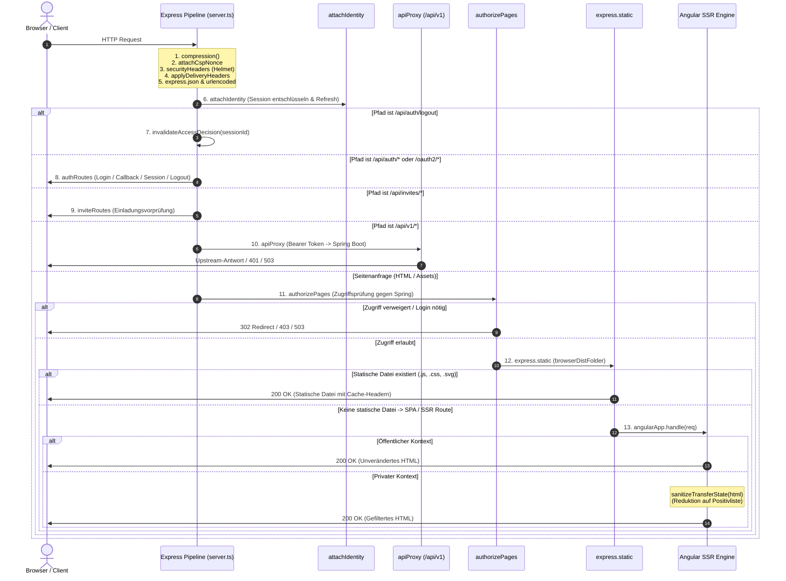

# 🔄 02. Request-Pipeline, Delivery-Header & SSR

Dieses Kapitel dokumentiert die exakte Ausführungsreihenfolge aller Middlewares in `webservice/src/server.ts`, das serverseitige Rendering mit Angular SSR sowie die zentralen Sicherheits-, Cache- und Transfer-State-Mechanismen.

---

## 🌊 Die Middleware-Pipeline im Überblick

Jeder eingehende HTTP-Request durchläuft die Express-5-Pipeline in einer streng determinierten Reihenfolge. Die Platzierung jeder Middleware folgt sicherheits- und zustandsspezifischen Prinzipien.



---

## 🔍 `server.ts` – Middleware-Reihenfolge & Begründung

In `webservice/src/server.ts` ist die Pipeline wie folgt aufgebaut:

### 1. `compression()`
- **Zweck**: Komprimiert HTTP-Antworten (Gzip/Deflate).
- **Position**: Ganz am Anfang, damit sowohl statische Dateien als auch dynamisch gerenderte SSR-Antworten komprimiert werden können. `Vary: Accept-Encoding` wird konsistent mitgeführt.

### 2. `attachCspNonce`
- **Zweck**: Generiert für jede Anfrage eine kryptografisch zufällige 16-Byte Base64-Nonce (`res.locals['cspNonce'] = randomBytes(16).toString('base64')`).
- **Position**: Unmittelbar vor `securityHeaders`, damit Helmet die Nonce in die `script-src`-Direktive der CSP einbetten kann.

### 3. `securityHeaders` (Helmet)
- **Zweck**: Setzt grundlegende HTTP-Sicherheitsheader (Content-Security-Policy, Framing-Schutz, MIME-Sniffing-Blocker, COOP, CORP).
- **Position**: Vor allen Routen, damit auch Fehler- und Redirect-Antworten vollständig geschützt sind.

### 4. `applyDeliveryHeaders`
- **Zweck**: Weist jeder Anfrage abhängig vom Pfad die exakten `Cache-Control`-, `Vary`- und `Strict-Transport-Security`-Header zu.
- **Position**: Vor dem Body-Parsing und Routing, um Caching-Header zentral und konsistent festzulegen.

### 5. `express.json()` & `express.urlencoded({ extended: true })`
- **Zweck**: Parst JSON- und Form-Payloads in `req.body`.
- **Position**: Vor `attachIdentity` und den API-Routen.

### 6. `attachIdentity`
- **Zweck**: Liest und entschlüsselt das Session-Cookie, führt bei Bedarf einen automatischen Token-Refresh durch und hängt die Benutzeridentität an `req.identity` bzw. `req.sessionData`.
- **Position**: Vor allen Routen-Handlern und vor dem API-Proxy, damit diese synchron auf die authentifizierte Identität zugreifen können.

### 7. Logout-Cache-Invalidierung (`/api/auth/logout`)
- **Zweck**: Ruft `invalidateAccessDecision(req.sessionData?.sessionId)` auf, bevor der Logout verarbeitet wird. Verhindert, dass nachfolgende Sessions alte Berechtigungen erben.

### 8. `authRoutes`
- **Zweck**: Behandelt Login, OIDC-Callback, Session-Status und Logout. Gemountet unter `/api/auth`, `/oauth2/authorization` und `/login/oauth2/code`.

### Schutz vor den Routen (`security/request-guards.ts`)
- **`trust proxy`**: Nur Caddy im privaten Container-Netz darf `X-Forwarded-For` setzen; direkte Clients können ihre IP nicht fälschen. `x-powered-by` ist abgeschaltet.
- **`crossSiteRequestGuard`**: Lehnt schreibende Anfragen ab, die nicht von der eigenen Seite stammen (`Sec-Fetch-Site`, ersatzweise `Origin`). Das schützt auch gegen andere Subdomains derselben Domain.
- **Rate-Limits** (`rateLimit`, im Speicher des Prozesses): öffentliche Token-Pfade (Einladungen, Gast-Zugang) 30 je IP in 15 Minuten, Gast-Chat 60 je Minute, Login-Start (`/api/auth/login`, `/oauth2/authorization`) 120 je IP in 5 Minuten, übrige API 600 je Sitzung und Minute.
- **API-Proxy**: reicht nur Pfade unter `/api/v1` weiter und verwirft `..` sowie kodierte Schrägstriche.

### 9. `/api/invites` (`inviteRoutes`)
- **Zweck**: Syntaktische Vorab-Validierung von Einladungstokens.

### 10. `/api/v1` (`apiProxy`)
- **Zweck**: Leitet fachliche API-Aufrufe an Spring Boot weiter und injiziert das Bearer-Token.

### 11. `authorizePages`
- **Zweck**: Autorisierungsprüfung für Seitenaufrufe (SSR & HTML).
- **Position**: **Vor** `express.static` und dem SSR-Handler! Ungeschützte statische HTML-Seiten oder SSR-Rendervorgänge dürfen für unautorisierte Nutzer gar nicht erst gestartet werden.

### 12. `express.static`
- **Zweck**: Liefert statische Build-Artefakte (`main-*.js`, Styles, Bilder) aus dem `browser/`-Ordner aus.
- **Konfiguration**:
  - `index: false`: Verhindert die automatische Auslieferung von `index.html` als statische Datei (damit Angular SSR greift).
  - `redirect: false`: Unterbindet automatische Slash-Redirects.
  - `cacheControl: false`: Verhindert, dass Express Standard-Cache-Header setzt; die Cache-Regeln stammen ausschließlich aus `applyDeliveryHeaders`.
  - `etag: true`, `lastModified: true`: Ermöglicht Revalidierung bei nicht gehashten Assets.

### 13. Angular SSR Handler (`angularApp.handle(req)`)
- **Zweck**: Führt das serverseitige Rendern der Angular-Anwendung aus.
- **Leckschutz**: Bei privaten Pfaden (`isPrivateDeliveryPath`) wird der HTML-Body vor der Auslieferung durch `sanitizeTransferState` bereinigt.

---

## 🛡️ Sicherheits- & Delivery-Header (`delivery.middleware.ts`)

Alle Auslieferungsrichtlinien werden zentral in `webservice/src/server/authorization/delivery.middleware.ts` definiert.

### Cache- & Vary-Matrix

| Ressourcentyp / Pfad | `Cache-Control` | `Vary` | Begründung |
| :--- | :--- | :--- | :--- |
| **Geschützte Pfade** (`isPrivatePath`: AppContexts, `/register/*`) | `private, no-store` | `Cookie, Accept-Encoding` | Benutzer- und sitzungsspezifische Daten dürfen niemals in Shared Caches / Proxies landen. |
| **Gehashte Build-Assets** (`isHashedAssetPath`: `main-5RAM3QJT.js` etc.) | `public, max-age=31536000, immutable` | `Accept-Encoding` | Dateiname ändert sich bei jedem Build; Inhalte können 1 Jahr unveränderlich gecacht werden. |
| **App-Shell & Öffentliche Seiten** (`index.html`, `/auth/error`, `/auth/logged-out` etc.) | `no-cache` | `Accept-Encoding` | Browser muss vor jeder Wiederverwendung beim Server revalidieren (ETag / 304). |

### Content-Security-Policy (CSP) Directives

Die CSP wird über `helmet` konfiguriert und blockiert unsichere Inline-Skripte und fremde Framing-Versuche:

```typescript
contentSecurityPolicy: {
  useDefaults: false,
  directives: {
    'default-src': ["'self'"],
    'base-uri': ["'self'"],
    'object-src': ["'none'"],
    'frame-ancestors': ["'none'"],
    'form-action': ["'self'"],
    'script-src': ["'self'", (_req, res) => `'nonce-${cspNonceOf(res as Response)}'`],
    'style-src': ["'self'", "'unsafe-inline'"], // unsafe-inline für Angular Komponentenstile erforderlich
    'img-src': ["'self'", 'data:', 'blob:'],
    'font-src': ["'self'", 'data:'],
    'connect-src': ["'self'"],
    'worker-src': ["'self'"],
    'manifest-src': ["'self'"],
    'upgrade-insecure-requests': null,
  }
}
```

### HSTS-Logik (`Strict-Transport-Security`)
- **Wert**: `max-age=31536000; includeSubDomains` (1 Jahr).
- **Bedingung**: HSTS wird nur gesetzt, wenn `isSecureRequest(req)` wahr ist (`req.secure`, `X-Forwarded-Proto: https` oder `SESSION_COOKIE_SECURE=true`). Im lokalen HTTP-Dev-Betrieb wird kein HSTS-Header gesendet, um Browser-Lockouts zu verhindern.

### Hilfsfunktionen
- `isApiRequest(req)`: Liefert `true`, wenn der Pfad mit `/api/` beginnt oder der `Accept`-Header `application/json` bzw. `application/problem+json` verlangt (ohne `text/html`). Steuert, ob Fehler als JSON-Problem oder HTML-Wartungsseite zurückgegeben werden.
- `isSecureRequest(req)`: Prüft auf aktive HTTPS-Verschlüsselung.

---

## 🔒 SSR-Leckschutz & Transfer-State (`transfer-state.ts`)

Angular SSR bettet Initialzustände im HTML-Dokument in einem `<script id="ng-state" type="application/json">`-Tag ein (*TransferState*). Um zu verhindern, dass vertrauliche Backend-Daten (Guthaben, Buchungen, Tokens) versehentlich an den Browser geleakt werden, filtert `sanitizeTransferState` diesen Block für alle privaten Kontexte.

### 1. Positivliste (`TRANSFER_STATE_ALLOWLIST`)
Ausschließlich diese Schlüssel dürfen im gerenderten Transfer-State verbleiben:
- `appContext`
- `title`
- `description`
- `access`
- `locale`
- `theme`
- `buildVersion`
- `featureFlags`

Alle anderen Felder werden vor der Auslieferung verworfen.

### 2. Verbotene Muster (`FORBIDDEN_HTML_PATTERNS`)
Zur Absicherung und in Tests wird das HTML gegen verbotene Muster geprüft:
- JWTs (`/\beyJ[A-Za-z0-9_-]{10,}/`)
- Token-Schlüsselwörter (`accessToken`, `refreshToken`, `idToken`, `Bearer ...`)
- Finanz- und Gastdaten (`balance`, `ledger`, `guestToken`)
- E-Mail-Adressen (`/[A-Za-z0-9._%+-]+@[A-Za-z0-9.-]+\.[A-Za-z]{2,}/`)

---

## 🏁 Serverstart & Lifecycle

Am Ende von `webservice/src/server.ts` wird der Server initialisiert:

```typescript
if (isMainModule(import.meta.url) || process.env['pm_id']) {
  assertServerEnvironment(serverEnvironment);

  const port = serverEnvironment.port;
  app.listen(port, (error) => {
    if (error) throw error;
    console.log(`Node Express server listening on http://localhost:${port}`);
    console.log(
      `Keycloak-Realm ${serverEnvironment.keycloakRealm}, Fachservice ${serverEnvironment.springApiBaseUrl}`,
    );
  });
}

export const reqHandler = createNodeRequestHandler(app);
```

- `isMainModule(import.meta.url)` / `process.env['pm_id']`: Stellt sicher, dass der Port nur gebunden wird, wenn die Datei als Hauptprozess (oder unter PM2) ausgeführt wird.
- `assertServerEnvironment`: Validiert alle Pflicht-Secrets vor dem Start (*Fail-Fast*).
- `reqHandler`: Exportiert den Request-Handler für serverlose Umgebungen oder Testrunner via `@angular/ssr/node`.
