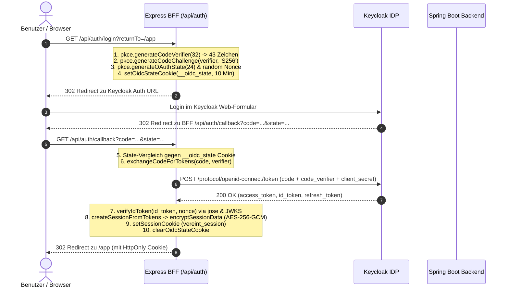
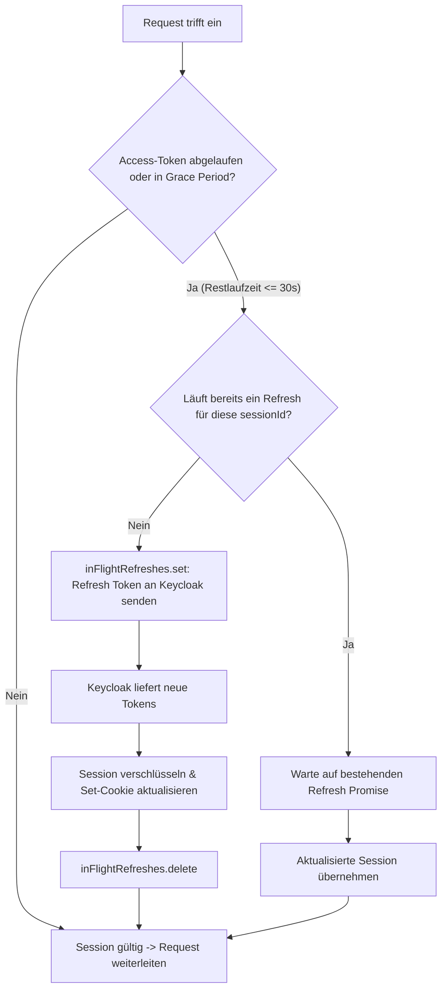

# 🔑 03. Authentifizierung, Session & OIDC

Dieses Kapitel beschreibt die serverseitige Authentifizierung über OpenID Connect (OIDC) und PKCE gegen Keycloak, das kryptografische Session-Management mit AES-256-GCM und HKDF, den automatischen Token-Refresh, den Logout-Ablauf sowie Sicherheitsmechanismen gegen Open Redirects und Token-Leaks.

---

## 🔄 OIDC Authorization Code Flow mit PKCE

Um Tokens vor dem Zugriff im Browser zu schützen, wickelt der Express-Server den OIDC Authorization Code Flow nach RFC 7636 (*Proof Key for Code Exchange*) vollständig serverseitig ab.



### Die Phasen des Ablaufs im Detail:

1. **Login-Start (`handleLogin`)**:
   - `resolveSafeReturnTo`: Prüft das Ziel gegen `KNOWN_APP_PREFIXES`.
   - `generateCodeVerifier(32)`: Erzeugt 32 Bytes Zufallsdaten, base64url-kodiert (43 Zeichen, RFC 7636).
   - `generateCodeChallenge(verifier, 'S256')`: Berechnet den SHA-256-Hash des Verifiers.
   - `generateOAuthState(24)` & `nonce`: Schutz gegen CSRF und Replay-Angriffe.
   - `setOidcStateCookie`: Legt den State (`OidcTransactionState`) verschlüsselt/geschützt im Cookie `__oidc_state` ab (Lebensdauer: 10 Minuten = 600 Sekunden).
   - `302 Redirect` auf Keycloaks `/protocol/openid-connect/auth`.

2. **Callback-Verarbeitung (`handleCallback`)**:
   - Liest `code` und `state` aus Query oder Body.
   - Liest `__oidc_state` aus dem Cookie und validiert:
     - Übereinstimmung von `state`.
     - Gültigkeitsdauer (`OIDC_STATE_MAX_AGE_MS = 600.000 ms`).
   - `exchangeCodeForTokens`: Sendet `code` und `code_verifier` an Keycloaks Token-Endpunkt unter Verwendung des `KEYCLOAK_CLIENT_SECRET`.
   - `verifyIdToken`: Prüft Signatur gegen Keycloaks JWKS-Zertifikate (`/protocol/openid-connect/certs`), validiert `iss`, `aud` (Client-ID), `exp` und gleicht den `nonce`-Claim ab.
   - `createSessionFromTokens`: Verschlüsselt die Tokens und Identitätsdaten, setzt das Session-Cookie und löscht das State-Cookie.
   - Leitet den Benutzer auf das sichere Ziel (`returnTo`) weiter.

---

## 🗺️ Auth-Routen & Endpunkte

Alle Routen werden in `webservice/src/server/routes/auth.routes.ts` definiert und sind in `server.ts` unter drei Präfixen gemountet:
- `/api/auth`
- `/oauth2/authorization`
- `/login/oauth2/code`

| Methode | Pfad | Beschreibung | Statuscodes & Verhalten |
| :--- | :--- | :--- | :--- |
| `GET` | `/login` | Startet den OIDC/PKCE Login-Flow. | `302 Redirect` zur Keycloak Login-Maske. |
| `GET`, `POST` | `/callback` | Verarbeitet den Authorization-Code von Keycloak. | `302 Redirect` zum `returnTo`-Pfad (bei HTML-Accept) oder `200 OK` JSON; `400` / `302 /web/login?error=...` bei ungültigem State/Code. |
| `GET` | `/keycloak` | Kombinierter Endpunkt: Verarbeitet Callback bei Vorhandensein von `code`/`error`, sonst Login-Start. | `302 Redirect`. |
| `GET` | `/me` | Liefert die Identität der aktuellen Session. | `200 OK` mit JSON `{ authenticated: true, identity: { subject, displayName, roles, boardRole, permissions } }` oder `401 Unauthorized` (`oidc_session_expired`). |
| `GET` | `/session` | Alias für `/me`. | Identisch zu `/me`. |
| `POST` | `/session` | **Legacy-Endpunkt**: Früherer Firebase-Session-Endpunkt. | **`410 Gone`** (`legacy_session_endpoint`). Token-Austausch erfolgt ausschließlich über OIDC. |
| `GET`, `POST` | `/logout` | Beendet die Session, invalidiert Caches und stößt Backchannel-Logout an. | `302 Redirect` zu Keycloak End-Session URL (bei `?redirect=true` oder HTML GET) bzw. `200 OK` JSON `{ success: true, backchannelLogout: boolean }`. |

---

## 🍪 Session-Cookie & Verschlüsselung (`session.service.ts`)

Der BFF speichert Session-Zustände **ausschließlich** serverseitig verschlüsselt im Cookie des Browsers.

```text
[Key-Version (k + 8 Hex)]:[IV (12 Byte Base64URL)]:[AuthTag (16 Byte Base64URL)]:[Ciphertext (Base64URL)]
```

### Kryptografische Details:
1. **Algorithmus**: `AES-256-GCM` (authentifizierte Verschlüsselung).
2. **Schlüsselableitung (HKDF)**:
   - Hash-Funktion: `SHA-256`
   - Info-String: `vereint.session.cookie.v1`
   - Salt: `vereint.session.hkdf.salt`
   - Schlüssellänge: 32 Byte (256 Bit)
3. **Schlüsselversionierung & Rotation**:
   - Die Version wird deterministisch aus dem Secret abgeleitet: `k` gefolgt von den ersten 8 Zeichen des SHA-256-Hashes (`sessionKeyVersion`).
   - Beim Entschlüsseln wird zuerst der aktuelle Schlüssel (`SESSION_SECRET_CURRENT`) geprüft.
   - Falls `SESSION_SECRET_PREVIOUS` konfiguriert ist, werden Cookies mit dem vorherigen Schlüssel ebenfalls transparent entschlüsselt. So können Secrets ohne Sessionverlust für eingeloggte Benutzer rotiert werden.

### Cookie-Chunking (`cookie.service.ts`):
Browser begrenzen einzelne Cookies auf maximal 4 KB. Da Access-, Refresh- und ID-Tokens zusammen diese Grenze überschreiten können:
- **Chunk-Größe (`SESSION_COOKIE_CHUNK_SIZE`)**: `3072` Zeichen.
- **Max. Chunks (`MAX_SESSION_COOKIE_CHUNKS`)**: `6`.
- **Max. Gesamtkapazität (`MAX_SESSION_COOKIE_BYTES`)**: `18.432` Bytes (18 KB).
- **Namensschema**: `vereint_session` (Teil 0), `vereint_session.1`, `vereint_session.2` bis `vereint_session.5`.
- **Cookie-Attribute**: `Path=/; HttpOnly; SameSite=Lax; Secure (in Prod); Max-Age=...`

---

## ⚡ Token-Refresh & Nebenläufigkeitssperre

Der Access-Token-Ablauf wird bei jeder Anfrage in `attachIdentity` / `verifyRequestSession` geprüft.



- **Karenzzeit (`REFRESH_GRACE_MS`)**: `30.000 ms` (30 Sekunden). Läuft das Access-Token innerhalb der nächsten 30 Sekunden ab, wird es vorzeitig erneuert.
- **Serialisierung via `inFlightRefreshes`**: Parallele Anfragen derselben Session teilen sich denselben Refresh-Vorgang über eine `Map<string, Promise<SessionData>>`. Dadurch werden Race Conditions und abgewiesene Refresh-Token-Rotationen in Keycloak zuverlässig verhindert.

---

## 🚪 Session-Zerstörung & Logout (`destroySession`)

Beim Aufruf von `/api/auth/logout`:
1. **Cache-Invalidierung**: `invalidateAccessDecision(sessionId)` verwirft sofort gecachte Rollenberechtigungen.
2. **Backchannel-Logout**: Der BFF sendet einen `POST`-Request an Keycloaks `/protocol/openid-connect/logout` mit `client_id`, `client_secret` und dem `refresh_token`.
3. **Cookie-Löschung**: Alle Session-Chunks (`vereint_session.*`) und State-Cookies werden mit `Max-Age=0` gelöscht.
4. **End-Session-Redirect**: Bei Browseraufrufen leitet der Server mit `id_token_hint` und `post_logout_redirect_uri` zu Keycloak weiter, um auch die Keycloak-SSO-Sitzung im Browser zu beenden.

---

## 🛡️ Open-Redirect-Schutz (`redirect.ts`)

Rücksprungziele (`returnTo`, `returnUrl`) werden vor jedem Redirect strikt validiert:

- **Maximale Länge**: 512 Zeichen.
- **Erlaubte Zeichen**: Keine Whitespaces, Steuerzeichen oder Backslashes (`/[\\\s\u0000-\u0008\u000e-\u001f\u007f]/`).
- **Keine absoluten oder protokollrelativen URLs**: URLs wie `https://evil.com`, `//evil.com` oder `/\evil.com` werden abgewiesen.
- **Keine URL-Encoding-Tricks**: `%2f`, `%5c` etc. werden verworfen.
- **Positivliste (`KNOWN_APP_PREFIXES`)**: Der Pfad muss mit einem bekannten Anwendungspräfix beginnen (`/app`, `/dashboard`, `/profile`, `/wallet`, `/purchases`, `/events`, `/guest`, `/catalog`, `/sublists`, `/chat`, `/notifications`, `/moments`, `/board`, `/admin`, `/tablet`, `/web/login`, `/pwa/login`, etc.).

---

## 📝 Sicherheits-Logging (`security-log.ts`)

Sicherheitsrelevante Ereignisse werden strukturiert als JSON protokolliert:

- **Ereignistypen**: `oidc_callback`, `legacy_session_endpoint`, `auth_access_resolver`, etc.
- **Outcomes**: `'allowed' | 'denied' | 'failed'`.
- **Korrelations-ID**: Jedes Ereignis erhält eine UUIDv4 (`createCorrelationId`), die als `X-Request-Id` und `traceId` durchgereicht wird.
- **Leckschutz**: Die Funktion `sanitizeDetail` maskiert vertrauliche Daten (`access_token`, `refresh_token`, `id_token`, `code_verifier`, `client_secret`, `nonce`, etc.) automatisch mit `[redacted]`.
