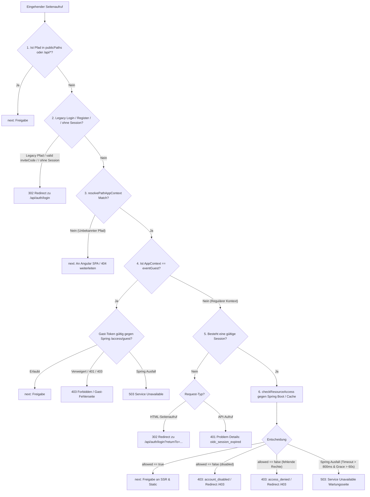

# 🛡️ 04. Seitenzugriffskontrolle & App-Kontexte

Dieses Kapitel dokumentiert die serverseitige Autorisierung von Seitenaufrufen in `webservice/src/server/authorization/authorization.middleware.ts`, das Pfadmapping auf `AppContexts`, den 5-Stufen-Entscheidungsbaum von `authorizePages`, die Anbindung an den Spring-Boot-Rechte-Resolver sowie den LRU-Entscheidungscache.

---

## 🗺️ AppContexts & Pfad-Mapping

Um feingranulare Zugriffsregeln durchzusetzen, ordnet `resolvePathAppContext(pathname)` jeden URL-Pfad einem standardisierten `AppContext` zu.

```typescript
export type AppContext =
  | 'memberPwa'
  | 'event'
  | 'eventOwner'
  | 'boardGeneral'
  | 'boardTreasury'
  | 'boardCommunications'
  | 'admin'
  | 'tabletRecorder'
  | 'eventGuest';
```

### Pfad-zu-Kontext-Zuordnungstabelle

| URL-Pfad / Präfix | Zugewiesener `AppContext` | Login-Ziel bei fehlender Session | Beschreibung |
| :--- | :--- | :--- | :--- |
| `/admin`, `/admin/*` | `admin` | `/api/auth/login?returnTo=/admin` | Administrationsbereich (Benutzer, Rollen, System). |
| `/board/treasury`, `/board/treasury/*` | `boardTreasury` | `/api/auth/login?returnTo=/board/treasury` | Kassen- und Finanzverwaltung des Vorstands. |
| `/board/communications`, `/board/communications/*` | `boardCommunications` | `/api/auth/login?returnTo=/board/communications` | Kommunikations- und Rundschreibungsbereich. |
| `/board`, `/board/*` | `boardGeneral` | `/api/auth/login?returnTo=/board` | Allgemeiner Vorstandsbereich. |
| `/tablet`, `/tablet/*` | `tabletRecorder` | `/api/auth/login?returnTo=/tablet` | Kiosk-Strichlisten-Modus für Thekengeräte. |
| `/guest/:eventId/*` | `eventGuest` | *(Gast-Token)* | Passwörterloser Gastzugang für Veranstaltungen. |
| `/events/:eventId/manage/*` | `eventOwner` | `/api/auth/login?returnTo=/events/...` | Veranstaltungsverwaltung für Ersteller/Verantwortliche. |
| `/events/:eventId/*` | `event` | `/api/auth/login?returnTo=/events/...` | Einzelansicht einer Veranstaltung für Mitglieder. |
| `/app`, `/dashboard`, `/profile`, `/wallet`, `/purchases`, `/events`, `/catalog`, `/sublists`, `/chat`, `/notifications`, `/moments` | `memberPwa` | `/api/auth/login?returnTo=...` | Reguläre PWA-Mitgliederansichten. |
| `/auth/error`, `/auth/logged-out`, `/invite/accept`, `/403`, `/404` | *(Öffentlich / `publicPaths`)* | *(Kein Login nötig)* | Öffentliche Seiten ohne Zugriffsbeschränkung. |
| `/` | `memberPwa` *(über `homeGuard`)* | `/api/auth/login` *(ohne Session)* | Startseite: leitet unauthentifiziert direkt zum Login, authentifiziert auf die kontextabhängige Startseite. |
| `/login`, `/web/login`, `/pwa/login`, `/password-reset` | *(Legacy)* | `302 /api/auth/login` | Alte Login- und Reset-URLs leiten per 302 auf den Keycloak-Login weiter (`returnUrl` wird zu `returnTo`). |
| `/register/:inviteCode` | *(Einladung)* | `302 /api/auth/login` / `/404` | Gültiger Code leitet per 302 zu `/api/auth/login`, ungültiger zu `/404`. |
| Unbekannte Pfade (z. B. `/impressum`) | `null` | *(Kein BFF-Block)* | Werden an Angular durchgereicht (SPA-404-Handling). |

---

## 🌳 Der 5-Stufen-Entscheidungsbaum (`authorizePages`)

Bevor statische Assets ausgeliefert oder das Angular-SSR gestartet wird, durchläuft die Anfrage die Middleware `authorizePages`.



---

## 🔄 Autorisierungs-Service & Resilienz (`authorization.service.ts`)

Die verbindliche Definition aller Berechtigungen liegt im Spring-Boot-Fachservice (`RolePermissionMatrix.kt`). Der Express-BFF leitet keine Rechte mehr eigenmächtig ab, sondern fragt Spring über `GET /api/v1/auth/access` an.

### Resilienz- und Timeout-Parameter:
- **Resolver-Timeout (`RESOLVER_TIMEOUT_MS`)**: `800 ms`. Antwortet Spring Boot nicht innerhalb von 800 Millisekunden, bricht der Request ab, um das SSR-Rendering nicht zu blockieren.
- **Stale Grace Period (`RESOLVER_STALE_GRACE_MS`)**: `60.000 ms` (60 Sekunden). Bei einem Verbindungsabbruch oder Timeout darf eine zuvor gecachte, abgelaufene Entscheidung bis zu 60 Sekunden weiterverwendet werden.
- **Fail Closed**: Konnte auch im Stale-Cache keine Entscheidung gefunden werden, verweigert der Server strikt den Zugriff (`503 Service Unavailable` mit `Retry-After: 30`). Ein "stilles Durchwinken" ist ausgeschlossen.

---

## ⚡ In-Memory-Entscheidungscache (`access-decision-cache.ts`)

Um Netzwerk-Latenzen bei jedem SSR-Seitenwechsel zu vermeiden, speichert der BFF Zugriffsentscheidungen kurzzeitig im Arbeitsspeicher:

- **Algorithmus**: LRU (*Least Recently Used*) basierend auf JavaScript `Map`.
- **TTL (`ACCESS_DECISION_TTL_MS`)**: `45.000 ms` (45 Sekunden).
- **Kapazitätsgrenze (`ACCESS_DECISION_CACHE_LIMIT`)**: Maximal `500` Sitzungen gleichzeitig. Älteste Einträge werden bei Überschreitung automatisch verdrängt.

### Cache-Invalidierungs-Ereignisse:
- **Logout**: `invalidateAccessDecision(sessionId)` löscht den Cache-Eintrag sofort.
- **Rollen- / Statusänderungen**: `invalidateAccessDecisionsForSubject(subject)` verwirft alle Einträge einer Person, wenn ein Administrator deren Rollen oder Deaktivierungsstatus ändert.
- **Vollständiger Reset**: `clearAccessDecisionCache()` (z. B. in Tests).

---

## 🎟️ Gastzugang für Veranstaltungen (`eventGuest`)

Gäste ohne Vereinskonto können über einen Einladungslink auf Veranstaltungsdetails zugreifen:
1. **Pfad**: `/guest/:eventId`
2. **Token-Quellen**: Query-Parameter `?token=...`, Header `X-Guest-Token` oder Cookie `guest_token`.
3. **Validierung**: Express fragt `GET /api/v1/auth/access/guest?eventId=...&token=...` bei Spring Boot an.
4. **Ergebnis**:
   - `200 OK`: Gast darf die Event-Ansicht nutzen.
   - `401 / 403`: Ungültiges oder abgelaufenes Token führt zu einer 403-Fehlerseite.
   - `503`: Bei Spring-Ausfall wird `sendServiceUnavailable` ausgelöst.

---

## 📋 Fehlerformate & RFC-7807 Problem Details

Alle abgewiesenen Anfragen liefern standardisierte Fehlerstrukturen:

### Für API-Aufrufe (`application/problem+json`):
```json
{
  "type": "about:blank",
  "title": "Forbidden",
  "status": 403,
  "detail": "Für diesen Bereich fehlen die erforderlichen Berechtigungen.",
  "code": "access_denied",
  "instance": "/admin",
  "traceId": "c8a4b62f-9231-4e76-8025-a18c642bfde1"
}
```

### Für HTML-Seitenaufrufe:
- **Unauthentifiziert**: `302 Redirect` auf `/api/auth/login?returnTo=...`.
- **Fehlende Berechtigung**: `302 Redirect` auf `/403`.
- **Wartung / Ausfall (503)**: Vollständige HTML-Wartungsseite (*"Zugriff derzeit nicht prüfbar"*) mit `Retry-After: 30`-Header.
