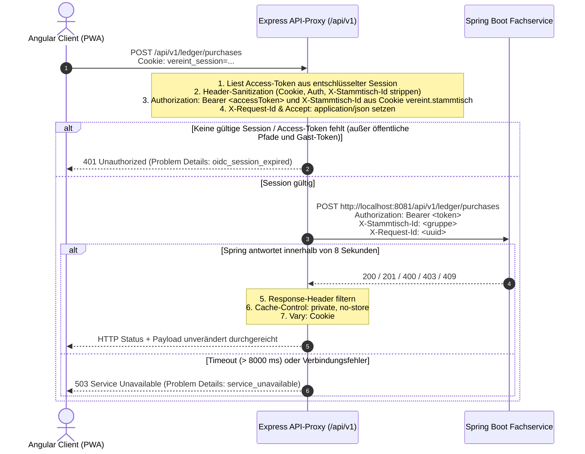

# 🔌 05. API-Proxy & Einladungs-Validierung

Dieses Kapitel dokumentiert die Weiterleitung fachlicher REST-Anfragen über den Same-Origin-Proxy in `webservice/src/server/api/api-proxy.middleware.ts` sowie die syntaktische Vorprüfung von Einladungscodes in `webservice/src/server/invites/invite.routes.ts`.

---

## 🔀 Der Same-Origin API-Proxy (`/api/v1/*`)

Um Cross-Origin-Probleme (CORS) zu vermeiden und sicherzustellen, dass keine OIDC-Tokens im Browser gespeichert werden müssen, greift das Angular-Frontend ausschließlich same-origin auf `/api/v1/*` zu.



---

## ⚙️ Proxy-Konfiguration & Header-Regeln

Der Proxy fungiert als reine Durchleitungsschicht (*Transparent Gateway*) mit automatischer Bearer-Token-Anreicherung:

### 1. Header-Stripping beim Weiterleiten (Request)
Um Header-Kollisionen und Sicherheitslecks zu verhindern, entfernt der Proxy folgende Client-Header, bevor die Anfrage an Spring Boot gesendet wird (`STRIPPED_REQUEST_HEADERS`):
- `host`
- `connection`
- `cookie`
- `authorization` (überschrieben durch das serverseitige Keycloak-Token)
- `content-length`
- `accept-encoding`
- `x-stammtisch-id` (die Gruppe kommt ausschließlich aus dem Cookie des BFF)

### 2. Header-Injektion (Request)
- `Authorization`: `Bearer <accessToken>` aus der Session.
- `X-Stammtisch-Id`: gewählte Gruppe aus dem HttpOnly-Cookie `vereint.stammtisch` (nur mit Session). Der Fachservice prüft die Mitgliedschaft selbst.
- `X-Request-Id`: Vorhandene `X-Request-Id` (falls `^[\w.-]{1,128}$`) oder neu generierte UUIDv4 (`requestId`).
- `Accept`: Standardmäßig `application/json`, falls vom Client nicht gesetzt.

### 3. Response-Header-Filterung & Caching
Vom Fachservice zurückgelieferte Antworten werden gefiltert:
- Entfernt werden: `content-length`, `transfer-encoding`, `connection` (`STRIPPED_RESPONSE_HEADERS`).
- **Zwangsgesetzte Cache-Header**: Da API-Daten (Guthaben, Buchungen, persönliche Daten) niemals zwischengespeichert werden dürfen, setzt der Proxy für jede Antwort:
  - `Cache-Control: private, no-store`
  - `Vary: Cookie`
  - `X-Request-Id: <traceId>`

### 4. Pfade ohne Session
Ohne Session reicht der Proxy nur Anfragen mit Header `X-Guest-Token` sowie `/api/v1/invites/accept`, `/api/v1/member-invites/preview`, `/api/v1/member-invites/register`, `/api/v1/signup`, `/api/v1/auth/access/guest`, `/api/v1/health` und `/api/v1/info` weiter.

### 5. Pfad-Prüfung (`resolveTargetUrl`)
Pfade mit `..`, `.`, Backslashes oder kodierten Schrägstrichen und Punkten werden verworfen; das Ziel muss unter `/api/v1/` des Fachservice liegen.

### 6. Uploads und Medien-Streaming
- Multipart-Uploads (Bilder, Gruppenbild) puffert der Proxy bis `API_PROXY_MAX_UPLOAD` (`6mb`).
- Fotos und Videos in Moments (`MOMENT_MEDIA_PATH`: `/api/v1/moments/{id}/media` und `.../media/{id}/content`) laufen über `mediaStreamProxy`: ungepuffert, mit `Content-Length` und `Range`-Unterstützung (`206`). Größen- und Dauergrenzen prüft Spring, Caddy begrenzt den Körper auf 110 MB.

### 7. Timeout-Parameter
- **`API_PROXY_TIMEOUT_MS`**: `8000 ms` (8 Sekunden).
- Antwortet Spring Boot nicht innerhalb von 8 Sekunden, bricht der Request via `AbortController` ab und liefert einen `503 Service Unavailable`-Fehler.

---

## 🚨 Proxy-Fehlerbehandlung (RFC 7807)

Tritt im Proxy ein Fehler auf, antwortet Express einheitlich im RFC-7807-Format:

### 1. Nicht authentifizierte API-Anfrage (401)
```json
{
  "type": "about:blank",
  "title": "oidc_session_expired",
  "status": 401,
  "detail": "Für den Zugriff auf die fachliche API ist eine gültige Sitzung erforderlich.",
  "instance": "/api/v1/profile",
  "code": "oidc_session_expired",
  "traceId": "b6f52e2c-3574-4b53-8b77-cf890289ab72",
  "timestamp": "2026-09-25T22:00:00.000Z"
}
```

### 2. Fachservice nicht erreichbar oder Timeout (503)
```json
{
  "type": "about:blank",
  "title": "service_unavailable",
  "status": 503,
  "detail": "Der Fachservice ist derzeit nicht erreichbar.",
  "instance": "/api/v1/ledger/purchases",
  "code": "service_unavailable",
  "traceId": "b6f52e2c-3574-4b53-8b77-cf890289ab72",
  "timestamp": "2026-09-25T22:00:00.000Z"
}
```

---

## 🎟️ Einladungs-Validierung (`/api/invites/*`)

Der Express-Server stellt einen Vorvalidierungs-Endpunkt für Einladungscodes bereit:

- **Route**: `GET /api/invites/:code`
- **Controller**: `webservice/src/server/invites/invite.routes.ts`
- **Service**: `webservice/src/server/invites/invite.service.ts`

### Syntaktische Vorprüfung:
```typescript
export async function validateInvite(code: string): Promise<ValidatedInvite | undefined> {
  if (!/^[A-Za-z0-9_-]{16,256}$/.test(code)) return undefined;
  return { type: 'member' };
}
```

### Sicherheitsprinzip (*Express ist keine Sicherheitsgrenze*):
1. Die Express-Prüfung prüft ausschließlich, ob der Code wohlgeformt ist (16 bis 256 alphanumerische Zeichen inkl. `-` und `_`), um offensichtlich unbrauchbare Eingaben frühzeitig mit `404 { error: 'invite-not-found' }` abzuweisen.
2. **Die verbindliche Einlösung, kryptografische Verifikation und Berechtigungszuweisung erfolgt ausschließlich in Spring Boot** (`deny by default`): Einladungslinks in eine Gruppe über `POST /api/v1/member-invites/preview`, `/register` (neues Konto) bzw. `/join` (bestehendes Konto), Gast-Einladungen zu Events über `POST /api/v1/invites/accept`.
3. Der BFF nutzt `validateInvite` außerdem für die alte Form `/register/<code>`, die er auf `/register#<code>` umleitet.
