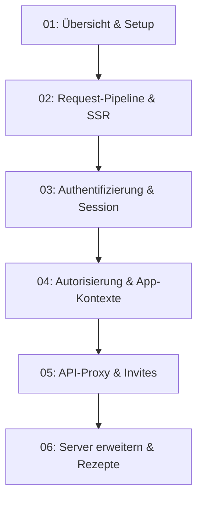

# 🌐 Backend-for-Frontend (Express 5 BFF)

Herzlich willkommen in der technischen Dokumentation des **Vereint Backend-for-Frontend (BFF)**. Dieses Modul verbindet den Browser-Client (Angular 22 SSR & PWA) sicher mit dem Identity-Provider (Keycloak) und dem Fachservice (Spring Boot).

---

## 🧭 Zielgruppe & Lernpfad für Entwickler

Diese Dokumentation richtet sich an alle Entwicklerinnen und Entwickler, die den Node.js/Express-Server verstehen, lokal betreiben, debuggen oder erweitern möchten.



1. **[01. Übersicht & Setup](01-overview-and-setup.md)**: Rolle des BFF, Tech-Stack, Verzeichnisstruktur, Skripte und vollständige Referenz aller Umgebungsvariablen.
2. **[02. Request-Pipeline & Header](02-request-pipeline.md)**: `server.ts` Zeile für Zeile, Middleware-Reihenfolge, Helmet/CSP, Cache-Strategien und SSR-Transfer-State-Schutz.
3. **[03. Authentifizierung & Session](03-authentication-and-session.md)**: OIDC Authorization Code Flow mit PKCE, Cookie-Verschlüsselung (AES-256-GCM + HKDF), Token-Refresh und Logout.
4. **[04. Autorisierung & Kontexte](04-authorization.md)**: AppContexts, 5-Stufen-Entscheidungsbaum von `authorizePages`, LRU-Cache, Stale-Grace-Resilienz und Fehlerformate.
5. **[05. API-Proxy & Einladungen](05-api-proxy-and-invites.md)**: Same-Origin `/api/v1/*` Weiterleitung mit automatischem Bearer-Token-Anhang und Einladungscode-Validierung.
6. **[06. Server erweitern & How-Tos](06-extending-the-server.md)**: Schritt-für-Schritt-Rezepte (neue Route, neuer Kontext, neue Env-Variable), Testen mit Vitest, Debugging und Checklisten.

---

## 🏛️ Gesamtarchitektur & Datenflüsse

Der Express-Server fungiert als vertrauenswürdige Zwischenschicht (*Confidential Client* im OIDC-Sinn). Tokens (Access-, Refresh- und ID-Token) verlassen den Server **niemals** in Richtung Browser.

```mermaid
graph LR
  subgraph Client
    B[Browser / PWA]
  end

  subgraph BFF["Express 5 BFF (Port 4300)"]
    S[Delivery & Security Headers]
    I[attachIdentity]
    A[authRoutes]
    P[apiProxy]
    Z[authorizePages]
    ST[express.static]
    SSR[Angular SSR Engine]
  end

  subgraph Backend["Infrastruktur & Fachservice"]
    K[Keycloak (Port 8082)]
    SP[Spring Boot API (Port 8081)]
  end

  B -->|HTTP Request| S
  S --> I
  I -->|/api/auth/*| A
  I -->|/api/v1/*| P
  I -->|Seitenaufruf| Z
  Z -->|Statische Assets| ST
  Z -->|HTML Rendering| SSR

  A <-->|OIDC / PKCE / Tokens| K
  P <-->|Bearer Token Forwarding| SP
  Z <-->|GET /api/v1/auth/access| SP
  SSR -->|Sanitized HTML| B
```

---

## 📖 Glossar & Kernkonzepte

| Begriff | Definition im Vereint BFF |
| :--- | :--- |
| **BFF (Backend-for-Frontend)** | Express-5-Server (`webservice/src/server.ts`), der SSR übernimmt, OIDC-Tokens in verschlüsselten HttpOnly-Cookies kapselt und API-Anfragen transparent mit Bearer-Token versieht. |
| **Confidential Client** | OIDC-Client-Typ in Keycloak mit eigenem Client-Secret (`KEYCLOAK_CLIENT_SECRET`), das ausschließlich auf dem Server gehalten wird. |
| **AppContext** | Granulare Berechtigungsebene für Seitenbereiche (`memberPwa`, `event`, `eventOwner`, `boardGeneral`, `boardTreasury`, `boardCommunications`, `admin`, `tabletRecorder`, `eventGuest`). |
| **PKCE (RFC 7636)** | *Proof Key for Code Exchange* mit SHA-256 (`S256`). Schützt den Authorization Code Flow vor Abfangangriffen. |
| **Deny by Default** | Sicherheitsgrundsatz: Jeder Request wird standardmäßig abgewiesen, es sei denn, er erfüllt explizit alle Kriterien für eine Freigabe. |
| **Fail Closed** | Ist ein Upstream-Dienst (Keycloak oder Spring Boot) nicht erreichbar oder antwortet zu langsam, wird der Zugriff blockiert (`503 Service Unavailable`) statt unberechtigt freigegeben. |
| **Transfer-State Sanitization** | Filterung des vom Angular SSR generierten `ng-state` auf eine explizite Positivliste unkritischer Felder vor Auslieferung des HTML an den Browser. |
| **Cookie Chunking** | Aufteilung großer verschlüsselter Sitzungszustände auf bis zu 6 Teil-Cookies (`vereint_session`, `vereint_session.1` ...), um Browsergrenzen (4 KB) sicher einzuhalten. |
| **Stale Grace Period** | 60-sekündige Übergangsfrist, in der bei kurzzeitigem Spring-Ausfall eine abgelaufene Zugriffsentscheidung weiterverwendet werden darf, um Ladeabbrüche zu minimieren. |

---

## 🔗 Querverweise zu weiteren Dokumenten

- [Systemarchitektur & Komponenten](../architecture/system-overview.md)
- [Sicherheit & Authentifizierungskonzept](../architecture/security-and-auth.md)
- [REST-API-Referenz & Schnittstellen](../api/rest-api-reference.md)
- [Fehlerbehandlung & Problem Details (RFC 7807)](../api/error-handling-and-idempotency.md)
- [Lokales Setup mit Docker Compose](../operations/local-setup-docker.md)
- [Keycloak & Storage Konfiguration](../operations/keycloak-and-storage.md)
- [Frontend SSR & PWA](../frontend/angular-ssr-and-pwa.md)
