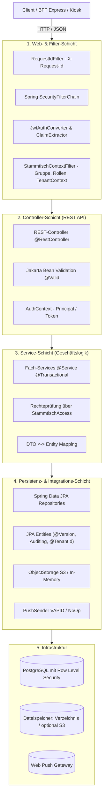
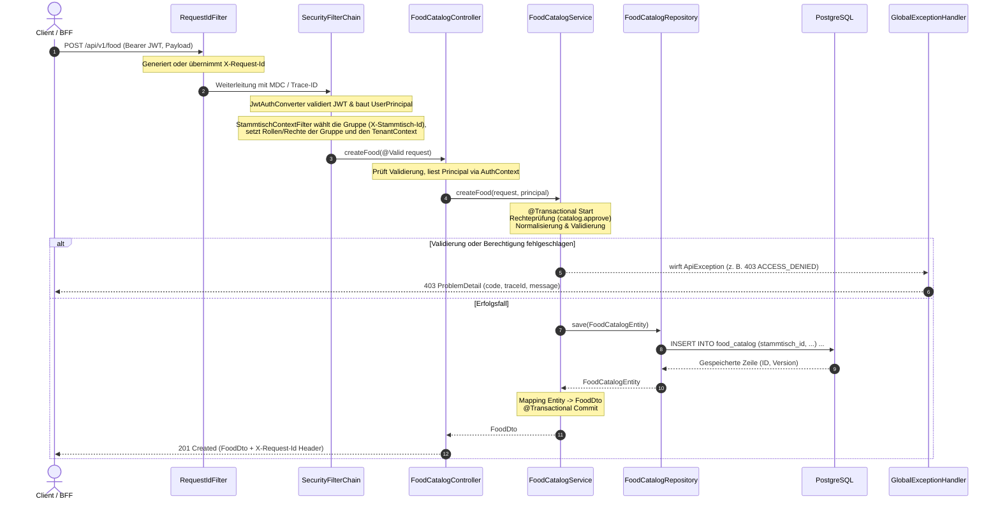

# 🏛️ Architektur, Schichten & Request-Lebenszyklus

In diesem Kapitel wird die interne Architektur des `baseservice`, das Schichtenmodell, der detaillierte Lebenszyklus eines HTTP-Requests sowie die Design-Konventionen anhand des Referenzbeispiels Speisenkatalog vorgestellt. Eine vollständige Paket- und Klassenkarte bietet zudem eine schnelle Orientierung im Quellcode.

---

## 🧱 Schichtenmodell

Der `baseservice` folgt einer sauberen, zustandslosen Schichtenarchitektur (*Layered Architecture*) mit klar abgegrenzten Verantwortlichkeiten:



---

## 🔄 Request-Lebenszyklus

Der Ablauf eines typischen API-Aufrufs – von der Header-Verarbeitung über die Authentifizierung und Transaktionssteuerung bis hin zum Fehlerhandling:



---

## 📋 Design-Konventionen am Referenzbeispiel Speisenkatalog

Die Kette **`FoodCatalogController` → `FoodCatalogService` → `FoodCatalogRepository` → `FoodCatalogEntity`** dient im gesamten Projekt als Referenz-Muster für alle Module.

### 1. Dünne REST-Controller (`FoodCatalogController.kt`)
Controller sind zustandslos, schlank und enthalten **keine Fachlogik**:
- **URL-Präfix**: `/api/v1/<ressource>`
- **OpenAPI**: `@Tag` für Gruppierung und `@Operation` für Endpunktbeschreibungen.
- **Sicherheitskontext**: Authentifizierter Benutzer wird über `authContext.getRequiredPrincipal()` bezogen.
- **ID-Parsing**: Sichere Konvertierung von Pfadvariablen mittels `Identifiers.parseUuid(id, "foodId")`.
- **Validierung**: `@Valid @RequestBody` validiert DTO-Annotationen deklarativ vor Methodenaufruf.
- **Rückgabe**: Rückgabe von `ResponseEntity<T>` mit passendem HTTP-Status (`200 OK`, `201 CREATED`).

```kotlin
@RestController
@RequestMapping("/api/v1/food")
@Tag(name = "Speisenkatalog", description = "Globaler Speisenkatalog des Vereins und Stammdatenpflege")
class FoodCatalogController(
    private val foodCatalogService: FoodCatalogService,
    private val authContext: AuthContext
) {
    @PostMapping
    @Operation(summary = "Speise anlegen")
    fun createFood(@Valid @RequestBody request: CreateFoodRequest): ResponseEntity<FoodDto> {
        val principal = authContext.getRequiredPrincipal()
        val food = foodCatalogService.createFood(request, principal)
        return ResponseEntity.status(HttpStatus.CREATED).body(food)
    }
}
```

### 2. Transaktionale Fach-Services (`FoodCatalogService.kt`)
Services kapseln die vollständige Business-Logik:
- **Transaktionsklammer**: Klassen-Annotation `@Service @Transactional`. Leseoperationen werden mit `@Transactional(readOnly = true)` optimiert.
- **Berechtigungsprüfung**: Prüfung der Rechte in der aktuellen Gruppe im Service-Code (z. B. `isBoardOrAdmin(caller, principal)`, das intern `StammtischAccess` fragt).
- **Normalisierung & Guard Clauses**: String-Bereinigung (`normalizeName`), Trimmen und Whitelist-Checks.
- **Fachliche Fehler**: Auslösen von typsicheren `ApiException`-Subklassen (`InvalidRequestException`, `AccessDeniedException`, `ResourceNotFoundException`) mit definierten `ErrorCode`-Konstanten.
- **Entity-DTO-Mapping**: Private Mapping-Funktionen (`toFoodDto`, `toSummaryDto`), sodass Entities die Service-Schicht niemals verlassen.

### 3. Unveränderliche DTOs (`FoodDtos.kt`)
- **Request-DTOs**: Data Classes mit Validierungs-Annotationen (`@field:NotBlank`, `@field:DecimalMin("0.00")`).
- **Response-DTOs**: Vollständige Datensätze für Detailansichten (`FoodDto`).
- **Summary-DTOs**: Kompakte Datensätze für Listenansichten zur Reduzierung von Payload und DB-Last (`FoodSummaryDto`).

### 4. JPA-Entities & Repositories (`FoodEntities.kt`, `Repositories.kt`)
- **Primärschlüssel**: UUIDs mit Default `UUID.randomUUID()`.
- **Gruppenzugehörigkeit**: Fachliche Entities erben von `StammtischScoped` (`@TenantId stammtischId`); Hibernate setzt die Gruppe beim Anlegen und filtert jede Abfrage danach.
- **Auditing**: `@EntityListeners(AuditingEntityListener::class)` mit `@CreatedDate` und `@LastModifiedDate` (UTC `Instant`).
- **Optimistic Locking**: `@Version var version: Long = 0` verhindert unbeabsichtigtes Überschreiben bei parallelem Zugriff.
- **Spring Data Repository**: Interfaces erweitern `JpaRepository<Entity, UUID>` mit sprechenden Abfragemethoden (`findByActiveTrueOrderByNameAsc()`).

---

## 🗺️ Paket- & Klassenkarte

Unter `de.maurer.baseservice` sind alle Controller und Services modular organisiert:

### Controller-Übersicht (`de.maurer.baseservice.controller`)

| Controller | Endpunkt-Basis | Zweck & Fachdomäne | Querverweis |
| :--- | :--- | :--- | :--- |
| `AccessResolverController` | `/api/v1/auth/access` | Berechnete AppContexts & Berechtigungen für BFF & Gast | [03. Security](03-security-and-authorization.md) |
| `ApiInfoController` | `/api/v1/info` | Öffentliche Versions- und Feature-Informationen | [05. Observability](05-error-handling-and-observability.md) |
| `AuditLogController` | `/api/v1/audit-logs` | Audit-Log-Abfragen für Vorstand und Admin | [Kassenbuch](../domains/ledger-and-finance.md) |
| `AuthController` | `/api/v1/auth` | Session-Kontext des angemeldeten Kontos (`/me`) | [03. Security](03-security-and-authorization.md) |
| `StammtischExportController` | `/api/v1/stammtisch/export` | Datenexport der gewählten Gruppe als JSON | [Gruppen](../domains/stammtische.md) |
| `ChatController` | `/api/v1/events/{eventId}/chat` | Event-Chat und Gast-Chat | [Chat & Push](../domains/chat-and-push-notifications.md) |
| `ConversationController` | `/api/v1/conversations` | Gruppenchat, Direktchats, Lesestand, Reaktionen, Infotafel | [Chat & Push](../domains/chat-and-push-notifications.md) |
| `DrinkCatalogController` | `/api/v1/drinks` | Getränkekatalog der Gruppe & Freigabe-Workflow | [Getränkekatalog](../domains/drink-catalog-and-sublists.md) |
| `DrinkLibraryController` | `/api/v1/drink-library` | Gemeinsame Getränkedatenbank (Pflege durch Plattform-Admin) | [Getränkekatalog](../domains/drink-catalog-and-sublists.md) |
| `DrinkSublistController` | `/api/v1/sublists` | Getränke-Sublisten für Veranstaltungen | [Getränkekatalog](../domains/drink-catalog-and-sublists.md) |
| `EventController` | `/api/v1/events` | Veranstaltungs-Lebenszyklus, Teilnehmer, Einladungen, Zusagen | [Events](../domains/events-and-invites.md) |
| `EventDrinkController` | `/api/v1/events/{eventId}/drinks` | Eventbezogene Getränkepreise und Freigaben | [Getränkekatalog](../domains/drink-catalog-and-sublists.md) |
| `EventFoodController` | `/api/v1/events/{eventId}/food` | Eventbezogene Speisenauswahl & Freigaben | [Speisen](../domains/food-catalog-and-event-food.md) |
| `FoodCatalogController` | `/api/v1/food` | Speisenkatalog, Preise und Einkaufspreise | [Speisen](../domains/food-catalog-and-event-food.md) |
| `HealthController` | `/api/v1/health` | Öffentlicher Health-Check | [05. Observability](05-error-handling-and-observability.md) |
| `ImageController` | `/api/v1/images` | Upload und berechtigte Auslieferung von Bildern | [06. Integrationen](06-integrations.md) |
| `InviteController` | `/api/v1/events/{eventId}/invites`, `/api/v1/invites/accept` | Gast-Einladungen zu Events | [Events](../domains/events-and-invites.md) |
| `KioskController` | `/api/v1/kiosk/sessions` | Kiosk-Modus mit PIN am Thekenterminal | [Thekenterminal](../domains/tablet-strichliste-recorder.md) |
| `LedgerController` | `/api/v1/ledger` | Salden, Käufe, Einzahlung, Auszahlung, Korrektur, Storno | [Kassenbuch](../domains/ledger-and-finance.md) |
| `MemberInviteController` | `/api/v1/member-invites` | Einladungslinks, Registrierung und Beitritt mit bestehendem Konto | [Einladungslinks](../domains/member-invites.md) |
| `MomentConfigController` | `/api/v1/moment-config` | Moment-Themen und Reaktionen der Gruppe | [Moments](../domains/moments-and-rituals.md) |
| `MomentController` | `/api/v1/moments` | Moments, Antworten, Karte, Fotos und Videos | [Moments](../domains/moments-and-rituals.md) |
| `NotificationController` | `/api/v1/notifications` | Benachrichtigungen, Push-Abonnements, Rundnachricht | [Chat & Push](../domains/chat-and-push-notifications.md) |
| `StammtischController` | `/api/v1/stammtische`, `/api/v1/stammtisch`, `/api/v1/signup`, `/api/v1/platform/stammtische` | Gruppen eröffnen, wählen, verwalten und verlassen, Rollen der Gruppe, Plattform-Administration | [Gruppen](../domains/stammtische.md) |
| `StatisticsController` | `/api/v1/statistics` | Kennzahlen und Auswertungen | [Statistik](../domains/statistics-and-analytics.md) |
| `TabletRecorderController`| `/api/v1/tablet` | Strichlisten-Erfassung am Thekenterminal & Abendabrechnung | [Thekenterminal](../domains/tablet-strichliste-recorder.md) |
| `UserController` | `/api/v1/users` | Profile, Mitgliederverzeichnis, Rollen und Rechte zuweisen, Sperren | [Benutzer](../domains/auth-and-user-management.md) |

---

### Service-Übersicht (`de.maurer.baseservice.service`, `tenancy`)

- **`AccessResolverService`**: Berechnet zugreifbare Rollen, Berechtigungen und AppContexts für das BFF.
- **`AuditService` / `AuditLogService`**: Erfassung und Abfrage sicherheits- und finanzrelevanter Ereignisse.
- **`ChatService` & `ConversationService`**: Event-, Gast-, Gruppen- und Direktchats.
- **`DrinkCatalogService`, `DrinkSublistService` & `DrinkLibraryService`**: Getränkekatalog der Gruppe, Sublisten und gemeinsame Getränkedatenbank.
- **`EventService`, `EventInvitationService`, `EventDrinkService` & `EventFoodService`**: Event-Lebenszyklus, Einladungen und Erinnerungen, Zusagen, Angebot je Event.
- **`FoodCatalogService`**: Speisenkatalog inklusive Einkaufspreisen.
- **`ImageService` & `GroupImageService`**: Bilder (Metadaten entfernen, verschlüsselt speichern) und Gruppenbild.
- **`InviteService`**: Gast-Einladungstokens für Events.
- **`MemberInviteService`**: Einladungslinks in eine Gruppe.
- **`KioskService`**: Kiosk-Sitzungen mit PIN.
- **`LedgerService`**: Unveränderliches Buchungsjournal mit Idempotenz-Schutz.
- **`MomentService`, `MomentConfigService` & `MomentMediaService`**: Moments, Typen und Reaktionen, Fotos und Videos.
- **`NotificationService`**: Benachrichtigungen und Web-Push-Abonnements.
- **`StammtischService`, `StammtischSignupService`, `MembershipService` & `PlatformService`**: Gruppen, Selbstregistrierung, Mitgliedschaften und Rollen, Plattform-Administration.
- **`StatisticsService`**: Kennzahlen.
- **`TabletRecorderService`**: Buchungen am Thekenterminal und Strichliste.
- **`RoundService`**: Runden am eigenen Handy; prüft beim Strich, ob eine Runde greift, und sperrt sie dabei.
- **`UserProvisioningService` & `UserService`**: Anlage lokaler Konten aus dem Keycloak-Token, Profile und Mitgliederverwaltung.
- **`StammtischExportService`**: Datenexport einer Gruppe als JSON.
- **`StammtischContextFilter`, `StammtischAccess`, `StammtischMemberships`** (Paket `tenancy`): Gruppenkontext, Rechteprüfung, Mitgliedschaften je Konto.

---

## 🔗 Querverweise

- Weiter zu [03. Sicherheit & Autorisierung](03-security-and-authorization.md)
- Zurück zu [01. Übersicht & Setup](01-overview-and-setup.md)
- [BFF Request-Pipeline](../backend-for-frontend/02-request-pipeline.md)
- [Dokumentationsübersicht](../README.md)
