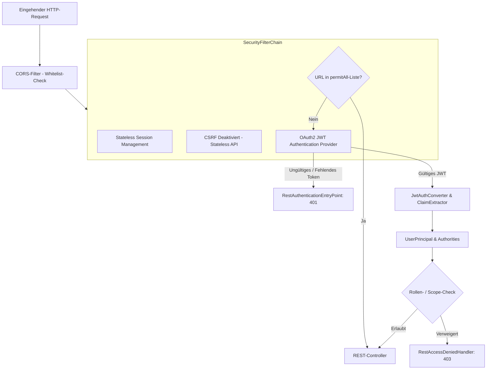
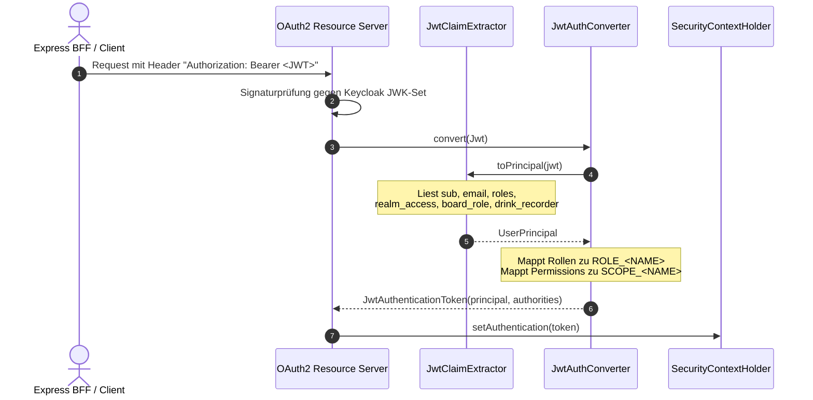

# 🔐 Sicherheit, Authentifizierung & Autorisierung

Dieses Kapitel beschreibt die Sicherheitsarchitektur des `baseservice`, einschließlich der `SecurityFilterChain`, der JWT-Token-Verarbeitung, der Rollen- und Permission-Matrix, des `AuthContext`, der automatischen Benutzerprovisionierung sowie der Absicherung von Gästen und CORS.

---

## 🛡️ Sicherheitsarchitektur & Filterkette (`SecurityConfig.kt`)

Der `baseservice` agiert als zustandsloser OAuth2/OIDC Resource Server. Das Kernprinzip lautet **Deny by Default**: Jeder Endpunkt erfordert standardmäßig eine gültige Authentifizierung, es sei denn, er ist explizit in der Positivliste freigegeben.



### 1. `permitAll()`-Positivliste
Folgende Pfade sind ohne Bearer-Token öffentlich erreichbar:
- **Health- & Info-Probes**: `/actuator/health`, `/actuator/health/liveness`, `/actuator/health/readiness`, `/actuator/info`, `/api/v1/health`, `/api/v1/info`
- **Gast-Zugang & Einladungen**: `/api/v1/auth/access/guest`, `/api/v1/invites/accept`
- **Registrierung per Einladungslink**: `/api/v1/member-invites/preview`, `/api/v1/member-invites/register` (das Token im Body ist das Geheimnis)
- **Gast-Chat**: `/api/v1/events/*/chat/guest/**` (die Autorisierung erfolgt über den kryptografischen `X-Guest-Token`-Header)
- **API-Dokumentation**: `/v3/api-docs/**`, `/swagger-ui/**`, `/swagger-ui.html` (nur erreichbar, wenn `API_DOCS_ENABLED=true`; in Produktion aus)

Alle übrigen Actuator-Endpunkte (`/actuator/**`) erfordern zwingend die Rolle `ADMIN`. Alle Fach-Endpunkte (`/api/v1/**`) erfordern standardmäßig ein gültiges JWT.

### 2. CORS-Konfiguration (`CorsProperties.kt`)
- Konfiguriert unter `vereint.cors` (`VEREIN_CORS_ALLOWED_ORIGINS`).
- Wildcards (`*`) werden aus Sicherheitsgründen verworfen.
- Gilt ausschließlich für `/api/**`.
- `allowCredentials = true` wird nur gesetzt, wenn die konfigurierte Ursprungsliste nicht leer ist.

---

## 🎟️ Token-Verarbeitung & `UserPrincipal`

Das vom Identity-Provider (Keycloak) ausgestellte JWT wird bei jedem Request validiert und in ein typsicheres `UserPrincipal`-Objekt umgewandelt.



### 1. `JwtClaimExtractor.kt`
Zentrale Komponente zur Extraktion claims-basierter Informationen aus dem `org.springframework.security.oauth2.jwt.Jwt`:
- `sub`: Eindeutige Keycloak-Benutzer-ID.
- `roles`: Zusammenführung aus flachem `roles`-Claim, `realm_access.roles` und `resource_access.<client>.roles`.
- `permissions`: Aus `permissions`-Array und leerzeichengetrenntem `scope`-Claim.
- `board_role`, `drink_recorder`, `event_scopes`: Spezifische Fach-Claims.

### 2. `UserPrincipal.kt` & `AuthContext.kt`
Das `UserPrincipal` stellt die Identität des Aufrufers dar. Das Attribut `attributes` (rohe JWT-Claims) ist mit `@JsonIgnore` versehen, damit Token-Interna niemals über JSON-Endpunkte nach außen gelangen.

Im Code wird der Principal über die Komponente `AuthContext` abgerufen:

```kotlin
@Component
class AuthContext(private val claimExtractor: JwtClaimExtractor) {
    fun getRequiredPrincipal(): UserPrincipal
    fun getCurrentPrincipal(): UserPrincipal?
    fun hasRole(role: String): Boolean
    fun hasPermission(permission: String): Boolean
    fun requireRole(role: String)           // wirft PermissionDeniedException (403)
    fun requirePermission(permission: String) // wirft PermissionDeniedException (403)
}
```

---

## 📊 Rollen- & Berechtigungsmatrix (`RolePermissionMatrix.kt`)

> **Mehrere Stammtische:** Rollen und Rechte gelten je Stammtisch. Die Matrix unten
> beschreibt nur die Startwerte der vier Systemrollen, die jeder neue Stammtisch
> erhält (`StammtischSeeder`); jeder Stammtisch kann sie anpassen und eigene Rollen
> anlegen. Keycloak-Realmrollen zählen nicht mehr, außer `admin` (Plattform-Admin).
> Details: [Mehrere Stammtische](../domains/stammtische.md).

Die Zuordnung von Benutzerrollen zu fachlichen Berechtigungen ist zentral in `RolePermissionMatrix.kt` definiert (**Matrix-Version 2**):

| Permission | Beschreibung | `member` | `board` | `admin` | `tabletRecorder` |
| :--- | :--- | :---: | :---: | :---: | :---: |
| `profile.read.self` | Eigenes Profil und Einstellungen einsehen | ✅ | ✅ | ✅ | ❌ |
| `balance.read.self` | Eigenen Kontostand & Buchungen einsehen | ✅ | ✅ | ✅ | ❌ |
| `purchase.self` | Eigene Getränke-/Speisenkäufe buchen | ✅ | ✅ | ✅ | ❌ |
| `chat.member` | Im allgemeinen Gruppenchat lesen/schreiben | ✅ | ✅ | ✅ | ❌ |
| `chat.event` | Im Event-Chat teilnehmen | ✅ | ✅ | ✅ | ❌ |
| `event.create` | Neue Veranstaltungen erstellen | ✅ | ✅ | ✅ | ❌ |
| `event.manage` | Veranstaltungen bearbeiten & absagen | ❌ | ✅ | ✅ | ❌ |
| `event.invites.manage` | Gast-Einladungen erstellen und verwalten | ❌ | ✅ | ✅ | ❌ |
| `catalog.propose` | Speisen/Getränke vorschlagen | ❌ | ✅ | ✅ | ❌ |
| `catalog.approve` | Speisen/Getränke im Katalog freigeben | ❌ | ✅ | ✅ | ❌ |
| `ledger.read` | Vollständiges Kassenbuch einsehen | ❌ | ✅ | ✅ | ❌ |
| `ledger.correct` | Fehlbuchungen stornieren/korrigieren | ❌ | ✅ | ✅ | ❌ |
| `audit.read` | Audit-Logs abrufen | ❌ | ✅ | ✅ | ❌ |
| `purchase.tablet` | Tablet-Kiosk Strichlisten-Buchungen durchführen | ❌ | ❌ | ✅ | ✅ |

### Dynamische Ableitung mit `drinkRecorder`-Flag
Wird einem Mitglied das Flag `drinkRecorder = true` verliehen (oder die Rolle `tabletRecorder`), erhält es zusätzlich die Berechtigung `purchase.tablet`, um am Theken-Tablet Strichlisten erfassen zu können, ohne vollen Administratorzugriff zu benötigen.

---

## 👤 Benutzerprovisionierung (`UserProvisioningService.kt`)

Loggt sich ein Benutzer zum ersten Mal ein, existiert in Keycloak bereits ein Konto, aber noch kein Eintrag in der PostgreSQL-Tabelle `users`.

- **Just-in-Time Provisioning**: Bei Bedarf erzeugt `UserProvisioningService.createUser(principal)` automatisch den Datenbank-Eintrag.
- **Transaktions-Isolation**: Ausgeführt mit `@Transactional(propagation = Propagation.REQUIRES_NEW)`.
- **Race Condition Schutz**: Bei parallelen Erstanfragen fängt die separate Transaktion eventuelle `DataIntegrityViolationException`-Fehler (Unique Constraint auf `keycloak_subject`) isoliert ab, ohne die äußere Fach-Transaktion zu beschädigen.

---

## 🚪 Exception-Handler für Security

Falls die Authentifizierung oder Autorisierung fehlschlägt, erzeugen dedizierte Handler eine RFC-7807-konforme Fehlerantwort mit korrelierter `X-Request-Id` (`traceId`):

1. **`RestAuthenticationEntryPoint` (401 Unauthorized)**:
   - Greift bei fehlendem oder ungültigem Bearer-Token.
   - Liefert `code: "access_denied"`.
2. **`RestAccessDeniedHandler` (403 Forbidden)**:
   - Greift bei fehlenden Rechten oder Deaktivierung.
   - Liefert `code: "permission_denied"`.

---

## 🔑 Gast-Token & `SecureTokens.kt`

Externe Gäste erhalten keinen Keycloak-Account, sondern ein kryptografisches Einladungs-Token:
- **Generierung**: `SecureTokens.generateToken(32)` erzeugt 32 Byte kryptografische Zufallsentropie (Base64-URL-encoded).
- **Speicherung**: Der Rohwert wird **niemals** in der Datenbank gespeichert. Es wird ausschließlich der SHA-256-Hash (`SecureTokens.sha256Hex(token)`) in der Spalte `token_hash` abgelegt.
- **Validierung**: Eingehende Gast-Anfragen werden gehasht und gegen `event_guests` abgeglichen (`AccessResolverService.resolveGuestAccess`).

---

## 🔗 Querverweise

- Weiter zu [04. Persistenz & Migrationen](04-persistence-and-migrations.md)
- Zurück zu [02. Architektur & Schichten](02-architecture-and-layers.md)
- [BFF Authentifizierung & Session](../backend-for-frontend/03-authentication-and-session.md)
- [BFF Autorisierung & App-Kontexte](../backend-for-frontend/04-authorization.md)
- [Sicherheitsarchitektur Konzept](../architecture/security-and-auth.md)
