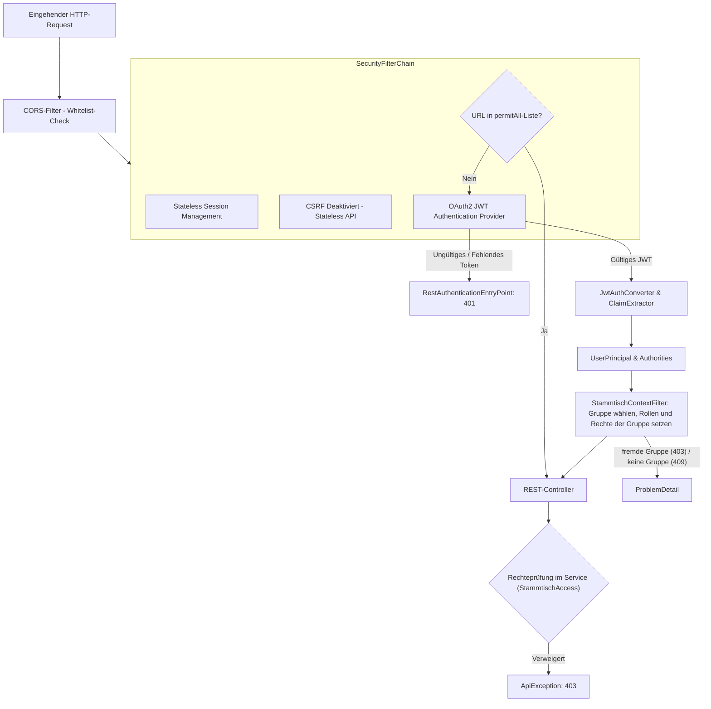
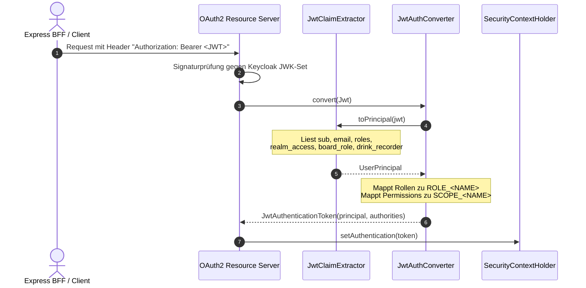

# 🔐 Sicherheit, Authentifizierung & Autorisierung

Dieses Kapitel beschreibt die Sicherheitsarchitektur des `baseservice`, einschließlich der `SecurityFilterChain`, der JWT-Token-Verarbeitung, des Gruppenkontexts mit Rollen je Gruppe, des `AuthContext`, der automatischen Benutzerprovisionierung sowie der Absicherung von Gästen und CORS.

---

## 🛡️ Sicherheitsarchitektur & Filterkette (`SecurityConfig.kt`)

Der `baseservice` agiert als zustandsloser OAuth2/OIDC Resource Server. Das Kernprinzip lautet **Deny by Default**: Jeder Endpunkt erfordert standardmäßig eine gültige Authentifizierung, es sei denn, er ist explizit in der Positivliste freigegeben.



### 1. `permitAll()`-Positivliste
Folgende Pfade sind ohne Bearer-Token öffentlich erreichbar:
- **Health- & Info-Probes**: `/actuator/health`, `/actuator/health/liveness`, `/actuator/health/readiness`, `/actuator/info`, `/api/v1/health`, `/api/v1/info`
- **Gast-Zugang & Einladungen**: `/api/v1/auth/access/guest`, `/api/v1/invites/accept`
- **Registrierung per Einladungslink**: `/api/v1/member-invites/preview`, `/api/v1/member-invites/register` (das Token im Body ist das Geheimnis)
- **Gast-Chat**: `/api/v1/events/*/chat/guest/**` (die Autorisierung erfolgt über den kryptografischen `X-Guest-Token`-Header)
- **Gruppe eröffnen**: `/api/v1/signup` (Konto anlegen und erste Gruppe eröffnen)
- **Stripe-Webhook**: `/api/v1/billing/stripe/webhook` (geschützt durch die Stripe-Signatur, `StripeWebhookService`)
- **API-Dokumentation**: `/v3/api-docs/**`, `/swagger-ui/**`, `/swagger-ui.html` (nur erreichbar, wenn `API_DOCS_ENABLED=true`; in Produktion aus)

Alle übrigen Actuator-Endpunkte (`/actuator/**`) erfordern zwingend die Rolle `ADMIN`. Alle Fach-Endpunkte (`/api/v1/**`) erfordern standardmäßig ein gültiges JWT.

### 2. CORS-Konfiguration (`CorsProperties.kt`)
- Konfiguriert unter `vereint.cors` (`VEREIN_CORS_ALLOWED_ORIGINS`).
- Wildcards (`*`) werden aus Sicherheitsgründen verworfen.
- Gilt ausschließlich für `/api/**`.
- `allowCredentials = true` wird nur gesetzt, wenn die konfigurierte Ursprungsliste nicht leer ist.

---

## 🎟️ Token-Verarbeitung & `UserPrincipal`

Das vom Identity-Provider (Keycloak) ausgestellte JWT wird bei jedem Request validiert und in ein typsicheres `UserPrincipal`-Objekt umgewandelt.



### Gruppenkontext (`StammtischContextFilter.kt`)
Direkt nach `BearerTokenAuthenticationFilter` läuft der `StammtischContextFilter`:

1. Er legt das lokale Konto bei Bedarf an und lädt die Mitgliedschaften (`StammtischMemberships`).
2. Er wählt die Gruppe aus dem Header `X-Stammtisch-Id`; ohne Header gilt die einzige Gruppe der Person. Ist die Person dort kein aktives Mitglied: `403 stammtisch_access_denied`. Fachliche Endpunkte ohne gewählte Gruppe: `409 stammtisch_required`. Ohne Gruppe laufen nur Konto-, Gruppenwahl-, Plattform-, Getränkedatenbank-, Einladungs- und Push-Geräte-Endpunkte (`isStammtischFree`).
3. Er ersetzt `roles`, `permissions` und `boardRole` im Principal durch die Werte der Gruppe. Die Realmrolle `admin` aus dem Token setzt nur `platformAdmin = true` (Autorität `ROLE_PLATFORM_ADMIN`).
4. Er setzt den `TenantContext`, aus dem Hibernate (`@TenantId`) und `TenantAwareDataSource` (Row Level Security) die Gruppe lesen.
5. Ist die Kulanzfrist nach einer offenen Zahlung abgelaufen, beantwortet er schreibende Anfragen mit `403 stammtisch_read_only` (außer Tarif, Export, Verlassen, Kiosk).

Nur in Entwicklung und E2E (`TENANCY_BOOTSTRAP_REALM_ROLES=true`) treten Konten ohne Mitgliedschaft automatisch „Meine Gruppe“ mit ihren Realmrollen bei (`RealmRoleBootstrap`). Ein Plattform-Admin ohne Mitgliedschaft übernimmt eine noch herrenlose Gruppe (`PlatformService.claimUnclaimedStammtisch`).

### 1. `JwtClaimExtractor.kt`
Zentrale Komponente zur Extraktion claims-basierter Informationen aus dem `org.springframework.security.oauth2.jwt.Jwt`:
- `sub`: Eindeutige Keycloak-Benutzer-ID.
- `roles`: Zusammenführung aus flachem `roles`-Claim, `realm_access.roles` und `resource_access.<client>.roles`.
- `permissions`: Aus `permissions`-Array und leerzeichengetrenntem `scope`-Claim.
- `board_role`, `drink_recorder`, `event_scopes`: Fach-Claims aus dem Token. Sie werden vom `StammtischContextFilter` durch die Werte der Gruppe ersetzt (`eventScopes` wird geleert) und haben damit keine Wirkung mehr.

### 2. `UserPrincipal.kt` & `AuthContext.kt`
Das `UserPrincipal` stellt die Identität des Aufrufers dar. Das Attribut `attributes` (rohe JWT-Claims) ist mit `@JsonIgnore` versehen, damit Token-Interna niemals über JSON-Endpunkte nach außen gelangen.

Im Code wird der Principal über die Komponente `AuthContext` abgerufen:

```kotlin
@Component
class AuthContext(private val claimExtractor: JwtClaimExtractor) {
    fun getRequiredPrincipal(): UserPrincipal
    fun getCurrentPrincipal(): UserPrincipal?
    fun hasRole(role: String): Boolean
    fun hasPermission(permission: String): Boolean
    fun requireRole(role: String)           // wirft PermissionDeniedException (403)
    fun requirePermission(permission: String) // wirft PermissionDeniedException (403)
}
```

Für Prüfungen gegen die Rollen der Gruppe nutzen die Services `StammtischAccess` (`has`, `hasAny`, `require`). Es zählt die Vereinigung aus den Rechten der Rollen der Person (`user_roles` → `stammtisch_roles.permissions`), individuell vergebenen Rechten (`user_permissions`) und den Rechten im Principal.

---

## 📊 Rollen je Gruppe & Startwerte (`RolePermissionMatrix.kt`)

Rollen und Rechte gelten je Gruppe und stehen in `stammtisch_roles`. `RolePermissionMatrix` (**Version 4**) beschreibt nur die Startwerte der vier Systemrollen, die jede neue Gruppe beim Anlegen erhält (`PlatformService.createStammtisch` → `StammtischSeeder`; für die erste Gruppe legt sie Migration `013` an). Die Rollenverwaltung der Gruppe (`roles.manage`) kann sie ändern und eigene Rollen anlegen (`/api/v1/stammtisch/roles`); zugewiesen werden Rollen im Bearbeiten-Formular eines Mitglieds (`PUT /api/v1/users/{id}/roles`, ebenfalls `roles.manage`). Keycloak-Realmrollen zählen nicht, außer `admin` (Plattform-Admin). Details: [Gruppen](../domains/stammtische.md).

Startwerte (vollständige Tabelle mit Beschreibungen: [Sicherheitskonzept](../architecture/security-and-auth.md#startwerte-der-systemrollen)):

- `member`: `profile.read.self`, `balance.read.self`, `purchase.self`, `chat.member`, `chat.event`, `event.create`, `catalog.propose`
- `board`: wie `member`, dazu `event.manage`, `event.invites.manage`, `catalog.approve`, `ledger.read`, `ledger.correct`, `audit.read`, `members.read`, `members.invite`, `moments.manage`, `kiosk.manage`, `notifications.broadcast`, `chat.moderate`
- `admin`: wie `board`, dazu `purchase.tablet`, `members.manage`, `roles.manage`, `stammtisch.manage`, `billing.manage`, `audit.read.all`
- `tabletRecorder`: nur `purchase.tablet` (Thekenkonto)

Schutzregeln beim Ändern: Niemand ändert die eigenen Rollen oder Rechte (`self_privilege_change_denied`), und nach jeder Änderung an Rollen, Zuweisungen oder Mitgliedschaften muss mindestens ein aktives Mitglied `members.manage` oder `roles.manage` behalten (`StammtischManagers`, `last_role_manager_protected`).

---

## 👤 Benutzerprovisionierung (`UserProvisioningService.kt`)

Loggt sich ein Benutzer zum ersten Mal ein, existiert in Keycloak bereits ein Konto, aber noch kein Eintrag in der PostgreSQL-Tabelle `users`.

- **Just-in-Time Provisioning**: Bei Bedarf erzeugt `UserProvisioningService.createUser(principal)` automatisch den Datenbank-Eintrag.
- **Transaktions-Isolation**: Ausgeführt mit `@Transactional(propagation = Propagation.REQUIRES_NEW)`.
- **Race Condition Schutz**: Bei parallelen Erstanfragen fängt die separate Transaktion eventuelle `DataIntegrityViolationException`-Fehler (Unique Constraint auf `keycloak_subject`) isoliert ab, ohne die äußere Fach-Transaktion zu beschädigen.

---

## 🚪 Exception-Handler für Security

Falls die Authentifizierung oder Autorisierung fehlschlägt, erzeugen dedizierte Handler eine RFC-7807-konforme Fehlerantwort mit korrelierter `X-Request-Id` (`traceId`):

1. **`RestAuthenticationEntryPoint` (401 Unauthorized)**:
   - Greift bei fehlendem oder ungültigem Bearer-Token.
   - Liefert `code: "access_denied"`.
2. **`RestAccessDeniedHandler` (403 Forbidden)**:
   - Greift bei fehlenden Rechten oder Deaktivierung.
   - Liefert `code: "permission_denied"`.

---

## 🔑 Gast-Token & `SecureTokens.kt`

Externe Gäste erhalten keinen Keycloak-Account, sondern ein kryptografisches Einladungs-Token:
- **Generierung**: `SecureTokens.generateToken(32)` erzeugt 32 Byte kryptografische Zufallsentropie (Base64-URL-encoded).
- **Speicherung**: Der Rohwert wird **niemals** in der Datenbank gespeichert. Es wird ausschließlich der SHA-256-Hash (`SecureTokens.sha256Hex(token)`) abgelegt (`event_invites.token_hash`, `event_guests.guest_token_hash`; ebenso `member_invites.token_hash` für Einladungslinks).
- **Validierung**: Eingehende Gast-Anfragen werden gehasht und gegen `event_guests` abgeglichen (`AccessResolverService.validateGuestAccess`).

---

## 🔗 Querverweise

- Weiter zu [04. Persistenz & Migrationen](04-persistence-and-migrations.md)
- Zurück zu [02. Architektur & Schichten](02-architecture-and-layers.md)
- [BFF Authentifizierung & Session](../backend-for-frontend/03-authentication-and-session.md)
- [BFF Autorisierung & App-Kontexte](../backend-for-frontend/04-authorization.md)
- [Sicherheitsarchitektur Konzept](../architecture/security-and-auth.md)
