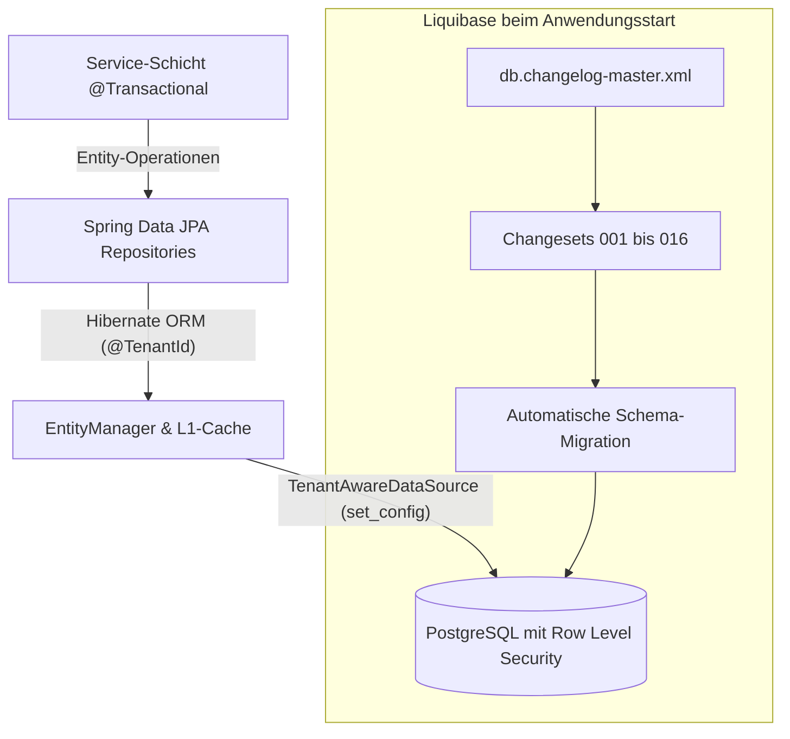

# 💾 Persistenz, Datenmodell & Liquibase-Migrationen

In diesem Kapitel erfährst du alles über die Persistenzschicht des `baseservice`: JPA-Entities, Spring Data Repositories, die Trennung der Gruppen, Transaktions- und Nebenläufigkeitskontrolle (Optimistic Locking) sowie die versionssichere Schema-Verwaltung mit Liquibase.

---

## 🏛️ Persistenz-Architektur & JPA-Konfiguration

Der `baseservice` setzt auf Spring Data JPA mit Hibernate als JPA-Provider. Um unbeabsichtigte Lazy-Loading-Probleme und Performance-Engpässe zu vermeiden, gelten strikte Architekturregeln:

- **`open-in-view: false`**: Der Hibernate-Session-Lebenszyklus ist strikt an die Transaktion in der Service-Schicht gebunden. Lazy Loading im Web-/Controller-Layer ist verboten.
- **`ddl-auto: none`**: Hibernate generiert oder verändert niemals automatisch Tabellen. Die alleinige Hoheit über das Datenbankschema liegt bei Liquibase.
- **`@EnableJpaAuditing` (`JpaConfig.kt`)**: Automatisches Setzen von `@CreatedDate` und `@LastModifiedDate` (UTC `Instant`) auf Entities mit `AuditingEntityListener`.



---

## 📦 JPA-Entities & Domänenmodelle

Alle Entities liegen unter `de.maurer.baseservice.domain` und sind nach Fachdomänen gegliedert:

| Domänen-Datei | Wichtige Entities | Beschreibung & Besonderheiten |
| :--- | :--- | :--- |
| **`StammtischEntities.kt`** | `StammtischEntity`, `StammtischMemberEntity`, `StammtischRoleEntity` | Gruppen, Mitgliedschaften (`active`, `boardRole`) und Rollen je Gruppe mit Berechtigungen. |
| **`StammtischScoped.kt`** | `StammtischScoped` | Basisklasse mit `@TenantId stammtischId` für alle Entities einer Gruppe. |
| **`UserEntities.kt`** | `UserEntity`, `UserRoleEntity`, `UserPermissionEntity` | Benutzerkonten (gruppenübergreifend), Keycloak-Subject-Mapping (`uk_users_keycloak_subject`), `disabled`, AGB-Zustimmung; Rollen und Rechte je Gruppe. |
| **`FoodEntities.kt`** | `FoodCatalogEntity`, `EventFoodEntity` | Speisenkatalog, Einkaufspreise (`costPrice`), Standardpreise (`defaultPrice`), Event-Verknüpfung und Freigaben. |
| **`DrinkEntities.kt`** | `DrinkCatalogEntity`, `DrinkBarcodeEntity`, `DrinkSublistEntity`, `DrinkSublistItemEntity`, `EventDrinkEntity` | Getränkekatalog, Genehmigungsstatus (`DrinkStatus`), Barcodes für den Scanner und veranstaltungsbezogene Sortimente. |
| **`DrinkLibraryEntities.kt`** | `DrinkLibraryEntity`, `DrinkLibraryBarcodeEntity` | Gemeinsame Getränkedatenbank aller Gruppen (ohne `@TenantId`, ohne Preise). |
| **`EventEntities.kt`** | `EventEntity`, `EventParticipantEntity`, `EventInviteEntity`, `EventGuestEntity` | Veranstaltungs-Lebenszyklus (`EventStatus`), Teilnehmerzusagen (RSVP), Einladungstokens und Gast-Profile. |
| **`LedgerEntities.kt`** | `LedgerEntryEntity`, `PurchaseSnapshotEntity`, `IdempotencyRecordEntity` | Unveränderliches Buchungsjournal (`LedgerEntryType`: `purchase`, `topup`, `payout`, `correction`), Beleg-Snapshots, Idempotenz-Datensätze. |
| **`ImageEntities.kt`** | `ImageAssetEntity` | Metadaten für hochgeladene Bilder, S3-Objektschlüssel, MIME-Typ und Dateigröße. |
| **`CommunicationEntities.kt`** | `ConversationEntity`, `ConversationMemberEntity`, `ChatMessageEntity`, `ChatReactionEntity`, `NotificationEntity`, `PushSubscriptionEntity`, `MomentSessionEntity`, `MomentResponseEntity`, `AuditLogEntity` | Chats und Reaktionen, Benachrichtigungen, Web-Push-Abonnements, Moments, Audit-Log. |
| **`MomentEntities.kt`** | `MomentTypeEntity`, `MomentReactionEntity`, `MomentMediaEntity` | Moment-Typen und Reaktionen je Gruppe, Fotos und Videos. |
| **`KioskEntities.kt`** | `KioskSessionEntity` | Kiosk-Sitzungen mit PIN-Hash und Sperrzählern. |
| **`MemberInviteEntities.kt`** | `MemberInviteEntity`, `MemberInviteRedemptionEntity` | Einladungslinks in eine Gruppe und ihre Einlösungen. |
| **`BillingEntities.kt`** | `StammtischSubscriptionEntity`, `BillingEventEntity` | Tarif je Gruppe (`BillingPlan`, `SubscriptionStatus`) und verarbeitete Stripe-Ereignisse. |
| **`DomainEnums.kt`** | `AccountingMode`, `PurchaseSource`, `LedgerEntryType`, `EventStatus`, `UserRole`, `BoardRole`, `RsvpStatus`, `GuestStatus`, `DrinkStatus`, `ImagePurpose`, `ImageStatus` | Typsichere Enums (gespeichert als `EnumType.STRING`). |

### Trennung der Gruppen
- **Hibernate**: `StammtischTenantResolver` liefert die Gruppe aus dem `TenantContext`. Ohne Kontext findet eine Abfrage nichts; nur der System-Kontext (`TenantTransactions.asSystem`, `readAsSystem`) ist `root` und sieht alle Gruppen.
- **PostgreSQL**: `TenantAwareDataSource` setzt bei jeder Verbindungsausgabe `vereint.stammtisch_id` und `vereint.rls_bypass`; die Policies aus Changeset `165-row-level-security` werten sie aus. In den H2-Tests ist das aus (`vereint.tenancy.row-level-security=false`).
- **Hintergrundjobs** laufen je Gruppe über `StammtischJobs`.

---

## 🔒 Transaktionen & Optimistic Locking

### 1. Transaktionsregeln
- Fach-Services tragen standardmäßig `@Service @Transactional`.
- Lese-Operationen werden explizit mit `@Transactional(readOnly = true)` annotiert. Dies aktiviert Hibernate-Leseoptimierungen (Flush-Mode `MANUAL`, kein Dirty-Checking).
- Bei geschachtelten Operationen mit Race-Condition-Gefahr (z. B. `UserProvisioningService.createUser`) wird `Propagation.REQUIRES_NEW` eingesetzt, um die innere Transaktion unabhängig von der äußeren zu isolieren.

### 2. Optimistic Locking mit `@Version`
Um *Lost Updates* bei gleichzeitigen Schreibzugriffen zu verhindern, besitzen alle relevanten Entities eine Versionsspalte:

```kotlin
@Version
@Column(name = "version", nullable = false)
var version: Long = 0
```

Wird eine Entity während einer Bearbeitung durch einen anderen Thread modifiziert, wirft Hibernate beim Commit eine `OptimisticLockingFailureException`. Der `GlobalExceptionHandler` fängt diese ab und liefert HTTP `409 CONFLICT` mit dem Fehlercode `concurrent_modification` an den Client.

---

## 📜 Liquibase Schema-Migrationen

Die Schemaverwaltung erfolgt über Liquibase-XML-Dateien unter `src/main/resources/db/changelog/`.

Die vollständige Liste aller Changesets mit Beschreibung steht im [Datenmodell](../architecture/data-model.md#-liquibase-migration-changelog-historie). Kurz:

### 1. Übersicht der Changesets

1. **`001-initial-schema.xml`**: Initialer Tabellenaufbau (Benutzer, Events, Getränke, Ledger, Chat, Push, Moments, Audit-Log).
2. **`002-integrity-constraints.xml`**: CHECK-Constraints, Optimistic Locking (`version`), Append-Only-Trigger für Ledger und Beleg-Snapshots, Indizes.
3. **`003-drink-catalog-approval.xml`**: Spalten für den Freigabe-Workflow neuer Getränke.
4. **`004-image-assets.xml`**: Tabelle `image_assets` für Bild-Metadaten und S3-Objektschlüssel.
5. **`005-ledger-transactions.xml`**: Buchungsarten (`entry_type`), Storno-Verweis (`reverses_entry_id`), optionale Kaufspalten.
6. **`007-food-and-cost-prices.xml`**: `food_catalog`, `event_food`, Einkaufspreise und Beleg-Snapshots mit `item_type`, `food_name`, `cost_price`, `profit`.
7. **`008`** bis **`012`**: verschlüsselte Benachrichtigungstitel, Chat und Zusagen, Einladungslinks, Kiosk-Sitzungen, Moment-Typen und Medien.
8. **`013-stammtische.xml`**: Gruppen, Mitgliedschaften, Rollen je Gruppe, `stammtisch_id` an allen fachlichen Tabellen, Eindeutigkeit je Gruppe, Row Level Security.
9. **`014`** bis **`018`**: gemeinsame Getränkedatenbank, Tarife und Stripe-Ereignisse, AGB-Zustimmung, Startbestand der Getränkedatenbank (Daten aus Open Food Facts, ODbL).

### 2. Liquibase-Kontexte (`contexts`)
- **`prod`**: Standardkontext für Produktiv- und Compose-Umgebungen (`EV_LIQUIBASE_CONTEXTS: prod`).
- **`test`**: Kontext der Tests (`application-test.yaml`).
- **`dev`**: Kontext für lokale Entwicklungs-Testdaten (`.env.example`: `EV_LIQUIBASE_CONTEXTS=dev`).

### 3. Konventionen für neue Changesets
- **Idempotenz**: Changesets müssen wiederholbar und deklarativ sein.
- **Preconditions**: Nutzung von `<preConditions onFail="MARK_RAN">` bei bedingten Schemaerweiterungen.
- **Rollback-Blöcke**: Changesets enthalten nach Möglichkeit ein explizites `<rollback>`-Element (z. B. `<dropTable tableName="..."/>` oder `<dropColumn .../>`).
- **Neue Gruppentabellen**: Spalte `stammtisch_id` (Fremdschlüssel auf `stammtische`), Entity erbt von `StammtischScoped`, und eine Policy `stammtisch_isolation` wie in Changeset `165` anlegen.
- **Datenänderungen an Gruppentabellen**: vorher `SET vereint.rls_bypass = 'on'` ausführen, sonst sieht Liquibase wegen `FORCE ROW LEVEL SECURITY` keine Zeilen.
- **Keine direkten Tabellen-Änderungen**: Änderungen am Schema dürfen **niemals** manuell in PostgreSQL ausgeführt werden, sondern ausschließlich über ein neues nummeriertes Changeset (nächste freie Nummer: `017-*.xml`).

---

## 🔗 Querverweise

- Weiter zu [05. Fehlerbehandlung & Observability](05-error-handling-and-observability.md)
- Zurück zu [03. Sicherheit & Autorisierung](03-security-and-authorization.md)
- [Entity-Relationship Datenmodell](../architecture/data-model.md)
- [Betrieb: Datenbank-Migrationen](../operations/database-migrations.md)
