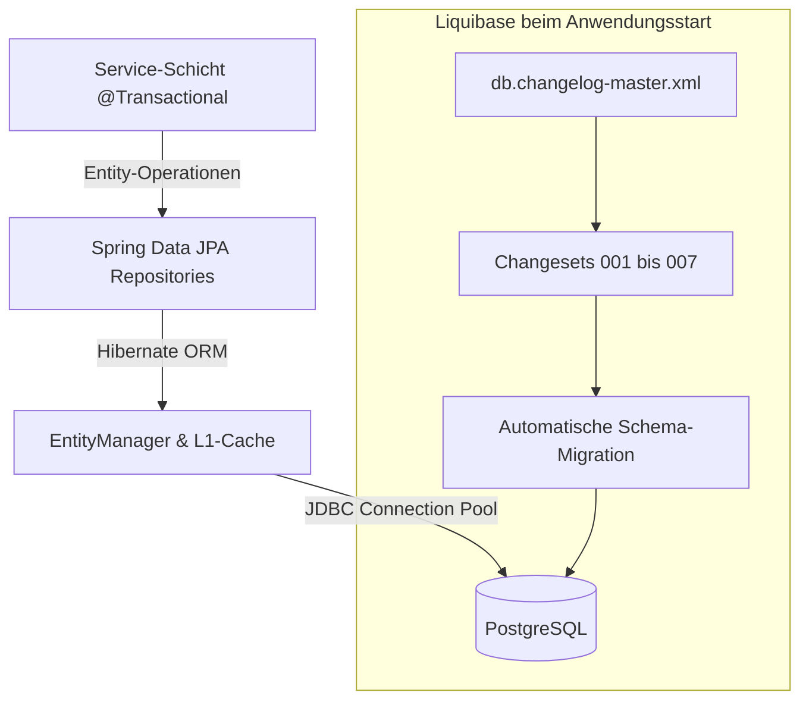
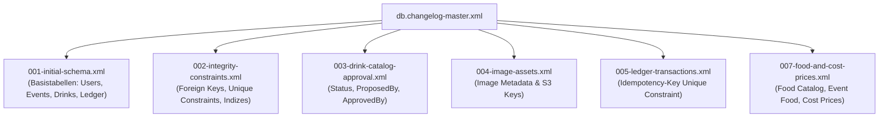

# 💾 Persistenz, Datenmodell & Liquibase-Migrationen

In diesem Kapitel erfährst du alles über die Persistenzschicht des `baseservice`: JPA-Entities, Spring Data Repositories, Transaktions- und Nebenläufigkeitskontrolle (Optimistic Locking) sowie die versionssichere Schema-Verwaltung mit Liquibase.

---

## 🏛️ Persistenz-Architektur & JPA-Konfiguration

Der `baseservice` setzt auf Spring Data JPA mit Hibernate als JPA-Provider. Um unbeabsichtigte Lazy-Loading-Probleme und Performance-Engpässe zu vermeiden, gelten strikte Architekturregeln:

- **`open-in-view: false`**: Der Hibernate-Session-Lebenszyklus ist strikt an die Transaktion in der Service-Schicht gebunden. Lazy Loading im Web-/Controller-Layer ist verboten.
- **`ddl-auto: none`**: Hibernate generiert oder verändert niemals automatisch Tabellen. Die alleinige Hoheit über das Datenbankschema liegt bei Liquibase.
- **`@EnableJpaAuditing` (`JpaConfig.kt`)**: Automatisches Setzen von `@CreatedDate` und `@LastModifiedDate` (UTC `Instant`) auf allen Entities.



---

## 📦 JPA-Entities & Domänenmodelle

Alle Entities liegen unter `de.maurer.baseservice.domain` und sind nach Fachdomänen gegliedert:

| Domänen-Datei | Wichtige Entities | Beschreibung & Besonderheiten |
| :--- | :--- | :--- |
| **`UserEntities.kt`** | `UserEntity`, `UserRoleEntity`, `UserPermissionEntity` | Benutzerkonten, Keycloak-Subject-Mapping (`uk_users_keycloak_subject`), Rollen & Flags (`drinkRecorder`, `disabled`). |
| **`FoodEntities.kt`** | `FoodCatalogEntity`, `EventFoodEntity` | Speisenkatalog, Einkaufspreise (`costPrice`), Standardpreise (`defaultPrice`), Event-Verknüpfung und Kiosk-Flags. |
| **`DrinkEntities.kt`** | `DrinkCatalogEntity`, `DrinkBarcodeEntity`, `DrinkSublistEntity`, `DrinkSublistItemEntity`, `EventDrinkEntity` | Getränkekatalog, Genehmigungsstatus (`DrinkStatus`), Barcodes für PWA-Scanner und veranstaltungsbezogene Sortimente. |
| **`EventEntities.kt`** | `EventEntity`, `EventParticipantEntity`, `EventInviteEntity`, `EventGuestEntity` | Veranstaltungs-Lebenszyklus (`EventStatus`), Teilnehmerzusagen (RSVP), Einladungstokens und Gast-Profile. |
| **`LedgerEntities.kt`** | `LedgerEntryEntity`, `LedgerCorrectionEntity` | Unveränderliches Buchungsjournal, Transaktionstypen (`TOPUP`, `PURCHASE`, `PAYOUT`, `CORRECTION`), Idempotency-Keys. |
| **`ImageEntities.kt`** | `ImageAssetEntity` | Metadaten für hochgeladene Bilder, S3-Objektschlüssel, MIME-Typ und Dateigröße. |
| **`CommunicationEntities.kt`** | `ChatMessageEntity`, `PushSubscriptionEntity`, `NotificationEntity`, `MomentSessionEntity`, `MomentResponseEntity` | Gruppen- und Event-Chat, VAPID Web-Push-Abonnements, Moment-Sessions und Rituale. |
| **`DomainEnums.kt`** | `AssignedRole`, `BoardRole`, `DrinkStatus`, `EventStatus`, `TransactionType`, `PaymentMethod` | Typsichere JPA-Enums (gespeichert als `EnumType.STRING`). |

---

## 🔒 Transaktionen & Optimistic Locking

### 1. Transaktionsregeln
- Fach-Services tragen standardmäßig `@Service @Transactional`.
- Lese-Operationen werden explizit mit `@Transactional(readOnly = true)` annotiert. Dies aktiviert Hibernate-Leseoptimierungen (Flush-Mode `MANUAL`, kein Dirty-Checking).
- Bei geschachtelten Operationen mit Race-Condition-Gefahr (z. B. `UserProvisioningService.createUser`) wird `Propagation.REQUIRES_NEW` eingesetzt, um die innere Transaktion unabhängig von der äußeren zu isolieren.

### 2. Optimistic Locking mit `@Version`
Um *Lost Updates* bei gleichzeitigen Schreibzugriffen zu verhindern, besitzen alle relevanten Entities eine Versionsspalte:

```kotlin
@Version
@Column(name = "version", nullable = false)
var version: Long = 0
```

Wird eine Entity während einer Bearbeitung durch einen anderen Thread modifiziert, wirft Hibernate beim Commit eine `OptimisticLockingFailureException`. Der `GlobalExceptionHandler` fängt diese ab und liefert HTTP `409 CONFLICT` mit dem Fehlercode `concurrent_modification` an den Client.

---

## 📜 Liquibase Schema-Migrationen

Die Schemaverwaltung erfolgt über Liquibase-XML-Dateien unter `src/main/resources/db/changelog/`.



### 1. Übersicht der Changesets

1. **`001-initial-schema.xml`**:
   - Initialer Tabellenaufbau: `users`, `user_roles`, `user_permissions`, `events`, `event_participants`, `event_invites`, `event_guests`, `drink_catalog`, `drink_barcodes`, `ledger_entries`, `audit_logs`.
2. **`002-integrity-constraints.xml`**:
   - Anlage aller Fremdschlüsselbeziehungen und Eindeutigkeitsregeln (`uk_users_keycloak_subject`, `uk_event_participants_event_user`, `uk_drink_barcodes_barcode`).
3. **`003-drink-catalog-approval.xml`**:
   - Ergänzung der Spalten für den Vorstandsgenehmigungsworkflow bei neuen Getränken.
4. **`004-image-assets.xml`**:
   - Tabelle `image_assets` für Bild-Metadaten und S3-Objektschlüssel.
5. **`005-ledger-transactions.xml`**:
   - Unique Constraint auf `idempotency_key` zur Absicherung des Kassenbuchs gegen Doppelbuchungen bei Netzwerk-Retries.
6. **`007-food-and-cost-prices.xml`**:
   - Anlage von `food_catalog` und `event_food` sowie Ergänzung der Spalte `cost_price` in `ledger_entries` zur Margenberechnung.

### 2. Liquibase-Kontexte (`contexts`)
- **`prod`**: Standardkontext für Produktiv- und Compose-Umgebungen (`EV_LIQUIBASE_CONTEXTS: prod`).
- **`test`**: Spezifischer Kontext für Unit- und Integrationstests (`application-test.yaml`), um ggf. Test-Seeds einzuspielen.
- **`dev`**: Optionaler Kontext für lokale Entwicklungs-Testdaten.

### 3. Konventionen für neue Changesets
- **Idempotenz**: Changesets müssen wiederholbar und deklarativ sein.
- **Preconditions**: Nutzung von `<preConditions onFail="MARK_RAN">` bei bedingten Schemaerweiterungen.
- **Rollback-Blöcke**: Jedes Changeset enthält ein explizites `<rollback>`-Element (z. B. `<dropTable tableName="..."/>` oder `<dropColumn .../>`).
- **Keine direkten Tabellen-Änderungen**: Änderungen am Schema dürfen **niemals** manuell in PostgreSQL ausgeführt werden, sondern ausschließlich über ein neues nummeriertes Changeset (`008-*.xml`).

---

## 🔗 Querverweise

- Weiter zu [05. Fehlerbehandlung & Observability](05-error-handling-and-observability.md)
- Zurück zu [03. Sicherheit & Autorisierung](03-security-and-authorization.md)
- [Entity-Relationship Datenmodell](../architecture/data-model.md)
- [Betrieb: Datenbank-Migrationen](../operations/database-migrations.md)
