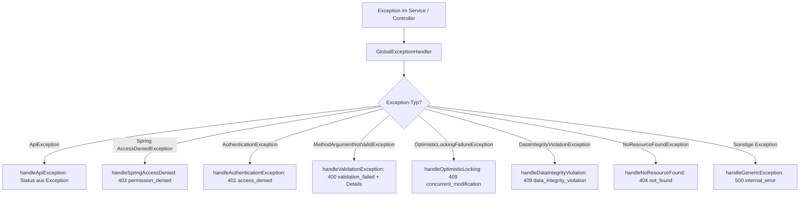

# 🚨 Fehlerbehandlung, Observability & OpenAPI

In diesem Kapitel erfährst du alles über das standardisierte Fehlerformat nach RFC 7807, den `ErrorCode`-Katalog, das zentrale Exception-Handling, die Trace-ID-Korrelation (`X-Request-Id`), Actuator-Health-Probes und die OpenAPI-3.1-Dokumentation.

---

## 📐 RFC-7807-Fehlerformat (`ApiProblem.kt`)

Alle Fehlerantworten des `baseservice` folgen dem standardisierten RFC-7807-Format (*Problem Details for HTTP APIs*), angereichert um die VEREINT-spezifischen Erweiterungen `code`, `traceId`, `timestamp` und `details`:

```json
{
  "type": "https://vereint.example/problems/validation_failed",
  "title": "Bad Request",
  "status": 400,
  "detail": "Validation failed for request parameters",
  "instance": "/api/v1/food",
  "code": "validation_failed",
  "traceId": "c8b4f63a-8b83-4923-a178-57778216c52b",
  "timestamp": "2026-09-25T20:15:30.123456Z",
  "details": [
    "name: darf nicht leer sein",
    "defaultPrice: muss größer oder gleich 0.00 sein"
  ]
}
```

### ProblemDetail-Struktur im Detail
- **`type`**: Eindeutige URI des Fehlertyps (`https://vereint.example/problems/<code/>`).
- **`title`**: HTTP-Status-Kurzbeschreibung (z. B. `Bad Request`, `Forbidden`, `Conflict`).
- **`status`**: Numerischer HTTP-Statuscode (`400`, `401`, `403`, `404`, `409`, `410`, `413`, `500`, `503`).
- **`detail`**: Menschlich lesbare Fehlerbeschreibung, übersetzt nach `Accept-Language` (siehe [i18n](i18n.md)).
- **`instance`**: URI des fehlerhaften API-Endpunkts (`request.requestURI`).
- **`code`**: Maschinenlesbarer Fehlercode aus `ErrorCode.kt`.
- **`traceId`**: Eindeutige Request-Korrelations-ID (identisch mit dem HTTP-Response-Header `X-Request-Id`).
- **`timestamp`**: ISO-8601-Zeitstempel der Antwort.
- **`details`**: Optionale Liste feingranularer Feld- oder Validierungsfehler.

---

## 🗂️ Fehlercode-Katalog (`ErrorCode.kt`)

Die Klasse `ErrorCode.kt` definiert alle stabilen Fehlerkonstanten im System:

| Fehlercode (`code`) | Standard-HTTP-Status | Bedeutung / Auslöser |
| :--- | :---: | :--- |
| `invalid_request` | `400 Bad Request` | Ungültige Parameter, leere Pflichtfelder oder ungültiges Format. |
| `validation_failed` | `400 Bad Request` | Bean-Validation-Fehler (`@Valid`, `@NotBlank`, `@DecimalMin`). |
| `consent_required` | `400 Bad Request` | Erforderliche Zustimmung (z. B. Datenschutz/Einverständnis) fehlt. |
| `event_not_active` | `400 Bad Request` | Buchung oder Chat auf einer inaktiven oder abgesagten Veranstaltung. |
| `access_denied` | `401 Unauthorized` | Fehlendes oder ungültiges Authentifizierungs-Token (JWT). |
| `oidc_login_failed` | `401 Unauthorized` | Fehler bei der OIDC-Token-Validierung oder im IdP-Handshake. |
| `oidc_session_expired`| `401 Unauthorized` | Das übergebene JWT ist abgelaufen. |
| `permission_denied` | `403 Forbidden` | Unzureichende Berechtigungen für die angeforderte Aktion. |
| `account_disabled` | `403 Forbidden` | Das Benutzerkonto wurde durch einen Administrator deaktiviert. |
| `role_not_assigned` | `403 Forbidden` | Die erforderliche Benutzerrolle fehlt. |
| `profile_not_found` | `403 Forbidden` | Dem Token kann kein aktives Benutzerprofil zugeordnet werden. |
| `self_privilege_change_denied` | `403 Forbidden` | Selbständerung der eigenen Rollen, Berechtigungen oder des Admin-Status verboten. |
| `last_admin_protected`| `403 Forbidden` | Konstante vorhanden, derzeit ohne Auslöser; den letzten Verwaltungszugang einer Gruppe schützt `last_role_manager_protected`. |
| `not_found` | `404 Not Found` | Gesuchte Ressource (ID, Entität oder URL-Pfad) existiert nicht. |
| `invitation_expired`| `410 Gone` | Einladungs-Link oder Gast-Token ist zeitlich abgelaufen. |
| `invitation_revoked`| `410 Gone` | Einladungs-Link oder Gast-Token wurde manuell widerrufen. |
| `concurrent_modification` | `409 Conflict` | Optimistic Locking Konflikt (`@Version`); parallele Bearbeitung. |
| `data_integrity_violation` | `409 Conflict` | Verletzung von Unique Constraints oder Fremdschlüsselregeln. |
| `idempotency_conflict` | `409 Conflict` | Wiederholte Anfrage mit identischem `Idempotency-Key` und abweichendem Payload. |
| `idempotency_key_required` | `400 Bad Request` | Für diesen Endpunkt ist ein `Idempotency-Key`-Header zwingend. |
| `ledger_already_corrected` | `409 Conflict` | Buchungseintrag wurde bereits storniert/korrigiert. |
| `self_service_disabled` | `403 Forbidden` | Self-Service für diesen Artikel oder diese Veranstaltung deaktiviert. |
| `drink_not_in_event`| `400 Bad Request` | Getränk ist nicht im Sortiment der angegebenen Veranstaltung. |
| `invitation_used_up` | `410 Gone` | Einladungslink ist ausgeschöpft. |
| `email_already_registered` | `409 Conflict` | Für die E-Mail-Adresse gibt es schon ein Konto (Registrierung). |
| `password_rejected` | `400 Bad Request` | Keycloak lehnt das Passwort ab (Passwortregeln). |
| `registration_unavailable` | `503 Service Unavailable` | Kontoanlage über Keycloak ist nicht eingerichtet. |
| `terms_not_accepted` | `400 Bad Request` | Der AGB wurde bei Registrierung oder Eröffnung nicht zugestimmt. |
| `kiosk_pin_invalid_format` | `400 Bad Request` | Die Kiosk-PIN hat ein ungültiges Format. |
| `media_too_large` | `413 Payload Too Large` | Foto oder Video in Moments ist zu groß. |
| `video_too_long` | `400 Bad Request` | Video in Moments ist zu lang. |
| `stammtisch_required` | `409 Conflict` | Fachlicher Endpunkt ohne gewählte Gruppe. |
| `stammtisch_access_denied` | `403 Forbidden` | Die Person ist kein aktives Mitglied der angefragten Gruppe. |
| `stammtisch_read_only` | `403 Forbidden` | Zahlung über die Kulanzfrist hinaus offen; die Gruppe ist nur lesbar. |
| `stammtisch_limit` | `409 Conflict` | Höchstzahl selbst eröffneter Gruppen erreicht (`SIGNUP_MAX_OWNED`). |
| `last_role_manager_protected` | `403 Forbidden` | Die Änderung nähme der Gruppe die letzte Person mit `members.manage` oder `roles.manage`. |
| `plan_limit_members`, `plan_limit_storage`, `plan_limit_videos`, `plan_limit_kiosk` | `409 Conflict` | Grenze des Tarifs erreicht (Mitglieder, Speicher, Videos, mehrere Kiosks). |
| `billing_unavailable` | `503 Service Unavailable` | Stripe ist nicht eingerichtet. |
| `billing_no_customer` | `409 Conflict` | Kundenportal ohne bestehendes Stripe-Kundenkonto. |
| `internal_error` | `500 Internal Server Error` | Unerwarteter Serverfehler oder ungefangene Exception. |

---

## 🛡️ Exception-Mapping-Tabelle (`GlobalExceptionHandler.kt`)

Der `@RestControllerAdvice` `GlobalExceptionHandler` fängt alle im Web-Layer auftretenden Exceptions ab und übersetzt sie deterministisch in ein `ProblemDetail`:



| Abgefangene Exception-Klasse | HTTP-Status | Fehlercode (`code`) | Details / Verhalten |
| :--- | :---: | :--- | :--- |
| `ApiException` (und Subklassen) | `ex.status` (`400`, `403`, `404`, `409`, `410`) | `ex.errorCode` | Liefert fachspezifische Fehlermeldung und optionale `details`. |
| `org.springframework.security.access.AccessDeniedException` | `403 FORBIDDEN` | `permission_denied` | Zugriff auf gesicherte Methode/Ressource verweigert. |
| `org.springframework.security.core.AuthenticationException` | `401 UNAUTHORIZED` | `access_denied` | Authentifizierung erforderlich oder Token ungültig. |
| `MethodArgumentNotValidException` | `400 BAD_REQUEST` | `validation_failed` | Extrahiert Feldfehler (`field: message`) und globale Objektfehler. |
| `HandlerMethodValidationException` | `400 BAD_REQUEST` | `validation_failed` | Validierungsfehler bei Methoden- und Queryparametern. |
| `jakarta.validation.ConstraintViolationException` | `400 BAD_REQUEST` | `validation_failed` | Extrahiert Property-Pfade und Verletzungstexte. |
| `OptimisticLockingFailureException` | `409 CONFLICT` | `concurrent_modification` | Loggt Warnung; fordert Client zum Neuladen des aktuellen Stands auf. |
| `DataIntegrityViolationException` | `409 CONFLICT` | `data_integrity_violation` | Loggt Warnung; Verletzung von Unique Constraints / FKs. |
| `NoResourceFoundException` | `404 NOT_FOUND` | `not_found` | Statische Ressource oder ungültiger Endpunkt nicht gefunden. |
| `java.lang.Exception` (Fallback) | `500 INTERNAL_SERVER_ERROR` | `internal_error` | Loggt vollen Stacktrace mit `log.error`; liefert neutrale Fehlermeldung. |

---

## 🔍 Request-Tracing & Korrelations-ID (`RequestIdFilter.kt`)

Jeder eingehende Request wird vom `RequestIdFilter` (`@Order(Ordered.HIGHEST_PRECEDENCE)`) erfasst:

1. **Header-Übernahme**: Enthält der Request einen `X-Request-Id`-Header (max. 128 Zeichen), wird dieser übernommen. Andernfalls wird eine neue UUIDv4 generiert.
2. **MDC-Logging**: Die Trace-ID wird im SLF4J-MDC unter dem Schlüssel `traceId` abgelegt. Dadurch erscheint sie in allen Log-Zeilen des aktuellen Threads.
3. **Request-Attribut**: Hinterlegt unter `de.maurer.baseservice.traceId`.
4. **Response-Header**: Wird als `X-Request-Id` im HTTP-Header der Antwort zurückgegeben.
5. **Fehler-Kopplung**: Im Fehlerfall setzt `GlobalExceptionHandler` dieselbe ID in das Feld `traceId` des `ProblemDetail`-JSONs.

---

## 📈 Observability & Actuator-Endpunkte

Spring Boot Actuator liefert standardisierte Schnittstellen für Health-Checks und Monitoring:

- **Liveness Probe**: `GET /actuator/health/liveness` (öffentlich) – Prüft, ob der Webserver läuft.
- **Readiness Probe**: `GET /actuator/health/readiness` (öffentlich) – Prüft, ob Datenbank und Liquibase bereit sind.
- **Info-Endpunkt**: `GET /actuator/info` (öffentlich) – Liefert Build-Informationen (`buildInfo()` in Gradle).
- **Detail-Health**: `GET /actuator/health` – Liefert Details (`show-details: when-authorized`) ausschließlich mit der Autorität `ROLE_ADMIN`. Diese setzt der `StammtischContextFilter` aus der Rolle `admin` der gewählten Gruppe, nicht aus der Plattform-Administration.
- **Weitere Endpunkte**: Freigegeben sind nur `health` und `info` (`management.endpoints.web.exposure.include`); alles andere unter `/actuator/**` ist zusätzlich durch Spring Security auf `ROLE_ADMIN` beschränkt.

---

## 📖 OpenAPI 3.1 & Swagger UI (`OpenApiConfig.kt`)

Der `baseservice` generiert seine Schnittstellendokumentation dynamisch über `springdoc-openapi` (Version `3.1.0`). Sie ist standardmäßig und in Produktion abgeschaltet und wird lokal mit `API_DOCS_ENABLED=true` eingeschaltet:

- **Swagger UI**: [http://localhost:8081/swagger-ui.html](http://localhost:8081/swagger-ui.html)
- **OpenAPI Schema (JSON)**: [http://localhost:8081/v3/api-docs](http://localhost:8081/v3/api-docs)
- **Sicherheits-Schema**: Konfiguriert als HTTP-Bearer-Token (`BearerAuth`) mit JWT-Format in `OpenApiConfig.kt`.

---

## 🔗 Querverweise

- Weiter zu [06. Integrationen](06-integrations.md)
- Zurück zu [04. Persistenz & Migrationen](04-persistence-and-migrations.md)
- [API Problem Details Spezifikation](../api/error-handling-and-idempotency.md)
- [REST-API Referenz](../api/rest-api-reference.md)
