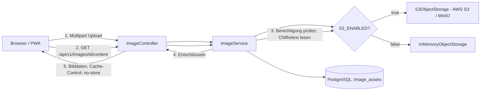
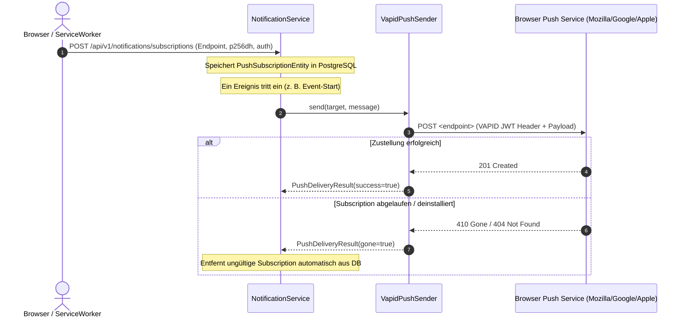

# 🔌 Integrationen, Objektspeicher & Push-Dienste

In diesem Kapitel erfährst du, wie der `baseservice` mit externen Systemen integriert ist: S3-kompatibler Objektspeicher (AWS S3 in Produktion, MinIO lokal), Web-Push-Zustellung über das VAPID-Protokoll, WebSocket-Echtzeit-Chat sowie die zugehörigen Feature-Toggles.

---

## 🗄️ Objektspeicher (`ObjectStorage.kt`)

Der `baseservice` speichert Binärdaten (Bilder sowie Fotos und Videos aus Moments) nicht in der relationalen Datenbank, sondern in einem S3-kompatiblen Objektspeicher.



### 1. Schnittstelle `ObjectStorage`
Die Fachschicht (`ImageService`, `MomentMediaService`) interagiert ausschließlich über das Interface `ObjectStorage`:

```kotlin
interface ObjectStorage {
    fun store(key: String, data: ByteArray, contentType: String)
    fun read(key: String): ByteArray?
    fun storeStream(key: String, data: InputStream, length: Long, contentType: String)
    fun readRange(key: String, start: Long, endInclusive: Long): InputStream?
    fun delete(key: String)
    fun presignedGetUrl(key: String, ttl: Duration): URI
}
```

### 2. Implementierungen & Konfiguration (`StorageConfig.kt`)
- **`S3ObjectStorage`**: Aktiviert, wenn `vereint.storage.enabled=true` (`S3_ENABLED=true`). Spricht die S3-REST-API mit selbst signierten Anfragen (SigV4) an, lokal gegen MinIO mit Path-Style-Access (`/bucket/key`), in Produktion gegen AWS S3 mit dem IAM-Benutzer `vereint-app-storage`.
- **`InMemoryObjectStorage`**: Fallback für lokale Entwicklung und Tests (`S3_ENABLED=false`). Hält Binärdaten in einer Concurrent-Map und erzeugt lokale Data-URIs.
- **Sicherheitsgarantie**: S3-Credentials gelangen **niemals** an den Client. Der Browser lädt Bilder nie direkt aus S3, sondern nur über `GET /api/v1/images/{id}/content`: Der `ImageService` prüft die Berechtigung bei jedem Abruf, liest den Chiffretext und liefert die entschlüsselten Daten mit `Cache-Control: private, no-store` aus. Presigned URLs nutzt der Service nur noch intern für den eigenen Zugriff auf S3 (Lebensdauer `S3_URL_TTL_SECONDS`).

### 3. Anwendungsverschlüsselung (`crypto/DataEncryptor.kt`)
Bilddateien, Fotos und Videos aus Moments (in 64-KiB-Blöcken, damit Videos gestreamt werden können), Chat-Nachrichten (`chat_messages.message`) sowie Titel und Text von Benachrichtigungen (`notifications.title`, `notifications.body`) werden vor dem Speichern mit **AES-256-GCM** verschlüsselt. Ein geleakter Datenbank-Dump oder Bucket-Inhalt ist ohne den Schlüssel unlesbar; GCM erkennt zusätzlich jede Manipulation.

- **Schlüssel:** `DATA_ENCRYPTION_KEY` (32 Byte, Base64), in Produktion aus dem SSM Parameter Store. Mit `DATA_ENCRYPTION_ENABLED=true` startet der Service ohne gültigen Schlüssel nicht. Lokal ist die Verschlüsselung standardmäßig aus; Tests laufen mit einem festen Testschlüssel.
- **Textspalten** nutzen den JPA-Konverter `EncryptedStringConverter` und speichern `enc:v1:` + Base64. Diese Spalten lassen sich nicht mehr per SQL durchsuchen oder sortieren.
- **Bestandsdaten** ohne Kennung werden unverändert gelesen und beim nächsten Schreiben verschlüsselt.
- **Rotation:** Neuen Schlüssel als `DATA_ENCRYPTION_KEY`, den alten als `DATA_ENCRYPTION_KEY_PREVIOUS` setzen. Jeder Chiffretext trägt eine Schlüssel-ID, daher bleiben alte Daten lesbar; neue werden mit dem neuen Schlüssel geschrieben.

---

## 📲 Web-Push-Zustellung (`PushSender.kt`)

Benachrichtigungen (z. B. Chat-Pings, Event-Erinnerungen oder Kassen-Aufladungen) werden über das standardisierte Web-Push-Protokoll (VAPID / RFC 8292) an Browser und PWA-Clients zugestellt.



### 1. Schnittstelle `PushSender` & Konfiguration (`PushConfig.kt`)
- **`VapidPushSender`**: Aktiviert, wenn `vereint.push.enabled=true` (`VAPID_ENABLED=true`). Signiert Nachrichten mit dem VAPID Private Key.
- **`NoOpPushSender`**: Fallback bei `VAPID_ENABLED=false`. Benachrichtigungen werden weiterhin in der Tabelle `notifications` persistiert, der externe HTTP-Versand wird jedoch stumm übersprungen.
- **Subscription-Bereinigung**: Meldet ein Push-Gateway HTTP `404` oder `410 Gone`, markiert der `PushSender` das Ergebnis mit `gone = true`, und der `NotificationService` bereinigt den Eintrag automatisch aus der Datenbank.

---

## 💬 WebSocket & Echtzeit-Chat (`ChatService.kt`, `ChatController.kt`)

Für den Gruppen- und Event-Chat bietet der `baseservice` sowohl REST-Endpunkte zur Nachrichtenabfrage als auch WebSocket-Kanäle für den verzögerungsfreien Empfang:

- **WebSocket-Endpunkt**: `/ws/chat`
- **Kanäle**:
  - `/topic/chat/general`: Allgemeiner Gruppenchat (autorisiert für Rollen `member`, `board`, `admin`).
  - `/topic/events/{eventId}/chat`: Veranstaltungschat (autorisiert für Teilnehmer und registrierte Gäste).
- **Gast-Chat-Besonderheit**: Externe Gäste mit gültigem `X-Guest-Token` können ohne Keycloak-Login am Chat ihres spezifischen Events teilnehmen (`/api/v1/events/*/chat/guest/**`).

---

## 🎛️ Feature-Toggles im Überblick

| Toggle (Umgebungsvariable) | Default | Bei `true` | Bei `false` (Fallback) |
| :--- | :---: | :--- | :--- |
| **`S3_ENABLED`** | `false` | Verwendet S3 (lokal MinIO) für Bilder und Moment-Medien | `InMemoryObjectStorage` (In-Memory Data URIs) |
| **`VAPID_ENABLED`** | `false` | Sendet echte Web-Push-Nachrichten via VAPID | `NoOpPushSender` (Persistenz ohne Versand) |
| **`EV_LIQUIBASE_ENABLED`** | `true` | Führt Schema-Migrationen beim Start aus | Migrationen deaktiviert (z. B. für externe Tools) |

Durch diese Toggles kann der gesamte `baseservice` lokal ohne Objektspeicher oder Push-Infrastruktur voll funktionsfähig betrieben und getestet werden.

---

## 🔗 Querverweise

- Weiter zu [07. Service erweitern & Rezepte](07-extending-the-service.md)
- Zurück zu [05. Fehlerbehandlung & Observability](05-error-handling-and-observability.md)
- [Fachdomäne: Chat & Push-Benachrichtigungen](../domains/chat-and-push-notifications.md)
- [Betrieb: Keycloak & Objektspeicher](../operations/keycloak-and-storage.md)
