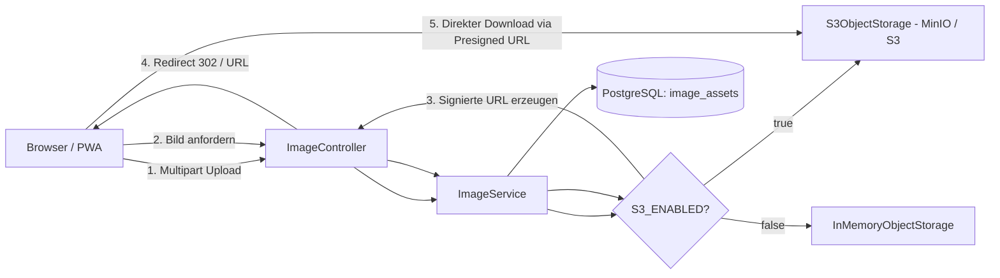
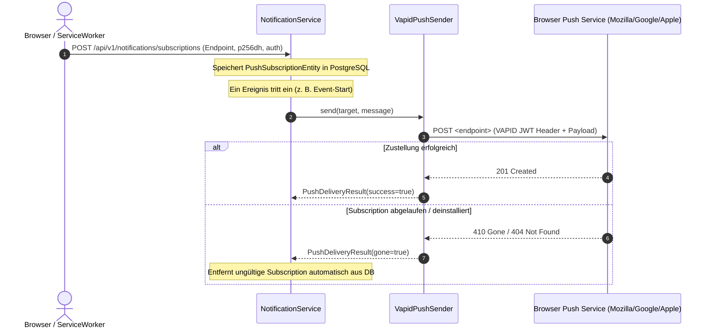

# 🔌 Integrationen, Objektspeicher & Push-Dienste

In diesem Kapitel erfährst du, wie der `baseservice` mit externen Systemen integriert ist: S3-kompatibler Objektspeicher (MinIO / AWS S3), Web-Push-Zustellung über das VAPID-Protokoll, WebSocket-Echtzeit-Chat sowie die zugehörigen Feature-Toggles.

---

## 🗄️ Objektspeicher (`ObjectStorage.kt`)

Der `baseservice` speichert Binärdaten (Profil- und Eventbilder) nicht in der relationalen Datenbank, sondern in einem S3-kompatiblen Objektspeicher.



### 1. Schnittstelle `ObjectStorage`
Die Fachschicht (`ImageService`) interagiert ausschließlich über das Interface `ObjectStorage`:

```kotlin
interface ObjectStorage {
    fun store(key: String, data: ByteArray, contentType: String)
    fun delete(key: String)
    fun presignedGetUrl(key: String, ttl: Duration): URI
}
```

### 2. Implementierungen & Konfiguration (`StorageConfig.kt`)
- **`S3ObjectStorage`**: Aktiviert, wenn `vereint.storage.enabled=true` (`S3_ENABLED=true`). Verwendet AWS S3 SDK / MinIO mit Path-Style-Access (`/bucket/key`), Access- und Secret-Key.
- **`InMemoryObjectStorage`**: Fallback für lokale Entwicklung und Tests (`S3_ENABLED=false`). Hält Binärdaten in einer Concurrent-Map und erzeugt lokale Data-URIs.
- **Sicherheitsgarantie**: S3-Credentials gelangen **niemals** an den Client. Der lesende Zugriff erfolgt ausschließlich über temporär signierte Presigned-URLs mit konfigurierbarer Lebensdauer (`S3_URL_TTL_SECONDS`, Standard: 900 Sekunden = 15 Minuten).

---

## 📲 Web-Push-Zustellung (`PushSender.kt`)

Benachrichtigungen (z. B. Chat-Pings, Event-Erinnerungen oder Kassen-Aufladungen) werden über das standardisierte Web-Push-Protokoll (VAPID / RFC 8292) an Browser und PWA-Clients zugestellt.



### 1. Schnittstelle `PushSender` & Konfiguration (`PushConfig.kt`)
- **`VapidPushSender`**: Aktiviert, wenn `vereint.push.enabled=true` (`VAPID_ENABLED=true`). Signiert Nachrichten mit dem VAPID Private Key.
- **`NoOpPushSender`**: Fallback bei `VAPID_ENABLED=false`. Benachrichtigungen werden weiterhin in der Tabelle `notifications` persistiert, der externe HTTP-Versand wird jedoch stumm übersprungen.
- **Subscription-Bereinigung**: Meldet ein Push-Gateway HTTP `404` oder `410 Gone`, markiert der `PushSender` das Ergebnis mit `gone = true`, und der `NotificationService` bereinigt den Eintrag automatisch aus der Datenbank.

---

## 💬 WebSocket & Echtzeit-Chat (`ChatService.kt`, `ChatController.kt`)

Für den Vereins- und Event-Chat bietet der `baseservice` sowohl REST-Endpunkte zur Nachrichtenabfrage als auch WebSocket-Kanäle für den verzögerungsfreien Empfang:

- **WebSocket-Endpunkt**: `/ws/chat`
- **Kanäle**:
  - `/topic/chat/general`: Allgemeiner Vereinschat (autorisiert für Rollen `member`, `board`, `admin`).
  - `/topic/events/{eventId}/chat`: Veranstaltungschat (autorisiert für Teilnehmer und registrierte Gäste).
- **Gast-Chat-Besonderheit**: Externe Gäste mit gültigem `X-Guest-Token` können ohne Keycloak-Login am Chat ihres spezifischen Events teilnehmen (`/api/v1/events/*/chat/guest/**`).

---

## 🎛️ Feature-Toggles im Überblick

| Toggle (Umgebungsvariable) | Default | Bei `true` | Bei `false` (Fallback) |
| :--- | :---: | :--- | :--- |
| **`S3_ENABLED`** | `false` | Verwendet MinIO / S3 für Bild-Assets | `InMemoryObjectStorage` (In-Memory Data URIs) |
| **`VAPID_ENABLED`** | `false` | Sendet echte Web-Push-Nachrichten via VAPID | `NoOpPushSender` (Persistenz ohne Versand) |
| **`EV_LIQUIBASE_ENABLED`** | `true` | Führt Schema-Migrationen beim Start aus | Migrationen deaktiviert (z. B. für externe Tools) |

Durch diese Toggles kann der gesamte `baseservice` lokal ohne externe MinIO- oder Push-Infrastruktur voll funktionsfähig betrieben und getestet werden.

---

## 🔗 Querverweise

- Weiter zu [07. Service erweitern & Rezepte](07-extending-the-service.md)
- Zurück zu [05. Fehlerbehandlung & Observability](05-error-handling-and-observability.md)
- [Fachdomäne: Chat & Push-Benachrichtigungen](../domains/chat-and-push-notifications.md)
- [Betrieb: Keycloak & Objektspeicher](../operations/keycloak-and-storage.md)
