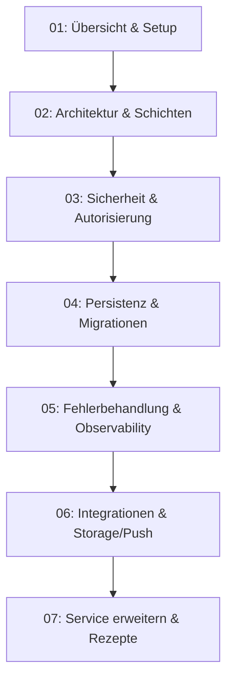
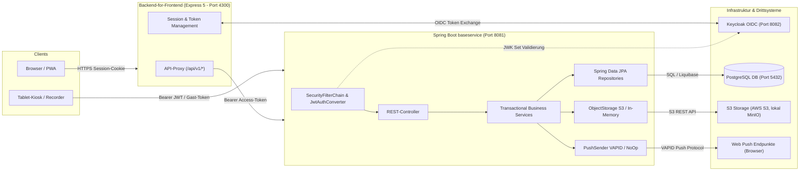

# ☕ Spring Boot Fachservice (baseservice)

Herzlich willkommen in der technischen Dokumentation des **Vereint Fachservice (`baseservice`)**. Dieses Backend-Modul implementiert die fachliche Geschäftslogik, Datenpersistenz, Benutzerprovisionierung, das Kassenbuch (Ledger), Event- und Katalogverwaltung sowie Realtime-Kommunikation und Push-Benachrichtigungen für die Vereint-Plattform.

---

## 🧭 Zielgruppe & Lernpfad für Entwickler

Diese Dokumentation richtet sich an Backend- und Fullstack-Entwickler, die den Spring-Boot-Service verstehen, lokal betreiben, debuggen, testen oder um neue Fachdomänen und Endpunkte erweitern möchten.

1. **[01. Übersicht & Setup](01-overview-and-setup.md)**: Rolle des `baseservice`, Tech-Stack (Kotlin 2.3, Spring Boot 4.1, Java 25), Ordnerstruktur, Gradle-Tasks, Start per Docker Compose und vollständige Referenz aller Umgebungsvariablen.
2. **[02. Architektur & Schichten](02-architecture-and-layers.md)**: Schichtenmodell (Filter → Security → Controller → Service → Repository → DB), Request-Lebenszyklus, Design-Konventionen am Referenzbeispiel Speisenkatalog und vollständige Paketkarte aller Controller und Services.
3. **[03. Sicherheit & Autorisierung](03-security-and-authorization.md)**: `SecurityConfig`, Deny-by-Default, JWT-Verarbeitung (`JwtAuthConverter`, `JwtClaimExtractor`, `UserPrincipal`, `AuthContext`), Rollen- und Permission-Matrix (`RolePermissionMatrix` V2), `AccessResolverService`, Provisionierung und CORS-Absicherung.
4. **[04. Persistenz & Migrationen](04-persistence-and-migrations.md)**: JPA-Entities, Repositories, Transaktionsregeln (`@Transactional`), Optimistic Locking (`@Version`), Liquibase-Changelogs (`001`–`007`), Konventionen und Rollback-Strategien.
5. **[05. Fehlerbehandlung & Observability](05-error-handling-and-observability.md)**: `ApiException`-Hierarchie, `ErrorCode`-Katalog, RFC-7807-Problem-Details (`ApiProblem`), `GlobalExceptionHandler`-Mapping, Request-Tracing (`X-Request-Id` / `traceId`), Actuator-Endpunkte und OpenAPI/Swagger.
6. **[06. Integrationen](06-integrations.md)**: S3-kompatibler Objektspeicher (`ObjectStorage`, `S3ObjectStorage`, `InMemoryObjectStorage`), Web-Push-Versand (`PushSender`, `VapidPushSender`, `NoOpPushSender`), WebSocket-Chat und Feature-Toggles.
7. **[07. Service erweitern & Rezepte](07-extending-the-service.md)**: Schritt-für-Schritt-Rezepte (neuer REST-Endpunkt, Entity mit Liquibase-Migration, Permission, ErrorCode, Config-Property), Testkonventionen (MockMvc, `@MockitoBean`, `jwt()`, Testcontainers), Debugging-Tabelle und PR-Checkliste.

---

## 🏛️ Gesamtarchitektur & Systemkontext

Der `baseservice` fungiert als Resource Server im OAuth2/OIDC-Ökosystem und wird primär durch das Express-5-BFF (`webservice`) oder berechtigte Tablet-Kioske aufgerufen.

---

## 📖 Glossar & Kernkonzepte

| Begriff | Definition im Vereint `baseservice` |
| :--- | :--- |
| **UserPrincipal** | Leichtgewichtige Repräsentation des authentifizierten Benutzers (`sub`, `roles`, `email`, `name`), erzeugt aus dem decodierten Keycloak-JWT. |
| **AuthContext** | Request-gebundene Hilfskomponente (`AuthContext.kt`), um den aktuellen `UserPrincipal` oder das Gast-Token typsicher im Controller oder Service abzurufen. |
| **RolePermissionMatrix** | Zentrale, versionierte Matrix (`RolePermissionMatrix.kt`, Version 2), die Rollen (`member`, `board`, `admin`, `tabletRecorder`) deterministisch auf feingranulare Berechtigungen (`Permission.*`) abbildet. |
| **ApiException** | Basisklasse aller fachlichen Laufzeitfehler (`Exceptions.kt`), die einen HTTP-Statuscode (`HttpStatus`) und einen maschinenlesbaren `ErrorCode` kapselt. |
| **ErrorCode** | Standardisierte String-Konstante (`ErrorCode.kt`, z. B. `invalid_request`, `permission_denied`, `concurrent_modification`), die im Fehler-JSON ausgeliefert wird. |
| **ApiProblem** | RFC-7807-konforme Fehlerantwort (`ProblemDetail`) mit den VEREINT-Erweiterungen `code`, `traceId`, `timestamp` und `details`. |
| **traceId / X-Request-Id** | Eindeutige Korrelations-ID (`RequestIdFilter.kt`), die jeden eingehenden HTTP-Request begleitet, in Logs protokolliert und im Fehlerfall an den Client zurückgegeben wird. |
| **Liquibase Changeset** | Deklarative Datenbankmigrationsanweisung (`db/changelog/changes/00X-*.xml`), die Schema- und Datenänderungen versionssicher und idempotent auf PostgreSQL ausführt. |
| **Optimistic Locking (`@Version`)** | Nebenläufigkeitsschutz in JPA-Entities über eine inkrementierte Versionsspalte; schützt vor Lost Updates bei parallelen Buchungen oder Stammdatenänderungen. |
| **Deny by Default** | Sicherheitsprinzip in `SecurityConfig.kt`: Jeder HTTP-Endpunkt erfordert zwingend Authentifizierung, sofern er nicht explizit in der `permitAll()`-Positivliste freigegeben ist. |
| **Idempotency-Key** | Optionaler oder verpflichtender HTTP-Header (`X-Idempotency-Key` / `Idempotency-Key`), der doppelte Transaktionen (z. B. Buchungen im Kassenbuch) bei Netzwerk-Retries verhindert. |

---

## 🔗 Querverweise zu weiteren Dokumenten

- [Gesamtarchitektur & Datenflüsse](../architecture/system-overview.md)
- [Sicherheits- & Authentifizierungskonzept](../architecture/security-and-auth.md)
- [Entity-Relationship-Datenmodell](../architecture/data-model.md)
- [BFF Express 5 Dokumentation](../backend-for-frontend/README.md)
- [REST-API-Referenz](../api/rest-api-reference.md)
- [Fehlerbehandlung & Idempotenz](../api/error-handling-and-idempotency.md)
- [Datenbankmigrationen mit Liquibase](../operations/database-migrations.md)
- [Lokales Docker Compose Setup](../operations/local-setup-docker.md)
- [Keycloak & Objektspeicher-Betrieb](../operations/keycloak-and-storage.md)
