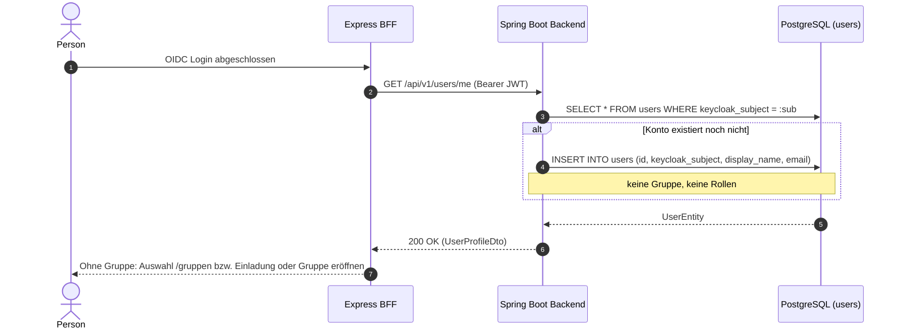

# Fachdomäne: Benutzerverwaltung & Authentifizierung

Die Benutzerverwaltung in **Vereint** verbindet das externe Identitätsmanagement (Keycloak OIDC) mit einer internen, gruppenbezogenen Profildatenbank in PostgreSQL. Sie regelt Konten, Profilpflege, Rollen- und Rechtevergabe je Gruppe sowie das Sperren von Mitgliedern.

---

## 🎯 Fachliche Sicht (Business Domain)

### Benutzer-Lebenszyklus & Onboarding
1. **Konto beim ersten Login**:
   - Meldet sich jemand erstmals über Keycloak an, legt der Fachservice anhand des OIDC-Subjekts (`keycloak_subject`) ein Konto in `users` an (*Just-in-Time Provisioning*, `UserProvisioningService`).
   - Ein neues Konto gehört zu keiner Gruppe und hat keine Rollen; Rollen aus dem Token werden nicht übernommen.
   - In eine Gruppe kommt man über einen [Einladungslink](member-invites.md) (neues oder bestehendes Konto), durch Eröffnen einer eigenen [Gruppe](stammtische.md) oder durch die Plattform-Administration. Per Einladung erhält man die Rolle `member`; wer eine Gruppe eröffnet, erhält dort `member` und `admin`.
   - In Produktion gibt es keine offene Registrierung und kein „Passwort vergessen“ auf der Keycloak-Seite.
2. **Profilpflege**:
   - Mitglieder ändern Anzeigenamen (`displayName`) und E-Mail-Adresse selbst (`PUT /api/v1/users/me`); das Profilbild läuft über die Bilder-API.
   - **Zwei-Faktor-Anmeldung (freiwillig)**: „Zwei-Faktor-Anmeldung einrichten“ im Profil öffnet die Keycloak-Kontoverwaltung (`/kc/realms/vereint/account/account-security/signing-in`). Wer dort eine Authenticator-App hinterlegt, wird beim Login nach dem Code gefragt. Pflicht ist sie für niemanden.
3. **Rollen & Vorstandsfunktion**:
   - Rollen gelten je Gruppe (`stammtisch_roles`); neben den Systemrollen `member`, `board`, `admin` und `tabletRecorder` kann jede Gruppe eigene Rollen anlegen. Keycloak-Realmrollen zählen nicht, außer `admin` für die Plattform-Administration. Siehe [Gruppen](stammtische.md#rollen-je-gruppe).
   - Wer `roles.manage` hat, weist im Bearbeiten-Formular eines Mitglieds alle Rollen der Gruppe zu, auch eigene Rollen.
   - Die Vorstandsfunktion (`chair`, `treasurer`, `secretary`, `assessor`) setzt man mit `members.manage`; sie steuert u. a., welche Bereiche des Audit-Logs sichtbar sind.
   - Eigene Rollen, Berechtigungen und den eigenen Status kann niemand selbst ändern. Die letzte Person mit `members.manage` oder `roles.manage` einer Gruppe bleibt geschützt.
4. **Sperren**:
   - Mit `members.manage` lässt sich ein Mitglied sperren. Das beendet die Mitgliedschaft in dieser Gruppe und entfernt seine Rollen dort; Buchungen und Verläufe bleiben erhalten. In anderen Gruppen bleibt die Person Mitglied.
   - Entsperren nimmt die Person wieder mit der Rolle `member` auf.
   - Gesperrte Mitglieder sehen die Gruppe nicht mehr und können dort weder buchen noch schreiben.
   - Daneben gibt es ein kontoweites Sperrkennzeichen (`users.disabled`, Antwort `403 account_disabled`); die App setzt es nur beim Löschen eines Kontos.
5. **Konto löschen** (#152): siehe [Konto löschen](#konto-löschen).

---

## ⚙️ Technische Sicht (Architecture & Implementation)

### 1. Relevante Komponenten & Klassen
- **Controller**: `de.maurer.baseservice.controller.UserController`
  - `GET /api/v1/users/me`: eigenes Profil (`UserProfileDto`)
  - `PUT /api/v1/users/me`: eigenes Profil ändern (`UpdateProfileRequest`)
  - `GET /api/v1/users`: Mitgliederliste mit Paging und Filtern `search`, `role`, `disabled` (`PagedResponse<UserSummaryDto>`, `members.read`)
  - `GET /api/v1/users/directory`: aktive Mitglieder für Auswahllisten, ohne E-Mail (alle Mitglieder)
  - `GET /api/v1/users/{id}`: Profil eines Mitglieds (`members.manage`)
  - `PUT /api/v1/users/{id}`: Mitglied bearbeiten (`AdminUpdateUserRequest`, `members.manage`; Rollen darin mit `roles.manage`; Name und E-Mail nur Plattform-Administration)
  - `PUT /api/v1/users/{id}/roles`: Rollen zuweisen (`AssignRolesRequest`, `roles.manage`)
  - `PUT /api/v1/users/{id}/permissions`: einzelne Berechtigungen zuweisen (`AssignPermissionsRequest`, `roles.manage`)
  - `PUT /api/v1/users/{id}/status`: sperren oder entsperren (`UpdateUserStatusRequest`, `members.manage`)
  - `GET /api/v1/users/me/deletion`: Vorschau der Kontolöschung (`AccountDeletionPreviewDto`)
  - `POST /api/v1/users/me/deletion`: eigenes Konto löschen (`DeleteAccountRequest` mit `confirm: true`, Antwort `AccountDeletedDto`; `409 account_deletion_blocked`, solange man irgendwo letzte Verwaltung ist)
- **Services**:
  - `UserService`: Profile, Rollen, Vorstandsfunktion und Status.
  - `UserProvisioningService`: legt das Konto beim ersten Aufruf in eigener Transaktion an.
  - `MembershipService`: Mitgliedschaft in der gewählten Gruppe aufnehmen oder beenden.
  - `StammtischManagers`: schützt die letzte Person mit `members.manage` oder `roles.manage`.
  - `StammtischAccess`: prüft Permissions der gewählten Gruppe.
  - `AccountDeletionService`: Selbstlöschung über alle Gruppen (siehe unten).
- **Entitäten**: `UserEntity`, `UserRoleEntity`, `UserPermissionEntity` (in `UserEntities.kt`), `StammtischMemberEntity`, `StammtischRoleEntity`.

---

## 📋 Datenstrukturen & DTOs

```kotlin
data class UserProfileDto(
    val id: String,
    val keycloakSubject: String,
    val displayName: String,
    val email: String?,
    val disabled: Boolean,        // Konto gesperrt oder keine aktive Mitgliedschaft
    val drinkRecorder: Boolean,   // hat die Rolle tabletRecorder
    val boardRole: String?,
    val roles: Set<String>,       // Rollen in der gewählten Gruppe
    val permissions: Set<String>,
    val createdAt: Instant,
    val updatedAt: Instant
)

data class UpdateProfileRequest(
    @field:Size(min = 1, max = 255) val displayName: String? = null,
    @field:Email @field:Size(max = 255) val email: String? = null
)

data class AdminUpdateUserRequest(
    val displayName: String? = null,
    val email: String? = null,
    val disabled: Boolean? = null,
    val drinkRecorder: Boolean? = null,
    val boardRole: String? = null,      // chair, treasurer, secretary, assessor
    val roles: Set<String>? = null,     // höchstens 32
    val permissions: Set<String>? = null // höchstens 64
)

data class AssignRolesRequest(val roles: Set<String> = emptySet())
data class AssignPermissionsRequest(val permissions: Set<String> = emptySet())
data class UpdateUserStatusRequest(val disabled: Boolean)
```

---

## 🔄 Sequenzablauf: Just-in-Time Provisionierung



---

## Konto löschen

Jede Person löscht ihr Konto selbst unter *Profil → Konto löschen*
(`AccountDeletionService`, `account-deletion.component.ts`). Google Play und
der App Store verlangen das für Apps mit Konten.

**Prüfen** je Gruppe mit aktiver Mitgliedschaft (nicht archiviert):

| Lage | Folge |
|---|---|
| Keine weiteren aktiven Mitglieder | Gruppe wird archiviert |
| Letzte Person mit `members.manage`/`roles.manage`, weitere Mitglieder da | Abgelehnt (`409 account_deletion_blocked`) bis zur Übergabe |
| Sonst | Mitgliedschaft endet wie beim Austritt |

Die Vorschau nennt zusätzlich offenes Guthaben je Gruppe
(`LedgerService.creditBalanceOf`) und ob das Login mitgelöscht wird.

**Löschen** in einer Transaktion im System-Kontext (RLS-Bypass) mit
nativem SQL über alle Gruppen, auch frühere:

- eigene Moments samt Moment-Chats, Antworten, Medien (`moment_media`,
  `image_assets` mit `purpose = moment`), Antworten auf fremde Moments
- eigene Nachrichten in Gruppen-, Event- und Moment-Chats mit `chat_media`
  und Reaktionen, eigene Anheftungen, Chat-Mitgliedschaften
- Direktchats der Person ganz (`direct_conversations` und alles darunter)
- `friendships`, `notifications`, `push_subscriptions`, `statistic_records`,
  `event_series_invitees`, `event_participants` künftiger Events
- Profilbild (`image_assets` mit `purpose = profile`)
- `user_roles`, `user_permissions`, `stammtisch_members.active = false`
- `users`: `display_name = 'Gelöschtes Konto'`, `email = null`,
  `disabled = true`, `deleted_at` (Changeset 350), AGB-Zustimmung und
  Statistik-Schalter zurückgesetzt. `keycloak_subject` bleibt, damit ein noch
  gültiges Token kein neues leeres Konto anlegt.

**Bleibt erhalten**, weil Gruppen es für Kasse und Nachvollziehbarkeit
brauchen: `ledger_entries`, `rounds`, `round_invitees`, `events` (als
Veranstalter), `kiosk_sessions`, `member_invites`, Katalog-Vorschläge,
`audit_logs`. Alle zeigen auf den Platzhalter.

**Nach dem Commit**: Dateien im Speicher löschen (`MediaStore.delete`, Fehler
nur im Log), Audit-Eintrag `ACCOUNT_DELETED` in jeder Gruppe mit Spuren des
Kontos (Details nur `deleted` bzw. `deleted; group archived`), Login über die
Keycloak-Admin-API löschen (`IdentityProvisioner.deleteAccount`, Client
`vereint-registration` mit `manage-users`). Ist die Registrierung nicht
konfiguriert oder scheitert Keycloak, bleibt das App-Konto gelöscht und
gesperrt; die Antwort meldet `loginDeleted: false` und das Log nennt das
Subject, damit der Betreiber das Login von Hand entfernt.

**Verschlüsselte Daten** haben keinen Schlüssel pro Person; sie verschwinden
mit Zeilen und Dateien. Backups enthalten sie bis zu deren Ablauf.

Ein gelöschtes Konto lässt sich nicht wieder aufnehmen
(`MembershipService.addMember`, `UserService.adminUpdateUser` lehnen ab).
