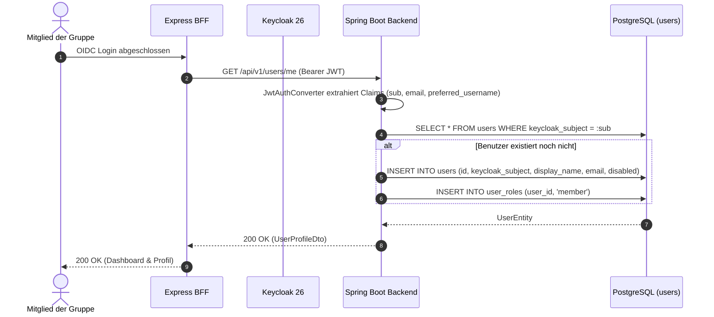

# Fachdomäne: Benutzerverwaltung & Authentifizierung

Die Benutzerverwaltung in **Vereint** verbindet das externe Identitätsmanagement (Keycloak OIDC) mit einer internen, gruppenbezogenen Profildatenbank in PostgreSQL. Sie regelt Mitglieder-Onboarding, Stammdatenpflege, Rollen- und Rechtevergabe sowie das administrative Sperren (*Disabling*) von Accounts.

---

## 🎯 Fachliche Sicht (Business Domain)

### Benutzer-Lebenszyklus & Onboarding
1. **Erstregistrierung / OIDC-Provisionierung**:
   - Wenn sich ein Benutzer erstmals über Keycloak anmeldet, wird anhand des OIDC-Subjekts (`keycloak_subject`) automatisch ein Benutzerdatensatz angelegt (*Just-in-Time Provisioning*).
   - Standardmäßig erhält jedes neue Mitglied die Rolle `member` und wird als aktiv (`disabled = false`) geführt.
   - Neue Personen kommen über einen Einladungslink von Vorstand oder Administration in die Gruppe und legen ihr Konto selbst an; siehe [Mitglieder per Einladungslink](member-invites.md).
2. **Profilpflege**:
   - Mitglieder können ihren Anzeigenamen (`displayName`), ihre E-Mail-Adresse und Profilbild-Referenzen selbst verwalten.
   - **Zwei-Faktor-Anmeldung (freiwillig)**: „Zwei-Faktor-Anmeldung einrichten“ im Profil öffnet die Keycloak-Kontoverwaltung (`/kc/realms/vereint/account`). Wer dort eine Authenticator-App hinterlegt, wird beim Login nach dem Code gefragt. Pflicht ist sie für niemanden.
3. **Rollen- & Funktionszuweisung (Vorstand/Admin)**:
   - Administratoren können Mitgliedern zusätzliche Rollen (`board`, `admin`, `tabletRecorder`) sowie Vorstandsfunktionen (`chair`, `treasurer`, `secretary`, `assessor`) zuweisen.
   - Rollen gelten je Gruppe (`stammtisch_roles`); neben den vier Systemrollen kann jede Gruppe eigene Rollen anlegen. Keycloak-Realmrollen zählen nicht mehr, außer `admin` für den Plattform-Admin. Siehe [Gruppen](stammtische.md#rollen-je-stammtisch).
4. **Sperrung (Account Disablement)**:
   - Bei Austritt oder Beitragsrückstand kann ein Administrator einen Benutzer sperren (`disabled = true`).
   - Gesperrte Benutzer können keine Kassenbuchungen, Barcodekäufe oder Chat-Nachrichten mehr tätigen.

---

## ⚙️ Technische Sicht (Architecture & Implementation)

### 1. Relevante Komponenten & Klassen
- **Controller**: `de.maurer.baseservice.controller.UserController`
  - `GET /api/v1/users/me` – Eigenes Profil laden (`UserProfileDto`)
  - `PUT /api/v1/users/me` – Eigenes Profil aktualisieren (`UpdateUserProfileRequest`)
  - `GET /api/v1/users` – Mitgliederliste paginiert abrufen (`PagedResponse<UserSummaryDto>`, optional Filter `search`, `role`, `disabled`)
  - `GET /api/v1/users/{id}` – Details eines Mitglieds abrufen
  - `PUT /api/v1/users/{id}` – Stammdaten durch Admin bearbeiten (`AdminUpdateUserRequest`)
  - `PUT /api/v1/users/{id}/roles` – Rollenzuweisung (`AssignRolesRequest`)
  - `PUT /api/v1/users/{id}/permissions` – Direkte Berechtigungszuweisung (`AssignPermissionsRequest`)
  - `PUT /api/v1/users/{id}/status` – Benutzer aktivieren/deaktivieren (`UpdateUserStatusRequest`)
- **Services**:
  - `UserService`: Geschäftslogik für Benutzerprofile, Rollenänderungen und Statusverwaltung.
  - `UserProvisioningService`: Synchronisation zwischen Keycloak JWT Claims und PostgreSQL `users`-Tabelle.
  - `UserPermissionCache`: Effizientes Caching der abgeleiteten Berechtigungen im Arbeitsspeicher.
- **Entitäten**: `UserEntity`, `UserRoleEntity`, `UserPermissionEntity` (in `UserEntities.kt`).

---

## 📋 Datenstrukturen & DTOs

```kotlin
data class UserProfileDto(
    val id: String,
    val keycloakSubject: String,
    val email: String?,
    val displayName: String,
    val disabled: Boolean,
    val drinkRecorder: Boolean,
    val boardRole: String?,
    val roles: Set<String>,
    val permissions: Set<String>,
    val createdAt: Instant,
    val updatedAt: Instant
)

data class UpdateUserProfileRequest(
    @field:Size(min = 2, max = 255)
    val displayName: String? = null,
    @field:Email
    val email: String? = null
)

data class AdminUpdateUserRequest(
    @field:Size(min = 2, max = 255) val displayName: String? = null,
    @field:Email val email: String? = null,
    val boardRole: String? = null,
    val drinkRecorder: Boolean? = null
)

data class AssignRolesRequest(
    @field:NotNull val roles: Set<String>
)

data class AssignPermissionsRequest(
    @field:NotNull val permissions: Set<String>
)

data class UpdateUserStatusRequest(
    @field:NotNull val disabled: Boolean
)
```

---

## 🔄 Sequenzablauf: Just-in-Time Provisionierung


