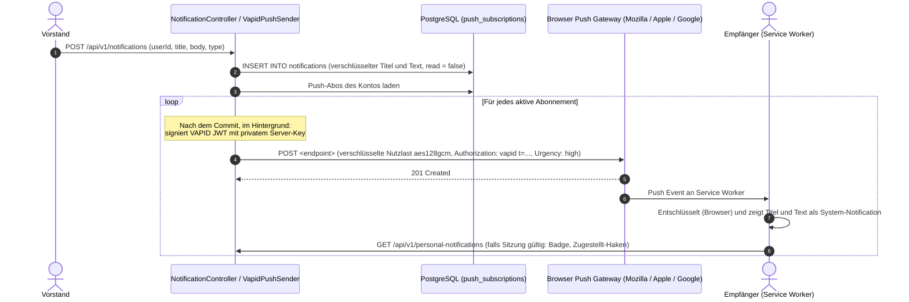

# Fachdomäne: Kommunikation & Push-Benachrichtigungen

Das Kommunikationsmodul in **Vereint** ermöglicht den Austausch zwischen Mitgliedern der Gruppe sowie die Zustellung von Mitteilungen über Web Push (VAPID).

---

## 🎯 Fachliche Sicht (Business Domain)

### 1. Gruppenchat & Konversationsarten
- **Gruppenchat**: Zentraler Raum für alle Mitglieder der Gruppe (im Code `club`). Wer `chat.moderate` oder `event.manage` hat, setzt dort eine **Infotafel** (angeheftete Notiz).
- **Event-Chats**: Jedes Event hat einen eigenen Chat für Veranstalter, Eingeladene und autorisierte Gäste. Alle Termine einer Serie teilen sich einen Chat (`conversations.series_id`, Schlüssel `series:{id}`; über geteilte Serien hinweg via `event_series.chat_root_id`, siehe `SeriesChats`). Ihn lesen Veranstalter und Eingeladene aller Termine; Gäste eines Termins sehen nur Nachrichten ab ihrer Einladung. Er nimmt Nachrichten an, solange ein Termin nicht abgesagt oder archiviert ist; Statistik, Titel und `eventId` beziehen sich auf den aktuellen Termin (laufend, sonst nächster, sonst zuletzt vergangener). Mit `chat.moderate` oder `event.manage` lassen sich alle Event-Chats öffnen. Beendete oder abgesagte Events nehmen keine neuen Nachrichten an.
- **Zu- und Absagen im Event-Chat** (`ChatRsvpNotes`): `PUT /events/{id}/rsvp` mit `accepted` bzw. `declined` legt eine Hinweiszeile an (`chat_messages.kind` = `rsvp_accepted`/`rsvp_declined`, `rsvp_event_id`; leerer Text), wenn sich die Antwort ändert. Kein Push, keine Statistik, zählt nicht als ungelesen und nicht für persönliche Mitteilungen; ein Live-Signal frischt offene Chats auf. Nachrichten tragen `senderRsvp` (`accepted`/`declined`): die aktuelle Antwort der Absenderin auf den Termin, für den sie schrieb (erster nicht abgesagter Termin, der beim Schreiben noch nicht vorbei war), nur solange dieser Termin nicht vorbei ist (Ende bzw. Beginn + 6 Stunden, oder `completed`/`archived`). `rsvpEventStartsAt` nennt bei Serien den Termin des Hinweises.
- **Direktnachrichten**: 1:1-Gespräche, gruppenübergreifend: genau ein Gespräch je Personenpaar, schreiben darf man Freunden und Personen aus den eigenen Gruppen (`/direktnachrichten`). Details in [Kalender, Freunde und Direktnachrichten](kalender-freunde-direktnachrichten.md).
- **Gast-Chat**: Gäste mit gültigem Einladungstoken lesen und schreiben im Chat ihres Events, ohne Benutzerkonto.
- **Reaktionen**: Emoji-Reaktionen auf einzelne Nachrichten.
- **Haken (Zugestellt/Gelesen)**: Eigene Nachrichten tragen einen Stand `sent` (ein Haken), `delivered` (zwei Haken) oder `read` (zwei farbige Haken). Zugestellt ist eine Nachricht, sobald die App der Empfängerin die Chat-Liste, den Verlauf oder den Ungelesen-Zähler geladen hat oder ihr Service Worker nach einem Push nachgeladen hat. Gelesen ist sie, sobald der Chat bei ihr sichtbar offen war. In Gruppen- und Event-Chats zählen alle, die den Chat lesen dürfen (wie beim Push), und die Haken wechseln erst, wenn alle so weit sind; die Zahlen dazu (`delivered`, `read` von `recipients`) stehen im Tooltip. Siehe [Haken, Tippen, Offline-Versand](#4-haken-schreibt-gerade-und-offline-versand).
- **„schreibt gerade…“**: Tippt jemand im offenen Chat, sehen die anderen Lesenden einige Sekunden „Anna schreibt…“. Nichts davon wird gespeichert.
- **Offline-Versand**: Ohne Netz bleibt eine Nachricht in einer Warteschlange auf dem Gerät und geht automatisch hinaus, sobald das Netz zurück ist. Eine von der App vergebene `clientId` verhindert, dass sie doppelt ankommt.
- **Ungelesen-Zähler**: Je Mitglied und Unterhaltung wird der Lesestand gespeichert (`conversation_members.last_read_at`, bei Direktnachrichten `direct_participants.last_read_at`); die App zeigt die Zahl ungelesener Nachrichten der gewählten Gruppe plus aller Direktnachrichten als Badge am Chat-Eintrag der Navigation.
- **Aktualisierung (live)**: Neue Nachrichten, Reaktionen, Lesestände und Mitteilungen erscheinen sofort. Die App hält dafür eine Live-Verbindung (Server-Sent Events, `GET /api/v1/live`); der Server meldet darüber nur, *was* sich geändert hat, die App lädt es dann wie gewohnt über die REST-Endpunkte. Steht die Verbindung nicht (Netz weg, Proxy puffert), fragt die App wie früher alle 10 Sekunden ab. Siehe [Live-Verbindung](#3-live-verbindung-server-sent-events).
- **Verschlüsselung**: Nachrichten werden vor dem Speichern mit AES-256-GCM verschlüsselt (`DATA_ENCRYPTION_KEY`).

### 2. Mitteilungen & Push-Benachrichtigungen
- **Mitteilungen** entstehen bei Event-Einladungen, Erinnerungen und Absagen, neuen Moments, Runden („Thomas gibt eine Runde aus“, Typ `round`, an die Eingeladenen) sowie Nachrichten des Vorstands. Sie gehören zur Gruppe, in der sie entstehen.
- **Web Push**: Browserbasierte Benachrichtigungen (auch bei geschlossener App) für diese Mitteilungen, für neue Nachrichten im Gruppenchat und in Event-Chats sowie für Direktnachrichten und Freundschaftsanfragen (siehe [Kalender, Freunde und Direktnachrichten](kalender-freunde-direktnachrichten.md#push-benachrichtigungen)).
  - Chat-Pushes gehen an alle, die den Chat lesen dürfen, außer an die Absenderin: im Gruppenchat an alle aktiven Mitglieder, im Event-Chat an Veranstalter und Eingeladene, deren Einladung schon verschickt ist (beim Chat einer Serie die aller Termine). Moment-Chats (24 Stunden) lösen keinen Push aus.
  - Die Benachrichtigung zeigt „Name in Chat“ und den Text. Je Chat gibt es eine Benachrichtigung; eine neue Nachricht ersetzt die vorige.
  - Pushes zeigen Inhalte aus **allen** eigenen Gruppen richtig an, nicht nur aus der gerade gewählten. Ein Tipp darauf wechselt zuerst in die Gruppe des Eintrags und öffnet dann Chat, Event oder Mitteilungen.
  - Bei Event-Einladungen bietet die Benachrichtigung „Zusagen“ und „Absagen“ an.
- **Nachrichten des Vorstands**: Wer `notifications.broadcast` hat, schickt eine Mitteilung an ein Mitglied (`SendNotificationRequest`) oder an ausgewählte bzw. alle Mitglieder der Gruppe (`BroadcastNotificationRequest`).

---

## ⚙️ Technische Sicht (Architecture & Implementation)

### 1. Relevante Komponenten & Klassen
- **Controller**:
  - `ChatController`: Event-Chat unter `/api/v1/events/{eventId}/chat`
    - `GET /`: Unterhaltung des Events laden
    - `GET /messages`, `POST /messages`: Nachrichten lesen bzw. als Mitglied senden (`SendMessageRequest`)
    - `GET /conversations/{conversationId}`, `GET|POST /conversations/{conversationId}/messages`: einzelne Unterhaltung des Events
    - `GET /guest/messages`, `POST /guest/messages`: als Gast lesen bzw. senden (Header `X-Guest-Token`)
  - `ChatOverviewController`: gemeinsame Chat-Liste unter `/api/v1/chats`, ohne gewählte Gruppe
    - `GET /`: Gruppenchats, Event-Chats und laufende Moment-Chats (24 Stunden nach Start, sichtbar wie der Moment) aller eigenen Gruppen plus Direktnachrichten, neueste Nachricht zuerst. Gruppen- und Event-Chats tragen `stammtischId` und `stammtischName`. Der `ChatOverviewService` liest jede Gruppe in einer eigenen Transaktion in deren Kontext (wie der Kalender), sichtbar ist dasselbe wie in `GET /api/v1/conversations` der Gruppe.
    - `GET /unread-count`: ungelesene Nachrichten über alle diese Chats (Badge am Chat-Eintrag)
  - `ConversationController`: Gruppenchat und Event-Chats unter `/api/v1/conversations`. Öffnet die App einen Chat aus der gemeinsamen Liste, nennt sie dessen Gruppe im Header `X-Vereint-Chat-Group`; der BFF setzt daraus `X-Stammtisch-Id` (nur für `/api/v1/conversations/{id}/…`), der Fachservice prüft die Mitgliedschaft wie immer.
    - `GET /`: eigene Unterhaltungen der Gruppe; `GET /unread-count`: ungelesene Nachrichten (inklusive Direktnachrichten)
    - `GET /club`: Gruppenchat; `PUT /club/pin`: Infotafel setzen (`PinNoteRequest`)
    - `GET|POST /{conversationId}/messages`, `POST /{conversationId}/read`
    - `POST /{conversationId}/messages/{messageId}/reactions`: Reaktion umschalten (`ToggleReactionRequest`); jedes Emoji (bis 16 Zeichen), die App bietet die volle Unicode-Auswahl
    - `POST /{conversationId}/media`, `GET /{conversationId}/media/{mediaId}/content`: Fotos und Videos (siehe unten)
  - `DirectConversationController`: Direktnachrichten unter `/api/v1/direct-conversations`, ohne gewählte Gruppe (siehe [Kalender, Freunde und Direktnachrichten](kalender-freunde-direktnachrichten.md))
  - `NotificationController`: Endpunkte unter `/api/v1/notifications`
    - `GET /`: eigene Mitteilungen (`List<NotificationDto>`); `GET /unread-count` (`UnreadCountDto`)
    - `POST /read-all`, `POST /{notificationId}/read`: als gelesen markieren
    - `GET /vapid-public-key`: öffentlicher VAPID-Schlüssel (`VapidPublicKeyDto`)
    - `GET|POST /subscriptions`, `DELETE /subscriptions/{subscriptionId}`: eigene Web-Push-Abos (`RegisterPushSubscriptionRequest`)
    - `POST /`: Mitteilung an ein Mitglied (`SendNotificationRequest`); `POST /broadcast`: an mehrere oder alle (`BroadcastNotificationRequest`)
- **Services**:
  - `ChatService`: Event-Chat, Gast-Chat und Zugriffsprüfung (Veranstalter, Eingeladene, `chat.moderate`, `event.manage`).
  - `ConversationService`: Gruppenchat, Lesestand und Reaktionen.
  - `DirectMessageService`: gruppenübergreifende Direktnachrichten.
  - `ChatMediaService`, `ChatMediaAttachments`, `MediaStore`: Fotos und Videos in allen Chats. Die App lädt jede Datei einzeln als rohen Körper hoch (`POST …/media`, wie bei Moments ungepuffert über den BFF) und schickt die Ids mit der Nachricht (`SendMessageRequest.mediaIds`, bis 4). `MediaStore` teilt sich Prüfung, Metadaten-Bereinigung (EXIF/GPS, MP4-Ortsangaben) und Verschlüsselung (`DataEncryptor`-Stromformat) mit den Moments; Grenzen: Fotos 10 MB, Videos MP4/MOV bis 60 s und 100 MB. Tabellen `chat_media` (mit Gruppe und RLS) und `direct_media`; bis zum Senden sieht nur der Eigentümer die Datei, ungesendete Uploads löscht ein stündlicher Job nach 6 Stunden. Abruf nur über `…/media/{id}/content` mit denselben Leserechten wie der Chat; ``/`<video>` aus Chats anderer Gruppen nennen ihre Gruppe als `?chatGroup=`.
  - `NotificationService`: Mitteilungen anlegen und den Push-Versand auslösen.
  - `ChatReceipts`: Zugestellt-/Gelesen-Haken; `TypingSignals`: „schreibt gerade…“ (siehe Abschnitt 4).
  - `ChatNotifier`: meldet neue Nachrichten und Reaktionen in Gruppen-, Event- und Moment-Chats als Live-Signal und neue Nachrichten im Gruppen- und Event-Chat als Push weiter.
  - `PersonalAlertService`: alles Ungelesene einer Person über alle Gruppen (`/api/v1/personal-notifications`), aus dem der Service Worker den Inhalt eines Pushs nimmt.
  - `LiveUpdateHub` / `LiveController`: Live-Verbindungen (`GET /api/v1/live`) und Verteilung der Signale.
  - `EventInvitationService`: Einladungen, Erinnerungen und Absagen zu Events.
  - `PushDispatcher`: Stellt nach dem Commit im Hintergrund zu und entfernt ungültige Abos (`404`/`410`). Offene Geräte bekommen zusätzlich sofort ein Live-Signal `notification`.
  - `VapidPushSender`: Erzeugt RFC-8292-konforme VAPID-Header und sendet Titel, Text, Ziel und Gruppe als nach RFC 8291 verschlüsselte Nutzlast (`WebPushEncryption`), mit `Urgency: high` und `Topic` je Gespräch. Der Service Worker zeigt den Push sofort an, ohne nachzuladen.
  - `NoOpPushSender`: Fallback ohne konfigurierte VAPID-Keys.
- **Entitäten**: `ConversationEntity`, `ConversationMemberEntity`, `ChatMessageEntity`, `NotificationEntity`, `PushSubscriptionEntity`.

### 3. Live-Verbindung (Server-Sent Events)
- `GET /api/v1/live` liefert einen Ereignisstrom (`text/event-stream`) für die eigenen Geräte, ohne gewählte Gruppe. Der BFF hängt wie bei allen API-Aufrufen das Token an und reicht den Strom ungepuffert und unkomprimiert durch (`liveStreamProxy`).
- Ereignisse: `ready` (Verbindung steht), `ping` (Lebenszeichen alle 25 Sekunden), `chat` und `direct` (Nachricht oder Reaktion, mit `conversationId`), `read` (eigener Lesestand auf einem anderen Gerät), `notification` (neue Mitteilung). Die Daten enthalten nur Art, Gruppe und Gespräch, nie Text. Was sich geändert hat, lädt die App über die normalen, berechtigten Endpunkte.
- Signale gehen erst nach dem Commit hinaus. Empfänger folgen den Leserechten wie beim Push (`ChatNotifier`); Direktnachrichten erreichen beide Beteiligten.
- Der Server beendet jede Verbindung nach 10 Minuten. Der Browser baut sie dann neu auf und bekommt dabei vom BFF ein frisches Token; ein gesperrtes Konto erhält spätestens dann keine Signale mehr.
- Die Verbindungen liegen im Speicher der einen baseservice-Instanz. Bei mehreren Instanzen bräuchte es einen gemeinsamen Verteiler (z. B. PostgreSQL `LISTEN/NOTIFY`).
- In der App bündelt `LiveUpdatesService` die Verbindung. Kommt sie wieder oder kehrt die App in den Vordergrund, schickt er `resync` und alle offenen Ansichten laden neu. Bleiben 70 Sekunden ohne Lebenszeichen, baut er die Verbindung neu auf.
- Ein Reverse Proxy vor der App darf `/api/v1/live` weder puffern noch komprimieren (siehe [Selbst betreiben](../betrieb/selbst-betreiben.md)).
- Zusätzlich: `receipt` (eigene Nachrichten in `conversationId` wurden zugestellt oder gelesen; nur an deren Absender) und `typing` (mit `userId` und `name` der tippenden Person; an die anderen Lesenden).

### 4. Haken, „schreibt gerade…“ und Offline-Versand
- **Speicherung**: Neben `last_read_at` merkt sich jede Mitgliedschaft `last_delivered_at` (`conversation_members`, `direct_participants`; Changelog `028-chat-receipts-and-outbox.xml`). Beides sind nur Zeitstempel. Wer den Gruppenchat noch nie geöffnet hat, bekommt beim ersten Zustellen eine Mitgliedschaft mit Beitritt = Anlage des Chats, damit der Ungelesen-Zähler unverändert rechnet.
- **`ChatReceipts`**: setzt `last_delivered_at` (nur wenn neue Nachrichten anderer da sind, also kein Schreiben bei jeder Abfrage) und meldet den Absendern der betroffenen Nachrichten `receipt`. Aufrufer: `ConversationService.listConversations`/`listMessages`/`unreadCount`/`markRead`, `DirectMessageService.list`/`messages`/`unreadTotal`/`markRead` und `PersonalAlertService.markDelivered` (nach `GET /api/v1/personal-notifications`, je Gruppe in deren Kontext). Beim Laden des Verlaufs rechnet es für eigene Nachrichten `MessageReceiptDto` aus.
- **`TypingSignals`**: `POST /api/v1/conversations/{id}/typing` bzw. `/api/v1/direct-conversations/{id}/typing` (204, nur wer schreiben darf). Höchstens ein Signal je Person und Gespräch alle 2 Sekunden; die App meldet beim Tippen höchstens alle 3 Sekunden und blendet die Anzeige nach 6 Sekunden ohne neues Signal aus.
- **Doppelte vermeiden**: `SendMessageRequest.clientId` (bis 64 Zeichen, `A-Z a-z 0-9 - _`), eindeutig je Absenderin (`uk_chat_messages_sender_client`, `uk_direct_messages_sender_client`). Kommt dieselbe `clientId` noch einmal, liefert der Server die schon gespeicherte Nachricht zurück; in einem anderen Gespräch ist sie ein `400`.
- **Warteschlange in der App** (`ChatOutboxService`): Jede Nachricht geht zuerst in die Warteschlange (`localStorage`, Schlüssel `vereint.chat.outbox`) und von dort der Reihe nach an den Server. Netzfehler, `401`, `408`, `429` und `5xx` lassen sie warten (erneut beim Ereignis `online`, beim Wiederverbinden der Live-Verbindung, im Vordergrund und nach 2, 5, 15, 30, 60 Sekunden); andere Fehler markieren sie als nicht gesendet. Gesendet wird nur, was das angemeldete Konto geschrieben hat, und Gruppenchats nur in ihrer Gruppe. Einträge älter als eine Woche fallen weg, beim Abmelden wird alles geleert. Die Warteschlange liegt **unverschlüsselt** im Browser des Geräts, bis die Nachricht gesendet ist.
- Die Eventseite bettet denselben Verlauf ein (`ChatThreadComponent` mit `embedded`).

---

## 📋 Datenstrukturen & DTOs

```kotlin
data class ChatMessageDto(
    val id: String,
    val conversationId: String,
    val senderType: String,
    val senderId: String?,
    val senderName: String,
    val message: String,
    val imageUrl: String?,
    val createdAt: Instant,
    val reactions: List<ChatReactionDto> = emptyList(),
    val clientId: String? = null,          // nur eigene Nachrichten
    val receipt: MessageReceiptDto? = null // nur eigene Nachrichten
)

data class MessageReceiptDto(
    val status: String,   // sent | delivered | read
    val recipients: Int,
    val delivered: Int,
    val read: Int
)

data class SendMessageRequest(
    @field:NotBlank @field:Size(max = 4000) val message: String? = null,
    @field:Size(max = 512) val imageUrl: String? = null,
    @field:Size(max = 64) @field:Pattern(regexp = "^[A-Za-z0-9_-]+$") val clientId: String? = null
)

data class RegisterPushSubscriptionRequest(
    @field:Size(max = 2048) val endpoint: String? = null,
    @field:Size(max = 255) val p256dh: String? = null,
    @field:Size(max = 255) val auth: String? = null,
    @field:Size(max = 512) val userAgent: String? = null
)

data class SendNotificationRequest(
    val userId: String? = null,
    val title: String? = null,
    val body: String? = null,
    val type: String? = null
)

data class BroadcastNotificationRequest(
    val userIds: List<String>? = null,
    val allMembers: Boolean? = null,
    val title: String? = null,
    val body: String? = null
)
```

Die Meldungen der Validierung kommen aus den Sprachdateien (`{validation.…}`), siehe [Fachservice-i18n](../baseservice/i18n.md).

---

## 🔄 Sequenzablauf: Push-Benachrichtigungszustellung via VAPID


