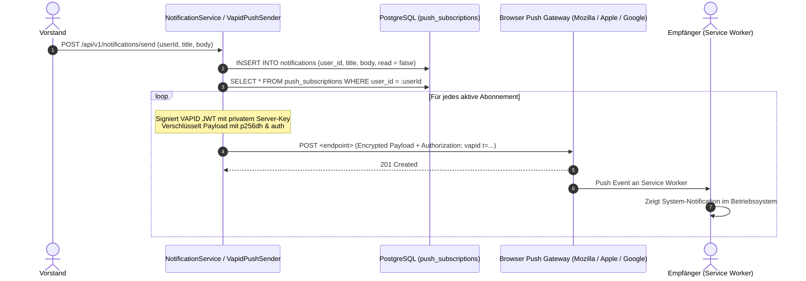

# Fachdomäne: Kommunikation & Push-Benachrichtigungen

Das Kommunikationsmodul in **Vereint** ermöglicht den interaktiven Austausch zwischen Vereinsmitgliedern sowie die zuverlässige Zustellung zeitkritischer Informationen über Web Push (VAPID).

---

## 🎯 Fachliche Sicht (Business Domain)

### 1. Vereinschat & Konversationsarten
- **Hauptkanal (Club Channel)**: Zentraler Raum für alle Vereinsmitglieder zum Austausch allgemeiner Neuigkeiten.
- **Event-Chaträume**: Jeder Veranstaltung kann ein eigener temporärer Chatraum zugeordnet werden, in dem Teilnehmer und autorisierte Gäste Fragen zu Treffpunkt, Mitbringseln oder Ablauf stellen können.
- **Direktnachrichten (Direct Messages)**: 1:1-Gespräche zwischen zwei Mitgliedern.
- **Gast-Chat**: Externe Gäste mit gültigem Einladungstoken können im jeweiligen Event-Chatraum mitlesen und schreiben, ohne ein Vereinsbenutzerkonto zu besitzen.

### 2. Push-Benachrichtigungen & Board-Broadcasts
- **Web Push Notifications**: Browserbasierte Benachrichtigungen (auch bei geschlossener App auf Smartphone oder Desktop) bei neuen Chat-Nachrichten, Event-Einladungen oder Kassenabbuchungen.
- **Vorstands-Broadcasts**: Vorstände und Administratoren können wichtige Ankündigungen an alle Mitglieder oder gezielte Personen senden (`SendNotificationRequest`).

---

## ⚙️ Technische Sicht (Architecture & Implementation)

### 1. Relevante Komponenten & Klassen
- **Controller**:
  - `ChatController`: Endpunkte unter `/api/v1/chat` (Konversationen auflisten, Nachrichten senden/abrufen, Event-Gast-Chat unter `/api/v1/events/{id}/chat/guest`).
  - `NotificationController`: Endpunkte unter `/api/v1/notifications`
    - `GET /api/v1/notifications` – Eigene Benachrichtigungen laden
    - `GET /api/v1/notifications/unread-count` – Anzahl ungelesener Nachrichten
    - `POST /api/v1/notifications/{id}/read` – Als gelesen markieren
    - `GET /api/v1/notifications/vapid-public-key` – Öffentlichen VAPID-Schlüssel für Browser holen
    - `POST /api/v1/notifications/push-subscriptions` – Browser-Abonnement registrieren
    - `POST /api/v1/notifications/send` – Vorstands-Broadcast versenden
- **Services**:
  - `ChatService`: Nachrichtenverwaltung und Berechtigungsprüfung (`chat.member`, `chat.event`).
  - `NotificationService`: Erstellung von In-App-Notifications und Auslösen des Push-Versands.
  - `VapidPushSender`: Erzeugt RFC-8292-konforme VAPID-Header und verschlüsselt Payloads über WebPush-Krypto (`p256dh`, `auth`).
  - `NoOpPushSender`: Fallback für lokale Tests ohne konfigurierte VAPID-Keys.
- **Entitäten**: `ConversationEntity`, `ConversationMemberEntity`, `ChatMessageEntity`, `NotificationEntity`, `PushSubscriptionEntity` (in `CommunicationEntities.kt`).

---

## 📋 Datenstrukturen & DTOs

```kotlin
data class ChatMessageDto(
    val id: String,
    val conversationId: String,
    val senderId: String?,
    val senderDisplayName: String,
    val content: String,
    val isGuest: Boolean,
    val createdAt: Instant
)

data class RegisterPushSubscriptionRequest(
    @field:NotBlank
    val endpoint: String,
    @field:NotBlank
    val p256dh: String,
    @field:NotBlank
    val auth: String,
    val userAgent: String? = null
)

data class SendNotificationRequest(
    @field:NotBlank
    val userId: String,
    @field:NotBlank
    val title: String,
    @field:NotBlank
    val body: String,
    val type: String? = null
)
```

---

## 🔄 Sequenzablauf: Push-Benachrichtigungszustellung via VAPID


