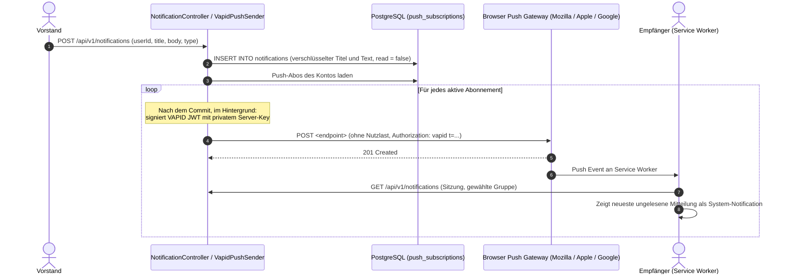

# Fachdomäne: Kommunikation & Push-Benachrichtigungen

Das Kommunikationsmodul in **Vereint** ermöglicht den Austausch zwischen Mitgliedern der Gruppe sowie die Zustellung von Mitteilungen über Web Push (VAPID).

---

## 🎯 Fachliche Sicht (Business Domain)

### 1. Gruppenchat & Konversationsarten
- **Gruppenchat**: Zentraler Raum für alle Mitglieder der Gruppe (im Code `club`). Wer `chat.moderate` oder `event.manage` hat, setzt dort eine **Infotafel** (angeheftete Notiz).
- **Event-Chats**: Jedes Event hat einen eigenen Chat für Veranstalter, Eingeladene und autorisierte Gäste. Mit `chat.moderate` oder `event.manage` lassen sich alle Event-Chats öffnen. Beendete oder abgesagte Events nehmen keine neuen Nachrichten an.
- **Direktnachrichten**: 1:1-Gespräche, gruppenübergreifend: genau ein Gespräch je Personenpaar, schreiben darf man Freunden und Personen aus den eigenen Gruppen (`/direktnachrichten`). Details in [Kalender, Freunde und Direktnachrichten](kalender-freunde-direktnachrichten.md).
- **Gast-Chat**: Gäste mit gültigem Einladungstoken lesen und schreiben im Chat ihres Events, ohne Benutzerkonto.
- **Reaktionen**: Emoji-Reaktionen auf einzelne Nachrichten.
- **Ungelesen-Zähler**: Je Mitglied und Unterhaltung wird der Lesestand gespeichert (`conversation_members.last_read_at`, bei Direktnachrichten `direct_participants.last_read_at`); die App zeigt die Zahl ungelesener Nachrichten der gewählten Gruppe plus aller Direktnachrichten als Badge am Chat-Eintrag der Navigation.
- **Aktualisierung**: Die App fragt neue Nachrichten regelmäßig ab (Polling, alle 10 Sekunden); einen WebSocket-Kanal gibt es nicht.
- **Verschlüsselung**: Nachrichten werden vor dem Speichern mit AES-256-GCM verschlüsselt (`DATA_ENCRYPTION_KEY`).

### 2. Mitteilungen & Push-Benachrichtigungen
- **Mitteilungen** entstehen bei Event-Einladungen, Erinnerungen und Absagen, neuen Moments, Runden („Thomas gibt eine Runde aus“, Typ `round`, an die Eingeladenen) sowie Nachrichten des Vorstands. Sie gehören zur Gruppe, in der sie entstehen.
- **Web Push**: Browserbasierte Benachrichtigungen (auch bei geschlossener App) für diese Mitteilungen. Nachrichten in Gruppen- und Event-Chats lösen keinen Push aus; sie erscheinen über den Ungelesen-Zähler. Direktnachrichten und Freundschaftsanfragen lösen gruppenübergreifend einen Push aus (siehe [Kalender, Freunde und Direktnachrichten](kalender-freunde-direktnachrichten.md#push-benachrichtigungen)). Bei Event-Einladungen bietet die Benachrichtigung „Zusagen“ und „Absagen“ an.
- **Nachrichten des Vorstands**: Wer `notifications.broadcast` hat, schickt eine Mitteilung an ein Mitglied (`SendNotificationRequest`) oder an ausgewählte bzw. alle Mitglieder der Gruppe (`BroadcastNotificationRequest`).

---

## ⚙️ Technische Sicht (Architecture & Implementation)

### 1. Relevante Komponenten & Klassen
- **Controller**:
  - `ChatController`: Event-Chat unter `/api/v1/events/{eventId}/chat`
    - `GET /`: Unterhaltung des Events laden
    - `GET /messages`, `POST /messages`: Nachrichten lesen bzw. als Mitglied senden (`SendMessageRequest`)
    - `GET /conversations/{conversationId}`, `GET|POST /conversations/{conversationId}/messages`: einzelne Unterhaltung des Events
    - `GET /guest/messages`, `POST /guest/messages`: als Gast lesen bzw. senden (Header `X-Guest-Token`)
  - `ConversationController`: Gruppenchat und Event-Chats unter `/api/v1/conversations`
    - `GET /`: eigene Unterhaltungen der Gruppe; `GET /unread-count`: ungelesene Nachrichten (inklusive Direktnachrichten)
    - `GET /club`: Gruppenchat; `PUT /club/pin`: Infotafel setzen (`PinNoteRequest`)
    - `GET|POST /{conversationId}/messages`, `POST /{conversationId}/read`
    - `POST /{conversationId}/messages/{messageId}/reactions`: Reaktion umschalten (`ToggleReactionRequest`)
  - `DirectConversationController`: Direktnachrichten unter `/api/v1/direct-conversations`, ohne gewählte Gruppe (siehe [Kalender, Freunde und Direktnachrichten](kalender-freunde-direktnachrichten.md))
  - `NotificationController`: Endpunkte unter `/api/v1/notifications`
    - `GET /`: eigene Mitteilungen (`List<NotificationDto>`); `GET /unread-count` (`UnreadCountDto`)
    - `POST /read-all`, `POST /{notificationId}/read`: als gelesen markieren
    - `GET /vapid-public-key`: öffentlicher VAPID-Schlüssel (`VapidPublicKeyDto`)
    - `GET|POST /subscriptions`, `DELETE /subscriptions/{subscriptionId}`: eigene Web-Push-Abos (`RegisterPushSubscriptionRequest`)
    - `POST /`: Mitteilung an ein Mitglied (`SendNotificationRequest`); `POST /broadcast`: an mehrere oder alle (`BroadcastNotificationRequest`)
- **Services**:
  - `ChatService`: Event-Chat, Gast-Chat und Zugriffsprüfung (Veranstalter, Eingeladene, `chat.moderate`, `event.manage`).
  - `ConversationService`: Gruppenchat, Lesestand und Reaktionen.
  - `DirectMessageService`: gruppenübergreifende Direktnachrichten.
  - `NotificationService`: Mitteilungen anlegen und den Push-Versand auslösen.
  - `EventInvitationService`: Einladungen, Erinnerungen und Absagen zu Events.
  - `PushDispatcher`: Stellt nach dem Commit im Hintergrund zu und entfernt ungültige Abos (`404`/`410`).
  - `VapidPushSender`: Erzeugt RFC-8292-konforme VAPID-Header und sendet Pushes ohne Nutzlast; der Service Worker lädt den Inhalt autorisiert nach.
  - `NoOpPushSender`: Fallback ohne konfigurierte VAPID-Keys.
- **Entitäten**: `ConversationEntity`, `ConversationMemberEntity`, `ChatMessageEntity`, `NotificationEntity`, `PushSubscriptionEntity`.

---

## 📋 Datenstrukturen & DTOs

```kotlin
data class ChatMessageDto(
    val id: String,
    val conversationId: String,
    val senderType: String,
    val senderId: String?,
    val senderName: String,
    val message: String,
    val imageUrl: String?,
    val createdAt: Instant,
    val reactions: List<ChatReactionDto> = emptyList()
)

data class SendMessageRequest(
    @field:NotBlank @field:Size(max = 4000) val message: String? = null,
    @field:Size(max = 512) val imageUrl: String? = null
)

data class RegisterPushSubscriptionRequest(
    @field:Size(max = 2048) val endpoint: String? = null,
    @field:Size(max = 255) val p256dh: String? = null,
    @field:Size(max = 255) val auth: String? = null,
    @field:Size(max = 512) val userAgent: String? = null
)

data class SendNotificationRequest(
    val userId: String? = null,
    val title: String? = null,
    val body: String? = null,
    val type: String? = null
)

data class BroadcastNotificationRequest(
    val userIds: List<String>? = null,
    val allMembers: Boolean? = null,
    val title: String? = null,
    val body: String? = null
)
```

Die Meldungen der Validierung kommen aus den Sprachdateien (`{validation.…}`), siehe [Fachservice-i18n](../baseservice/i18n.md).

---

## 🔄 Sequenzablauf: Push-Benachrichtigungszustellung via VAPID


