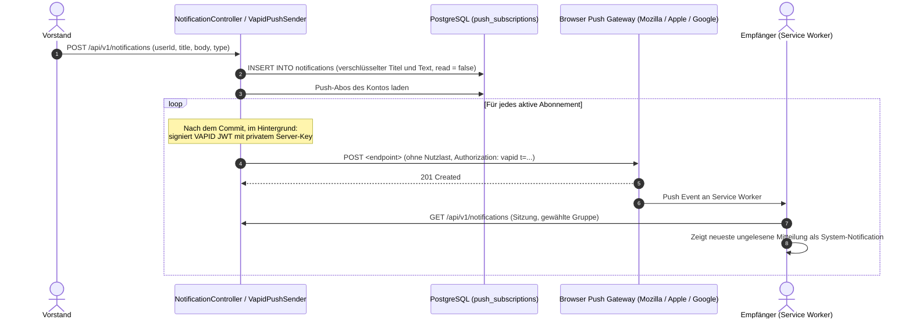

# Fachdomäne: Kommunikation & Push-Benachrichtigungen

Das Kommunikationsmodul in **Vereint** ermöglicht den Austausch zwischen Mitgliedern der Gruppe sowie die Zustellung von Mitteilungen über Web Push (VAPID).

---

## 🎯 Fachliche Sicht (Business Domain)

### 1. Gruppenchat & Konversationsarten
- **Gruppenchat**: Zentraler Raum für alle Mitglieder der Gruppe (im Code `club`). Wer `chat.moderate` oder `event.manage` hat, setzt dort eine **Infotafel** (angeheftete Notiz).
- **Event-Chats**: Jedes Event hat einen eigenen Chat für Veranstalter, Eingeladene und autorisierte Gäste. Mit `chat.moderate` oder `event.manage` lassen sich alle Event-Chats öffnen. Beendete oder abgesagte Events nehmen keine neuen Nachrichten an.
- **Direktnachrichten**: 1:1-Gespräche, gruppenübergreifend: genau ein Gespräch je Personenpaar, schreiben darf man Freunden und Personen aus den eigenen Gruppen (`/direktnachrichten`). Details in [Kalender, Freunde und Direktnachrichten](kalender-freunde-direktnachrichten.md).
- **Gast-Chat**: Gäste mit gültigem Einladungstoken lesen und schreiben im Chat ihres Events, ohne Benutzerkonto.
- **Reaktionen**: Emoji-Reaktionen auf einzelne Nachrichten.
- **Ungelesen-Zähler**: Je Mitglied und Unterhaltung wird der Lesestand gespeichert (`conversation_members.last_read_at`, bei Direktnachrichten `direct_participants.last_read_at`); die App zeigt die Zahl ungelesener Nachrichten der gewählten Gruppe plus aller Direktnachrichten als Badge am Chat-Eintrag der Navigation.
- **Aktualisierung (live)**: Neue Nachrichten, Reaktionen, Lesestände und Mitteilungen erscheinen sofort. Die App hält dafür eine Live-Verbindung (Server-Sent Events, `GET /api/v1/live`); der Server meldet darüber nur, *was* sich geändert hat, die App lädt es dann wie gewohnt über die REST-Endpunkte. Steht die Verbindung nicht (Netz weg, Proxy puffert), fragt die App wie früher alle 10 Sekunden ab. Siehe [Live-Verbindung](#3-live-verbindung-server-sent-events).
- **Verschlüsselung**: Nachrichten werden vor dem Speichern mit AES-256-GCM verschlüsselt (`DATA_ENCRYPTION_KEY`).

### 2. Mitteilungen & Push-Benachrichtigungen
- **Mitteilungen** entstehen bei Event-Einladungen, Erinnerungen und Absagen, neuen Moments, Runden („Thomas gibt eine Runde aus“, Typ `round`, an die Eingeladenen) sowie Nachrichten des Vorstands. Sie gehören zur Gruppe, in der sie entstehen.
- **Web Push**: Browserbasierte Benachrichtigungen (auch bei geschlossener App) für diese Mitteilungen, für neue Nachrichten im Gruppenchat und in Event-Chats sowie für Direktnachrichten und Freundschaftsanfragen (siehe [Kalender, Freunde und Direktnachrichten](kalender-freunde-direktnachrichten.md#push-benachrichtigungen)).
  - Chat-Pushes gehen an alle, die den Chat lesen dürfen, außer an die Absenderin: im Gruppenchat an alle aktiven Mitglieder, im Event-Chat an Veranstalter und Eingeladene, deren Einladung schon verschickt ist. Moment-Chats (24 Stunden) lösen keinen Push aus.
  - Die Benachrichtigung zeigt „Name in Chat“ und den Text. Je Chat gibt es eine Benachrichtigung; eine neue Nachricht ersetzt die vorige.
  - Pushes zeigen Inhalte aus **allen** eigenen Gruppen richtig an, nicht nur aus der gerade gewählten. Ein Tipp darauf wechselt zuerst in die Gruppe des Eintrags und öffnet dann Chat, Event oder Mitteilungen.
  - Bei Event-Einladungen bietet die Benachrichtigung „Zusagen“ und „Absagen“ an.
- **Nachrichten des Vorstands**: Wer `notifications.broadcast` hat, schickt eine Mitteilung an ein Mitglied (`SendNotificationRequest`) oder an ausgewählte bzw. alle Mitglieder der Gruppe (`BroadcastNotificationRequest`).

---

## ⚙️ Technische Sicht (Architecture & Implementation)

### 1. Relevante Komponenten & Klassen
- **Controller**:
  - `ChatController`: Event-Chat unter `/api/v1/events/{eventId}/chat`
    - `GET /`: Unterhaltung des Events laden
    - `GET /messages`, `POST /messages`: Nachrichten lesen bzw. als Mitglied senden (`SendMessageRequest`)
    - `GET /conversations/{conversationId}`, `GET|POST /conversations/{conversationId}/messages`: einzelne Unterhaltung des Events
    - `GET /guest/messages`, `POST /guest/messages`: als Gast lesen bzw. senden (Header `X-Guest-Token`)
  - `ConversationController`: Gruppenchat und Event-Chats unter `/api/v1/conversations`
    - `GET /`: eigene Unterhaltungen der Gruppe; `GET /unread-count`: ungelesene Nachrichten (inklusive Direktnachrichten)
    - `GET /club`: Gruppenchat; `PUT /club/pin`: Infotafel setzen (`PinNoteRequest`)
    - `GET|POST /{conversationId}/messages`, `POST /{conversationId}/read`
    - `POST /{conversationId}/messages/{messageId}/reactions`: Reaktion umschalten (`ToggleReactionRequest`)
  - `DirectConversationController`: Direktnachrichten unter `/api/v1/direct-conversations`, ohne gewählte Gruppe (siehe [Kalender, Freunde und Direktnachrichten](kalender-freunde-direktnachrichten.md))
  - `NotificationController`: Endpunkte unter `/api/v1/notifications`
    - `GET /`: eigene Mitteilungen (`List<NotificationDto>`); `GET /unread-count` (`UnreadCountDto`)
    - `POST /read-all`, `POST /{notificationId}/read`: als gelesen markieren
    - `GET /vapid-public-key`: öffentlicher VAPID-Schlüssel (`VapidPublicKeyDto`)
    - `GET|POST /subscriptions`, `DELETE /subscriptions/{subscriptionId}`: eigene Web-Push-Abos (`RegisterPushSubscriptionRequest`)
    - `POST /`: Mitteilung an ein Mitglied (`SendNotificationRequest`); `POST /broadcast`: an mehrere oder alle (`BroadcastNotificationRequest`)
- **Services**:
  - `ChatService`: Event-Chat, Gast-Chat und Zugriffsprüfung (Veranstalter, Eingeladene, `chat.moderate`, `event.manage`).
  - `ConversationService`: Gruppenchat, Lesestand und Reaktionen.
  - `DirectMessageService`: gruppenübergreifende Direktnachrichten.
  - `NotificationService`: Mitteilungen anlegen und den Push-Versand auslösen.
  - `ChatNotifier`: meldet neue Nachrichten und Reaktionen in Gruppen-, Event- und Moment-Chats als Live-Signal und neue Nachrichten im Gruppen- und Event-Chat als Push weiter.
  - `PersonalAlertService`: alles Ungelesene einer Person über alle Gruppen (`/api/v1/personal-notifications`), aus dem der Service Worker den Inhalt eines Pushs nimmt.
  - `LiveUpdateHub` / `LiveController`: Live-Verbindungen (`GET /api/v1/live`) und Verteilung der Signale.
  - `EventInvitationService`: Einladungen, Erinnerungen und Absagen zu Events.
  - `PushDispatcher`: Stellt nach dem Commit im Hintergrund zu und entfernt ungültige Abos (`404`/`410`). Offene Geräte bekommen zusätzlich sofort ein Live-Signal `notification`.
  - `VapidPushSender`: Erzeugt RFC-8292-konforme VAPID-Header und sendet Pushes ohne Nutzlast; der Service Worker lädt den Inhalt autorisiert nach.
  - `NoOpPushSender`: Fallback ohne konfigurierte VAPID-Keys.
- **Entitäten**: `ConversationEntity`, `ConversationMemberEntity`, `ChatMessageEntity`, `NotificationEntity`, `PushSubscriptionEntity`.

### 3. Live-Verbindung (Server-Sent Events)
- `GET /api/v1/live` liefert einen Ereignisstrom (`text/event-stream`) für die eigenen Geräte, ohne gewählte Gruppe. Der BFF hängt wie bei allen API-Aufrufen das Token an und reicht den Strom ungepuffert und unkomprimiert durch (`liveStreamProxy`).
- Ereignisse: `ready` (Verbindung steht), `ping` (Lebenszeichen alle 25 Sekunden), `chat` und `direct` (Nachricht oder Reaktion, mit `conversationId`), `read` (eigener Lesestand auf einem anderen Gerät), `notification` (neue Mitteilung). Die Daten enthalten nur Art, Gruppe und Gespräch, nie Text. Was sich geändert hat, lädt die App über die normalen, berechtigten Endpunkte.
- Signale gehen erst nach dem Commit hinaus. Empfänger folgen den Leserechten wie beim Push (`ChatNotifier`); Direktnachrichten erreichen beide Beteiligten.
- Der Server beendet jede Verbindung nach 10 Minuten. Der Browser baut sie dann neu auf und bekommt dabei vom BFF ein frisches Token; ein gesperrtes Konto erhält spätestens dann keine Signale mehr.
- Die Verbindungen liegen im Speicher der einen baseservice-Instanz. Bei mehreren Instanzen bräuchte es einen gemeinsamen Verteiler (z. B. PostgreSQL `LISTEN/NOTIFY`).
- In der App bündelt `LiveUpdatesService` die Verbindung. Kommt sie wieder oder kehrt die App in den Vordergrund, schickt er `resync` und alle offenen Ansichten laden neu. Bleiben 70 Sekunden ohne Lebenszeichen, baut er die Verbindung neu auf.
- Ein Reverse Proxy vor der App darf `/api/v1/live` weder puffern noch komprimieren (siehe [Selbst betreiben](../betrieb/selbst-betreiben.md)).

---

## 📋 Datenstrukturen & DTOs

```kotlin
data class ChatMessageDto(
    val id: String,
    val conversationId: String,
    val senderType: String,
    val senderId: String?,
    val senderName: String,
    val message: String,
    val imageUrl: String?,
    val createdAt: Instant,
    val reactions: List<ChatReactionDto> = emptyList()
)

data class SendMessageRequest(
    @field:NotBlank @field:Size(max = 4000) val message: String? = null,
    @field:Size(max = 512) val imageUrl: String? = null
)

data class RegisterPushSubscriptionRequest(
    @field:Size(max = 2048) val endpoint: String? = null,
    @field:Size(max = 255) val p256dh: String? = null,
    @field:Size(max = 255) val auth: String? = null,
    @field:Size(max = 512) val userAgent: String? = null
)

data class SendNotificationRequest(
    val userId: String? = null,
    val title: String? = null,
    val body: String? = null,
    val type: String? = null
)

data class BroadcastNotificationRequest(
    val userIds: List<String>? = null,
    val allMembers: Boolean? = null,
    val title: String? = null,
    val body: String? = null
)
```

Die Meldungen der Validierung kommen aus den Sprachdateien (`{validation.…}`), siehe [Fachservice-i18n](../baseservice/i18n.md).

---

## 🔄 Sequenzablauf: Push-Benachrichtigungszustellung via VAPID


