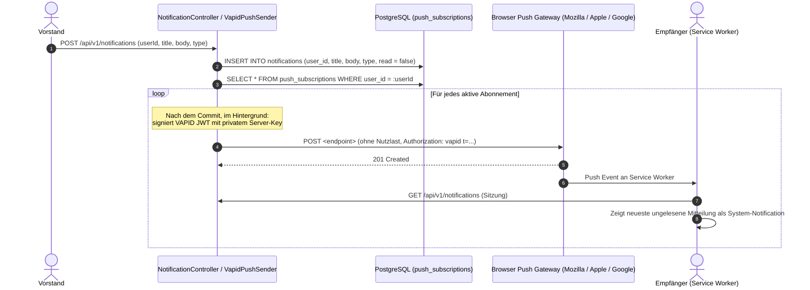

# Fachdomäne: Kommunikation & Push-Benachrichtigungen

Das Kommunikationsmodul in **Vereint** ermöglicht den interaktiven Austausch zwischen Vereinsmitgliedern sowie die zuverlässige Zustellung zeitkritischer Informationen über Web Push (VAPID).

---

## 🎯 Fachliche Sicht (Business Domain)

### 1. Vereinschat & Konversationsarten
- **Hauptkanal (Club Channel)**: Zentraler Raum für alle Vereinsmitglieder zum Austausch allgemeiner Neuigkeiten.
- **Event-Chaträume**: Jeder Veranstaltung kann ein eigener temporärer Chatraum zugeordnet werden, in dem Teilnehmer und autorisierte Gäste Fragen zu Treffpunkt, Mitbringseln oder Ablauf stellen können.
- **Direktnachrichten (Direct Messages)**: 1:1-Gespräche zwischen zwei Mitgliedern.
- **Gast-Chat**: Externe Gäste mit gültigem Einladungstoken können im jeweiligen Event-Chatraum mitlesen und schreiben, ohne ein Vereinsbenutzerkonto zu besitzen.

### 2. Push-Benachrichtigungen & Board-Broadcasts
- **Web Push Notifications**: Browserbasierte Benachrichtigungen (auch bei geschlossener App auf Smartphone oder Desktop) bei neuen Chat-Nachrichten, Event-Einladungen oder Kassenabbuchungen.
- **Vorstands-Broadcasts**: Vorstände und Administratoren können wichtige Ankündigungen an alle Mitglieder oder gezielte Personen senden (`SendNotificationRequest`).

---

## ⚙️ Technische Sicht (Architecture & Implementation)

### 1. Relevante Komponenten & Klassen
- **Controller**:
  - `ChatController`: Endpunkte unter `/api/v1/events/{eventId}/chat`
    - `GET /` – Konversationsmetadaten für das Event laden
    - `GET /messages` – Nachrichten des Event-Chats abrufen
    - `POST /messages` – Nachricht als authentifiziertes Mitglied senden (`SendMessageRequest`)
    - `GET /guest/messages` – Nachrichten als Gast abrufen (Header `X-Guest-Token`)
    - `POST /guest/messages` – Nachricht als Gast senden (`SendMessageRequest` + `X-Guest-Token`)
  - `NotificationController`: Endpunkte unter `/api/v1/notifications`
    - `GET /` – Eigene Benachrichtigungen laden (`List<NotificationDto>`)
    - `GET /unread-count` – Anzahl ungelesener Nachrichten (`UnreadCountDto`)
    - `POST /read-all` – Alle Benachrichtigungen als gelesen markieren
    - `POST /{id}/read` – Einzelne Benachrichtigung als gelesen markieren
    - `GET /vapid-public-key` – Öffentlichen VAPID-Schlüssel abfragen (`VapidPublicKeyDto`)
    - `POST /subscriptions` – Web-Push-Abonnement registrieren (`PushSubscriptionCreateRequest`)
    - `POST /` – Benachrichtigung / Broadcast an Benutzer senden (`SendNotificationRequest`)
- **Services**:
  - `ChatService`: Nachrichtenverwaltung und Berechtigungsprüfung (`chat.member`, `chat.event`).
  - `NotificationService`: Erstellung von In-App-Notifications und Auslösen des Push-Versands.
  - `PushDispatcher`: Stellt nach dem Commit im Hintergrund zu und entfernt ungültige Abos (`404`/`410`).
  - `VapidPushSender`: Erzeugt RFC-8292-konforme VAPID-Header und sendet Pushes ohne Nutzlast; der Service Worker lädt den Inhalt autorisiert nach.
  - `NoOpPushSender`: Fallback für lokale Tests ohne konfigurierte VAPID-Keys.
- **Entitäten**: `ConversationEntity`, `ConversationMemberEntity`, `ChatMessageEntity`, `NotificationEntity`, `PushSubscriptionEntity`.

---

## 📋 Datenstrukturen & DTOs

```kotlin
data class ChatMessageDto(
    val id: String,
    val conversationId: String,
    val senderUserId: String?,
    val senderDisplayName: String,
    val senderRole: String?,
    val guestId: String?,
    val message: String,
    val imageUrl: String?,
    val isGuest: Boolean,
    val createdAt: Instant
)

data class SendMessageRequest(
    @field:NotBlank(message = "message darf nicht leer sein")
    @field:Size(max = 2000, message = "message darf höchstens 2000 Zeichen lang sein")
    val message: String? = null,

    @field:Size(max = 512, message = "imageUrl darf höchstens 512 Zeichen lang sein")
    val imageUrl: String? = null
)

data class PushSubscriptionCreateRequest(
    @field:NotBlank(message = "endpoint darf nicht leer sein")
    @field:Size(max = 1024, message = "endpoint darf höchstens 1024 Zeichen lang sein")
    val endpoint: String? = null,

    @field:NotBlank(message = "p256dh darf nicht leer sein")
    @field:Size(max = 255, message = "p256dh darf höchstens 255 Zeichen lang sein")
    val p256dh: String? = null,

    @field:NotBlank(message = "auth darf nicht leer sein")
    @field:Size(max = 255, message = "auth darf höchstens 255 Zeichen lang sein")
    val auth: String? = null,

    @field:Size(max = 512, message = "userAgent darf höchstens 512 Zeichen lang sein")
    val userAgent: String? = null
)

data class SendNotificationRequest(
    @field:NotBlank(message = "userId darf nicht leer sein")
    val userId: String? = null,

    @field:NotBlank(message = "title darf nicht leer sein")
    @field:Size(max = 255, message = "title darf höchstens 255 Zeichen lang sein")
    val title: String? = null,

    @field:NotBlank(message = "body darf nicht leer sein")
    @field:Size(max = 4000, message = "body darf höchstens 4000 Zeichen lang sein")
    val body: String? = null,

    @field:Size(max = 64, message = "type darf höchstens 64 Zeichen lang sein")
    val type: String? = null
)
```

---

## 🔄 Sequenzablauf: Push-Benachrichtigungszustellung via VAPID


