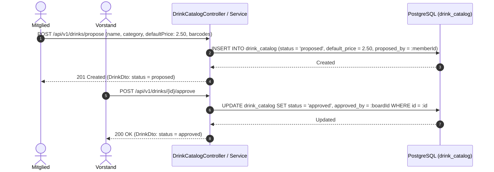

# Fachdomäne: Getränkekatalog & Sublisten

Die Getränkeverwaltung in **Vereint** bildet das gesamte Sortiment ab – vom Masterkatalog der Gruppe über Event-spezifische Sublisten bis hin zu flexiblen Event-Getränkeauswahlen.

---

## 🎯 Fachliche Sicht (Business Domain)

### 1. Globaler Getränkekatalog & Vorschlagsworkflow
- **Masterkatalog**: Zentrales Verzeichnis aller in der Gruppe verfügbaren Getränke mit Name, Beschreibung, Kategorie (z. B. Bier, Softdrinks, Heißgetränke), Standard-Verkaufspreis (`defaultPrice: BigDecimal`), Einkaufspreis (`costPrice: BigDecimal`), Währung (`currency: String`, z. B. `EUR`), Bildreferenz und Barcode(s).
- **Einkaufspreise & Wirtschaftlichkeit**: Die Pflege von `costPrice` ermöglicht exakte Deckungsbeitrags- und Gewinnrechnungen (`profit = unitPrice - costPrice`) pro Event und Verkaufskanal.
- **Vorschlags- & Freigabeprozess**:
  1. Mitglieder oder Vorstände schlagen neue Getränke vor (`status = proposed`, erfasst `proposed_by_user_id`).
  2. Der Vorstand prüft und gibt das Getränk frei (`status = approved`, erfasst `approved_by_user_id`) oder lehnt es ab (`status = rejected`).
  3. Nur freigegebene Getränke können in Sublisten oder Event-Angebote aufgenommen werden.
  4. Legen Vorstand oder Administration ein Getränk selbst an, ist es sofort freigegeben und aktiv (`approved_by_user_id` = Anlegende); ein zweiter Freigabeschritt entfällt.
- **Erfassung in der Oberfläche** (`/catalog`):
  - „Barcode scannen“: Ein bekannter Barcode öffnet das Getränk, ein unbekannter das Formular „Getränk anlegen“ mit vorausgefülltem Code.
  - Ein Formular für Anlegen, Vorschlagen und Bearbeiten: Name, Kategorie (Vorschläge aus vorhandenen Kategorien), Verkaufs- und Einkaufspreis mit Marge (Einkaufspreis nur Vorstand/Admin), Beschreibung, beliebig viele Barcodes per Kamera oder Eingabe.
  - Vor dem Speichern wird geprüft, ob ein Barcode schon zu einem anderen Getränk gehört und ob es ein Getränk gleichen Namens gibt.
  - „Im Sortiment“ nimmt ein Getränk aus dem Verkauf (`active = false`), ohne es zu löschen; die Karte zeigt dann „Inaktiv“.

### 2. Event-Sublisten (Sortimentssteuerung) & Event-Getränke
- Nicht jedes Event bietet das gesamte Sortiment der Gruppe an.
- **Sublisten** definieren ausgewählte Sortiments-Teilmengen (z. B. "Sommerfest", "Mitgliederversammlung", "Sportturnier").
- Innerhalb einer Subliste können globale Katalogpreise mit einem spezifischen `default_price` überschrieben werden.
- Über `EventDrinkController` (`/api/v1/events/{eventId}/drinks/assign-sublist`) werden Sublisten an Events gekoppelt oder Einzelgetränke (`AddEventDrinkRequest`) mit festen Eventpreisen (`price`, `costPrice`), `selfServiceEnabled` und `tabletEnabled` zugewiesen.


---

## ⚙️ Technische Sicht (Architecture & Implementation)

### 1. Relevante Komponenten & Klassen
- **Controller**:
  - `DrinkCatalogController`: Globaler Katalog (`/api/v1/drinks`), Vorschläge (`/propose`), Freigaben (`/{id}/approve`, `/{id}/reject`), Barcodes (`/{id}/barcodes`).
  - `DrinkSublistController`: Verwaltung von Sublisten (`/api/v1/sublists`) und Artikeln (`/items`).
  - `EventDrinkController`: Eventbezogene Getränkeauswahl (`/api/v1/events/{eventId}/drinks`) und Sublistenzuweisung.
- **Services**: `DrinkCatalogService`, `DrinkSublistService`, `EventDrinkService`.
- **Entitäten**: `DrinkCatalogEntity`, `DrinkBarcodeEntity`, `DrinkSublistEntity`, `DrinkSublistItemEntity`, `EventDrinkEntity`.

---

## 📋 Datenstrukturen & DTOs

```kotlin
data class DrinkDto(
    val id: String,
    val name: String,
    val description: String?,
    val category: String?,
    val defaultPrice: BigDecimal,
    val costPrice: BigDecimal = BigDecimal.ZERO,
    val currency: String,
    val imageReference: String?,
    val catalogVersion: Int,
    val status: String,
    val active: Boolean,
    val proposedById: String?,
    val approvedById: String?,
    val barcodes: List<DrinkBarcodeDto>,
    val createdAt: Instant,
    val updatedAt: Instant
)

data class ProposeDrinkRequest(
    @field:NotBlank val name: String?,
    @field:Size(max = 4000) val description: String? = null,
    @field:Size(max = 64) val category: String? = null,
    @field:NotNull @field:DecimalMin("0.00") val defaultPrice: BigDecimal?,
    @field:DecimalMin("0.00") val costPrice: BigDecimal? = null,
    @field:Pattern(regexp = "^[A-Za-z]{3}$") val currency: String? = null,
    @field:Size(max = 512) val imageReference: String? = null,
    val barcodes: List<String>? = null
)

data class EventDrinkDto(
    val id: String,
    val eventId: String,
    val drinkId: String,
    val drinkName: String,
    val price: BigDecimal?,
    val effectivePrice: BigDecimal,
    val costPrice: BigDecimal?,
    val effectiveCostPrice: BigDecimal,
    val currency: String,
    val selfServiceEnabled: Boolean,
    val tabletEnabled: Boolean,
    val catalogVersion: Int,
    val imageSnapshot: String?,
    val createdAt: Instant,
    val updatedAt: Instant
)
```

---

## 🔄 Sequenzablauf: Vorschlag & Freigabe eines Getränks


