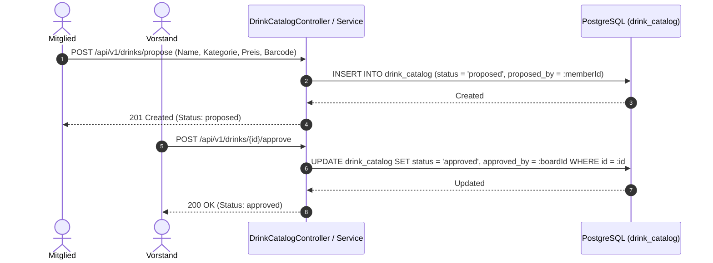

# Fachdomäne: Getränkekatalog, Sublisten & "Drink With Me"

Die Getränkeverwaltung in **Vereint** bildet das Sortiment ab – vom globalen Vereins-Masterkatalog über Event-spezifische Sublisten bis hin zu kollaborativen Rundenangeboten ("Trink mit mir").

---

## 🎯 Fachliche Sicht (Business Domain)

### 1. Globaler Getränkekatalog & Vorschlagsworkflow
- **Masterkatalog**: Zentrales Verzeichnis aller im Verein verfügbaren Getränke mit Name, Kategorie (z. B. Bier, Softdrinks, Heißgetränke), Preis in Cents, Volumen in ml, Steuersatz und Barcode(s).
- **Vorschlags- & Freigabeprozess**:
  1. Mitglieder oder Vorstände schlagen neue Getränke vor (`status = proposed`, erfasst `proposed_by`).
  2. Der Vorstand prüft und gibt das Getränk frei (`status = approved`, erfasst `approved_by`) oder lehnt es ab (`status = rejected`).
  3. Nur freigegebene Getränke können in Sublisten oder Event-Angebote aufgenommen werden.

### 2. Event-Sublisten (Sortimentssteuerung)
- Nicht jedes Vereins-Event bietet das gesamte Vereinssortiment an.
- **Sublisten** definieren ausgewählte Sortiments-Teilmengen (z. B. "Sommerfest", "Mitgliederversammlung", "Sportturnier").
- Innerhalb einer Subliste können globale Katalogpreise mit **Preisanpassungen (`price_cents_override`)** überschrieben werden (z. B. Happy-Hour-Preise oder Sonderpreise).

### 3. "Trink mit mir" (Kollaborative Runden)
- Ein Mitglied kann eine digitale Runde initiieren (`DrinkWithMeSession`), indem es ein Getränk und eine maximale Teilnehmerzahl festlegt.
- Andere anwesende Mitglieder können der Runde beitreten (`join`).
- Der Initiator schließt die Runde ab; die Abrechnung erfolgt gebündelt über das Kassenbuch (`entryType = purchase, source = round`).

---

## ⚙️ Technische Sicht (Architecture & Implementation)

### 1. Relevante Komponenten & Klassen
- **Controller**:
  - `DrinkCatalogController`: CRUD für globalen Katalog (`/api/v1/drinks`), Vorschläge (`/propose`), Freigaben (`/approve`, `/reject`) und Barcodes.
  - `DrinkSublistController`: Verwaltung von Sublisten (`/api/v1/sublists`) und Zuweisung von Artikeln.
  - `EventDrinkController`: Abfrage des für ein Event aktiven Getränkeangebots (`/api/v1/events/{eventId}/drinks`).
  - `DrinkWithMeController`: Erstellen, Beitreten und Abschließen von Runden (`/api/v1/drink-with-me`).
- **Services**: `DrinkCatalogService`, `DrinkSublistService`, `EventDrinkService`, `DrinkWithMeService`.
- **Entitäten**: `DrinkCatalogEntity`, `DrinkBarcodeEntity`, `DrinkSublistEntity`, `DrinkSublistItemEntity`, `EventDrinkEntity`, `DrinkWithMeSessionEntity`, `DrinkWithMeParticipantEntity` (in `DrinkEntities.kt`).

---

## 📋 Datenstrukturen & DTOs

```kotlin
data class DrinkCatalogDto(
    val id: String,
    val name: String,
    val category: String,
    val priceCents: Int,
    val volumeMl: Int,
    val status: String,
    val proposedById: String?,
    val approvedById: String?,
    val imageAssetId: String?,
    val barcodes: List<String>
)

data class ProposeDrinkRequest(
    @field:NotBlank
    val name: String,
    @field:NotBlank
    val category: String,
    @field:Min(1)
    val priceCents: Int,
    @field:Min(1)
    val volumeMl: Int,
    val barcodes: List<String> = emptyList()
)

data class DrinkSublistDto(
    val id: String,
    val name: String,
    val description: String?,
    val items: List<DrinkSublistItemDto>
)

data class DrinkSublistItemDto(
    val drinkId: String,
    val name: String,
    val category: String,
    val defaultPriceCents: Int,
    val priceCentsOverride: Int?,
    val effectivePriceCents: Int,
    val active: Boolean
)
```

---

## 🔄 Sequenzablauf: Vorschlag & Freigabe eines Getränks


