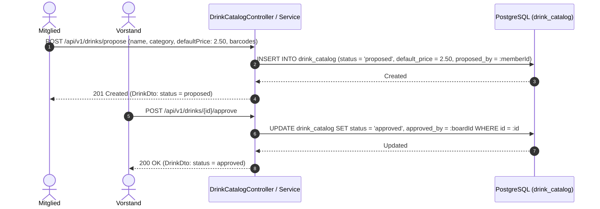

# Fachdomäne: Getränkekatalog, Sublisten & "Drink With Me"

Die Getränkeverwaltung in **Vereint** bildet das gesamte Sortiment ab – vom globalen Vereins-Masterkatalog über Event-spezifische Sublisten bis hin zu opt-in Standortfreigaben ("Drink With Me").

---

## 🎯 Fachliche Sicht (Business Domain)

### 1. Globaler Getränkekatalog & Vorschlagsworkflow
- **Masterkatalog**: Zentrales Verzeichnis aller im Verein verfügbaren Getränke mit Name, Beschreibung, Kategorie (z. B. Bier, Softdrinks, Heißgetränke), Standardpreis (`defaultPrice: BigDecimal`), Währung (`currency: String`, z. B. `EUR`), Bildreferenz und Barcode(s).
- **Vorschlags- & Freigabeprozess**:
  1. Mitglieder oder Vorstände schlagen neue Getränke vor (`status = proposed`, erfasst `proposed_by_user_id`).
  2. Der Vorstand prüft und gibt das Getränk frei (`status = approved`, erfasst `approved_by_user_id`) oder lehnt es ab (`status = rejected`).
  3. Nur freigegebene Getränke können in Sublisten oder Event-Angebote aufgenommen werden.

### 2. Event-Sublisten (Sortimentssteuerung)
- Nicht jedes Vereins-Event bietet das gesamte Vereinssortiment an.
- **Sublisten** definieren ausgewählte Sortiments-Teilmengen (z. B. "Sommerfest", "Mitgliederversammlung", "Sportturnier").
- Innerhalb einer Subliste können globale Katalogpreise mit einem spezifischen `default_price` überschrieben werden.
- Über `EventDrinkController` (`/api/v1/events/{eventId}/drinks/assign-sublist`) werden Sublisten an Events gekoppelt oder Einzelgetränke (`AddEventDrinkRequest`) mit festen Eventpreisen zugewiesen.

### 3. "Drink With Me" (Präsenz- & Standort-Freigabe)
- `DrinkWithMe` ist ein **opt-in Location- & Presence-Sharing-Feature**: Mitglieder können während eines aktiven Events ihren Standort (Breiten- und Längengrad) sowie eine Statusnachricht für andere Vereinsmitglieder freigeben.
- **Zustimmungspflicht**: Erfordert zwingend `consent = true`. Fehlt die Zustimmung, wird die Anfrage mit Fehlercode `consent_required` abgewiesen.
- **Zeitliche Begrenzung**: Die Session läuft nach Ablauf von `durationMinutes` (Standard z. B. 60 Minuten, maximal 720 Minuten) automatisch ab oder kann jederzeit durch das Mitglied widerrufen werden (`DELETE /api/v1/events/{eventId}/drink-with-me/{sessionId}`).

---

## ⚙️ Technische Sicht (Architecture & Implementation)

### 1. Relevante Komponenten & Klassen
- **Controller**:
  - `DrinkCatalogController`: Globaler Katalog (`/api/v1/drinks`), Vorschläge (`/propose`), Freigaben (`/{id}/approve`, `/{id}/reject`), Barcodes (`/{id}/barcodes`).
  - `DrinkSublistController`: Verwaltung von Sublisten (`/api/v1/sublists`) und Artikeln (`/items`).
  - `EventDrinkController`: Eventbezogene Getränkeauswahl (`/api/v1/events/{eventId}/drinks`) und Sublistenzuweisung.
  - `DrinkWithMeController`: Starten, Abfragen und Beenden von Standort-Sessions (`/api/v1/events/{eventId}/drink-with-me`).
- **Services**: `DrinkCatalogService`, `DrinkSublistService`, `EventDrinkService`, `DrinkWithMeService`.
- **Entitäten**: `DrinkCatalogEntity`, `DrinkBarcodeEntity`, `DrinkSublistEntity`, `DrinkSublistItemEntity`, `EventDrinkEntity`, `DrinkWithMeSessionEntity`.

---

## 📋 Datenstrukturen & DTOs

```kotlin
data class DrinkDto(
    val id: String,
    val name: String,
    val description: String?,
    val category: String?,
    val defaultPrice: BigDecimal,
    val currency: String,
    val imageReference: String?,
    val catalogVersion: Int,
    val status: String,
    val active: Boolean,
    val proposedById: String?,
    val approvedById: String?,
    val barcodes: List<DrinkBarcodeDto>,
    val createdAt: Instant,
    val updatedAt: Instant
)

data class ProposeDrinkRequest(
    @field:NotBlank val name: String?,
    @field:Size(max = 4000) val description: String? = null,
    @field:Size(max = 64) val category: String? = null,
    @field:NotNull @field:DecimalMin("0.00") val defaultPrice: BigDecimal?,
    @field:Pattern(regexp = "^[A-Za-z]{3}$") val currency: String? = null,
    @field:Size(max = 512) val imageReference: String? = null,
    val barcodes: List<String>? = null
)

data class StartDrinkWithMeRequest(
    val consent: Boolean = false,
    @field:DecimalMin("-90.0") @field:DecimalMax("90.0") val latitude: BigDecimal? = null,
    @field:DecimalMin("-180.0") @field:DecimalMax("180.0") val longitude: BigDecimal? = null,
    @field:Size(max = 255) val message: String? = null,
    @field:Min(1) @field:Max(720) val durationMinutes: Long? = null
)

data class DrinkWithMeSessionDto(
    val id: String,
    val eventId: String,
    val userId: String,
    val userName: String,
    val latitude: BigDecimal?,
    val longitude: BigDecimal?,
    val message: String?,
    val active: Boolean,
    val expiresAt: Instant,
    val createdAt: Instant
)
```

---

## 🔄 Sequenzablauf: Vorschlag & Freigabe eines Getränks


