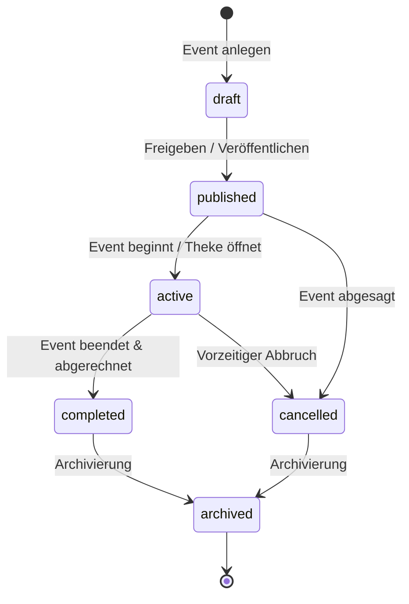
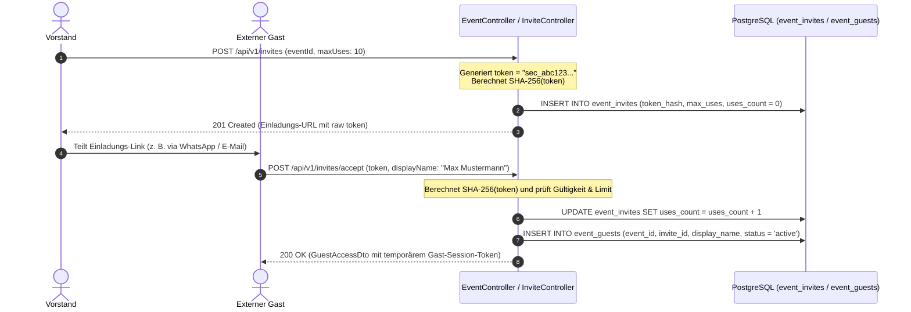

# Fachdomäne: Event-Management & Gast-Einladungen

Das Event-Modul in **Vereint** verwaltet den gesamten Lebenszyklus von Vereinsveranstaltungen – von der Planung über Mitglieder-Zusagen (RSVP) bis hin zu sicheren, tokenbasierten Einladungen für externe Gäste ohne vollwertiges Vereinskonto.

---

## 🎯 Fachliche Sicht (Business Domain)

### 1. Event-Lebenszyklus (`EventStatus`)
Events durchlaufen definierte Zustände:



- **`draft`**: Entwurf (nur für Ersteller und Vorstand sichtbar).
- **`published`**: Öffentlich für alle Mitglieder sichtbar; RSVPs sind geöffnet.
- **`active`**: Event läuft aktuell; Strichliste am Kiosk-Tablet ist aktiv und Getränkebuchungen sind möglich.
- **`completed`**: Event erfolgreich abgeschlossen; Abendabrechnung ist erfolgt.
- **`cancelled`**: Event wurde storniert.
- **`archived`**: Historisches Event für statistische Auswertungen.

### 2. Mitglieder-Zusagen (RSVP)
- Vereinsmitglieder können ihre Teilnahme vorab signalisieren:
  - `attending` (Zusage / Ich komme)
  - `declined` (Absage / Ich komme nicht)
  - `maybe` (Vielleicht / Unsicher)
- Vorstände sehen eine aggregierte Übersicht zur Einkaufs- und Getränkeplanung.

### 3. Gast-Einladungen via Krypto-Token
- Für externe Gäste (z. B. Freunde, Familienangehörige, Gastredner) können Vorstände **Einladungslinks** mit kryptografischen Tokens generieren.
- **Sicherheitskonzept**:
  - Im Link wird ein zufälliges URL-sicheres Geheimnis übergeben.
  - In der Datenbank wird ausschließlich der kryptografische **SHA-256 Hash** (`token_hash`) gespeichert (`SecureTokens.kt`).
  - Einladungen können mit einer maximalen Nutzungsanzahl (`max_uses`) und einem Ablaufdatum (`expires_at`) versehen werden.
- **Gast-Erlebnis**:
  - Gast öffnet den Link, gibt seinen Anzeigenamen ein und erhält temporären Zugriff auf das Event, das Getränkeangebot und den Event-Gastchat.

---

## ⚙️ Technische Sicht (Architecture & Implementation)

### 1. Relevante Komponenten & Klassen
- **Controller**:
  - `EventController`: CRUD für Events (`/api/v1/events`), Statusübergänge (`/publish`, `/activate`, `/complete`, `/cancel`), RSVP-Endpunkte (`/rsvp`).
  - `InviteController`: Erstellung von Einladungen (`/api/v1/invites`), Einlösen von Gasttokens (`/api/v1/invites/accept`), Gaststatus-Verwaltung.
- **Services**: `EventService`, `InviteService`.
- **Sicherheit & Krypto**: `SecureTokens.kt` (Generierung von 256-Bit Zufalls-Tokens und SHA-256 Hashing).
- **Entitäten**: `EventEntity`, `EventRsvpEntity`, `EventInviteEntity`, `EventGuestEntity` (in `EventEntities.kt`).

---

## 📋 Datenstrukturen & DTOs

```kotlin
data class EventDto(
    val id: String,
    val title: String,
    val description: String?,
    val location: String?,
    val startsAt: Instant,
    val endsAt: Instant?,
    val status: String,
    val sublistId: String?,
    val createdById: String,
    val rsvpSummary: RsvpSummaryDto
)

data class CreateEventInviteRequest(
    @field:NotBlank
    val eventId: String,
    @field:Min(1)
    val maxUses: Int = 1,
    val expiresAt: Instant? = null
)

data class AcceptInviteRequest(
    @field:NotBlank
    val token: String,
    @field:NotBlank
    @field:Size(min = 2, max = 255)
    val displayName: String
)

data class GuestAccessDto(
    val guestId: String,
    val eventId: String,
    val displayName: String,
    val guestToken: String,
    val expiresAt: Instant
)
```

---

## 🔄 Sequenzablauf: Gast-Einladung & Einlösung


