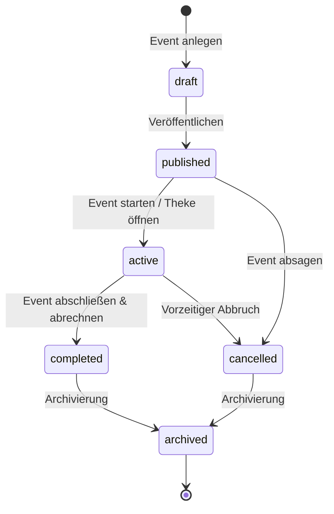
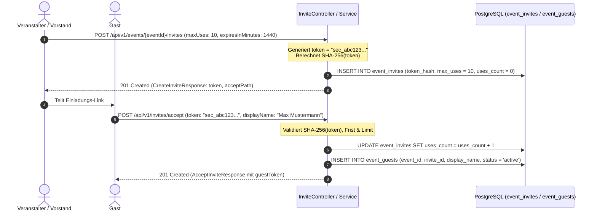

# Fachdomäne: Event-Management & Gast-Einladungen

Das Event-Modul in **Vereint** verwaltet Veranstaltungen der Gruppe: von der Planung über Einladungen und Zusagen der Mitglieder bis zu tokenbasierten Einladungen für Gäste ohne Konto.

---

## 🎯 Fachliche Sicht (Business Domain)

### 1. Event-Lebenszyklus (`EventStatus`)
Events durchlaufen definierte Zustände:



- **`draft`**: Entwurf.
- **`published`**: Veröffentlicht; Eingeladene werden benachrichtigt (sofort oder zu `invitationNotifyAt`).
- **`active`**: Event läuft aktuell; Strichliste am Tablet und Kassenbuchungen sind möglich.
- **`completed`**: Event erfolgreich beendet und abgerechnet.
- **`cancelled`**: Event wurde abgesagt; Eingeladene erhalten eine Mitteilung.
- **`archived`**: Archiviertes Event für Statistiken.

Statusänderungen und Stammdatenaktualisierungen laufen über `PUT /api/v1/events/{id}` (`UpdateEventRequest`); das dürfen der Veranstalter (Owner) und wer `event.manage` hat. Der Fachservice erzwingt keine Reihenfolge der Zustände; das Diagramm zeigt die üblichen Übergänge der Oberfläche.

**Sichtbarkeit:** Ein Mitglied sieht die Events, die es selbst veranstaltet oder zu denen es eingeladen ist. Wer `event.manage` hat (Startwert: Vorstand und Admin), sieht alle Events der Gruppe. Anlegen darf, wer `event.create` hat.

### 2. Einladungen, Zusagen & Teilnehmer (`EventParticipantDto`)
- **Mitglieder einladen**: Beim Anlegen (`inviteUserIds`, `inviteAllMembers`) oder später über `POST /api/v1/events/{id}/invitations` (`userIds` oder `allMembers`). Die Mitteilung geht bei Veröffentlichung raus oder zum Zeitpunkt `invitationNotifyAt`.
- **Zusagen**: Eingeladene antworten mit `PUT /api/v1/events/{id}/rsvp` (`accepted`, `maybe`, `declined`), in der App oder direkt aus der Push-Benachrichtigung. Bei abgesagten, beendeten oder archivierten Events geht das nicht mehr. `EventDto` enthält die eigene Antwort (`myRsvp`) und die Zählung (`rsvpCounts`).
- **Erinnerung**: `reminderHoursBefore` (1 bis 720 Stunden, `0` schaltet ab) erinnert Eingeladene vor Beginn.
- **Teilnehmer** verwalten Veranstalter und wer `event.manage` hat:
  - `GET /api/v1/events/{id}/participants`: Teilnehmerliste (für alle, die das Event sehen).
  - `POST /api/v1/events/{id}/participants`: fügt ein Mitglied (`AddParticipantRequest`) mit einer Rolle (z. B. `participant`) hinzu.
  - `DELETE /api/v1/events/{id}/participants/{userId}`: entfernt einen Teilnehmer.

### 3. Event-Verpflegungsangebot (Getränke & Speisen)
- Veranstalter und wer `event.manage` hat verwalten das Angebot der Veranstaltung:
  - **Event-Getränke (`event_drinks`)**: Zuweisung über Sublisten oder Einzelauswahl (`EventDrinkController`) mit eventbezogener Preisanpassung (`price`, `costPrice`) und Freischaltung für Tablet-Strichliste (`tabletEnabled`).
  - **Event-Speisen (`event_food`)**: Zuweisung aus dem Katalog der Gruppe (`EventFoodController`) mit individuellen Verkaufspreisen, Wareneinsatz-Kosten (`costPrice`) und Kiosk-Steuerung (`tabletEnabled`).
- Im Zustand `active` werden diese Artikel über die Kiosk-API (`/api/v1/tablet/events/{eventId}/items`) für das Thekenteam bereitgestellt.

### 4. Gast-Einladungen via Krypto-Token
- Für Gäste ohne Konto erzeugen Veranstalter und wer `event.invites.manage` hat über `POST /api/v1/events/{eventId}/invites` Einladungslinks mit zufälligen Tokens.
- **Sicherheitskonzept**:
  - Im Antwort-Payload (`CreateInviteResponse`) wird das einmalig einsehbare Klartext-Token (`token`) und der `acceptPath` übergeben.
  - In der Datenbank wird ausschließlich der kryptografische **SHA-256 Hash** (`token_hash`) gespeichert (`SecureTokens.kt`).
  - Einladungen unterstützen Nutzungsbegrenzungen (`maxUses`, 1 bis 10000) und Gültigkeitsdauer (`expiresInMinutes`, Standard 7 Tage, höchstens 90 Tage).
- **Gast-Erlebnis**:
  - Der Gast löst die Einladung über `POST /api/v1/invites/accept` (`AcceptInviteRequest`) mit seinem Anzeigenamen ein.
  - Die Antwort (`AcceptInviteResponse`) enthält ein temporäres Gast-Session-Token (`guestToken`), das für nachfolgende Gast-Chat-Aufrufe (`X-Guest-Token`) genutzt wird.

---

## ⚙️ Technische Sicht (Architecture & Implementation)

### 1. Relevante Komponenten & Klassen
- **Controller**:
  - `EventController`: Anlegen, Lesen und Ändern (`/api/v1/events`, `PUT /api/v1/events/{id}`), Teilnehmer (`/api/v1/events/{id}/participants`), Einladungen (`POST /{id}/invitations`), Zusagen (`PUT /{id}/rsvp`).
  - `InviteController`: Event-Einladungsverwaltung (`/api/v1/events/{eventId}/invites`), Einlösen von Gasttokens (`POST /api/v1/invites/accept`).
- **Services**: `EventService`, `EventInvitationService` (Einladungs-, Erinnerungs- und Absage-Mitteilungen), `InviteService`.
- **Sicherheit & Krypto**: `SecureTokens.kt` (Generierung von 256-Bit Zufalls-Tokens und SHA-256 Hashing).
- **Entitäten**: `EventEntity`, `EventParticipantEntity`, `EventInviteEntity`, `EventGuestEntity`.

---

## 📋 Datenstrukturen & DTOs

```kotlin
data class EventDto(
    val id: String,
    val title: String,
    val description: String?,
    val location: String?,
    val startsAt: Instant,
    val endsAt: Instant?,
    val status: String,
    val ownerId: String,
    val ownerDisplayName: String,
    val participantCount: Int,
    val createdAt: Instant,
    val updatedAt: Instant,
    val invitationNotifyAt: Instant? = null,
    val reminderHoursBefore: Int? = null,
    val myRsvp: String? = null,
    val rsvpCounts: RsvpCountsDto = RsvpCountsDto(),
    val canManage: Boolean = false
)

data class UpdateEventRequest(
    val title: String? = null,
    val description: String? = null,
    val location: String? = null,
    val startsAt: Instant? = null,
    val endsAt: Instant? = null,
    val status: String? = null,              // draft, published, active, completed, cancelled, archived
    val invitationNotifyAt: Instant? = null,
    val inviteOnPublish: Boolean? = null,
    @field:Min(0) @field:Max(720) val reminderHoursBefore: Int? = null
)

data class CreateInviteRequest(
    @field:Min(1) @field:Max(10000) val maxUses: Int? = null,
    @field:Min(1) @field:Max(129600) val expiresInMinutes: Long? = null,
    @field:Pattern(regexp = "^(guest)?$") val role: String? = null
)

data class AcceptInviteRequest(
    val token: String? = null,
    val displayName: String? = null
)

data class AcceptInviteResponse(
    val guestToken: String,
    val eventId: String,
    val eventTitle: String,
    val displayName: String,
    val status: String,
    val expiresAt: Instant
)
```

---

## 🔄 Sequenzablauf: Gast-Einladung & Einlösung


