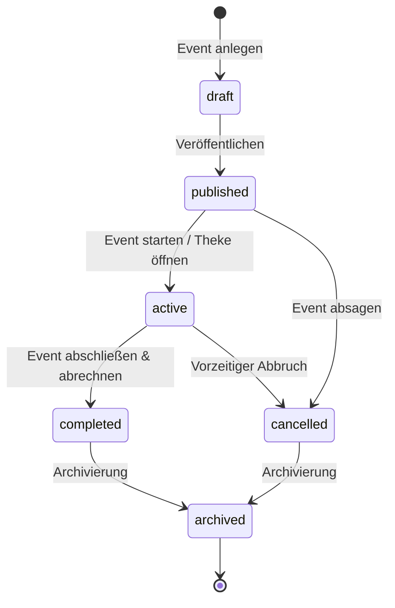
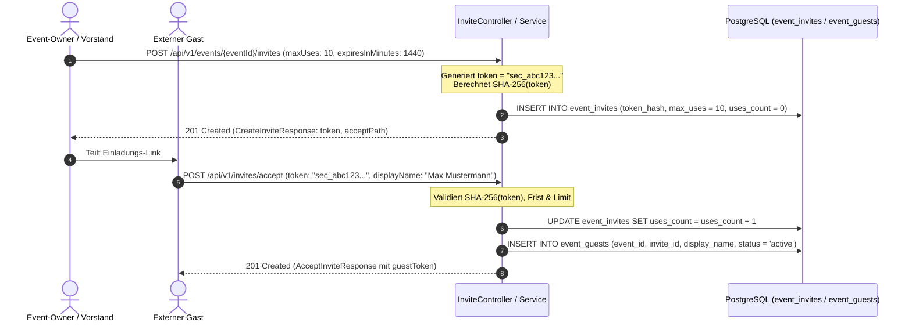

# Fachdomäne: Event-Management & Gast-Einladungen

Das Event-Modul in **Vereint** verwaltet den gesamten Lebenszyklus von Veranstaltungen der Gruppe – von der Planung über die Teilnehmerverwaltung bis hin zu sicheren, tokenbasierten Einladungen für externe Gäste ohne vollwertiges Guthabenkonto.

---

## 🎯 Fachliche Sicht (Business Domain)

### 1. Event-Lebenszyklus (`EventStatus`)
Events durchlaufen definierte Zustände:



- **`draft`**: Entwurf (nur für Owner und Vorstand sichtbar).
- **`published`**: Für alle Mitglieder sichtbar; Teilnehmer können sich anmelden.
- **`active`**: Event läuft aktuell; Strichliste am Tablet-Recorder ist aktiv und Kassenbuchungen sind möglich.
- **`completed`**: Event erfolgreich beendet und abgerechnet.
- **`cancelled`**: Event wurde storniert.
- **`archived`**: Archiviertes Event für Statistiken.

Statusänderungen und Stammdatenaktualisierungen werden über `PUT /api/v1/events/{id}` (`UpdateEventRequest`) vorgenommen.

### 2. Teilnehmerverwaltung (`EventParticipantDto`)
- Mitglieder der Gruppe und Vorstände verwalten Teilnehmer über `/api/v1/events/{id}/participants`:
  - `GET /api/v1/events/{id}/participants`: Liefert die Liste aller registrierten Teilnehmer.
  - `POST /api/v1/events/{id}/participants`: Fügt einen Teilnehmer (`AddParticipantRequest`) mit einer Rolle (z. B. `participant`) hinzu.
  - `DELETE /api/v1/events/{id}/participants/{userId}`: Entfernt einen Teilnehmer aus dem Event.

### 3. Event-Verpflegungsangebot (Getränke & Speisen)
- Neben Teilnehmern verwalten Event-Owner und Vorstände das gastronomische Angebot der Veranstaltung:
  - **Event-Getränke (`event_drinks`)**: Zuweisung über Sublisten oder Einzelauswahl (`EventDrinkController`) mit eventbezogener Preisanpassung (`price`, `costPrice`) und Freischaltung für Tablet-Strichliste (`tabletEnabled`).
  - **Event-Speisen (`event_food`)**: Zuweisung aus dem Katalog der Gruppe (`EventFoodController`) mit individuellen Verkaufspreisen, Wareneinsatz-Kosten (`costPrice`) und Kiosk-Steuerung (`tabletEnabled`).
- Im Zustand `active` werden diese Artikel über die Kiosk-API (`/api/v1/tablet/events/{eventId}/items`) für das Thekenteam bereitgestellt.

### 4. Gast-Einladungen via Krypto-Token
- Für externe Gäste können Veranstaltungs-Owner und Vorstände über `POST /api/v1/events/{eventId}/invites` Einladungslinks mit kryptografischen Tokens generieren.
- **Sicherheitskonzept**:
  - Im Antwort-Payload (`CreateInviteResponse`) wird das einmalig einsehbare Klartext-Token (`token`) und der `acceptPath` übergeben.
  - In der Datenbank wird ausschließlich der kryptografische **SHA-256 Hash** (`token_hash`) gespeichert (`SecureTokens.kt`).
  - Einladungen unterstützen Nutzungsbegrenzungen (`maxUses`) und Gültigkeitsdauer (`expiresInMinutes`).
- **Gast-Erlebnis**:
  - Der Gast löst die Einladung über `POST /api/v1/invites/accept` (`AcceptInviteRequest`) mit seinem Anzeigenamen ein.
  - Die Antwort (`AcceptInviteResponse`) enthält ein temporäres Gast-Session-Token (`guestToken`), das für nachfolgende Gast-Chat-Aufrufe (`X-Guest-Token`) genutzt wird.

---

## ⚙️ Technische Sicht (Architecture & Implementation)

### 1. Relevante Komponenten & Klassen
- **Controller**:
  - `EventController`: CRUD und Lifecycle (`/api/v1/events`, `PUT /api/v1/events/{id}`), Teilnehmerverwaltung (`/api/v1/events/{id}/participants`).
  - `InviteController`: Event-Einladungsverwaltung (`/api/v1/events/{eventId}/invites`), Einlösen von Gasttokens (`POST /api/v1/invites/accept`).
- **Services**: `EventService`, `InviteService`.
- **Sicherheit & Krypto**: `SecureTokens.kt` (Generierung von 256-Bit Zufalls-Tokens und SHA-256 Hashing).
- **Entitäten**: `EventEntity`, `EventParticipantEntity`, `EventInviteEntity`, `EventGuestEntity`.

---

## 📋 Datenstrukturen & DTOs

```kotlin
data class EventDto(
    val id: String,
    val title: String,
    val description: String?,
    val location: String?,
    val ownerId: String,
    val startsAt: Instant,
    val endsAt: Instant?,
    val status: String,
    val createdAt: Instant,
    val updatedAt: Instant
)

data class UpdateEventRequest(
    @field:Size(min = 1, max = 255) val title: String? = null,
    @field:Size(max = 4000) val description: String? = null,
    @field:Size(max = 255) val location: String? = null,
    val status: EventStatus? = null,
    val startsAt: Instant? = null,
    val endsAt: Instant? = null
)

data class CreateInviteRequest(
    @field:Min(1) @field:Max(10000) val maxUses: Int? = null,
    @field:Min(1) @field:Max(129600) val expiresInMinutes: Long? = null,
    @field:Pattern(regexp = "^(guest)?$") val role: String? = null
)

data class AcceptInviteRequest(
    @field:NotBlank val token: String,
    @field:Size(max = 255) val displayName: String
)

data class AcceptInviteResponse(
    val guestToken: String,
    val eventId: String,
    val eventTitle: String,
    val displayName: String,
    val status: String,
    val expiresAt: Instant
)
```

---

## 🔄 Sequenzablauf: Gast-Einladung & Einlösung


