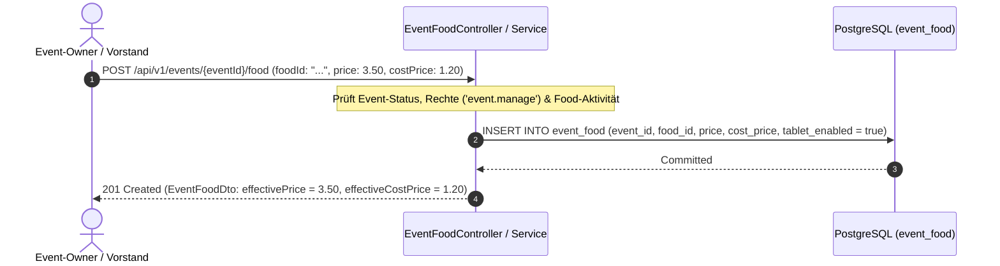

# Fachdomäne: Speisenkatalog & Eventspeisen

Die Speisenverwaltung in **Vereint** ermöglicht die strukturierte Verwaltung von Verzehrangeboten – vom zentralen Vereins-Speisenkatalog bis hin zum veranstaltungsspezifischen Speisenangebot mit individueller Preisanpassung und Kiosk-Steuerung.

---

## 🎯 Fachliche Sicht (Business Domain)

### 1. Globaler Speisenkatalog (`food_catalog`)
- **Stammdatenverwaltung**: Zentrales Sortiment aller im Verein zubereiteten oder angebotenen Speisen (z. B. Grillgut, Kuchen, Brezeln, Snacks, vegetarische/vegane Optionen).
- **Attribute**:
  - Name, Beschreibung und Kategorie (z. B. `Grill`, `Kuchen`, `Snacks`).
  - Standard-Verkaufspreis (`defaultPrice: BigDecimal`) und Standard-Einkaufspreis (`costPrice: BigDecimal`).
  - Währung (`currency: String`, z. B. `EUR`).
  - Status (`active: Boolean`) zur Deaktivierung saisonaler oder nicht mehr angebotener Speisen.
  - Ersteller-Referenz (`created_by`) für Revisions- und Audit-Zwecke.
- **Berechtigungen**:
  - Speisenkatalog ansehen: Alle aktiven Mitglieder sehen aktive Speisen; inaktive Speisen sind Vorständen (`board`) und Administratoren (`admin`) vorbehalten.
  - Speisen anlegen & bearbeiten: Nur Vorstand und Administration (`board`, `admin`).

### 2. Eventspezifische Speisen (`event_food`)
- **Veranstaltungsbezogenes Angebot**: Jedes Event kann eine maßgeschneiderte Auswahl an Speisen aus dem Gesamtkatalog zusammenstellen.
- **Preis- & Margen-Flexibilität**:
  - **Verkaufspreis (`price` / `effectivePrice`)**: Kann pro Event individuell festgelegt werden (z. B. Sonderpreise für Sommerfest). Bleibt `price` leer (`null`), greift automatisch der `defaultPrice` des Katalogs.
  - **Einkaufspreis (`costPrice` / `effectiveCostPrice`)**: Kann eventbezogen angepasst werden (z. B. bei tagesaktuellen Metzgereipreisen). Bleibt `costPrice` leer, gilt der Katalogwert.
- **Kanal- und Kiosk-Steuerung**:
  - `tabletEnabled: Boolean`: Steuert die Anzeige auf dem Tablet Strichlisten-Recorder an der Theke/Küche.
  - `selfServiceEnabled: Boolean`: Steuert die Verfügbarkeit für künftige Self-Service- und PWA-Buchungen.
- **Berechtigungen**:
  - Eventspeisen verwalten (`POST`, `PUT`, `DELETE`): Event-Owner sowie Vorstände/Administratoren (`event.manage`).
  - Eventspeisen abrufen (`GET`): Event-Teilnehmer und berechtigte Kiosk-Recorder (`event.read`).

---

## ⚙️ Technische Sicht (Architecture & Implementation)

### 1. Relevante Komponenten & Klassen
- **Controller**:
  - `FoodCatalogController`: Endpunkte unter `/api/v1/food` für Stammdatenverwaltung.
  - `EventFoodController`: Endpunkte unter `/api/v1/events/{eventId}/food` für veranstaltungsbezogene Speisen.
- **Services**:
  - `FoodCatalogService`: Validiert Namensregeln, Preise, Dezimalstellen und Rollenberechtigungen.
  - `EventFoodService`: Prüft Event-Existenz, Berechtigungen (`event.manage`), Dubletten-Schutz (`uk_event_food_event_food`) und berechnet effektive Preise (`effectivePrice`, `effectiveCostPrice`).
- **Repositories**: `FoodCatalogRepository`, `EventFoodRepository`.
- **Entitäten**: `FoodCatalogEntity`, `EventFoodEntity` (in `FoodEntities.kt`).

---

## 📋 Datenstrukturen & DTOs

```kotlin
// Globaler Speisenkatalog
data class CreateFoodRequest(
    @field:NotBlank val name: String?,
    @field:Size(max = 4000) val description: String? = null,
    @field:Size(max = 64) val category: String? = null,
    @field:NotNull @field:DecimalMin("0.00") val defaultPrice: BigDecimal?,
    @field:DecimalMin("0.00") val costPrice: BigDecimal? = null,
    @field:Pattern(regexp = "^[A-Za-z]{3}$") val currency: String? = null
)

data class UpdateFoodRequest(
    @field:Size(min = 1, max = 255) val name: String? = null,
    @field:Size(max = 4000) val description: String? = null,
    @field:Size(max = 64) val category: String? = null,
    @field:DecimalMin("0.00") val defaultPrice: BigDecimal? = null,
    @field:DecimalMin("0.00") val costPrice: BigDecimal? = null,
    @field:Pattern(regexp = "^[A-Za-z]{3}$") val currency: String? = null,
    val active: Boolean? = null
)

data class FoodDto(
    val id: String,
    val name: String,
    val description: String?,
    val category: String?,
    val defaultPrice: BigDecimal,
    val costPrice: BigDecimal,
    val currency: String,
    val active: Boolean,
    val createdById: String?,
    val createdAt: Instant,
    val updatedAt: Instant
)

// Eventspeisen
data class AddEventFoodRequest(
    @field:NotBlank val foodId: String?,
    @field:DecimalMin("0.00") val price: BigDecimal? = null,
    @field:DecimalMin("0.00") val costPrice: BigDecimal? = null,
    @field:Pattern(regexp = "^[A-Za-z]{3}$") val currency: String? = null,
    val selfServiceEnabled: Boolean? = null,
    val tabletEnabled: Boolean? = null
)

data class UpdateEventFoodRequest(
    @field:DecimalMin("0.00") val price: BigDecimal? = null,
    @field:DecimalMin("0.00") val costPrice: BigDecimal? = null,
    @field:Pattern(regexp = "^[A-Za-z]{3}$") val currency: String? = null,
    val selfServiceEnabled: Boolean? = null,
    val tabletEnabled: Boolean? = null
)

data class EventFoodDto(
    val id: String,
    val eventId: String,
    val foodId: String,
    val foodName: String,
    val price: BigDecimal?,
    val effectivePrice: BigDecimal,
    val costPrice: BigDecimal?,
    val effectiveCostPrice: BigDecimal,
    val currency: String,
    val selfServiceEnabled: Boolean,
    val tabletEnabled: Boolean,
    val createdAt: Instant,
    val updatedAt: Instant
)
```

---

## 🔄 Sequenzablauf: Speisenzuweisung zu einem Event


