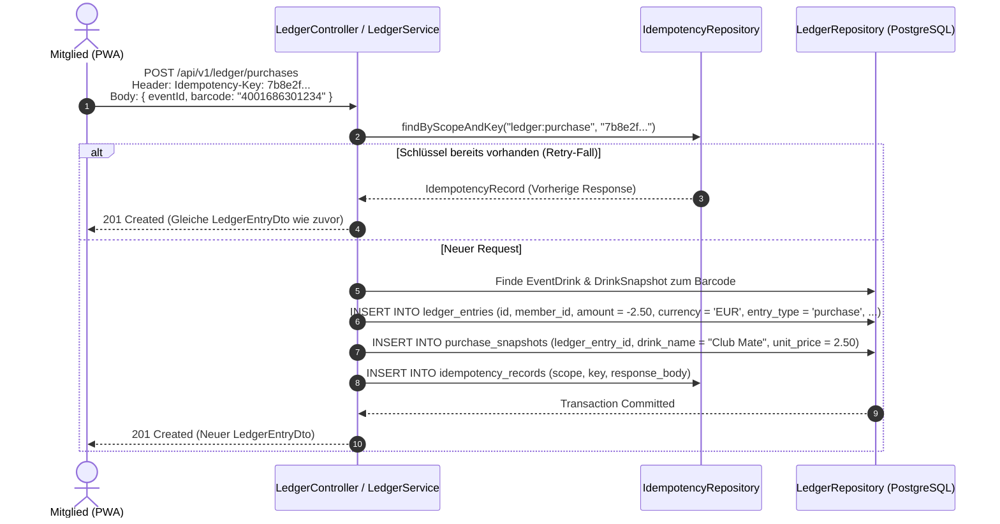

# Fachdomäne: Kassenbuch & Finanzwesen (Ledger)

Das Kassenbuch in **Vereint** bildet das finanzielle Herzstück für Guthabenverwaltung, Getränkeabrechnungen und Event-Umsätze. Es folgt strengen Buchhaltungsprinzipien (*Double-Entry Journal*, *Append-Only Revisionssicherheit*, *Idempotenz*).

---

## 🎯 Fachliche Sicht (Business Domain)

### Buchungsarten & Geldflüsse
Das System unterscheidet vier elementare Buchungstypen (`entryType`):

1. **Guthaben-Aufladung (`topup`)**:
   - Einzahlung eines Mitglieds (z. B. Bargeld an den Kassier oder Überweisung).
   - Erhöht das persönliche Guthaben (`creditBalance`).
2. **Getränke-/Eventkauf (`purchase`)**:
   - Abbuchung für konsumierte Getränke am Theken-Tablet oder via PWA-Barcodescan.
   - Verringert das Guthaben im Modus `credit` oder wird als Bareinnahme im Modus `revenueOnly` verbucht.
3. **Guthaben-Auszahlung (`payout`)**:
   - Rückzahlung von verbleibendem Restguthaben bei Vereinsaustritt.
   - Verringert das Guthaben.
4. **Korrekturbuchung / Stornierung (`correction`)**:
   - Revisionssichere Gegenbuchung zu einer früheren Fehlbuchung.
   - Da Einträge niemals gelöscht werden dürfen (*Append-Only*), hebt ein Storno den Ursprungsbetrag über einen referenzierten Gegeneintrag auf.

### Abrechnungsmodi (`accountingMode`)
- **`credit`**: Der Kaufbetrag wird direkt dem persönlichen Vereinskonto des Mitglieds belastet.
- **`revenueOnly`**: Der Umsatz wird statistisch und kassenmäßig erfasst (z. B. bei Barzahlung auf Events oder Pauschalbuchungen), ohne ein Mitgliedskonto zu belasten.

---

## ⚙️ Technische Sicht (Architecture & Implementation)

### 1. Relevante Komponenten & Klassen
- **Controller**: `de.maurer.baseservice.controller.LedgerController`
  - `GET /api/v1/ledger/members/{memberId}/balance` – Aktueller Kontostand (`MemberBalanceDto`)
  - `GET /api/v1/ledger/members/{memberId}/entries` – Revisionssicherer Kontoauszug
  - `GET /api/v1/ledger/events/{eventId}/summary` – Gesamtabrechnung eines Events (`EventLedgerSummaryDto`)
  - `POST /api/v1/ledger/purchases` – PWA Barcode-Kauf (`PurchaseRequest`, erfordert `Idempotency-Key`)
  - `POST /api/v1/ledger/topups` – Guthabenaufladung (nur Vorstand/Admin)
  - `POST /api/v1/ledger/payouts` – Guthabenauszahlung (nur Vorstand/Admin)
  - `POST /api/v1/ledger/corrections` – Gegenbuchung/Storno (`CorrectionRequest`)
- **Service**: `LedgerService`
  - Berechnet Salden über aggregierte SQL-Summenabfragen.
  - Speichert `PurchaseSnapshot`-Objekte mit fixem Getränkepreis zum Kaufzeitpunkt.
  - Prüft und persistiert Idempotenzschlüssel in `idempotency_records`.
- **Datenbank & Entitäten**:
  - `LedgerEntry`, `PurchaseSnapshot`, `IdempotencyRecord` (in `LedgerEntities.kt`).
  - PostgreSQL Append-Only Trigger `trg_ledger_entries_append_only`.

---

## 💰 Saldenberechnung & Formel

```text
creditBalance = topupTotal - payoutTotal - (creditPurchases) ± (correctionTotal)
```

Jeder Buchungsdatensatz speichert den Betrag als `DECIMAL(10,2)` (`amount: BigDecimal`):
- `topup`: Positiv (`+amount`)
- `payout`: Negativ (`-amount`)
- `purchase` (im Modus `credit`): Negativ (`-amount`)
- `correction`: Hebt den Betrag der Originalbuchung umgekehrt auf (`-original.amount`)

---

## 🔄 Sequenzablauf: Idempotenter Barcode-Kauf


