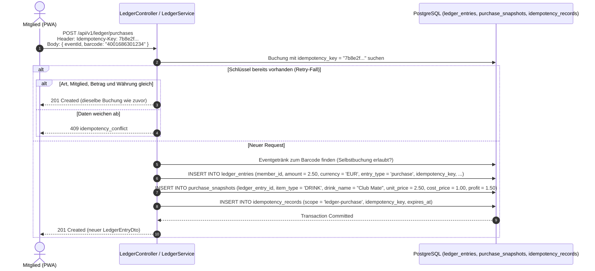

# Fachdomäne: Kassenbuch & Finanzwesen (Ledger)

Das Kassenbuch in **Vereint** bildet das finanzielle Herzstück für Guthabenverwaltung, Getränke- und Speisenabrechnungen, Event-Umsätze und Deckungsbeitragsanalysen. Es folgt festen Prinzipien: Buchungen werden nur angehängt, nie geändert oder gelöscht (*Append-Only*), und jede Buchung trägt einen Idempotenzschlüssel. Jede Gruppe hat ihr eigenes Kassenbuch.

---

## 🎯 Fachliche Sicht (Business Domain)

### Buchungsarten & Geldflüsse
Das System unterscheidet vier elementare Buchungstypen (`entryType`):

1. **Guthaben-Aufladung (`topup`)**:
   - Einzahlung eines Mitglieds (z. B. Bargeld an die Kasse oder Überweisung).
   - Erhöht das persönliche Guthaben (`creditBalance`).
2. **Getränke- & Speisenkauf (`purchase`)**:
   - Abbuchung für konsumierte Getränke (`drink_id`) oder Speisen (`food_id`) am Theken-Tablet oder via PWA-Barcodescan.
   - Verringert das Guthaben im Modus `credit` oder wird als Bareinnahme im Modus `revenueOnly` verbucht.
   - Erzeugt einen unveränderlichen Beleg-Snapshot (`PurchaseSnapshot`) mit Verkaufs- und Einkaufspreis zur exakten Deckungsbeitragsermittlung.
   - Gehört das Getränk zu einer Strich-Kategorie, steht sie zusätzlich am Eintrag (`tally_category_id`, im DTO `tallyCategoryId`/`tallyCategoryName`), und der Betrag ist der Kategoriepreis. Der Eintrag nennt also immer Getränk **und** Kategorie. Korrekturen übernehmen die Kategorie des Ursprungseintrags.
3. **Guthaben-Auszahlung (`payout`)**:
   - Rückzahlung von Guthaben, z. B. beim Verlassen der Gruppe.
   - Verringert das Guthaben.
4. **Korrekturbuchung / Stornierung (`correction`)**:
   - Revisionssichere Gegenbuchung zu einer früheren Fehlbuchung.
   - Da Einträge niemals gelöscht werden dürfen (*Append-Only*), hebt ein Storno den Ursprungsbetrag über einen referenzierten Gegeneintrag auf (`reverses_entry_id`). Eine Buchung lässt sich nur einmal stornieren (`409 ledger_already_corrected`).
   - **Rückgängig**: Eigene Barcode-Käufe und Tablet-Buchungen lassen sich innerhalb von 10 Minuten selbst zurücknehmen; auch das ist eine Korrekturbuchung.

### Runden
- Gibt jemand am eigenen Handy eine Runde aus, gehen die Striche der Eingeladenen an der Theke auf **sein** Guthaben: Die Buchung hat `member_id` = Geber, `beneficiary_id` = wer getrunken hat, `round_id` und `source = round` bzw. `evening` (Modus `credit`). Im Kontoauszug des Gebers steht „Runde: Felix Braun · Helles“. Das Guthaben des Gebers darf dabei ins Minus gehen. Statistiken zählen das Getränk bei der Person, die getrunken hat. Einzelheiten: [Thekenterminal](tablet-strichliste-recorder.md).

### Abrechnungsmodi (`accountingMode`)
- **`credit`**: Der Kaufbetrag wird direkt dem persönlichen Guthabenkonto des Mitglieds belastet.
- **`revenueOnly`**: Der Umsatz wird statistisch und kassenmäßig erfasst (z. B. bei Barzahlung auf Events oder den früheren Rundenbuchungen am Terminal), ohne ein Mitgliedskonto zu belasten.

---

## ⚙️ Technische Sicht (Architecture & Implementation)

### 1. Relevante Komponenten & Klassen
- **Controller**: `de.maurer.baseservice.controller.LedgerController`
  - `GET /api/v1/ledger/balances`: Guthaben aller Mitglieder (`ledger.read`)
  - `GET /api/v1/ledger/members/{memberId}/balance`: Kontostand (`MemberBalanceDto`; eigenes Konto oder `ledger.read`)
  - `GET /api/v1/ledger/members/{memberId}/entries`: Kontoauszug (eigenes Konto oder `ledger.read`)
  - `GET /api/v1/ledger/events/{eventId}/summary`: Abrechnung eines Events inkl. Umsatz, Wareneinsatz & Gewinn (`EventLedgerSummaryDto`; `ledger.read` oder `event.manage`)
  - `POST /api/v1/ledger/purchases/preview`: Preis und Event zu einem Barcode vorab (`purchase.self`)
  - `POST /api/v1/ledger/purchases`: Barcode-Kauf in der App (`PurchaseRequest`, `purchase.self`)
  - `POST /api/v1/ledger/purchases/{entryId}/undo`: eigenen Barcode-Kauf zurücknehmen (`purchase.self`)
  - `POST /api/v1/ledger/topups`, `POST /api/v1/ledger/payouts`, `POST /api/v1/ledger/corrections`: Aufladung, Auszahlung, Gegenbuchung (`ledger.correct`, Startwert: Vorstand und Admin)
  - Alle schreibenden Aufrufe verlangen den Header `Idempotency-Key`.
  - Die App (Kasse, Thekenterminal, Bezahlen) behält den Schlüssel nach einem Fehler und schickt ihn bei einer Wiederholung mit denselben Daten erneut (`RetryableIdempotencyKey` in `webservice/src/app/api/idempotency.ts`). Nach einer Zeitüberschreitung kann die Buchung schon gespeichert sein; die Wiederholung liefert dann diese Buchung zurück, statt eine zweite anzulegen. Gemerkt wird ein Schlüssel nur nach einem Fehler; gleichzeitig laufende Buchungen mit gleichen Daten (zweimal schnell „+“ am Thekenterminal) bekommen eigene Schlüssel und zählen beide.
- **Service**: `LedgerService`
  - Berechnet Salden aus den Buchungen eines Mitglieds und Event-Summen aus den Buchungen des Events.
  - Speichert `PurchaseSnapshot`-Objekte mit fixem Verkaufs- und Einkaufspreis (`unitPrice`, `costPrice`, `profit = unitPrice - costPrice`) zum Kaufzeitpunkt.
  - Erkennt Wiederholungen am Idempotenzschlüssel der Buchung (`ledger_entries.idempotency_key`, eindeutig je Gruppe) und vermerkt Scope und Schlüssel in `idempotency_records`; siehe [Idempotenz](../api/error-handling-and-idempotency.md#-idempotenz-muster--header-spezifikation).
- **Datenbank & Entitäten**:
  - `LedgerEntry`, `PurchaseSnapshot`, `IdempotencyRecord` (in `LedgerEntities.kt`).
  - PostgreSQL Append-Only Trigger `trg_ledger_entries_append_only` und `trg_purchase_snapshots_append_only`.
  - Jede Buchung hat höchstens eine Gegenbuchung: Unique-Constraint `uk_ledger_entries_reverses_entry` (Migration `022`). Zwei gleichzeitige Korrekturen derselben Buchung ergeben eine Gegenbuchung und einmal `409 ledger_already_corrected`.

---

## 💰 Finanzformeln & Deckungsbeitragsrechnung

### 1. Persönliche Saldenberechnung
```text
creditBalance = topupTotal - payoutTotal - (creditPurchases) ± (correctionTotal)
```

Jeder Buchungsdatensatz speichert den Betrag positiv als `DECIMAL(10,2)` (`amount: BigDecimal`); die Wirkung auf das Guthaben ergibt sich aus der Buchungsart:
- `topup`: erhöht (`+amount`)
- `payout`: verringert (`-amount`)
- `purchase` im Modus `credit`: verringert (`-amount`); im Modus `revenueOnly` keine Wirkung
- `correction`: hebt die Wirkung der Originalbuchung auf

### 2. Deckungsbeitrag & Event-Gewinnermittlung
Für jeden getätigten Kauf (Getränk oder Speise) wird im Beleg-Snapshot der Reingewinn/Deckungsbeitrag fixiert:
```text
profit = unit_price - cost_price
```

In der Event-Gesamtabrechnung (`EventLedgerSummaryDto`) aggregiert der `LedgerService`:
- `revenueTotal`: Summe aller Brutto-Verkaufserlöse (`SUM(unit_price)`)
- `costTotal`: Summe des Wareneinsatzes (`SUM(cost_price)`)
- `profitTotal`: Gesamter Deckungsbeitrag des Events (`SUM(profit) = revenueTotal - costTotal`)
- `creditConsumptionTotal`: Gesamtsumme der über Mitgliedsguthaben bezahlten Käufe

---

## 📋 Datenstrukturen & DTOs

```kotlin
data class PurchaseSnapshotDto(
    val itemType: String = "DRINK", // "DRINK" | "FOOD"
    val drinkName: String? = null,
    val foodName: String? = null,
    val imageReference: String? = null,
    val barcode: String? = null,
    val unitPrice: BigDecimal,
    val costPrice: BigDecimal = BigDecimal.ZERO,
    val profit: BigDecimal = BigDecimal.ZERO,
    val currency: String,
    val catalogVersion: Int? = 1
)

data class LedgerEntryDto(
    val id: String,
    val entryType: String,
    val eventId: String?,
    val memberId: String,
    val memberDisplayName: String,
    val drinkId: String?,
    val foodId: String? = null,
    val amount: BigDecimal,
    val currency: String,
    val accountingMode: String,
    val source: String?,
    val actorId: String,
    val reversesEntryId: String?,
    val idempotencyKey: String,
    val createdAt: Instant,
    val snapshot: PurchaseSnapshotDto?
)

data class EventLedgerSummaryDto(
    val eventId: String,
    val currency: String,
    val revenueTotal: BigDecimal,
    val costTotal: BigDecimal = BigDecimal.ZERO,
    val profitTotal: BigDecimal = BigDecimal.ZERO,
    val creditConsumptionTotal: BigDecimal,
    val entryCount: Int
)
```

---

## 🔄 Sequenzablauf: Idempotenter Barcode-Kauf


