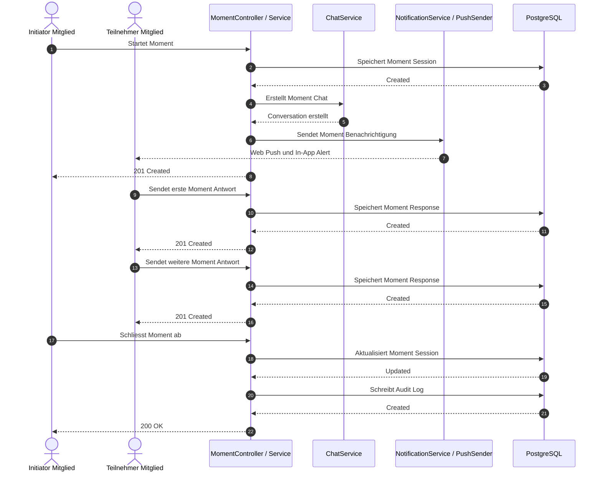

# Fachdomäne: Moments & Rituale (Gemeinschaftsmomente)

**Moments** (Gemeinschaftsmomente & Rituale) ist ein vielseitiges, ereignisgesteuertes Kollaborationsmerkmal für alle Arten von Clubs und Gemeinschaften. Es ermöglicht Mitgliedern, spontane Momente gemeinsamer Aktivität zu initiieren und zu teilen – von Toasts und Gebeten über Jubelmomente bis hin zu Check-ins und Reflexionsmomenten.

---

## 🎯 Fachliche Sicht (Business Domain)

### 1. Moments-Konzept & Anwendungsfälle
**Moments** ist ein **zeitlich begrenztes Kollaborationsmerkmal**, das Mitglieder der Gruppe nutzen können, um spontane Momente gemeinsamer Aktivität zu initiieren – mit oder ohne Event:

- **Soziale & Stammtisch-Clubs**: Gemeinsames Anstoßen ("Gemeinsames Anstoßen 🍻")
- **Glaubensgemeinschaften & Kirchen**: Gemeinsame Gebetskreise ("Gemeinsames Beten & Fürbitten 🙏")
- **Sport- & Fan-Clubs**: Kollektives Jubeln oder Anfeuern ("Jubeln / Anfeuern 📣")
- **Allgemeine Vereinigungen**: Spontane Check-ins, Reflexionsmomente oder Treffpunkt-Bestätigungen ("Check-in 📍")

### 1a. Thema, Event und Sichtbarkeit
- **Thema (Pflicht)**: Das Mitglied wählt eines der Themen, die der Vorstand pflegt (siehe [Typen & Reaktionen verwalten](#7-typen--reaktionen-verwalten)). Ein eigener Titel ist optional; ohne Titel trägt der Moment den Namen des Themas.
- **Event (optional)**: Ein Moment kann an ein offenes Event geknüpft werden, muss aber nicht.
- **Sichtbarkeit** (`moment_sessions.visibility`):
  - `group` (Standard): alle Mitglieder der Gruppe sehen den Moment, auch wenn er an einem Event hängt und sie nicht teilnehmen.
  - `event`: nur Veranstalter und Teilnehmende des verknüpften Events. Geht nur mit Event.
  - Vorstand und Administration (`event.manage`) sehen alle Moments.
- **Benachrichtigung** beim Start: alle, die den Moment sehen dürfen (außer dem Starter).
- Moments von vor der Umstellung (Migration `020-moments-without-events.xml`) stehen auf `event` und bleiben damit wie bisher nur für Event-Teilnehmende sichtbar.

### 2. Moment-Lebenszyklus
Ein Moment durchläuft folgende Zustände:

- **`active`**: Der Moment ist offen für Antworten und Live-Karten-/Timeline-Updates. Mitglieder können mehrfach Status-Updates und Reaktionen einreichen.
- **`completed`**: Der Moment ist abgelaufen oder wurde manuell vom Initiator/Vorstand finalisiert. Die abgeschlossene Session wird über `listMomentHistory` in der Event-Historie bereitgestellt.
- **`revoked`**: Der Moment wurde vor normaler Fertigstellung storniert.

### 3. Teilnehmer-Multi-Status-Einreichungen
Teilnehmer können während der aktiven Moment-Dauer **mehrfach Status-Updates und Reaktionen** einreichen (z. B. progressive Updates während eines Gebets, wiederholte Toasts/Jubelrufe):

- **Reaktionen**: vom Vorstand verwaltet (siehe [Typen & Reaktionen verwalten](#7-typen--reaktionen-verwalten)); Startbestand u. a. `TOAST`, `PRAYER`, `CHEER`, `CHECKIN`, `THUMBS_UP`, `HEART`, `FIRE`
- **Fotos & Videos** (optional): bis zu 4 Dateien je Beitrag (siehe [Fotos & Videos](#8-fotos--videos))
- **Status-Text** (optional): Persönliche Nachricht oder Kommentar (max. 255 Zeichen)
- **Opt-in Koordinaten**: `latitude` und `longitude` mit expliziter Zustimmung (`consent = true`)

### 4. Automatische 24-Stunden-Linked-Konversation
Wenn ein Moment gestartet wird, wird automatisch eine `ConversationEntity` vom Typ `moment` erstellt:

- **Zweck**: Gibt Mitgliedern einen reibungslosen Raum zum Austausch während und nach dem Moment.
- **Lebensdauer**: Automatische Archivierung 24 Stunden nach Erstellung.
- **Teilnehmer**: Alle, die den Moment sehen dürfen (siehe Sichtbarkeit), können beitreten und Nachrichten senden. Der Zugriff auf den Chat folgt der Sichtbarkeit des Moments.

### 5. Karte & GeoJSON-Visualisierung
Ein Moment bietet eine Karte mit den Standorten der Teilnehmer, die sich für die Standortfreigabe entschieden haben:

- **Endpunkt**: `GET /api/v1/moments/{momentId}/map`
- **Darstellung**: Leaflet mit OpenStreetMap-Kacheln (`tile.openstreetmap.org`, in der CSP unter `img-src` freigegeben). Die Karte zeigt nur den Bereich, in dem alle geteilten Standorte liegen (`fitBounds`, höchstens Zoom 15; ein einzelner Standort mit Zoom 14), nicht die ganze Welt.
- **Datenschutz-Hinweis**: Beim Anzeigen der Karte lädt der Browser Kartenkacheln von OpenStreetMap; dabei sieht der Kachelserver die IP-Adresse und den groben Kartenausschnitt. Die Koordinaten der Teilnehmer verlassen den Server dabei nicht.
- **Format**: RFC 7946 GeoJSON FeatureCollection mit Point-Geometrien
- **Datenschutz**: Nur Antworten mit `consent = true` und gültigen Koordinaten werden einbezogen.

### 6. Kalender-/Event-Verlauf-Archivierung
Wenn ein Moment abläuft oder fertiggestellt wird, wird die Session abgeschlossen und über `listMomentHistory` in der Moment-Historie bereitgestellt (alle sichtbaren Moments der Gruppe, mit `?eventId=` nur die eines Events). Im Kalender erscheinen weiterhin nur Moments mit Event. Der Abschluss wird zusätzlich über `AuditService` protokolliert:

- **Zusammenfassung**: Die Moment-Historie liefert `momentId`, `title`, `topicType`, `totalResponses`, `uniqueParticipants`, `summary` und das nullable Feld `completedAt`.
- **Beispiel-Zusammenfassung**: "5 Teilnehmer haben 8 Statusbeiträge zum Moment 'Stammtisch Anstoßen' (toast) geteilt."
- **Zweck**: Bewahrt gemeinsame Erinnerungen, ohne Haupt-Planungskalender mit Mikro-Events zu überladen.

### 7. Typen & Reaktionen verwalten
Vorstand und Administration legen unter *Vorstand → Moments · Typen & Reaktionen* (`/board/moments`) fest, welche Arten von Moments es gibt und mit welchen Reaktionen Mitglieder antworten:

- **Typ**: Emoji, Name, optionale Beschreibung, Reihenfolge. Je Typ sind entweder alle aktiven Reaktionen erlaubt oder eine Auswahl.
- **Reaktion**: Emoji, Name, Reihenfolge.
- **Ausmustern statt Löschen**: Ausgemusterte Typen und Reaktionen sind für neue Moments nicht mehr wählbar; bestehende Moments und Beiträge behalten sie.
- Die früher fest eingebauten Typen (Anstoßen, Gebet, Jubeln, Check-in, Sonstiges) und Reaktionen sind der Startbestand (Migration `012-moment-types-and-media.xml`).
- Änderungen stehen im Audit-Protokoll.

### 8. Fotos & Videos
Zu einem Beitrag lassen sich bis zu **4 Fotos oder Videos** anhängen (höchstens 40 je Mitglied und Moment):

- **Fotos**: JPEG, PNG oder GIF bis 10 MB. Der Browser verkleinert sie vor dem Hochladen; der Server entfernt EXIF/XMP-Metadaten (GPS, Gerät, Aufnahmezeit).
- **Aufnehmen**: Im Beitragsdialog gibt es „Foto aufnehmen“ und „Video aufnehmen“ (`<input capture="environment">`, öffnet auf Handys direkt die Kamera) sowie „Aus Galerie“.
- **Tarif**: Videos nur in Tarifen mit Videos (`PlanLimits.videos`). Die App blendet den Video-Button sonst aus (`mediaLimits.videosAllowed`); der Server prüft beim Upload zusätzlich (`PLAN_LIMIT_VIDEOS`).
- **Videos**: MP4 oder MOV, höchstens **60 Sekunden** und **100 MB**. Der Server entfernt ohne Transkodierung die Metadaten-Boxen (`udta`, `meta`, XMP) mit Ort und Gerät.
- **Speicherung**: AES-256-GCM-verschlüsselt in 64-KiB-Blöcken im Objektspeicher, gestreamt statt ganz im Speicher gehalten.
- **Auslieferung**: nur über den berechtigungsgeprüften Endpunkt mit HTTP-Range, damit Videos abspielbar und spulbar sind.
- **Entfernen**: die eigene Datei jederzeit; Vorstand, Administration und Gastgeber des Events können Dateien in Beiträgen anderer entfernen (Audit `MOMENT_MEDIA_REMOVED`).

---

## ⚙️ Technische Sicht (Architecture & Implementation)

### 1. Relevante Komponenten & Klassen

#### Backend (Spring Boot / Kotlin)
- **Controller**:
  - `MomentController`: Verwaltet Moment-Sessions, Antworten, GeoJSON-Kartendaten, Fertigstellungs-Trigger und Medien (`/api/v1/moments`).
  - `MomentAccessPolicy`: Gemeinsame Sichtbarkeitsregel für Moments und ihre Chats.
  - `MomentConfigController`: Typen und Reaktionen (`/api/v1/moment-config`; Lesen für alle Angemeldeten, Schreiben nur Vorstand/Admin).
- **Services**:
  - `MomentService`: Kerngeschäftslogik für Session-Orchestrierung, Multi-Status-Antworten, Push-Benachrichtigungsverteilung via `NotificationService` / `PushSender`, Chat-Erstellung via `ChatService` und Bereitstellung der Moment-Historie.
  - `NotificationService` & `PushSender`: Verteilt Web-Push- und In-App-Benachrichtigungen bei Moment-Initiierung an alle, die den Moment sehen dürfen.
  - `ChatService`: Aktualisiert zur Unterstützung temporärer Moment-Konversationen mit 24-Stunden-Ablauf.
  - `MomentConfigService`: Typen, Reaktionen und erlaubte Kombinationen.
  - `MomentMediaService` & `Mp4Sanitizer`: Upload, Bereinigung, Verschlüsselung und Range-Auslieferung von Fotos und Videos.
- **Entitäten**:
  - `MomentSessionEntity`: Aggregat-Root für eine Moment-Session mit Metadaten (Titel, Thementyp, Nachricht, Initiator, Ablauf).
  - `MomentResponseEntity`: Chronologische Status-Events ohne Eindeutigkeitsbeschränkung pro Benutzer (ermöglicht mehrfache Einreichungen).
  - `MomentTypeEntity`, `MomentReactionEntity`: verwaltbare Typen und Reaktionen.
  - `MomentMediaEntity`: Foto oder Video zu einem Beitrag (Art, Größe, Abmessungen, Dauer, Speicher-Schlüssel).

#### Frontend (Angular 22)
- **Komponenten**:
  - `MomentsComponent`: Master-Ansicht mit aktiven Moments, Start-Moment-Modal, Multi-Status-Reaktions-Trigger und Link zu 24h-Chat.
  - `MomentTimelineComponent`: Chronologischer Feed von Teilnehmer-Status-Updates mit Benutzer-Badges.
  - `MomentMapComponent`: Responsive Welt-Karte mit GeoJSON-Marker-Projektion.
  - `EventDetailComponent`: Eingebettete aktive Moments-Schnellaktion und vergangene Moment-Aktivitätszusammenfassungen.
  - `MomentConfigComponent`: Verwaltung der Typen und Reaktionen für den Vorstand (`/board/moments`).
  - `moment-media.ts`: Verkleinern, Prüfen und Hochladen von Fotos und Videos.

### 2. Datenbank-Schema (PostgreSQL / Liquibase)

```sql
CREATE TABLE moment_sessions (
    id UUID PRIMARY KEY,
    event_id UUID REFERENCES events(id) ON DELETE CASCADE,          -- optional
    visibility VARCHAR(16) NOT NULL DEFAULT 'group',                 -- 'group' | 'event' (nur mit Event)
    creator_user_id UUID NOT NULL REFERENCES users(id) ON DELETE CASCADE,
    conversation_id UUID REFERENCES conversations(id) ON DELETE SET NULL,
    title VARCHAR(255) NOT NULL,
    topic_type VARCHAR(64) NOT NULL, -- Code aus moment_types, z. B. 'toast'
    message VARCHAR(500),
    latitude DOUBLE PRECISION,
    longitude DOUBLE PRECISION,
    active BOOLEAN NOT NULL DEFAULT TRUE,
    expires_at TIMESTAMP WITH TIME ZONE NOT NULL,
    completed_at TIMESTAMP WITH TIME ZONE,
    summary TEXT,
    created_at TIMESTAMP WITH TIME ZONE NOT NULL DEFAULT CURRENT_TIMESTAMP,
    updated_at TIMESTAMP WITH TIME ZONE NOT NULL DEFAULT CURRENT_TIMESTAMP,
    version BIGINT NOT NULL DEFAULT 0
);

CREATE TABLE moment_responses (
    id UUID PRIMARY KEY,
    moment_id UUID NOT NULL REFERENCES moment_sessions(id) ON DELETE CASCADE,
    user_id UUID NOT NULL REFERENCES users(id) ON DELETE CASCADE,
    reaction VARCHAR(64) NOT NULL,
    status_text VARCHAR(255),
    latitude DOUBLE PRECISION,
    longitude DOUBLE PRECISION,
    created_at TIMESTAMP WITH TIME ZONE NOT NULL DEFAULT CURRENT_TIMESTAMP,
    version BIGINT NOT NULL DEFAULT 0
);

-- Seit Migration 012: verwaltbare Typen und Reaktionen, Medien
CREATE TABLE moment_types (id UUID PRIMARY KEY, code VARCHAR(64), name VARCHAR(64), emoji VARCHAR(16),
    description VARCHAR(255), sort_order INTEGER, active BOOLEAN, all_reactions BOOLEAN, ...);
CREATE TABLE moment_reactions (id UUID PRIMARY KEY, code VARCHAR(64), name VARCHAR(64), emoji VARCHAR(16),
    sort_order INTEGER, active BOOLEAN, ...);
CREATE TABLE moment_type_reactions (type_id UUID, reaction_id UUID, PRIMARY KEY (type_id, reaction_id));
CREATE TABLE moment_media (id UUID PRIMARY KEY, moment_id UUID, response_id UUID, owner_id UUID,
    kind VARCHAR(16), content_type VARCHAR(64), size_bytes BIGINT, storage_key VARCHAR(512),
    encrypted BOOLEAN, width INTEGER, height INTEGER, duration_ms BIGINT, ...);

CREATE INDEX idx_moment_sessions_event_active ON moment_sessions(event_id, active);
CREATE INDEX idx_moment_responses_moment_created ON moment_responses(moment_id, created_at ASC);
CREATE INDEX idx_moment_responses_user ON moment_responses(user_id);
```

---

## 📋 Datenstrukturen & DTOs

```kotlin
data class StartMomentRequest(
    @field:NotBlank @field:Size(max = 255) val title: String,
    @field:NotBlank @field:Size(max = 64) val topicType: String,
    @field:Size(max = 500) val message: String? = null,
    val consent: Boolean = false,
    @field:DecimalMin("-90.0") @field:DecimalMax("90.0") val latitude: Double? = null,
    @field:DecimalMin("-180.0") @field:DecimalMax("180.0") val longitude: Double? = null,
    @field:Min(1) @field:Max(1440) val durationMinutes: Int = 60
)

data class SubmitMomentResponseRequest(
    @field:NotBlank @field:Size(max = 64) val reaction: String,
    @field:Size(max = 255) val statusText: String? = null,
    val consent: Boolean = false,
    @field:DecimalMin("-90.0") @field:DecimalMax("90.0") val latitude: Double? = null,
    @field:DecimalMin("-180.0") @field:DecimalMax("180.0") val longitude: Double? = null
)

data class MomentSessionDto(
    val id: String,
    val eventId: String,
    val creatorId: String,
    val creatorName: String,
    val conversationId: String?,
    val title: String,
    val topicType: String,
    val message: String?,
    val latitude: Double?,
    val longitude: Double?,
    val active: Boolean,
    val responsesCount: Int,
    val expiresAt: Instant,
    val createdAt: Instant,
    val summary: String?
)

data class MomentResponseDto(
    val id: String,
    val momentId: String,
    val userId: String,
    val userName: String,
    val reaction: String,
    val statusText: String?,
    val latitude: Double?,
    val longitude: Double?,
    val createdAt: Instant
)

data class MomentDetailDto(
    val session: MomentSessionDto,
    val responses: List<MomentResponseDto>,
    val mapGeoJson: GeoJsonFeatureCollectionDto
)

data class MomentSummaryDto(
    val momentId: String,
    val title: String,
    val topicType: String,
    val totalResponses: Int,
    val uniqueParticipants: Int,
    val summary: String?,
    val completedAt: Instant?
)
```

---

## 🔄 Sequenzablauf: Moment starten & Teilnehmer-Antworten



---

## 🔒 Datenschutz & GDPR-Compliance

### Opt-in Geolokalisierung
- **Zustimmungspflicht**: Sowohl `StartMomentRequest` als auch `SubmitMomentResponseRequest` erzwingen `consent = true` vor dem Schreiben von Koordinaten.
- **Koordinaten-Validierung**: Latitude `[-90, 90]`, Longitude `[-180, 180]`.
- **Snapshot-basiert**: Geolokalisierung ist snapshot-basiert bei Status-Einreichung, nicht kontinuierliches GPS-Tracking.

### Zugriffskontrolle (Deny-by-Default)
- `group`: alle Mitglieder der Gruppe; `event`: nur Event-Besitzer und beigetretene Teilnehmer; Board/Admin immer (`MomentAccessPolicy`).
- Nicht-Teilnehmer erhalten `403 Forbidden` (`ErrorCode.ACCESS_DENIED`).

---

## 🎨 Frontend-Benutzerfluss

### 1. Moment starten (Initiator)
1. Navigiere zu `/events/:eventId/moments`
2. Klicke auf "Moment starten"
3. Wähle einen der aktiven Moment-Typen (vom Vorstand verwaltet)
4. Gib optionale Nachricht ein
5. Wähle Dauer (15–1440 Minuten, Standard 60)
6. Aktiviere Standortfreigabe (optional, mit Browser-GPS)
7. Klicke "Moment starten"
8. Alle, die den Moment sehen dürfen, erhalten Web-Push-Benachrichtigung

### 2. Moment beitreten & Antworten (Teilnehmer)
1. Erhalte Web-Push-Benachrichtigung oder navigiere zu `/events/:eventId/moments`
2. Klicke auf aktiven Moment
3. Wähle Reaktion (Emoji/Typ)
4. Gib optionalen Status-Text ein
5. Hänge optional bis zu 4 Fotos oder Videos an ("Foto/Video teilen")
6. Aktiviere Standortfreigabe (optional)
7. Klicke "Antwort einreichen"
8. Wiederhole Schritte 3–7 für mehrfache Updates während des Moments

### 3. Timeline & Karte anzeigen
1. Öffne Moment-Details
2. Sehe chronologische Timeline mit allen Teilnehmer-Updates
3. Sehe interaktive Welt-Karte mit Standort-Markern (nur für Teilnehmer mit Zustimmung)

### 4. Moment-Chat beitreten
1. Klicke auf "24h Chat" im Moment-Detail
2. Navigiere zu `/chat?conversationId={conversationId}`
3. Sende Nachrichten mit anderen Teilnehmern

### 5. Moment abschließen (Initiator/Board)
1. Klicke auf "Moment abschließen"
2. Moment wird als `completed` markiert
3. Automatische Zusammenfassung wird generiert
4. Moment wird in der Event-Historie verfügbar; der Abschluss wird zusätzlich per Audit protokolliert

---

## 📊 Metriken & Archivierung

Wenn ein Moment abläuft oder fertiggestellt wird, werden für die Moment-Historie folgende Werte erfasst:

- **`uniqueParticipants`**: Anzahl eindeutiger Benutzer aus Antworten einschließlich des Initiators
- **`totalResponses`**: Gesamtzahl der eingereichten Status-Updates
- **`summary`**: Ein Satz mit Teilnehmerzahl, Beitragszahl, Moment-Titel und `topicType`
- **`completedAt`**: Zeitpunkt des Abschlusses; vor dem Abschluss kann der Wert `null` sein

Beispiel-Zusammenfassung:
```
"5 Teilnehmer haben 8 Statusbeiträge zum Moment 'Stammtisch Anstoßen' (toast) geteilt."
```
