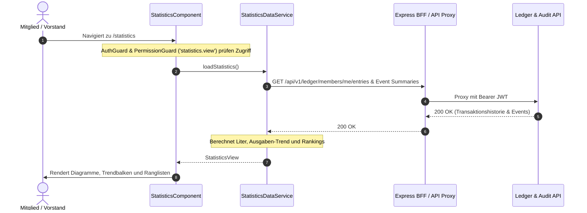

# Fachdomäne: Statistiken, Eber-Analytics & Audit-Logs

Das Statistik- und Analysemodul in **Vereint** liefert visuelle Auswertungen über Getränkekonsum, beliebteste Artikel, Spenden-/Rundengeber, Anwesenheitsquoten und Finanztrends für Mitglieder und Vorstände. Ergänzend dokumentieren revisionssichere Audit-Logs alle kritischen Systemänderungen.

---

## 🎯 Fachliche Sicht (Business Domain)

### 1. Auswertungsbereiche & Kennzahlen
- **Getränkekonsum (Liter / Bierkonsum)**: Zeigt den summierten Konsum der Mitglieder im Betrachtungszeitraum als Rangliste an.
- **Anwesenheitsquote (`attendancePercent`)**: Prozentualer Anteil besuchter Vereins-Events basierend auf RSVPs und Thekenbuchungen.
- **Ausgaben- & Finanztrend (`SpendingTrend`)**: Monatliche Ausgabenentwicklung, prozentuale Veränderung zum Vormonat und Sparkline-Trendkurve.
- **Top-Rundengeber (`topRounds`)**: Auszeichnung besonders spendabler Mitglieder, die Runden für die Gemeinschaft ausgegeben haben.
- **Getränke-Ranking (`drinkRanking`)**: Beliebteste Getränke nach Marktanteil im Verein.

### 2. Revisionssicheres Audit-Logging
- Alle administrativen und finanziellen Aktionen (Rollenänderungen, manuelle Guthabenkorrekturen, Account-Sperrungen) werden manipulationssicher mit Zeitstempel, Akteur-ID, Ziel-ID und Aktionsart in `audit_logs` protokolliert.

---

## ⚙️ Technische Sicht (Architecture & Implementation)

### 1. Relevante Komponenten & Klassen
- **Frontend (Angular)**:
  - `webservice/src/app/statistics/statistics.component.ts` – Dashboard mit Visualisierungskarten.
  - `statistics-data.service.ts` – Aggregiert Kassen-, Event- und Konsumdaten clientseitig.
  - Berechtigung: Geschützt über `permissionGuard` mit Berechtigung `statistics.view`.
- **Backend**:
  - `AuditLogController`: Endpunkte unter `/api/v1/audit-logs` (abgesichert für `board` und `admin`).
  - `LedgerController`: Liefert historische Buchungen (`/api/v1/ledger/members/{id}/entries`) und Event-Zusammenfassungen (`/summary`).
- **Aggregationsprinzip**:
  - Statistiken sind dynamische Aggregate. Sie werden **nicht** im SSR-HTML vorgerendert (Vermeidung von Daten-Leaks), sondern ausschließlich im Browser nach erfolgreicher Authentifizierung frisch geladen.

---

## 📋 Datenstrukturen & TypeScript Interfaces

```typescript
export interface MemberConsumption {
  member: string;
  liters: number;
}

export interface SpendingTrend {
  total: string;
  currency: string;
  changePercent: number;
  trend: number[];
}

export interface RoundGiver {
  member: string;
  rounds: number;
}

export interface DrinkRankingEntry {
  drink: string;
  sharePercent: number;
}

export interface StatisticsView {
  consumption: MemberConsumption[];
  attendancePercent: number;
  spending: SpendingTrend;
  topRounds: RoundGiver[];
  drinkRanking: DrinkRankingEntry[];
}
```

---

## 🔄 Sequenzablauf: Clientseitiges Laden der Statistiken


