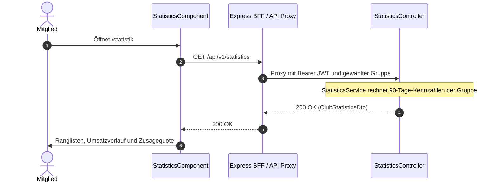

# Fachdomäne: Statistik & Audit-Protokoll

Die Statistik in **Vereint** zeigt jeder angemeldeten Person Auswertungen ihrer Gruppe: Konsum, Ranglisten, Umsatzverlauf und Zusagequote. Das Audit-Protokoll hält privilegierte Aktionen von Vorstand und Administration fest.

---

## 🎯 Fachliche Sicht (Business Domain)

### 1. Auswertungsbereiche & Kennzahlen
Alle Werte beziehen sich auf die gerade gewählte Gruppe und die letzten **90 Tage**. Grundlage sind Käufe im Kassenbuch; stornierte Käufe zählen nicht.

- **Gesamtzahl und eigene Zahl der Käufe** (`totalItems`, `myItems`) und der **eigene Rang** (`myRank`).
- **Top-Konsumenten** (`topConsumers`): die fünf Mitglieder mit den meisten Käufen.
- **Zusagequote** (`attendancePercent`): Anteil der Zusagen an allen verschickten Einladungen zu Events im Zeitraum.
- **Umsatz** (`spending`): Summe der letzten 30 Tage, Veränderung zu den 30 Tagen davor in Prozent und der Verlauf der letzten 8 Wochen.
- **Beliebteste Artikel** (`itemRanking`): die fünf meistgekauften Getränke oder Speisen mit Anteil in Prozent.
- **Events mit den meisten Käufen** (`topEvents`): die fünf stärksten Abende.

Die Statistik sehen alle angemeldeten Mitglieder der Gruppe (Produktentscheidung 2026-10-14).

### 2. Audit-Protokoll
- Privilegierte Aktionen (z. B. Rollenänderungen, Guthabenbuchungen durch den Vorstand, Kiosk-Start und Fernentsperrung) landen mit Zeitstempel, Akteur, Ziel und Aktionsart in `audit_logs`.
- Lesen darf, wer `audit.read` hat; `audit.read.all` zeigt zusätzlich alle Einträge. Im Handbuch heißt die Ansicht **Letzte Aktionen** bzw. **Audit-Protokoll**.

---

## ⚙️ Technische Sicht (Architecture & Implementation)

### 1. Relevante Komponenten & Klassen
- **Backend**:
  - `StatisticsController`: `GET /api/v1/statistics` liefert `ClubStatisticsDto` für alle Angemeldeten.
  - `StatisticsService.clubStatistics()`: rechnet die Kennzahlen serverseitig aus Kassenbuch und Event-Einladungen (Konstanten `PERIOD_DAYS = 90`, `WEEKS = 8`, `TOP = 5`). Durch die Mandantentrennung (Hibernate-Tenant und RLS) sieht die Abfrage nur Daten der aktuellen Gruppe.
  - `AuditLogController`: `GET /api/v1/audit-logs` mit Filtern `targetEntity`, `action`, `actorId`, `targetId` und Seitenaufteilung.
- **Frontend (Angular)**:
  - Route `/statistik` mit `authGuard` (keine eigene Berechtigung nötig).
  - `webservice/src/app/statistics/statistics-data.service.ts` lädt `GET /statistics` über den BFF; `statistics.component.ts` stellt die Karten dar.
- **Kein Vorrendern**: Die Werte werden nicht ins SSR-HTML geschrieben, sondern erst im Browser nach der Anmeldung geladen.

---

## 📋 Datenstrukturen (`StatisticsDtos.kt`)

```kotlin
data class ClubStatisticsDto(
    val periodDays: Int,
    val totalItems: Int,
    val myItems: Int,
    val myRank: Int?,
    val topConsumers: List<MemberCountDto>,   // memberId, displayName, count
    val attendancePercent: Int?,
    val spending: SpendingDto,                // total, currency, changePercent, weekly
    val itemRanking: List<ItemShareDto>,      // name, count, sharePercent
    val topEvents: List<EventCountDto>        // eventId, title, count
)
```

---

## 🔄 Sequenzablauf: Statistik laden


