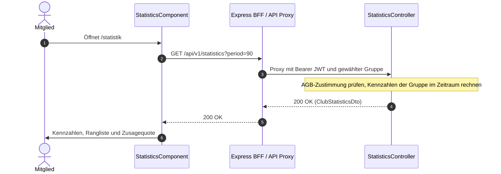

# Fachdomäne: Statistik & Audit-Protokoll

Die Statistik in **Vereint** zeigt allen Mitgliedern einer Gruppe Auswertungen ihrer Gruppe, mit Namen: Striche, Getränke mit Litern und Kalorien, Zusagen, Anwesenheit und Gemeinschaft. Das Audit-Protokoll hält privilegierte Aktionen von Vorstand und Administration fest.

---

## 🎯 Fachliche Sicht (Business Domain)

### 1. Auswertungsbereiche & Kennzahlen
Alle Werte beziehen sich auf die gerade gewählte Gruppe und den gewählten **Zeitraum**: die letzten **30** oder **90 Tage** (Standard) oder das laufende **Kalenderjahr** ab 1. Januar (Zeitzone Europe/Berlin; Entscheidung Maurer zu #82). Grundlage sind die erfassten Käufe (`statistic_records`, siehe Abschnitt 3); stornierte Käufe zählen nicht. Der Umsatz kommt immer aus dem Kassenbuch.

Die Statistiken sind Spaß-Fakten und für alle Mitglieder der Gruppe namentlich sichtbar. Grundlage ist der AGB-Abschnitt „Statistiken“ (§ 11); die Endpunkte antworten erst, wenn das Konto der aktuellen AGB-Fassung zugestimmt hat (`403 terms_required`, siehe [Rechtliches](rechtliches.md#zustimmung)).

- **Einstieg** (`/statistik`): Striche der Gruppe und eigene (`totalItems`, `myItems`), eigener Platz (`myRank` von `rankedMembers`), Rangliste (`topConsumers`) und Zusagequote (`attendancePercent`: Anteil der Einladungen mit „Zusagen“).
- **Getränkestatistik** (`/statistik/getraenke`): Getränke, Liter, Kalorien, Ø je Event/Tag/Woche/Monat; je Mitglied Platz, Anzahl, Kalorien, Ø je Event und Woche, Kategorieanteile und die einzelnen Getränke; oder je Getränk Anzahl, Liter, Kalorien und Zahl der Personen.
- **Übersicht** (`/statistik/uebersicht`): Kennzahlen (Mitglieder aktiv/neu, Events mit Ø Teilnehmenden, Zusagequote, Getränke, Liter, Kalorien, Umsatz, Getränke je Monat), Zusagen je Event und je Mitglied mit „Da gewesen“ (Event mit mindestens einem Strich oder Kauf), Getränke je Woche, nach Wochentag und Uhrzeit, „Wer trinkt was?“, beliebteste Getränke, Anteil nach Kategorie, Rundengeber (Buchungen mit `source = round|evening`, je Vorgang einmal), Moments, Chat (Gruppen- und Event-Chats, keine Direktnachrichten) und Rekorde.
- **Umsatz** nur mit `ledger.read` (Vorstand, Kasse, Admin; Entscheidung Maurer zu #82), sonst `null`.
- **Liter und Kalorien** aus `volume_ml` und `kcal_per_serving` des Katalog-Getränks. Fehlt eine Angabe, zählt der Kauf dort nicht mit (`withoutVolume`, `withoutKcal`; die Seiten nennen die Zahl).
- **Kategoriegruppen** (`beer`, `nonAlcoholic`, `spirits`, `wineSparkling`, `other`) werden aus Kategorie und Name des Getränks abgeleitet (`StatisticsService.categoryGroup`).

### 2. Ebenen, Erfassung und Schalter (#104)

**Sechs Ebenen**:

| Ebene | Route | Endpunkt | Wer | Inhalt |
| :--- | :--- | :--- | :--- | :--- |
| Eigene | `/statistik/ich` | `GET /api/v1/statistics/me?zeitraum=` | nur ich | alles, was ich ausgelöst habe, über alle eigenen Gruppen, je Funktion und je Gruppe; Zusagen und Teilnahmen |
| Übergreifende Events | `/statistik/events` | `GET /api/v1/statistics/events?zeitraum=` | nur ich | alle Events meiner Gruppen, die ich sehen darf (wie im Kalender), mit Summen, Durchschnitten und meinen Werten; keine Namen anderer |
| Gruppe | `/statistik`, `/statistik/getraenke`, `/statistik/uebersicht` | siehe oben | Mitglieder der Gruppe | Gruppenstatistik, Umsatz nur mit `ledger.read` |
| Events der Gruppe | `/statistik/gruppe/events` | `GET /api/v1/statistics/group-events?zeitraum=` | Mitglieder; nur sichtbare Events | Summen und Vergleich aller Events |
| Event | `/events/:id/statistik` | `GET /api/v1/events/{id}/statistics` | wer das Event sehen darf | Antworten, Anwesende, Striche je Person, Runden, Moments, Reaktionen, Bilder, Event-Chat; ohne Zeitraum |
| Funktionen | `/statistik/funktionen` | `GET /api/v1/statistics/features?zeitraum=` | Mitglieder der Gruppe | je Funktion ausgelöst/geantwortet, mit Aufschlüsselung (z. B. Zusagen nach Antwort, Käufe nach Quelle, Chat nach Art) |

`zeitraum` ist `30`, `90` (Standard) oder `jahr`; `period=30|90|year` geht weiterhin. Alle Seiten verlangen die AGB-Zustimmung. Jede Antwort trägt `recording` (`userEnabled`, `groupEnabled`, `eventEnabled`), damit die Seiten einen Hinweis statt leerer Diagramme zeigen.

**Erfasste Funktionen** (`StatisticFeature`): `purchase` (Variante = Quelle: Strichliste, Kiosk, Barcode, Runde …), `round` (je Runde einmal, Antwort = bedachte Personen), `top_up`, `event`, `rsvp` (Antwort auf ein Event, Variante = Antwort), `moment`, `moment_reaction`, `moment_media` (Menge = Zahl der Bilder/Videos), `chat_message` (Variante `club`, `event`, `moment`; Gastnachrichten ohne Person), `chat_reaction`, `invite_link`, `invite_join`. **Direktnachrichten werden nicht erfasst**: Sie gehören zu keiner Gruppe. Antworten auf Chatnachrichten sind die Chat-Reaktionen, da es keine Antwort-Threads gibt.

**Schalter**, alle standardmäßig an: `users.statistics_enabled` (*Meine Statistik erfassen*), `stammtische.statistics_enabled` (*Statistik in dieser Gruppe*, `stammtisch.manage`) und `events.statistics_enabled` (*Statistik für dieses Event*, beim Anlegen und unter Verwalten). Gewichtung **Nutzer > Gruppe > Event** (`StatisticsRecorder.decide`): Ist der Nutzer aus, wird nichts über ihn erfasst, egal wie Gruppe und Event stehen; sonst sperrt die Gruppe alle ihre Events; sonst entscheidet das Event. Ausschalten wirkt ab sofort und löscht nichts. Eine nicht beantwortete Einladung zählt als „Keine Antwort“ nur, wenn Event und Person erfasst werden.

**Löschen**: `DELETE /api/v1/me/statistics` löscht alle Einträge der Person in allen Gruppen (auch verlassenen), `DELETE /api/v1/stammtisch/statistics` alle Einträge der Gruppe (`stammtisch.manage`). Beides schreibt einen Eintrag ins Audit-Protokoll der Gruppe (`STATISTICS_DELETED_SELF`, `STATISTICS_DELETED`); das Umschalten der Gruppe steht dort als `STATISTICS_SWITCHED`. Kasse, Guthaben und Umsatz bleiben unberührt. Der Gruppen-Export enthält unter `statistics` den Schalter und alle Einträge.

### 3. Audit-Protokoll
- Privilegierte Aktionen (z. B. Rollenänderungen, Guthabenbuchungen durch den Vorstand, Kiosk-Start und Fernentsperrung) landen mit Zeitstempel, Akteur, Ziel und Aktionsart in `audit_logs`.
- Lesen darf, wer `audit.read` hat; `audit.read.all` zeigt zusätzlich alle Einträge. Im Handbuch heißt die Ansicht **Letzte Aktionen** bzw. **Audit-Protokoll**.

---

## ⚙️ Technische Sicht (Architecture & Implementation)

### 1. Relevante Komponenten & Klassen
- **Tabelle `statistic_records`** (Liquibase `026-statistic-records.xml`, Changesets 300–303): `id`, `stammtisch_id` (RLS-Policy `stammtisch_isolation`, Entity `StatisticRecordEntity : StammtischScoped`), `event_id`, `actor_user_id` (beim Löschen des Kontos mitgelöscht), `feature`, `kind` (`triggered` oder `response`), `variant`, `responds_to` (ID des beantworteten Objekts, z. B. Event oder Moment), `source_id` (auslösender Datensatz, z. B. Kassenbuchung; dient der Storno-Zuordnung und Idempotenz), `quantity`, `occurred_at`. Changeset 302 füllt die Tabelle einmalig aus vorhandenen Käufen, Aufladungen, Runden, Events, Zusagen, Moments, Gruppen- und Event-Chats und Einladungen; es nutzt nur Spalten, die vor #104 bestanden.
- **`StatisticsRecorder`**: einziger Schreibweg. Liest die drei Schalter frisch aus der Datenbank, schreibt nur mit Gruppenkontext. Aufgerufen aus `LedgerService` (Kauf, Aufladung, Storno löscht den Eintrag des Originals), `TabletRecorderService` (Runden), `EventService` (Event angelegt, Zusage), `MomentService`, `ChatService`/`ConversationService` (Nachricht, Reaktion) und `MemberInviteService` (Link erstellt, Beitritt).
- **`StatisticsLevelService`**: Ebenen eigene, übergreifend, Gruppen-Events, Event und Funktionen. Gruppenübergreifend über `StammtischMemberships.memberships` und je Gruppe `TenantTransactions.readInStammtisch` (wie `CalendarService`), sichtbare Events über `EventVisibility`. Keine RLS-Ausnahme.
- **`StatisticsSettingsService`**: Schalter und Löschen.
- **`StatisticsLevelController`**: `/api/v1/statistics/me|events|group-events|features`, `/api/v1/events/{id}/statistics`, `GET|PUT /api/v1/me/statistics-settings`, `DELETE /api/v1/me/statistics`, `GET|PUT /api/v1/stammtisch/statistics-settings`, `DELETE /api/v1/stammtisch/statistics`. Die vier persönlichen Pfade brauchen keine gewählte Gruppe (`StammtischContextFilter`).
- **Backend**:
  - `StatisticsController`: `GET /api/v1/statistics?period=30|90|year` (`ClubStatisticsDto`), `GET /api/v1/statistics/drinks?period=…&by=member|drink` (`DrinkStatisticsDto`) und `GET /api/v1/statistics/overview?period=…` (`StatisticsOverviewDto`). Ungültiger Zeitraum: `400 invalid_request`.
  - `StatisticsPeriod`: Beginn des Zeitraums (30/90 Tage zurück oder 1. Januar).
  - `StatisticsService`: rechnet die Kennzahlen serverseitig aus Kassenbuch, Katalog, Event-Einladungen, Moments und Chat; an den Client gehen nur Summen und Ranglisten. Durch die Mandantentrennung (Hibernate-Tenant und RLS) sieht die Abfrage nur Daten der aktuellen Gruppe. Vorher `TermsConsent.requireAccepted`.
  - `AuditLogController`: `GET /api/v1/audit-logs` mit Filtern `targetEntity`, `action`, `actorId`, `targetId` und Seitenaufteilung.
- **Frontend (Angular)**:
  - Ebenen-Seiten `my-statistics.component.ts`, `event-level-statistics.component.ts` (übergreifend und Gruppe), `feature-statistics.component.ts` (Funktionen und Event), gemeinsame Bausteine in `statistics-levels.ts`; Schalter und Löschen in `statistics-settings.component.ts` (in Mein Konto und in den Gruppeneinstellungen). Schalter des Events im Formular zum Anlegen und Verwalten.
  - Routen `/statistik`, `/statistik/getraenke` und `/statistik/uebersicht` mit `authGuard` (keine eigene Berechtigung nötig; die AGB-Sperre greift im Guard). Der Zeitraum steht als `?zeitraum=30|90|jahr` in der Adresse.
  - `webservice/src/app/statistics/`: `statistics-data.service.ts` lädt die drei Endpunkte über den BFF; `statistics.component.ts`, `drink-statistics.component.ts`, `statistics-overview.component.ts`; Diagramme als CSS/SVG ohne Bibliothek, mit Textalternative.
- **Kein Vorrendern**: Die Werte werden nicht ins SSR-HTML geschrieben, sondern erst im Browser nach der Anmeldung geladen.

---

## 📋 Datenstrukturen (`StatisticsDtos.kt`)

Siehe `baseservice/src/main/kotlin/de/maurer/baseservice/dto/StatisticsDtos.kt`. Alle drei Antworten tragen `period`, `from` (Beginn) und `days` (Länge in Tagen).

```kotlin
data class ClubStatisticsDto(
    val period: String, val from: Instant, val days: Int,
    val totalItems: Int, val myItems: Int, val myRank: Int?, val rankedMembers: Int,
    val topConsumers: List<MemberCountDto>,   // memberId, displayName, count
    val attendancePercent: Int?
)
// DrinkStatisticsDto: totalDrinks, liters, kcal, withoutVolume, withoutKcal,
//   averages (perEvent, perDay, perWeek, perMonth), by, members, drinks
// StatisticsOverviewDto: kpis, rsvpByEvent, rsvpByMember, weekly, weekdays, hours,
//   whoDrinksWhat, topDrinks, categories, roundGivers, moments, chat, records
```

---

## 🔄 Sequenzablauf: Statistik laden


