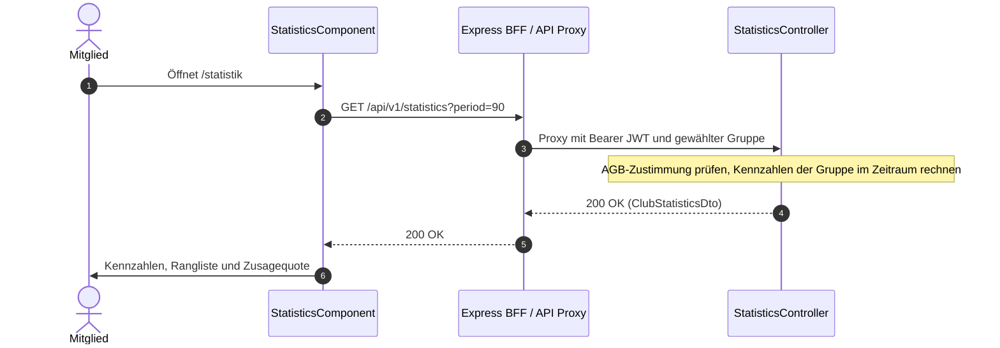

# Fachdomäne: Statistik & Audit-Protokoll

Die Statistik in **Vereint** zeigt allen Mitgliedern einer Gruppe Auswertungen ihrer Gruppe, mit Namen: Striche, Getränke mit Litern und Kalorien, Zusagen, Anwesenheit und Gemeinschaft. Das Audit-Protokoll hält privilegierte Aktionen von Vorstand und Administration fest.

---

## 🎯 Fachliche Sicht (Business Domain)

### 1. Auswertungsbereiche & Kennzahlen
Alle Werte beziehen sich auf die gerade gewählte Gruppe und den gewählten **Zeitraum**: die letzten **30** oder **90 Tage** (Standard) oder das laufende **Kalenderjahr** ab 1. Januar (Zeitzone Europe/Berlin; Entscheidung Maurer zu #82). Grundlage sind Käufe im Kassenbuch; stornierte Käufe zählen nicht.

Die Statistiken sind Spaß-Fakten und für alle Mitglieder der Gruppe namentlich sichtbar. Grundlage ist der AGB-Abschnitt „Statistiken“ (§ 11); die Endpunkte antworten erst, wenn das Konto der aktuellen AGB-Fassung zugestimmt hat (`403 terms_required`, siehe [Rechtliches](rechtliches.md#zustimmung)).

- **Einstieg** (`/statistik`): Striche der Gruppe und eigene (`totalItems`, `myItems`), eigener Platz (`myRank` von `rankedMembers`), Rangliste (`topConsumers`) und Zusagequote (`attendancePercent`: Anteil der Einladungen mit „Zusagen“).
- **Getränkestatistik** (`/statistik/getraenke`): Getränke, Liter, Kalorien, Ø je Event/Tag/Woche/Monat; je Mitglied Platz, Anzahl, Kalorien, Ø je Event und Woche, Kategorieanteile und die einzelnen Getränke; oder je Getränk Anzahl, Liter, Kalorien und Zahl der Personen.
- **Übersicht** (`/statistik/uebersicht`): Kennzahlen (Mitglieder aktiv/neu, Events mit Ø Teilnehmenden, Zusagequote, Getränke, Liter, Kalorien, Umsatz, Getränke je Monat), Zusagen je Event und je Mitglied mit „Da gewesen“ (Event mit mindestens einem Strich oder Kauf), Getränke je Woche, nach Wochentag und Uhrzeit, „Wer trinkt was?“, beliebteste Getränke, Anteil nach Kategorie, Rundengeber (Buchungen mit `source = round|evening`, je Vorgang einmal), Moments, Chat (Gruppen- und Event-Chats, keine Direktnachrichten) und Rekorde.
- **Umsatz** nur mit `ledger.read` (Vorstand, Kasse, Admin; Entscheidung Maurer zu #82), sonst `null`.
- **Liter und Kalorien** aus `volume_ml` und `kcal_per_serving` des Katalog-Getränks. Fehlt eine Angabe, zählt der Kauf dort nicht mit (`withoutVolume`, `withoutKcal`; die Seiten nennen die Zahl).
- **Kategoriegruppen** (`beer`, `nonAlcoholic`, `spirits`, `wineSparkling`, `other`) werden aus Kategorie und Name des Getränks abgeleitet (`StatisticsService.categoryGroup`).

### 2. Audit-Protokoll
- Privilegierte Aktionen (z. B. Rollenänderungen, Guthabenbuchungen durch den Vorstand, Kiosk-Start und Fernentsperrung) landen mit Zeitstempel, Akteur, Ziel und Aktionsart in `audit_logs`.
- Lesen darf, wer `audit.read` hat; `audit.read.all` zeigt zusätzlich alle Einträge. Im Handbuch heißt die Ansicht **Letzte Aktionen** bzw. **Audit-Protokoll**.

---

## ⚙️ Technische Sicht (Architecture & Implementation)

### 1. Relevante Komponenten & Klassen
- **Backend**:
  - `StatisticsController`: `GET /api/v1/statistics?period=30|90|year` (`ClubStatisticsDto`), `GET /api/v1/statistics/drinks?period=…&by=member|drink` (`DrinkStatisticsDto`) und `GET /api/v1/statistics/overview?period=…` (`StatisticsOverviewDto`). Ungültiger Zeitraum: `400 invalid_request`.
  - `StatisticsPeriod`: Beginn des Zeitraums (30/90 Tage zurück oder 1. Januar).
  - `StatisticsService`: rechnet die Kennzahlen serverseitig aus Kassenbuch, Katalog, Event-Einladungen, Moments und Chat; an den Client gehen nur Summen und Ranglisten. Durch die Mandantentrennung (Hibernate-Tenant und RLS) sieht die Abfrage nur Daten der aktuellen Gruppe. Vorher `TermsConsent.requireAccepted`.
  - `AuditLogController`: `GET /api/v1/audit-logs` mit Filtern `targetEntity`, `action`, `actorId`, `targetId` und Seitenaufteilung.
- **Frontend (Angular)**:
  - Routen `/statistik`, `/statistik/getraenke` und `/statistik/uebersicht` mit `authGuard` (keine eigene Berechtigung nötig; die AGB-Sperre greift im Guard). Der Zeitraum steht als `?zeitraum=30|90|jahr` in der Adresse.
  - `webservice/src/app/statistics/`: `statistics-data.service.ts` lädt die drei Endpunkte über den BFF; `statistics.component.ts`, `drink-statistics.component.ts`, `statistics-overview.component.ts`; Diagramme als CSS/SVG ohne Bibliothek, mit Textalternative.
- **Kein Vorrendern**: Die Werte werden nicht ins SSR-HTML geschrieben, sondern erst im Browser nach der Anmeldung geladen.

---

## 📋 Datenstrukturen (`StatisticsDtos.kt`)

Siehe `baseservice/src/main/kotlin/de/maurer/baseservice/dto/StatisticsDtos.kt`. Alle drei Antworten tragen `period`, `from` (Beginn) und `days` (Länge in Tagen).

```kotlin
data class ClubStatisticsDto(
    val period: String, val from: Instant, val days: Int,
    val totalItems: Int, val myItems: Int, val myRank: Int?, val rankedMembers: Int,
    val topConsumers: List<MemberCountDto>,   // memberId, displayName, count
    val attendancePercent: Int?
)
// DrinkStatisticsDto: totalDrinks, liters, kcal, withoutVolume, withoutKcal,
//   averages (perEvent, perDay, perWeek, perMonth), by, members, drinks
// StatisticsOverviewDto: kpis, rsvpByEvent, rsvpByMember, weekly, weekdays, hours,
//   whoDrinksWhat, topDrinks, categories, roundGivers, moments, chat, records
```

---

## 🔄 Sequenzablauf: Statistik laden


