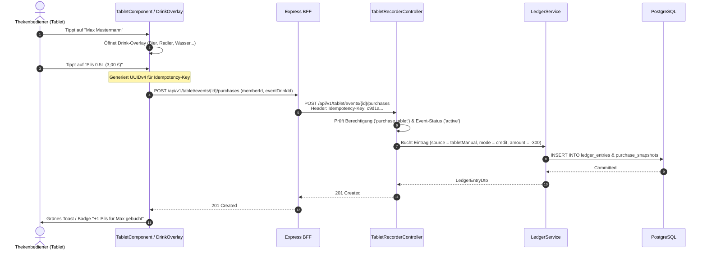

# Fachdomäne: Tablet Strichlisten-Recorder (Kiosk Mode)

Der Tablet Strichlisten-Recorder in **Vereint** ist für den hochfrequenten Thekenbetrieb auf Vereinsfesten, Feiern und Mitgliederversammlungen optimiert. Er bietet eine touch-optimierte Kiosk-Oberfläche zur blitzschnellen 1-Tap-Getränkebuchung, Rundenabrechnung und zum Abendabschluss.

---

## 🎯 Fachliche Sicht (Business Domain)

### 1. Kiosk-Modus & Theken-Bedienung
- **1-Tap Schnellbuchung**:
  - Thekenbediener sehen eine touch-optimierte Liste aller aktiven Vereinsmitglieder (`TabletMemberDto`).
  - Ein Antippen einer Mitgliedszeile öffnet das Getränke-Overlay mit großen Buttons für die für dieses Event freigeschalteten Getränke.
  - Eine Getränkeauswahl löst die sofortige Buchung auf das persönliche Vereinskonto aus (`accountingMode = credit, source = tabletManual`).
- **Runden-Erfassung (`round`)**:
  - Ermöglicht das gleichzeitige Buchen eines Getränks für eine Gruppe ausgewählter Mitglieder (`memberIds`).
  - Wird als `revenueOnly`-Buchung erfasst und belastet die Kasse bzw. den Rundengeber ohne negative Einzelbelastungen.
- **Abendabschluss & Bareinnahmen (`evening`)**:
  - Erfassung von pauschalen Einnahmen oder Abrechnungen am Ende eines Festabends (`source = evening, accountingMode = revenueOnly`).

### 2. Fehlertoleranz & Entlastung des Personals
- **Idempotenz-Schutz**: Bei unruhigem Netz oder versehentlichem Mehrfachtippen verhindert der `Idempotency-Key`-Header doppelte Abbuchungen.
- **Visuelle Buchungsbestätigung**: Diskrete Animationen und Ton-/Farbfeedback bestätigen jede Buchung in Millisekunden.

---

## ⚙️ Technische Sicht (Architecture & Implementation)

### 1. Relevante Komponenten & Klassen
- **Backend**:
  - `TabletRecorderController`: Endpunkte unter `/api/v1/tablet`
    - `GET /api/v1/tablet/events` – Liste aktiver Events für die Kioskauswahl
    - `GET /api/v1/tablet/events/{eventId}/members` – Aktive Teilnehmerliste
    - `GET /api/v1/tablet/events/{eventId}/drinks` – Verfügbare Event-Getränke
    - `POST /api/v1/tablet/events/{eventId}/purchases` – Einzelkauf buchen (`TabletPurchaseRequest`)
    - `POST /api/v1/tablet/events/{eventId}/rounds` – Rundenbuchung (`TabletRevenuePurchaseRequest`)
    - `POST /api/v1/tablet/events/{eventId}/evening` – Abendabschlussbuchung
  - `TabletRecorderService`: Validiert Event-Status (`active`), Event-Getränke-Zuordnung und delegiert Buchungen an den `LedgerService`.
  - Berechtigung: Erfordert Rolle `tabletRecorder` oder Berechtigung `purchase.tablet`.
- **Frontend (Angular)**:
  - `webservice/src/app/tablet/tablet.component.ts` – Haupt-Container mit Eventauswahl und Mitgliedsliste.
  - `drink-overlay.component.ts` – Touch-Modal zur Getränkewahl.
  - `strichliste-row.component.ts` – Optimierte Tabellenzeile mit schnellem Touch-Handler.
  - `revenue-sheet.component.ts` – Übersicht der an diesem Abend getätigten Buchungen.

---

## 📋 Datenstrukturen & DTOs

```kotlin
data class TabletPurchaseRequest(
    @field:NotBlank
    val memberId: String,
    @field:NotBlank
    val eventDrinkId: String
)

data class TabletRevenuePurchaseRequest(
    @field:NotBlank
    val eventDrinkId: String,
    @field:NotEmpty
    val memberIds: List<String>
)

data class TabletMemberDto(
    val memberId: String,
    val displayName: String
)
```

---

## 🔄 Sequenzablauf: 1-Tap Thekenbuchung


