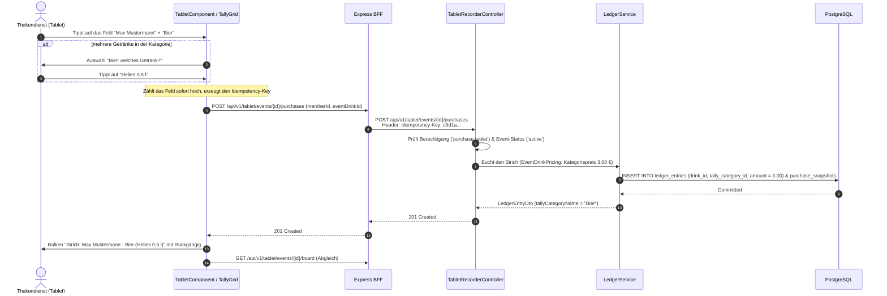

# Fachdomäne: Tablet Strichlisten-Recorder (Kiosk Mode)

Der Tablet Strichlisten-Recorder in **Vereint** ist für den hochfrequenten Thekenbetrieb auf Festen, Feiern und Mitgliederversammlungen optimiert. Er bietet eine touch-optimierte Kiosk-Oberfläche zur blitzschnellen 1-Tap-Getränke- und Speisenbuchung und zeigt die laufenden Runden an, die Mitglieder am eigenen Handy ausgeben.

---

## 🎯 Fachliche Sicht (Business Domain)

### 1. Kiosk-Modus & Theken-Bedienung
- **Strichliste nach Kategorien**:
  - Die Ansicht ist ein Raster wie auf der Papier-Strichliste: eine Zeile je aktivem Teilnehmer des Events, eine Spalte je Strich-Kategorie der Gruppe (Name und Preis je Strich im Spaltenkopf, Reihenfolge wie vom Vorstand festgelegt).
  - Ein Tipp in ein Feld bucht einen Strich auf das Guthaben der Person (`accountingMode = credit, source = tabletManual`). Jeder Strich nennt ein konkretes Getränk **und** die Kategorie; der Betrag ist der Kategoriepreis.
  - Enthält die Kategorie im Event genau ein Getränk, bucht der Tipp sofort. Bei mehreren öffnet sich eine Auswahl dieser Getränke. Ist im Event kein Getränk der Kategorie freigegeben, erscheint ein Hinweis und nichts wird gebucht.
  - Die Spalte **Sonstiges** erscheint, wenn das Event Getränke ohne Strich-Kategorie oder Speisen hat. Der Tipp öffnet die Auswahl dieser Artikel mit ihrem eigenen Preis.
  - Die Felder zeigen die Striche als Fünferbündel und die Zahl. Gezählt werden alle nicht stornierten Käufe des Events je Person, bei Runden bei der Person, die getrunken hat (`GET …/board`), also auch die anderer Geräte, früherer Sitzungen und Barcode-Käufe am Handy. Nach jeder Buchung zählt die Oberfläche sofort hoch und gleicht danach mit dem Server ab.
  - Rechts stehen Zahl der Striche und Umsatz des Abends.
- **Rückgängig**: Nach jedem Strich zeigt ein Balken die letzte Buchung („Strich: Name · Kategorie (Getränk)“) mit **Rückgängig**. Zurücknehmen lassen sich die Striche der laufenden Sitzung, jeweils innerhalb von 10 Minuten, als Korrekturbuchung.
- **Preis im Event**: Kategoriepreis vor Eventpreis vor Getränkepreis, siehe [Getränkekatalog](drink-catalog-and-sublists.md#3-strich-kategorien-spalten-der-strichliste).
- **Kombiniertes Sortiment (`/items`)**:
  - Der Endpunkt `/api/v1/tablet/events/{eventId}/items` liefert in einer Abfrage alle freigegebenen Event-Getränke (`drinks`) und Event-Speisen (`food`). Daraus entsteht die Auswahl unter „Sonstiges“.
- **Runden am eigenen Handy (Issue #81)**:
  - Eine Runde gibt jede Person **nur am eigenen Handy** und mit dem eigenen Guthaben aus (`/events/{id}/runde`): **Eine Runde** (höchstens ein Getränk je eingeladener Person) oder **Ganzer Abend** (alles bis zur Höchstsumme), für ein bestimmtes Getränk oder alle Getränke, gültig 30 Minuten, 1 Stunde oder bis Event-Ende. Nur bei laufendem Event und nur für Personen des Events. Die Eingeladenen bekommen eine Mitteilung (Push, abschaltbar wie alle Mitteilungen über den Push-Schalter des Geräts).
  - Beim Start wird nichts gebucht. Bucht das Terminal einen Strich für eine eingeladene Person, prüft der Service, ob eine **laufende, nicht aufgebrauchte** Runde greift (älteste zuerst; das Getränk passt, wenn die Runde für alle Getränke gilt, für genau dieses Getränk oder für ein Getränk derselben Strich-Kategorie; bei „Eine Runde“ ist die Person noch nicht eingelöst; der Preis passt noch in die Höchstsumme). Dann geht die Buchung auf den **Geber** (`member_id` = Geber, `beneficiary_id` = wer getrunken hat, `round_id`, `source = round|evening`, `accountingMode = credit`). Das Guthaben des Gebers darf dabei wie bei der Barcode-Zahlung ins Minus gehen.
  - Gegen parallele Einlösung sperrt der Service die Runde (`SELECT … FOR UPDATE`), bevor er Verbrauch und Einlösungen prüft. Ein wiederholter Strich mit demselben Idempotency-Key wird nicht erneut geprüft, sondern liefert die gespeicherte Buchung.
  - **Rückgängig** eines Strichs auf eine Runde bucht dem Geber zurück; die Gegenbuchung übernimmt `round_id` und `beneficiary_id`. Verbrauch und Einlösungen werden aus den nicht stornierten Buchungen berechnet, also ist der Platz wieder frei.
  - Am Terminal steht im Zeilenkopf, auf wessen Kosten getrunken wird („Runde von Thomas“, „Abend von Sabine“, sonst „Eigene Rechnung“), und rechts unter **Laufende Runden** wer was bis zu welcher Summe ausgibt, wie viele eingelöst haben und wie lange die Runde noch gilt. **Alle ansehen** öffnet die Rundenübersicht (nur Anzeige). Die Strichliste lädt alle 30 Sekunden nach.
  - Die früheren Terminal-Endpunkte `POST …/rounds` und `…/evening` (Revenue-Only-Buchung je Mitglied) sind entfernt. Alte Buchungen mit `source = round|evening` und `accountingMode = revenueOnly` bleiben unverändert.

- **Gesperrter Kiosk-Modus mit PIN**:
  - Am Terminal startet „Kiosk-Modus starten“ den Modus. Dabei vergibt das Gerät seine eigene PIN (4–8 Ziffern) und optional einen Gerätenamen. Der Server legt eine Kiosk-Sitzung an (`kiosk_sessions`) und speichert nur den BCrypt-Hash der PIN.
  - Der Zustand liegt im `localStorage` des Geräts (`vereint.kiosk`, mit der Sitzungs-ID). Neuladen, Schließen und Neuöffnen von Tab, App oder Browser landen wieder im Terminal, beim zuletzt gewählten Event.
  - Solange er aktiv ist, leitet `kioskGuard` jede andere Seite auf `/tablet` um; Navigation, Mitteilungen und Abmelden sind ausgeblendet.
  - Verlassen am Gerät geht nur über das Schloss oben rechts oder „Kiosk-Modus verlassen“ und die vom Server bestätigte PIN. Nach 5 falschen Eingaben ist die Prüfung für diese Sitzung gesperrt (1, 5, 15, danach 60 Minuten).
  - Vorstand und Administration sehen unter *Vorstand → Kiosk-Geräte* alle laufenden Geräte und entsperren jedes jederzeit ohne PIN. Das Gerät gleicht alle 15 Sekunden und beim Zurückkehren in den Vordergrund ab und verlässt den Modus; Netzfehler lassen ihn bestehen.
  - Start, Fernentsperrung und PIN-Sperren stehen im Audit-Protokoll.
  - Das Schließen des Browsers oder ein App-Wechsel lässt sich aus einer Web-App nicht verhindern. Dafür das Gerät festsetzen: Android „Bildschirm fixieren“ (App-Pinning), iOS/iPadOS „Geführter Zugriff“.

### 2. Fehlertoleranz & Entlastung des Personals
- **Idempotenz-Schutz**: Bei unruhigem Netz oder versehentlichem Mehrfachtippen verhindert der `Idempotency-Key`-Header doppelte Abbuchungen.
- **Visuelle Buchungsbestätigung**: Diskrete Animationen und Ton-/Farbfeedback bestätigen jede Buchung in Millisekunden.

---

## ⚙️ Technische Sicht (Architecture & Implementation)

### 1. Relevante Komponenten & Klassen
- **Backend**:
  - `TabletRecorderController`: Endpunkte unter `/api/v1/tablet`
    - `GET /api/v1/tablet/events` – Liste aktiver Events für die Kioskauswahl
    - `GET /api/v1/tablet/events/{eventId}/members` – Aktive Teilnehmerliste
    - `GET /api/v1/tablet/events/{eventId}/drinks` – Verfügbare Event-Getränke
    - `GET /api/v1/tablet/events/{eventId}/food` – Verfügbare Event-Speisen
    - `GET /api/v1/tablet/events/{eventId}/items` – Kombinierte Getränke & Speisen (`TabletItemsDto`)
    - `GET /api/v1/tablet/events/{eventId}/board` – Strichliste des Abends (`TabletBoardDto`)
    - `POST /api/v1/tablet/events/{eventId}/purchases` – Einzelkauf buchen (`TabletPurchaseRequest`, `eventDrinkId` oder `eventFoodId`)
    - `POST /api/v1/tablet/events/{eventId}/purchases/{entryId}/undo` – Strich innerhalb von 10 Minuten zurücknehmen
  - `TabletRecorderService`: Validiert Event-Status (`active`), Event-Artikel-Zuordnung und delegiert Buchungen (`recordTabletPurchase` / `recordTabletFoodPurchase`) an den `LedgerService`; vor einem Getränkestrich fragt er `RoundService.claimFor` nach einer passenden Runde.
  - `RoundController` / `RoundService` (Runden am Handy, `/api/v1/events/{eventId}/rounds`):
    - `GET …/rounds` – alle Runden des Events mit Verbrauch, Stand (`running`, `usedUp`, `expired`, `ended`) und Eingeladenen (Personen des Events und Terminal)
    - `GET …/rounds/options` – Guthaben, Getränke mit Preis an der Theke und Personen mit „zugesagt“/„vor Ort“ für das Formular
    - `POST …/rounds` – Runde ausgeben (`CreateRoundRequest`: `kind`, `eventDrinkId`, `validity` `30m|1h|eventEnd`, `memberIds`, `maxAmount` nur beim ganzen Abend; bei „Eine Runde“ rechnet der Server Preis × Personen, bei allen Getränken mit dem teuersten)
    - `POST …/rounds/{roundId}/end` – eigene Runde vorzeitig beenden (Geber oder Event-Verwaltung)
  - Tabellen `rounds` und `round_invitees` (je `stammtisch_id` + RLS), Spalten `ledger_entries.round_id` und `beneficiary_id` (Migration `025-rounds.xml`).
  - Berechtigung: Erfordert Rolle `tabletRecorder` oder Berechtigung `purchase.tablet`.
- **Frontend (Angular)**:
  - `webservice/src/app/tablet/tablet.component.ts` – Haupt-Container mit Eventauswahl, Raster, Buchung und Rückgängig.
  - `tally-grid.component.ts` – Raster Mitglied × Strich-Kategorie; meldet den Tipp auf ein Feld.
  - `tally-marks.component.ts` – Striche als Fünferbündel.
  - `tally-picker.component.ts` – Auswahl des Getränks in einer Kategorie bzw. der Artikel unter „Sonstiges“.
  - `rounds/round-card.component.ts` – Karte einer Runde (Terminal-Übersicht und eigene Runden am Handy).
  - `rounds/round-give.component.ts` – Formular „Runde ausgeben“ am Handy.

---

## 📋 Datenstrukturen & DTOs

```kotlin
data class TabletPurchaseRequest(
    @field:NotBlank(message = "memberId darf nicht leer sein")
    val memberId: String? = null,

    val eventDrinkId: String? = null,
    val eventFoodId: String? = null
)

data class CreateRoundRequest(
    val kind: String?,              // round | evening
    val eventDrinkId: String?,      // leer = alle Getränke
    val validity: String?,          // 30m | 1h | eventEnd
    val memberIds: List<String>?,
    val maxAmount: BigDecimal?      // nur bei evening
)

data class TabletItemsDto(
    val drinks: List<EventDrinkDto>,
    val food: List<EventFoodDto>
)

data class TabletMemberDto(
    val memberId: String,
    val displayName: String
)

// Strichliste des Abends
data class TabletBoardDto(
    val columns: List<TabletBoardColumnDto>,   // Strich-Kategorien mit Getränken im Event
    val members: List<TabletBoardMemberDto>,
    val tallyCount: Int,                       // Striche des Abends
    val revenue: BigDecimal,                   // Umsatz des Abends
    val currency: String,
    val rounds: List<RoundDto>                 // laufende Runden (nur Anzeige)
)

data class TabletBoardColumnDto(
    val categoryId: String,
    val name: String,
    val price: BigDecimal,                     // Preis je Strich
    val currency: String,
    val drinks: List<TabletBoardDrinkDto>      // eventDrinkId, drinkName
)

data class TabletBoardMemberDto(
    val memberId: String,
    val displayName: String,
    val counts: Map<String, Int>,              // Striche je categoryId
    val otherCount: Int,                       // Striche unter „Sonstiges“
    val fundedBy: RoundFundingDto?             // Runde, auf die der nächste Strich geht
)
```

---

## 🔄 Sequenzablauf: Strich in einer Kategorie


