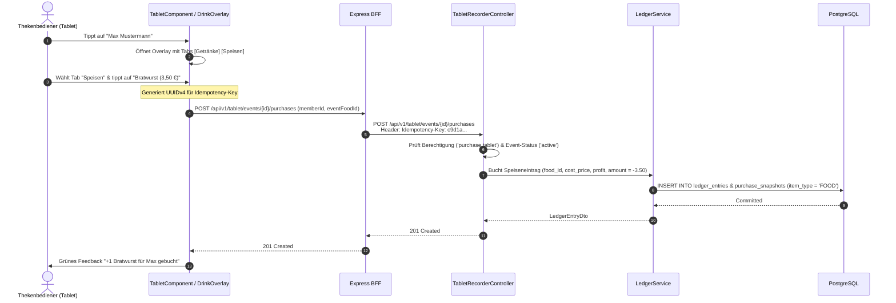

# Fachdomäne: Tablet Strichlisten-Recorder (Kiosk Mode)

Der Tablet Strichlisten-Recorder in **Vereint** ist für den hochfrequenten Thekenbetrieb auf Vereinsfesten, Feiern und Mitgliederversammlungen optimiert. Er bietet eine touch-optimierte Kiosk-Oberfläche zur blitzschnellen 1-Tap-Getränke- und Speisenbuchung, Rundenabrechnung und zum Abendabschluss.

---

## 🎯 Fachliche Sicht (Business Domain)

### 1. Kiosk-Modus & Theken-Bedienung
- **1-Tap Schnellbuchung**:
  - Thekenbediener sehen eine touch-optimierte Liste aller aktiven Vereinsmitglieder (`TabletMemberDto`).
  - Ein Antippen einer Mitgliedszeile öffnet das Artikel-Overlay mit Tabs für **Getränke** und **Speisen**.
  - Große Kachel-Buttons zeigen die für dieses Event freigeschalteten Artikel (`tabletEnabled = true`) mit Name und effektivem Preis.
  - Eine Artikelauswahl löst die sofortige Buchung auf das persönliche Vereinskonto aus (`accountingMode = credit, source = tabletManual`, `eventDrinkId` oder `eventFoodId`).
- **Kombiniertes Sortiment (`/items`)**:
  - Der Endpunkt `/api/v1/tablet/events/{eventId}/items` liefert in einer Abfrage alle freigegebenen Event-Getränke (`drinks`) und Event-Speisen (`food`) zur Minimierung von Latenzen.
- **Runden-Erfassung (`round`)**:
  - Ermöglicht das gleichzeitige Buchen eines Getränks oder einer Speise für eine Gruppe ausgewählter Mitglieder (`memberIds`).
  - Wird als `revenueOnly`-Buchung erfasst und belastet die Kasse bzw. den Rundengeber ohne negative Einzelbelastungen.
- **Abendabschluss & Bareinnahmen (`evening`)**:
  - Erfassung von pauschalen Einnahmen oder Abrechnungen am Ende eines Festabends (`source = evening, accountingMode = revenueOnly`).

- **Gesperrter Kiosk-Modus mit PIN**:
  - Am Terminal startet „Kiosk-Modus starten“ den Modus. Dabei vergibt das Gerät seine eigene PIN (4–8 Ziffern) und optional einen Gerätenamen. Der Server legt eine Kiosk-Sitzung an (`kiosk_sessions`) und speichert nur den BCrypt-Hash der PIN.
  - Der Zustand liegt im `localStorage` des Geräts (`vereint.kiosk`, mit der Sitzungs-ID). Neuladen, Schließen und Neuöffnen von Tab, App oder Browser landen wieder im Terminal, beim zuletzt gewählten Event.
  - Solange er aktiv ist, leitet `kioskGuard` jede andere Seite auf `/tablet` um; Navigation, Mitteilungen und Abmelden sind ausgeblendet.
  - Verlassen am Gerät geht nur über das Schloss oben rechts oder „Kiosk-Modus verlassen“ und die vom Server bestätigte PIN. Nach 5 falschen Eingaben ist die Prüfung für diese Sitzung gesperrt (1, 5, 15, danach 60 Minuten).
  - Vorstand und Administration sehen unter *Vorstand → Kiosk-Geräte* alle laufenden Geräte und entsperren jedes jederzeit ohne PIN. Das Gerät gleicht alle 15 Sekunden und beim Zurückkehren in den Vordergrund ab und verlässt den Modus; Netzfehler lassen ihn bestehen.
  - Start, Fernentsperrung und PIN-Sperren stehen im Audit-Protokoll.
  - Das Schließen des Browsers oder ein App-Wechsel lässt sich aus einer Web-App nicht verhindern. Dafür das Gerät festsetzen: Android „Bildschirm fixieren“ (App-Pinning), iOS/iPadOS „Geführter Zugriff“.

### 2. Fehlertoleranz & Entlastung des Personals
- **Idempotenz-Schutz**: Bei unruhigem Netz oder versehentlichem Mehrfachtippen verhindert der `Idempotency-Key`-Header doppelte Abbuchungen.
- **Visuelle Buchungsbestätigung**: Diskrete Animationen und Ton-/Farbfeedback bestätigen jede Buchung in Millisekunden.

---

## ⚙️ Technische Sicht (Architecture & Implementation)

### 1. Relevante Komponenten & Klassen
- **Backend**:
  - `TabletRecorderController`: Endpunkte unter `/api/v1/tablet`
    - `GET /api/v1/tablet/events` – Liste aktiver Events für die Kioskauswahl
    - `GET /api/v1/tablet/events/{eventId}/members` – Aktive Teilnehmerliste
    - `GET /api/v1/tablet/events/{eventId}/drinks` – Verfügbare Event-Getränke
    - `GET /api/v1/tablet/events/{eventId}/food` – Verfügbare Event-Speisen
    - `GET /api/v1/tablet/events/{eventId}/items` – Kombinierte Getränke & Speisen (`TabletItemsDto`)
    - `POST /api/v1/tablet/events/{eventId}/purchases` – Einzelkauf buchen (`TabletPurchaseRequest`, `eventDrinkId` oder `eventFoodId`)
    - `POST /api/v1/tablet/events/{eventId}/rounds` – Rundenbuchung (`TabletRevenuePurchaseRequest`)
    - `POST /api/v1/tablet/events/{eventId}/evening` – Abendabschlussbuchung
  - `TabletRecorderService`: Validiert Event-Status (`active`), Event-Artikel-Zuordnung und delegiert Buchungen (`recordTabletPurchase` / `recordTabletFoodPurchase`) an den `LedgerService`.
  - Berechtigung: Erfordert Rolle `tabletRecorder` oder Berechtigung `purchase.tablet`.
- **Frontend (Angular)**:
  - `webservice/src/app/tablet/tablet.component.ts` – Haupt-Container mit Eventauswahl und Mitgliedsliste.
  - `drink-overlay.component.ts` – Touch-Modal zur Artikelwahl mit Tab-Umschaltung ("Getränke" / "Speisen").
  - `strichliste-row.component.ts` – Optimierte Tabellenzeile mit schnellem Touch-Handler.
  - `revenue-sheet.component.ts` – Übersicht der an diesem Abend getätigten Buchungen.

---

## 📋 Datenstrukturen & DTOs

```kotlin
data class TabletPurchaseRequest(
    @field:NotBlank(message = "memberId darf nicht leer sein")
    val memberId: String? = null,

    val eventDrinkId: String? = null,
    val eventFoodId: String? = null
)

data class TabletRevenuePurchaseRequest(
    val eventDrinkId: String? = null,
    val eventFoodId: String? = null,

    @field:NotEmpty(message = "memberIds darf nicht leer sein")
    val memberIds: List<String>? = null
)

data class TabletItemsDto(
    val drinks: List<EventDrinkDto>,
    val food: List<EventFoodDto>
)

data class TabletMemberDto(
    val memberId: String,
    val displayName: String
)
```

---

## 🔄 Sequenzablauf: 1-Tap Thekenbuchung (Getränk oder Speise)


