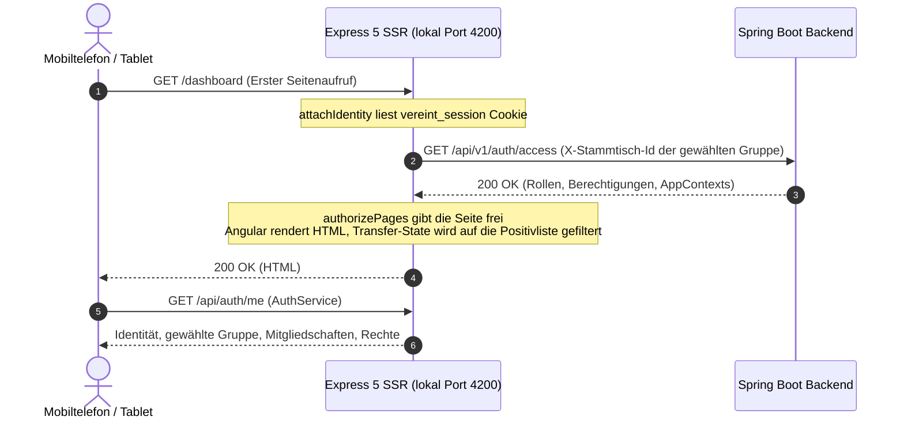

# Frontend-Architektur: Angular 22 SSR, BFF & PWA

Das Web-Frontend von **Vereint** kombiniert serverseitiges Rendering (Angular SSR auf Express 5), eine reaktive Standalone-Komponentenarchitektur und eine robuste Progressive Web App (PWA) für Theken- und Mobilgeräte. Die detaillierte technische Dokumentation des Express-BFF-Servers befindet sich unter [Backend-for-Frontend](../backend-for-frontend/README.md).

---

## 🏗️ Express BFF & SSR-Hydration

### 1. Transfer-State & Hydration
- Die App nutzt `provideClientHydration()`; der Angular-Transfer-State wird für private Seiten vor der Auslieferung gefiltert.
- **Sicherheitsfilterung**: Zur Vermeidung von Datenlecks reduziert der BFF (`transfer-state.ts`) den State auf eine feste Positivliste unkritischer Felder (`appContext`, `title`, `description`, `access`, `locale`, `theme`, `buildVersion`, `featureFlags`). Siehe dazu [02. Request-Pipeline & Transfer-State](../backend-for-frontend/02-request-pipeline.md).
- Identität, Rechte und gewählte Gruppe lädt der `AuthService` im Browser über `/api/auth/me` nach; die Sprache legt `I18nService` vor dem ersten Rendern fest, damit SSR und Hydration denselben Text zeigen.

### 2. App Shell & Responsive Breakpoints
- **`AppShellComponent`**: Globaler Rahmen mit adaptiver Navigation (`BreakpointService`, Signal `Viewport`: `mobile`, `tablet`, `web`):
  - **Mobile (≤ 640px)**: Untere Navigationsleiste mit Start, Events, Chat, Guthaben und **Mehr**.
  - **Tablet (641px bis 1024px)**: Beschriftete Icon-Leiste mit denselben Zielen plus **Mehr**.
  - **Desktop (> 1024px)**: Gruppierte Seitenleiste und Kopfzeile.
- SSR rendert die Desktop-Variante; im Browser schaltet `BreakpointService` per `matchMedia` um.
- Die Shell zeigt außerdem die gewählte Gruppe mit Gruppenwechsel, ein Banner, wenn die Gruppe wegen offener Zahlung nur lesbar ist (`readOnlyInterceptor`), und die Sperre im Kiosk-Modus.

---

## 📱 PWA & Service Worker Caching-Strategien

Die Progressive Web App (`pwa/`, Service Worker `public/vereint-sw.js`, Regeln gespiegelt in `service-worker-cache-policy.ts`) gewährleistet Installationsfähigkeit (A2HS - *Add to Home Screen*) und Ausfallsicherheit:

### 1. Caching-Richtlinien
| Ressourcentyp | Caching-Strategie | Begründung |
| :--- | :--- | :--- |
| **Gehashte Build-Dateien (JS, CSS, Schriften)** | `Cache-First` (Cache-Busting via Hash) | Maximale Ladegeschwindigkeit bei wiederholten Aufrufen. |
| **Übrige öffentliche Assets (Bilder, Icons)** | `Network-First` mit Cache-Fallback (höchstens 150 Einträge) | Logo und Icons bleiben offline sichtbar. |
| **API-Anfragen (`/api/*`), Nicht-GET, fremde Ursprünge, Antworten mit `private`/`no-store`** | `Network-Only` (kein Caching) | Kassen- und Transaktionsdaten dürfen niemals veraltet sein. |
| **SSR-Seitenanfragen** | `Network-Only` mit `/offline.html` als Fallback | Seiten enthalten persönliche Daten und werden deshalb nie gecacht; ohne Netz erscheint die Offline-Seite. |

### 2. VAPID Web Push im Service Worker
- Der Service Worker registriert einen `push`-Event-Listener.
- Jeder Push trägt Titel, Text, Ziel-Link und Gruppe als JSON, **Ende-zu-Ende-verschlüsselt** nach RFC 8291 (`aes128gcm`) mit den Schlüsseln des Abonnements; der Push-Dienst (Google, Mozilla, Apple) sieht nur Chiffretext. Der Service Worker zeigt die Benachrichtigung sofort an, ohne erst nachzuladen. Das wirkt auch mit abgelaufener Sitzung und schlechtem Netz, und iOS entzieht kein Abo, weil die Anzeige zu lange gedauert hätte. Danach lädt er, falls die Sitzung gilt, `/api/v1/personal-notifications` für App-Badge und Zugestellt-Haken (höchstens 8 Sekunden).
- Kommt ein Push ohne Inhalt (älterer Server), lädt der Worker wie früher den neuesten ungelesenen Eintrag von dort; ohne gültige Sitzung erscheint nur „Du hast eine neue Mitteilung.“
- Chats und Direktnachrichten teilen sich je Gespräch einen Tag (`renotify`), eine neue Nachricht ersetzt die vorige. Ein Tipp auf die Benachrichtigung wählt bei Bedarf die Gruppe und öffnet das Ziel (Chat, Direktnachricht, Event, Moment, Freunde, sonst Mitteilungen) im offenen App-Fenster oder in einem neuen.
- Der Server sendet mit `Urgency: high`, damit Android-Geräte im Ruhemodus den Push nicht zurückhalten, und mit `Topic` je Gespräch, damit beim Push-Dienst wartende ältere Pushes desselben Chats ersetzt werden.
- Bei Event-Einladungen bietet die Benachrichtigung die Aktionen „Zusagen“ und „Absagen“, die direkt `PUT /api/v1/events/{id}/rsvp` aufrufen.
- Ein Klick öffnet den Link der Mitteilung (z. B. das Event oder den Chat), sonst `/notifications`. Trägt der Eintrag eine `stammtischId`, wählt der Service Worker vorher diese Gruppe (`POST /api/auth/stammtisch`), damit Link und „Zusagen“/„Absagen“ in der richtigen Gruppe landen.
- Die Zahl ungelesener Einträge über alle Gruppen erscheint als App-Badge, wo das Betriebssystem es unterstützt.
- Solange die App offen ist, kommen Änderungen zusätzlich über die Live-Verbindung (`LiveUpdatesService`, `GET /api/v1/live`, siehe [Kommunikation & Push](../domains/chat-and-push-notifications.md#3-live-verbindung-server-sent-events)).
- Opt-in pro Gerät im Profil und auf der Mitteilungsseite (`PwaSettingsComponent`, `PushNotificationsService`). Beim App-Start wird ein bestehendes Abo erneut beim Server angemeldet und bei geändertem VAPID-Schlüssel ersetzt.
- iPhone/iPad: Web Push gibt es nur in der installierten App (Home-Bildschirm, iOS 16.4+). Das Profil zeigt dafür die Installationsanleitung.

### 3. Installation
- Manifest mit Icons (inkl. maskable), Shortcuts (Events, Chat, Guthaben, Mitteilungen) und `start_url` `/dashboard`.
- QS-Variante: Mit `APP_STAGE=qs` liefert der BFF unter denselben Adressen `public/qs/manifest.webmanifest` („Vereint QS“) und die orangen QS-Icons aus (`stage-assets.middleware.ts`). Favicon, Apple Touch Icon und das Icon der Push-Mitteilungen wechseln dadurch mit.
- `InstallPromptService` fängt `beforeinstallprompt` ab; das Profil zeigt dann „Installieren“. Auf iOS erscheint die Anleitung „Teilen → Zum Home-Bildschirm“.

### 4. Startdialog „Vereint einrichten“
- `StartSetupDialogComponent` (`pwa/start-setup-dialog.component.ts`) lädt die App-Shell per `@defer`, sobald eine Session da ist, kein Kiosk-Modus läuft und `localStorage['vereint.startSetup']` fehlt (`pwa/start-setup.ts`).
- Zeigt den Home-Bildschirm-Hinweis (nur wenn nicht standalone) mit Installieren-Knopf bzw. iOS-Anleitung und je eine Zeile für Push, Kamera und Standort. Die Browserabfrage startet erst auf Knopfdruck (Browser verlangen eine Nutzeraktion): Push über `PushNotificationsService.enable()`, Kamera über ein kurzes `getUserMedia` (Spuren werden sofort gestoppt), Standort über ein einmaliges `getCurrentPosition` (Wert wird verworfen). Der Stand kommt aus der Permissions-API; Geräte ohne Kamera bzw. Geolocation bekommen keine Zeile.
- Schließen (X, Hintergrund, „Später“/„Fertig“) setzt den Merker; abgelehnte oder übersprungene Erlaubnisse werden beim Start nie wieder abgefragt, sondern erst von der jeweiligen Funktion (Scan, Moment mit Standort, Push-Schalter). Gibt es nichts zu fragen, setzt der Dialog den Merker unsichtbar.
- Auf iPhone/iPad hat die installierte App einen eigenen Speicher; dort erscheint der Dialog deshalb nach der Installation noch einmal, damit Push erlaubt werden kann.
- E2E: `e2e/support/fixtures.ts` setzt den Merker per `addInitScript`; `as(role, { startSetup: true })` lässt den Dialog zu (Test in `e2e/tests/mobile.spec.ts`).
